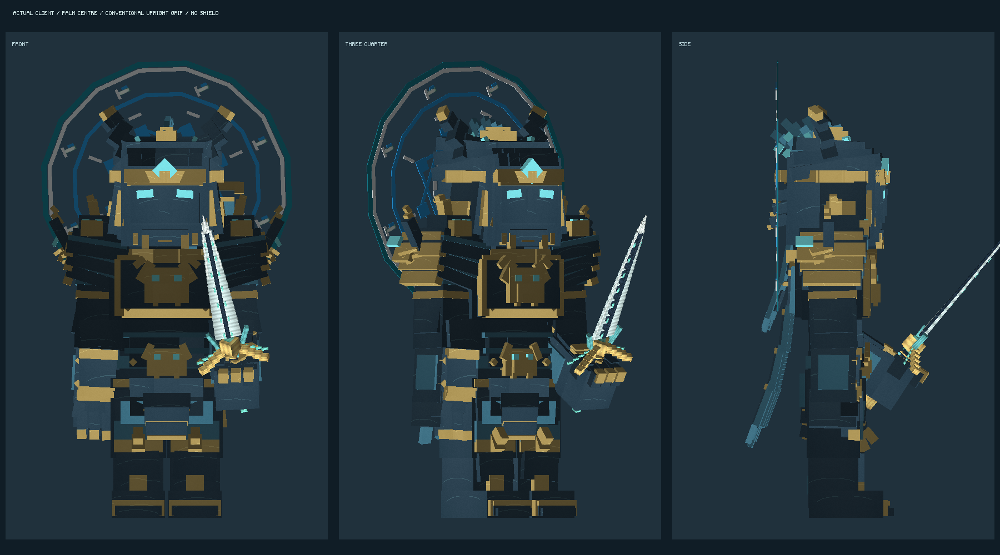
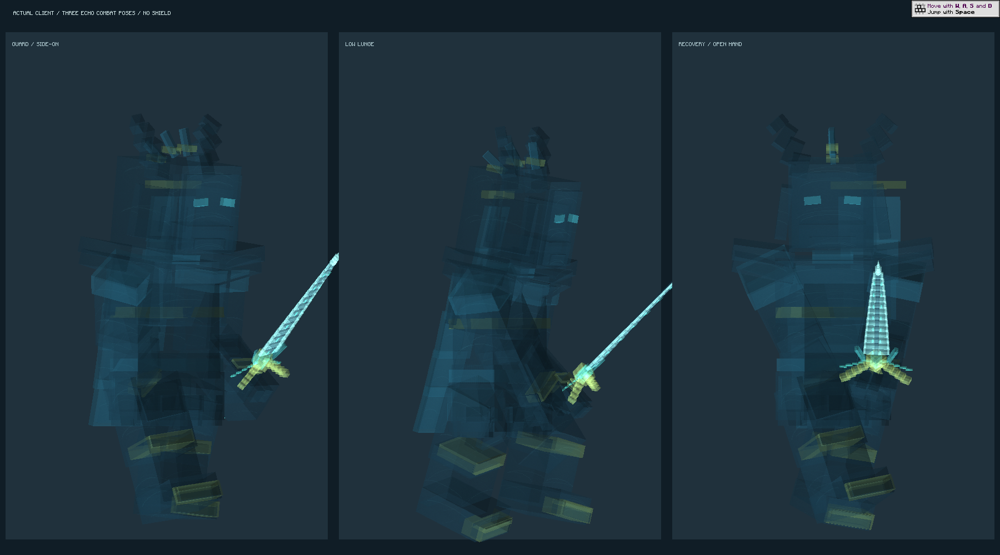
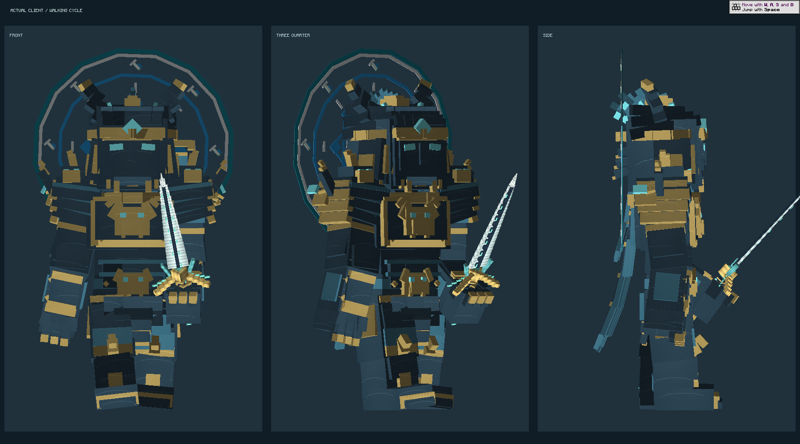
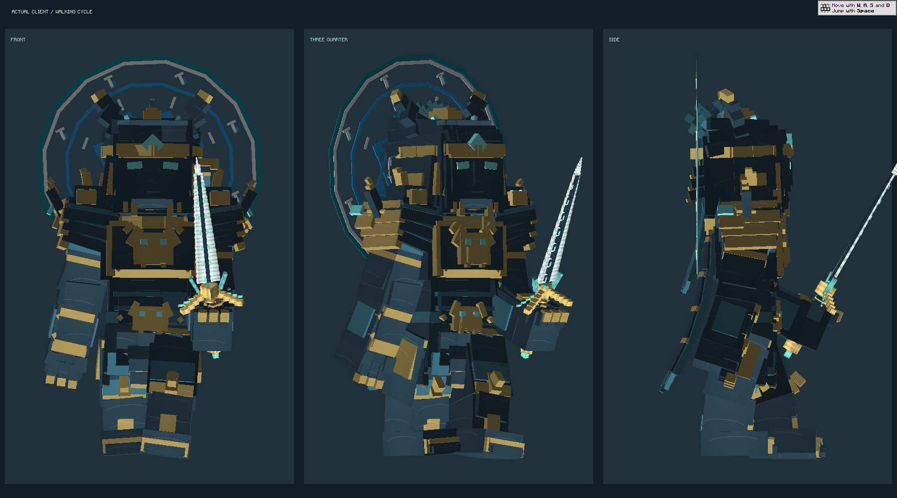

# 苍岚战将：持握与动作修复（2026-10-22）

去掉实体及回溯虚影的盾牌，保留空骨骼兼容旧动画。剑柄以兵器实际握柄中心对齐掌心，修正物品模型居中与缩放叠加造成的偏移；待机按用户侧面示意改成上臂下垂、前臂前弯、剑尖斜指前上方的正握架剑，抬手举剑的肩部路径绕开头盔。武器在身体渲染完成后绘制，避免递归中途切换纹理缓冲。

普通追击原先要求没有目标，与追击 Goal 的有目标条件相互冲突，已修复。步行采用双腿交替、空手摆臂、持剑手稳定的动作；动画同时读取实体步行速度。攻击起手跟随目标调整朝向，之后锁定斩击方向。

锚点轮换架剑、低身突进、收招三种战斗姿势，并在出现和消散时渐变。二阶段使用独立的虚影警戒站姿。盔甲材质收敛重复纹理，采用深蓝钢、金色饰边与青色风纹，保留分层结构。

## 验证

- 26 项 Canglan 单元检查通过，覆盖模型、盾牌移除、姿势差异、实际握柄中心以及数值重复关键帧。
- 17 项实际服务器 GameTests 通过，包括入场/乘风移动时禁止普通追击、正常有目标时允许追击、两阶段、十锚点及龙卷风伤害和清理。
- 21 段动画完整骨架审计通过。离线工具改用 GeckoLib 实际的镜像与旋转符号；另检查拳头位于肘前、剑尖同时位于拳头前上方，避免旧坐标检查把背后持剑判为正确。
- 原生 Minecraft 开发客户端在独立测试世界使用实际 GeckoLib 和兵器渲染器截取持握、步行两帧及虚影姿势，检查画面和启动；不是完整整合包的帧率压力测试。

原生截图：

测试入口 `CanglanGripClientAudit` 仅在显式 JVM 属性启用时执行，发布安装器排除此类。安装基于当前 PCL JAR 的条目覆盖，保留其他协作者的内容和本地三首 Boss 音乐，两个副本先备份再校验。
