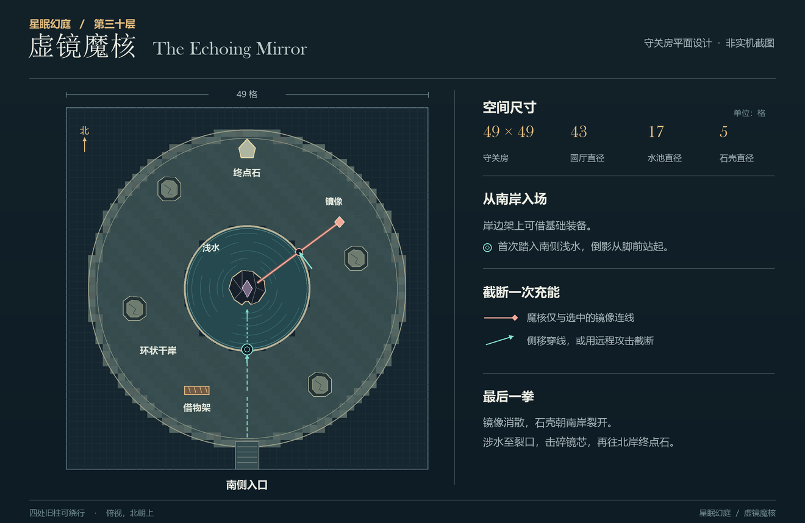

# 虚镜魔核 · The Echoing Mirror

《星眠幻庭》第 30 层终场设计稿　｜　单人或 2–4 人　｜　首轮试玩数值建议

玩家在池边低头。水里的自己已经站直了，手里举着自己最常用的那根杖。等玩家把这个“自己”打倒两次，整场最安静的一刻才到来。那些黑岩退开，里面只有一小片镜子，等人伸手。

## 星眠幻庭最深处的镜池

前层的「镜中棋局」已经让玩家留意自己的倒影。到了终层，让倒影第一次抢在玩家前面动。建议将本主题第 30 层的基础守关者换为虚镜魔核。沿用现有 49 × 49 格守关房，内部做直径 43 格的圆厅、直径 17 格的浅池。实际生成按迷宫来路旋转，下图以入口朝南为例。

- **进场所见。** 从较暗的低拱进门，天光落在池心的黑岩上。池心为岩壳与轨道符环留出直径 5 格。岩壳自身高 4.6 格、宽 3.1 格，下尖离水面 0.65 格。正面是泛起墨色水纹的大镜面，背面为层层咬合的岩板。细金符环一前一后斜穿轮廓，少量带紫色断面的碎片缓慢翻转。绕到背后只能看到岩缝里的微弱反光。
- **能打斗的水池。** 池缘浅阶可从任意方向上岸，外圈留干燥石铺面，四处高低不一的断柱供卡视野、绕后、骗钩。把最宽的一段干岸留给双方拉竿、搭高。池底旧石缝朝内收拢，终局露出的镜心处于玩家站在池底也可空手打到的高度。北岸终点石在镜心破碎后亮起。
- **先准备，再入水。** 全队到岸上集合，个人借物架可取铁剑、盾、水桶、弓、少量箭和一把能破镜造石的镐。物品只在本遭遇有效，已有同类装备可直接使用。满背包可通过房内借用栏切换，原装备保留。首位队员踏进浅水，涟漪扩向各人的池边倒影；此刻封场，按本次到齐且可战的玩家各起一影。队伍未到齐时水面只出现涟漪，齐员后检测仍站在水里的玩家，避免必须重新进池。

## 这个人必须长得像我

生成时为每位参与者冻结外观。头顶**逐字显示本人的玩家 ID**，沿用大小写，无乱码、称号或前缀。保留本人皮肤、宽臂或细臂、皮肤二层开关、可见体型、惯用手、可见披风与饰品，以及双手和每个盔甲槽的外观、染色、纹饰和附魔光。所有客户端均按被复制者的外观渲染。镜像使用独立实体身份，整场只持有装备的镜像副本，无法转移物品。二阶段保留同一张脸、身形和原穿戴轮廓，战斗数值与手上道具切为原版 PVP 套装。

区分敌友靠**脚下倒流的细水纹和动作**。镜像立起时，倒影先抬头，真人与镜像没有强制镜头。二阶段多一层冷白眼部反光，只叠在眼位。特殊皮肤按眼位适配；整脸面具和全封闭头盔会遮住白光，这时让水中的倒影短暂显出白眼。看不清特效时，地面的逆向水纹同样可辨认。多人可帮队友攻击、截线或打断吃苹果，镜像默认盯自己的原主。

## 第一阶段 · 它记得你惯用的那一招

**取什么。** 入池那一刻快照权威装配。TN-C 读取两页共十八个装配槽，仅取已学、确实装入槽位的技能并去重；背包或法杖若有独立、实际可用的装配容器，再从对应槽读取。普通卷轴、已经卸下的技能以及仅供显示的法杖缓存均不授招。出手遵循原技能的射程、蓄力、弹道、冷却和朝向。施法者是镜像，魔力、消耗品、经验与击杀归属独立。语音和按键共用同一个成功施放事件，每次真正释放只记一次，自由吟唱的任意组合不会凭空进入这份装配清单。

**它怎么学你。** 用个人最近 32 次成功释放给当前池内的输出法术排序。开场第一手优先用最常用、当前距离合适的一招。此后在惯用输出、其他输出、场上可用的防御间选择；同一招连续两次后优先换招。历史为空时依当前页槽位顺序。没有输出就模仿已有辅助和普通杖击；空手玩家会遇到空手倒影。远程读条最后 0.25 秒锁定方向，侧移可躲；重法术收势固定 0.5 秒，杖尖水滴落回地面才恢复动作。贴近 3 格时镜像会优先交已装且冷却完毕的闪烁或护盾，没有对应技能则抬臂退步。玩家能故意贴近骗走防御，再截它真正想放的那一招。

**每 15 秒一次的供能。** 金环转向一名存活镜像，池面先出现一道窄金倒影，0.8 秒后胸前与镜壳接成实体可判定的光线，最多持续 3 秒。接通时镜像每秒回复自身魔力上限的 8%，技能剩余冷却按 1.5 倍速度流逝。玩家穿过光束吃 1 点伤害即截断；箭、远程法术穿过光束的任一处也能无伤截断。第一次有效接触就熄灭整条线，金环偏离、响一声短促裂音；同一次供能不会重新接上。多人每轮只连一影并轮换，使队友能配合。连线的职责是向镜像输能，全场本体都没有瞄准玩家的攻击动作。

**收影。** 单个镜像生命耗尽后，法杖先落下，头肩先化成银液，融化的边沿一路落到脚踝，银液沿水面汇入棱镜下尖的岩缝。它在本阶段彻底退出。最后一股银液进入岩缝，才触发全场转段；转段期间也不能越过岩壳打到真身。

**首轮平衡。** 一阶段每影建议取原主最大生命的 1.2 倍，限制在 28–56 点；初始独立魔力充足到能施放一次已装配的最高耗蓝输出，其余按自身收支与冷却。二阶段每影 40 点生命，不叠原主的魔法词条；按铁甲全套、铁剑、铁斧、盾、弓、16 支箭、钓竿、水桶、岩浆桶及两枚普通金苹果作首轮基准，另备 16 格镜石、两张网。挥砍、射箭或举盾都得实际换到相应的手。每多一名玩家增加一个镜像，每影血量与单人一致。首轮重点观测单人可否靠读招获胜、四人可否同时分辨各自的镜像，然后再调生命和伤害。

## 第二阶段 · 杖灭以后，听它换手

先抽掉环境回响，再让一声玻璃裂响掠过圆厅。暗紫波从水面贴地展开，屏幕边缘短暂泛灰，中央视线清楚。热栏上的杖芯熄灭，魔力条扣上一道灰线。银液再按原位置站起，举起剑，眼前掠过白光。最后一股水银在第 46 tick 收尽，裂镜声响起。镜像于第 60 tick 站稳，第 66 tick 起才可造成伤害，从静默来临到第一次可能受击至少有 1 秒可换盾、上岸。此时依然可以移动、救人，整段无需接管镜头。

房间只对参战者静默。锁住施法、回蓝、耗蓝与魔法饰品的主动和被动效果；包括语音、按键、物品触发和信标代付路径。房内旧的魔法弹体、召唤或持续场对本阶段停止生效。保留原魔力数值、装备、魔法以外的属性与原版消耗品；弓箭、鱼钩、盾、桶、食物、末影珍珠可用。离场、团灭或通关解除房间标记。用房间权威状态单独判定，现有通用沉默会误拦普通箭和鱼钩。

下表按 20 tick = 1 秒。镜像遵守手持物互斥和武器攻击蓄力。危险动作先换手、发声、摆姿势，再由服务端判定。玩家可以在结果发生前做决定。

| 战况 | 玩家先看到或听到什么 | 命中、代价和反制 |
| --- | --- | --- |
| 相距 5–11 格，钩线无遮挡 | 镜像横身，甩竿手先摆向对侧，第 8 tick 才从竿尖出钩；线落空会垂到地上。左撇子全套反向。 | 依真实弹道和视线挂钩。举盾正面格挡或横移可躲。钩中触发本房专属轻击退、断疾跑，再收线追上、换剑、起跳，下降时收冲刺出剑。空钩收竿有 0.45 秒破绽；再次起竿至少相隔 3 秒。 |
| 正面举盾满 0.5 秒，镜像有路可追 | 剑入鞘，斧换手，第 5 tick 抬肩，第 10 tick 举到最高，第 14 tick 才落斧。肩线确定后不再转向。 | 正面命中按破盾处理，盾暂时失能，保留物品。及时收盾侧闪能让它劈空，重心前倾 0.6 秒。 |
| 两秒内连续两次被近身击中 | 它先退半步、低头看地，再翻桶或张开持网手。 | 干岸放一格镜造岩浆，浅水或己方路径有积水时改在后退路线放网。水桶能把岩浆凝固，剑能割网。封路至少相隔 7 秒，优先给对手留一侧可走。自身着火则优先用桶灭火，腾出手才能还击。 |
| 低于对手且缺少射线，或连续被追到岸角 | 它抬头看一眼落脚处，换圆石；每次落脚才出现下一格。 | 连搭 4–5 格，登顶才换弓。第一块带贯穿银纹，用镐敲碎它，同根镜造柱逐块散成水滴。也能以弓或珍珠抢高台。相邻两次搭柱至少相隔 12 秒。 |
| 生命首次低于 40%，找到遮挡 | 退至断柱背后，或自己搭两格墙；金苹果在手中至少停留 32 tick，隔墙也听得见咀嚼。 | 每个镜像携带两枚普通金苹果。吃完获得普通金苹果的再生与吸收。完整吃完消耗一枚；有效伤害打断咀嚼，至少 6 秒后才能重试，无法用连续吃果拖死队伍。 |
| 被击飞，预计危险落差至少 5 格 | 它俯身看落点，第一个明显动作是剑换水桶。 | 最后约 4 tick 尝试落地水，有合法落点且成功放水才免摔。收水要俯身 0.55 秒，可趁机反打。被撞离预判落点可能失手。 |

优先级依次为保命落地或灭火、完成已承诺的出手、低血找掩体进食、破盾、反压制、抢高、钩剑或弓。决定起手后只因明确的打断、失足或目标失效而中止。多人镜像各自用自己的道具和冷却；同一真人刚遭钩控的 1.5 秒内，其他镜像不给他叠钩。第一阶段的魔力连线在静默期间停止。

## 动作与音画交接

建模窗口已按参考图确认尖顶、宽腰、坠尖的外轮廓。挂点、左右手与四段分镜见[美术与动作审核稿](echoing-mirror-art.md)及[动作分镜图](echoing-mirror-motion.png)。岩板、镜心水纹、两道符环、悬屑各用独立挂点；真镜心另挂在背壳内唇。角色沿用被复制玩家的手型和骨架，鱼线从实际持竿手的竿尖发出，斧刃接触、箭离弦、桶落点与声音由服务端同一动作节拍驱动。受击提示在普通视界也能看清。

| 一拍 | 应该让玩家看见的细节 |
| --- | --- |
| 出水 | 先见眼睛的水中倒影，再见水面托起双肩。主手抬杖时绕腕的一圈水才断开。衣服二层和头盔随身体一起出水。 |
| 回流 | 杖尖滴落 → 头与肩先化成银线 → 银纹顺衣缝流至小腿 → 水面上的银流汇入棱镜下尖。避免像突然删除实体。 |
| 换手 | 鱼竿横甩时另一只肩迎上来，斧头抬起时重心压在后脚；收水会短暂低头，吃果时另一只手无法隔空挥剑。声音留在手、钩或落点的位置。 |
| 露芯 | 金环先失去匀速，两块前岩擦开，后板下沉，石粉落水。天光穿过首次出现的缝照到真镜心。把最亮的细反光留给这一片；终局取消持续战斗声，只剩水和玩家自己的脚步。 |

## 第三拍 · 最后一拳

最后一个二阶段镜像倒下时，剑先落地，声音是一滴水。静默当场解除，玩家手上的杖先亮回来。巨大金环急停，第 10 tick 金字熄灭，结界碎开。第 22 tick 两片颊岩向外打开，大镜面的黑水褪尽，背壳内唇仍合拢。直到第 36 tick 岩板后面的内唇才打开，下岩片承出原本藏在**石后**的真镜心。镜心只有 0.42 格高，停在距水面 1.15 格的低托上，此刻才开放受击。外壳的悬浮中心始终固定在池心。

真身 **1 HP**，没有位移、索敌、反击或倒计时。末名镜像的致死弹、旧范围伤害和转段前残留命中不能顺带击碎它；露出后，任一参战者的新一次有效命中都算，空手一拳亦可。给足玩家涉水走近的时间。击碎只响一声清脆的小响，半拍后，满地碎光才顺着水波扩散，北岸的终点石亮起。建议首通个人纪念掉落「无相镜片」，配文「你收手以后，它就再也没有动过。」通关奖励按地下城现有逐人结算处理，碎片演出人人可见，复制装备不进入掉落。

## 多人、清场与验收

- **阶段归属。** 房间记录入池名单、每人外观与装配快照、镜像实体标识和当前阶段。同一房间只结算一次；全体一阶段镜像收尽才重塑，全体二阶段镜像清尽才开壳。本体在升起、两阶段、回流和重塑期间对近战、穿透、范围与环境伤害全部免疫。镜像倒下不杀原主，不触发房间通关。队友仍沿用既有倒地和救援规则。
- **断线与撤离。** 掉线者的镜像保留外观和现有生命；同伴可继续击败它。重连绑定原镜像与当前阶段，禁止再起一只。所有人离线时挂起遭遇，回来恢复；团灭、正式放弃或房间清除时撤销静默、归还借用位、移除标记及造物。旧存档中已完成的第 30 层结算保持有效，升级时只为新开且未生成的对应终场采用这间房。
- **十秒后谁来扫场。** 造物由「本局遭遇 + 位置 + 原方块状态」登记，生成后 200 tick 消散。水和岩浆的传播、流体交互产生的凝固块、镜网、支撑柱的衍生位置都继承原到期时间。恢复前核对位置仍由本局造物占用，防止吞掉他人变更。只在此房授权参与者对造物浇水、剪网、拆柱和落地水，用桶不能取走镜造流体，原建筑以及原池水保持保护。房间结束、区块重载和服务器重启都核对登记，禁止从还原过程产出方块掉落。
- **验收场景。** 两个客户端用不同皮肤、体型、惯用手、染甲和附魔，交叉看彼此镜像；空槽、双页配装、纯辅助、旧档无施法历史分别单人通关。实测身体截线与弹道截线，验证举盾防钩、打断苹果、拆柱、凝固岩浆、落地水失手。四人错时入池、两阶段分别掉线、最后两影同 tick 倒下、持续法术跨段、强退重进，以及两人同时打出最后一拳，都应得到相同阶段与一份个人结算。正式接入前分别以有光影、无光影查看黑岩内唇、钩线和举斧预警。

仓库对接时须新增镜像归属的施法入口和个人成功施法历史。现有玩家施法入口依赖真实玩家；现成的剧情替身只复制本机玩家。地下城的通用清怪检测、中心终点石和用桶保护也须为本房单独接好。上述内容是制作规格，尚未发布为游戏内遭遇。
