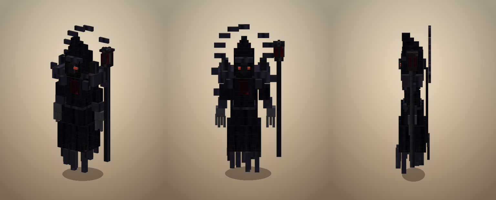
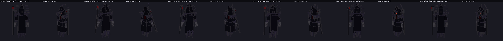
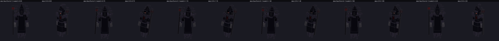
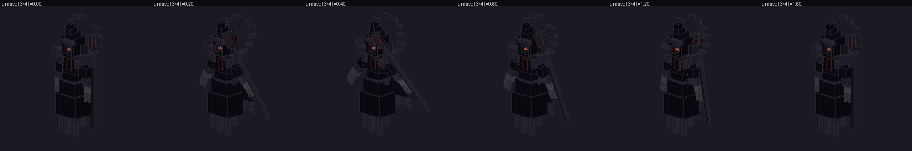

# 黑魔法师（暗系新 boss，2026-11-07）

> 作者：「你新做一个暗系boss吧，现在有的这个我想到时候拿去做战士那边的boss / 你做一个黑魔法师，通身黑暗，你可以搜搜网络上的素材，做一个，然后把现在的暗系boss的法术绑到它身上」

## 1. 一句话

新增暗系 **法师系** boss **黑魔法师**（`tnc:dark_mage`）：一个通身近黑、没有脸、没有脚、浮在破布堆上的尖帽法师，
**法术和现有暗系 boss 巨兽人领主完全同一套**（直接读 `TNDarkGiantSpells`，不复制数值）；
巨兽人领主**一个字节没动**，留给作者后面做战士系 boss。

2026-11-07 第二轮加了 5 段"诡异"小动作（§2.4），第三轮加了**黑雾分身**（§3.4）：
放完黑雾从雾里分出**两个一模一样**的分身，雾散的那一刻**三个身影一起抬手**；
分身有 **220** 血、玩家可打碎，**打碎一个本体掉 8% 最大生命**（两个都碎 = 16%）。



*（左：正面偏 3/4；中：正面；右：侧面。离线正交渲染，`tools/gen_dark_mage.py` 跑完自动出；光比游戏里暗，游戏里有环境光。）*

---

## 2. "通身黑暗"怎么落到模型上（这是本轮的主要工作量）

"通身黑暗"不是"整只涂黑"——第一版就是把袍子/破布/法杖全压在 `#06~#15`，渲染出来是**一坨分辨不出的黑块**，
形状全丢了（作者一眼就会说"这啥"）。最后落成四条**能自检**的规则：

| # | 规则 | 落在哪 | 为什么 |
| --- | --- | --- | --- |
| 1 | **没有脸** | 兜帽里塞一块 `void` 材质的方块（比全身更深，中央 RGB `(6,0,8)`），只有两道 2×1 的暗红眼缝 | 兜帽里是"洞"而不是"一块布"，黑魔法师的脸就不该存在 |
| 2 | **没有脚** | 袍摆下缘离地 **10 单位 = 0.625 格**，下面挂 15 片**角度抖动/长短不一**的破布 | 他是浮着的；等角度等长会读成一排栅栏（第一版就是 ✗） |
| 3 | **只有三档明度** | 近黑袍 `#0C0B15` / 亮一档破布边·护肩·帽檐 `#2A2638` / 暗红眼·符文·杖心 `#B0202C` | 全部压黑就"看不清"；只要出现一档暖色高光就"不黑暗" |
| 4 | **剪影优先** | 尖兜帽（4 节收尖）+ 宽护肩带 4 根尖刺 + 喇叭袍摆 + 比人还高的法杖 + 头后**断环**（14 段缺 2 段） | 远看轮廓就认得出"法师"，不靠细节 |

### 2.1 尺寸与结构

| 项 | 值 | 说明 |
| --- | --- | --- |
| 总高 | 62 单位 = **3.875 格** | 帽尖 y=62；玩家 1.8 格 |
| 最宽 | 20 单位 = **1.25 格**（护肩） | 高/宽 ≈ 3.1；第一版 2.5 太矮胖 ✗ |
| 骨骼 / 方块 | **16 骨 / 87 方块** | `root → hover → robe/body → mantle/cape/arm*/head/halo/shard0..3` |
| 贴图 | 256×256（albedo）+ 256×256（emissive） | 8 个分区，见 `PATCH` |
| 碰撞箱 | 1.1 × 3.4 格 | 比模型矮一点，钻 3 格洞不会卡死 |
| 渲染缩放 | **1.0** | 和巨人不同（巨人 ×10）：这个 geo 是按 1 单位 = 1/16 格直接量的 |

### 2.2 贴图分区（改颜色只动这几行）

| 分区 | 区域 | 底色 | 用途 |
| --- | --- | --- | --- |
| `cloth` | 0,0 128×128 | `#0C0B15`，褶 `#050509`，褶脊 `#151421` | 袍子 / 披风 / 帽体 |
| `edge` | 128,0 96×64 | `#2A2638`，褶 `#171521`，脊 `#3A3448` | 破布边 / 护肩 / 帽檐 / 腰带 / 断环 |
| `void` | 224,0 32×32 | 径向 `#07000B → #000` | 兜帽里的"脸" |
| `rune` | 224,32 32×32 | `#1E0509` + 刻线 `#680D14` / `#9E181E` | 胸前符文 |
| `bone` | 128,64 64×64 | `#42~#60` 冷灰 | 手 / 十根爪指 |
| `metal` | 0,128 64×64 | `#14~#36` | 法杖杆 / 杖爪 / 护肩尖刺 |
| `orb` | 64,128 32×32 | 中心 `#F02E28` → 边 `#2C040C` | 杖心球 |
| `eye` | 96,128 16×16 | `#FF604A` + 白热芯 | 两道眼缝 |

**emissive** 只画三块（眼缝 / 符文刻线 / 杖心），其余 **alpha=0** ⇒ 那一层看起来"只点亮这三处"。
用 `RenderType.entityTranslucentEmissive`（吃 alpha）；换成 `entityCutoutNoCull` 会把透明像素画成黑，整件袍子糊一层黑。

### 2.3 动作（13 段，全部自带）

片段名**必须**和 `TNDarkGiantSpells.animation()` 的返回值对上，否则起手时模型没动作：

| 片段 | 长度 | 循环 | 什么时候播 |
| --- | --- | --- | --- |
| `idle` | 4.0s | ✓ | 站着（上下浮 + 头极慢地"扫" + 披风摆 + 断环 180°/4s + 4 块碎屑各绕各的） |
| `glide` | 1.4s | ✓ | 移动（他是滑，不是迈腿：前倾 3° + 袍摆后拖 5° + 上下浮） |
| `cast_hands` | 2.2s | ✗ | 黑夜之手 T3/T4（双手前推 84° + 断环 +60° + 碎块绕 220°） |
| `cast_sky_hands` | 2.8s | ✗ | 黑夜之手 T5（双手举天 166° + 帽檐后仰 + 断环转一圈 + 杖心升 1.2 单位） |
| `cast_mist` | 2.6s | ✗ | 黑雾 T5（法杖横扫 + 躯干左右拧 ±14° + 断环反转 95°） |
| `cast_siphon` | 2.2s | ✗ | 以伤换伤 T3（法杖指人 + 躯干拧 18° + 杖心涨到 1.45×） |
| `command_army` | 2.8s | ✗ | 召唤 T4/T5（整体下沉 2.4 单位 + 法杖顿地 + 断环反转 360° 并放大 1.3×） |
| `phase2` | 3.0s | 停最后一帧 | 二阶段（人涨开 + 护肩抬 + 断环放大 1.35× 转 720° + 碎块上飘） |
| `idle_watch` | 5.2s | ✗ | **久视**：几乎不动，只有头 1.6 秒慢慢转到 −16°，第 4.5 秒一片碎块猛地一抽 |
| `twitch` | **0.9s** | ✗ | **抽搐**：0.1 秒内甩头 −44° + 断环跳 120° + 碎块全跳 60°，再慢慢归位 |
| `beckon` | 2.4s | ✗ | **招手**：空手抬起"来"两下（1.0s / 1.7s 各一次顿挫）+ 头歪 14° + 杖心两下搏动 |
| `unravel` | 1.6s | ✗ | **溃散**（被动）：身体压扁-拉伸-回弹 + 碎块炸开再收 + 断环狂转 540° |
| `stare` | 2.2s | ✗ | **逼视**：整体下沉 1.4 单位、躯干前倾 11°、头低 17° 盯着你 |

### 2.4 第二轮："诡异神秘"是怎么做出来的（作者：他的动作你也可以多做一点）

不是"多加几个动作"就行 —— 加一排同样舒缓的动作只会更无聊。这一轮靠**四条节奏规则**：

| # | 规则 | 具体做法 |
| --- | --- | --- |
| 1 | **快慢对比** | 全场动作都在 1.4~5.2 秒之间慢慢来，**只有 `twitch` 是 0.9 秒、核心 0.1 秒完成**。人眼对"慢中的一次快"最敏感 —— 这一下甩头就是"诡异"的主力 |
| 2 | **不完全静止** | `idle_watch` 5.2 秒里身体几乎不动，只有头转 16°；到第 4.5 秒**一片碎块突然抽一下**。看起来像"它在盯着你、又有点不对劲" |
| 3 | **被动反应** | 被打中时 `unravel`（像信号不好一样压扁-回弹）。这是唯一**由玩家动作触发**的表演 ⇒ 打他有反馈，不是打一堵墙 |
| 4 | **声音陪着** | `stare` 配末影人凝视音（0.85 音量 / 0.55 音高）、`twitch` 配末影人环境音（0.55 / 0.45）。压低了以后的末影人音色很"空"，比再加一个法术音效更像"东西在看你" |

排期（`TNDarkMageEntity.tickActions`）：没在起手、没在演的时候，**5~12 秒**排一次，按权重抽 ——
目标在 16 格内 45% 逼视、35% 抽搐、15% 久视、5% 招手。演的时候身体冻结（`isBusy()`）⇒ 不移动、不放招、不近战。



*（`twitch` 六个时间点 × 正/侧 3/4。第 2、3 格是甩头的那一下，第 4 格开始慢慢归位。）*



*（`stare`：t=0.7 起整体下沉 1.4 格、头低 17°，到 t=1.4 还侧了一点。）*



*（`unravel`：身体 0.94↔1.03 来回压、碎块炸开（第 2、3 格）再在 1.6 秒收干净。）*

> 这三张是 **离线正交渲染**（`tools/preview_geo_anim.py`，只做骨骼变换 + 贴图取样，不含游戏光照/自发光），
> 用来确认"姿态没崩、没有穿插"，**不代表实机观感**（游戏里更暗、有眼缝自发光和黑雾粒子）。


---

## 3. 法术绑定：同一套，不复制

作者要的是"**把现在的暗系 boss 的法术绑到它身上**"。所以 `TNDarkMageSpells`（新文件，约 90 行）**一条数值都没有**：

```
TNDarkMageSpells.pick(...)  → TNDarkGiantSpells.pick(...)
TNDarkMageSpells.move(i)    → TNDarkGiantSpells.move(i)
TNDarkMageSpells.animation()→ TNDarkGiantSpells.animation()
TNDarkMageSpells.cast(...)  → TNDarkGiantCasting.cast(caster, move, 2.6, 4.5)
```

⇒ 以后改巨人的招式/权重/连招，**法师同步生效**，只有一个地方要改。

### 3.1 招式表（两边完全一样）

| # | 路径 | 档 | 链 | 起手 tick | 权重 | 中文名 |
| --- | --- | --- | --- | --- | --- | --- |
| 0 | `dark_king` | 4 | 召唤 | 56 | 2 | 暗之国王 |
| 1 | `evil_god` | 5 | 召唤 | 56 | 2 | 邪神 |
| 2 | `night_embrace` | 3 | 手 | 44 | 2 | 黑夜之手 T3 |
| 3 | `black_ruin` | 4 | 手 | 44 | 12 | 黑夜之手 T4 |
| 4 | `slay_light` | 5 | 手 | 56 | 3 | 黑夜之手 T5 |
| 5 | `devour_light` | 5 | 黑雾 | 52 | 2 | 黑雾 T5 |
| 6 | `sacrifice` | 3 | 以伤换伤 | 44 | 3 | 以伤换伤 T3 |

连招顺序也共用：`completedCasts % 3 == 0` 在 `sacrifice ↔ night_embrace` 之间换，`% 3 == 1` 用 `black_ruin`，其余按权重抽（不重复上一招，T3 不进随机池）。

### 3.2 唯一不同的两个数（体型）

| 项 | 巨兽人领主 | 黑魔法师 | 为什么 |
| --- | --- | --- | --- |
| 召唤物体型 `setScale` | **10** | **2.6** | 巨人肩宽 4 格，召唤物是它的"小兵"；法师只有 1 格宽，×10 的召唤物比他还大 ✗ |
| 召唤物落点半径的**加数** | 14 格 | **4.5 格** | 照抄 14 ⇒ 法师身边 15.1 格，看不见也打不到 ✗；4.5 ⇒ 1.1+4.5≈**5.6 格**，围在他身边 ✓ |

改法（`TNDarkGiantCasting`）：只把两个**写死的数**提成参数，**公式一个字没改** ——

| | 改前 | 改后 |
| --- | --- | --- |
| `cast` 入口 | `cast(caster, move)` | `cast(caster, move)` → 转发 `cast(caster, move, 10.0, 14.0)` |
| 召唤半径 | `radius = caster.getBbWidth() + 14` | `radius = caster.getBbWidth() + summonRadius` |
| 召唤体型 | `summon.setScale(10)` | `summon.setScale(summonScale)` |

> ⇒ **巨兽人领主的行为零变化**：它拿到的是 `(10.0, 14.0)`，算出来还是 `24+14=38` 格、`setScale(10)`。
> 这是本轮唯一碰到巨人那条链的地方，而且是纯参数化（`javap` 可验：`GIANT_SUMMON_SCALE/RADIUS` 两个常量 +
> `cast(LivingEntity,Move,double,double)` 重载）。

### 3.3 数值对照

| 项 | 巨兽人领主 | 黑魔法师 | 说明 |
| --- | --- | --- | --- |
| 血量 | 3000 | **2600** | 法师不该比巨人还肉 |
| 攻击 | 18 | 14 | 主要靠法术，不靠抡 |
| 移速 | 0.16 | **0.22** | 飘着走 |
| 护甲 / 韧性 | 12 / 6 | 6 / 3 | 没穿甲 |
| 击退抗性 | 1.0 | 0.6 | boss 不该被一路推着走 |
| 索敌 / 施法距离 | 128 / 96 | 同（共用常量） | 法术行为必须一致 |
| 两招间隔（一/二阶段） | 90 / 45 tick | **70 / 40** | 他更快 |
| 二阶段 | 50%，背后 2 倍虚影 | 50%，**人涨开 + 断环加速** | 规则同一条 `TNDarkGiantPhase.shouldEnterPhaseTwo`，表现分开 |
| 血条 | 红 | **紫** | 两个暗系 boss 同场时一眼分开 |
| 经验 | 800 | 600 | |

---

### 3.4 黑雾分身（2026-11-07 第三轮）

> 作者原话：**"我还希望这个boss有分身的能力，能在释放黑雾之后分出两个分身，等黑雾时间结束之后一起攻击，
> 分身有血量，玩家可摧毁，摧毁分身会扣除boss百分比血量"**。

#### 3.4.1 时间轴（一条线看完）

```
t=0        黑雾铺开（devour_light 读完条那一刻）           ← beginMist()
           ├─ 左右各分出一个分身（贴着他身体两侧 2.6 格）    ← spawnSwarm()
           └─ 记下"雾什么时候散"：gameTime + TTL            ← TNDarkGiantCasting.mistTicks("devour_light")
t=0..300   雾里三个身影（本体照常施法，分身只飘不近战）        ← tickClone()
t=300      雾散了                                          ← 一声上滑的尖啸（WARDEN_SONIC_CHARGE）
t=300..320 1 秒预警（给玩家跑/吃药的窗口）                    ← VOLLEY_WARNING_TICKS = 20
t=320      齐射：还活着的分身 + 本体 同一 tick 起手 night_embrace
           三个人各从自己的位置放 T3 黑夜之手（各 3 只黑手）   ← launchJointAttack()
t=364      手落下（起手 44 tick）
t=380      分身自己散掉（不是被打死 ⇒ 不反噬）                ← dissolve()
```

**关键点：雾的时长是读数据读出来的**，不是写死 300 ——
`TNDarkGiantCasting.mistTicks("devour_light")` 读法术 JSON 的
`release.target.cloud.time_to_live_seconds`（现在是 **15.0 秒**，由 `tools/gen_dark_fog_spells.py` 断言钉住），
读不到（没装 Spell Engine / 法术没注册）才回落到 **300 tick**。
⇒ 以后改雾的时长，分身**自动**跟着改，不会出现"雾早没了分身还在等"或反过来的错位。

#### 3.4.2 数值

| 项 | 值 | 为什么是这个数 |
| --- | --- | --- |
| 分身数量 | **2** | 作者原话"分出两个分身" |
| 分身血量 | **220** | 本体的 8.5%。玩家有心就能在 15 秒雾里砍掉一个（钻石剑 7~9 下），但顺手路过砍不完 |
| 打碎一个分身 ⇒ 本体掉 | **8% 最大生命**（2600 × 8% = **208**） | 作者要"百分比"，不是固定值：以后调本体血量，反噬自动同步 |
| 两个都打碎 ⇒ 本体总共掉 | **16%**（416） | 刚好够"值得打"，又不会一开雾就白送半管 |
| 反噬能不能打死本体 | **不能**，留 1 点保底 | 否则"养分身再杀"可以跳过整个二阶段 ✗ |
| 分身经验 | 0 | 不然刷分身比打 boss 还赚 |
| 分身近战 | **不打** | 它们唯一的攻击方式就是那次齐射；不然等于三个 boss 在同时抡你 |
| 齐射用的招 | `night_embrace`（T3，44 tick 起手，各 3 只黑手） | 三个人各从自己位置放 ⇒ 三组黑手从三个方向同时下来 |
| 齐射预警 | 20 tick | 1 秒：够跳开/举盾，又不至于像卡住 |

**三种结局**（这是这套机制真正的"玩法"）：

| 玩家在雾里做了什么 | 结果 |
| --- | --- |
| 一个分身都没打碎 | 三个身影齐射 ⇒ **9 只黑手**，本体不掉血（最亏） |
| 打碎一个 | 本体 **−208**，两个身影齐射 ⇒ 6 只黑手 |
| 两个都打碎 | 本体 **−416**（16%），只剩本体自己放 ⇒ 3 只黑手（最赚） |
| 干脆躲开雾 | 雾散了照样齐射，只是手可能砸在地上 |

#### 3.4.3 为什么分身**不**另写一个实体类

分身必须和本体**长得一模一样**（不然"分不清哪个是真的"这个点就没了）。
如果另写 `TNDarkMageCloneEntity`，就得再注册一个 EntityType、再写一套 geo 模型 / 渲染器 / 自发光层
（4 个文件），而且以后改本体外观要记得同步改分身 ✗。

这里只加了一个同步标记 `DATA_CLONE`（`SynchedEntityData`，1 个 boolean）：

| 复用的东西 | 说明 |
| --- | --- |
| 模型 / 贴图 / 自发光层 / 13 段动作 | **全部**复用 `TNDarkMageEntity` 的资源与控制器 |
| 碰撞箱 / 移速 / 索敌 / 近战伤害 | 同一个 `createAttributes()`（分身只把 `MAX_HEALTH` 基值改成 220） |
| 血条 | ★ 分身**不挂**血条（`startSeenByPlayer` 里判 `isClone()`）⇒ 血条是"哪个是真的"的唯一提示 |

分身和本体的差别只有四条，全部集中在 `TNDarkMageEntity` 里：

| # | 位置 | 差别 |
| --- | --- | --- |
| 1 | `configureAsClone(owner, lifeTicks)` | 血 220、经验 0、记下本体 UUID、继承本体的目标 |
| 2 | `aiStep` 开头 | 分身走 `tickClone()` 然后 **return** ⇒ 没有血条、不进二阶段、不排小动作以外的活 |
| 3 | `tickCasting` 的抽招段 | `if (isClone()) return;` ⇒ 分身**只放被排好的那一招**，不自己抽招 |
| 4 | `doHurtTarget` | `isClone()` ⇒ 返回 false（不近战） |

另外两处必须改的：
- `isAlliedTo`：本体 ↔ 自己的分身、同一批分身之间是友军（否则**黑雾会抓自己的分身**、抽血会抽到分身 ✗）；
- `die(DamageSource)`：分身被打死 ⇒ 通知本体扣血；**本体死了 ⇒ 分身一起散**（不留两个"没主的黑魔法师"）；
  自己散掉的分身走 `discard()`，**不**经过 `die()` ⇒ 不会反噬 ✓。

#### 3.4.4 为什么每 5 招**必**放一次黑雾

黑雾在共用的权重表里只占 `2/21`，再叠上"每三招里有两招是定死的"，
实测**大约 3% 的出手**会是黑雾 ⇒ 平均两分钟才见一次分身，作者很可能以为"没做" ✗。

所以 `TNDarkMageSpells.pick(...)` 加了一条**只属于法师**的节奏：

```java
if (completedCasts % 5 == 2) return indexOf("devour_light");   // 每 5 招的第 3 招
return TNDarkGiantSpells.pick(random, completedCasts, previous);  // 其余照旧
```

⇒ 开打后大约 20 秒第一次见分身，之后每 5 招一次。
**招式表 / 权重 / 巨人的出手顺序一个字节没动**（`DarkMageBossTest` 里钉住了巨人前两招仍是 `#6` / `#3`）。

#### 3.4.5 存档

分身的全部状态都进 NBT（`addAdditionalSaveData` / `readAdditionalSaveData`）：
`TnClone`（是不是分身）、`TnAnchor`（本体 UUID）、`TnCloneLife`（还剩多久）、
`TnSwarmEnd` / `TnJoint`（本体记的"雾什么时候散 / 齐射倒计时"）、`TnSwarm`（分身名单）。

★ 读档时如果 `TnClone` 为真，会把 `MAX_HEALTH` 基值**重新压回 220** ——
不这么做，退出重进之后分身会变成一只 2600 血的"假 boss" ✗。

#### 3.4.6 日志（实机验收时看 `latest.log`）

```
TN-C/boss: 黑魔法师在雾里分出 2 个分身，雾还有 300 tick
TN-C/boss: 分身被打碎 ⇒ 本体 -208 HP（2600 → 2392）
TN-C/boss: 黑魔法师齐射 boss=true clones=2
```

---

## 4. 接线点（漏一个就崩，这是这一轮最容易踩的）

| # | 文件 | 加的东西 | 漏了会怎样 |
| --- | --- | --- | --- |
| 1 | `npc/TNNpcs.java` | `DARK_MAGE` EntityType（`sized(1.1, 3.4)`，tracking 12） | 实体不存在 |
| 2 | `npc/TNNpcAttributes.java` | `event.put(DARK_MAGE, createAttributes())` | **生成即崩** `has no attributes` |
| 3 | `npc/TNNpcAttributes.java` | `DARK_MAGE_SPAWN_EGG`（`0x0C0B15` / `0xB0202C`） | 验收时没法一句话扔到场上 |
| 4 | `TNMod.java` | 创造模式页签 `output.accept(DARK_MAGE_SPAWN_EGG)` | 蛋注册了但拿不到 |
| 5 | `npc/client/TNNpcClientEvents.java` | `registerEntityRenderer(DARK_MAGE, …)`，**写在所有 if/else 外面** | **客户端崩**（Oculus 影子 pass 里 `getRenderer` 不做 null 检查 ⇒ NPE） |
| 6 | `lang/zh_cn.json` `lang/en_us.json` | `entity.tnc.dark_mage` + `item.tnc.dark_mage_spawn_egg` | 显示 `entity.tnc.dark_mage` |
| 7 | `models/item/dark_mage_spawn_egg.json` | `parent: minecraft:item/template_spawn_egg` | 蛋是个紫黑方块（缺模型） |
| 8 | `client/DarkCastFx.java` | 读条前戏从"只认 `TNDarkGiantEntity`"改成"**认暗系 boss**" | 法师放法术时**没有读条前戏**（黑雾/暗阵/心跳全不出现） |

第 8 条改法：`instanceof TNDarkGiantEntity` 的单一判断 → 分别取 `isCasting()`，并给法师一个更小的环半径
（`8.5 → 5.5`，他只有 3.9 格高，8.5 格的环比他人还大）。

---

## 5. 新增 / 改动文件

| 类型 | 文件 |
| --- | --- |
| 新（生成器） | `tools/gen_dark_mage.py`（geo + 双贴图 + **13 段动作** + 预览，一条命令全出） |
| 新（资源） | `assets/tnc/geo/entity/dark_mage.geo.json`、`textures/entity/dark_mage_bedrock.png`、`textures/entity/dark_mage_emissive.png`、`animations/entity/dark_mage.animation.json`、`models/item/dark_mage_spawn_egg.json` |
| 新（代码） | `boss/TNDarkMageEntity.java`、`boss/TNDarkMageSpells.java`、`boss/client/TNDarkMageGeoModel.java`、`boss/client/TNDarkMageRenderer.java`、`boss/client/TNDarkMageEmissiveLayer.java` |
| 新（测试） | `src/test/java/com/tnc/tnc/boss/DarkMageBossTest.java`（**8** 个闸门，见 §6.2） |
| 改 | `boss/TNDarkGiantCasting.java`（召唤体型/半径提成参数 ＋ 第三轮加 `mistTicks(path)` 读雾的真实时长）、`npc/TNNpcs.java`、`npc/TNNpcAttributes.java`、`npc/client/TNNpcClientEvents.java`、`TNMod.java`、`client/DarkCastFx.java`、`lang/zh_cn.json`、`lang/en_us.json` |
| 改（第三轮·分身） | `boss/TNDarkMageEntity.java`（`DATA_CLONE` / `configureAsClone` / `beginMist` / `spawnSwarm` / `tickSwarm` / `launchJointAttack` / `onCloneDefeated` / `tickClone` / `dissolve` / `die` / `isAlliedTo` / NBT）、`boss/TNDarkMageSpells.java`（`pick` 每 5 招黑雾 ＋ `indexOf`） |
| 新（文档） | 本文件；`docs/previews/mobs/dark_mage.png`、`docs/previews/dark_mage_model_texture.png`、`docs/previews/dark_mage_{twitch,stare,unravel}.png` |

**没有动**：`TNDarkGiantEntity` / `TNDarkGiantSpells` / `TNDarkGiantPhase` / 巨人的模型贴图与动作 / `BossHudTheme` / `BossSiteSpawns`。

---

## 6. 装机

### 6.0 本轮（第 4 次构建：黑雾分身）

| 项 | 值 |
| --- | --- |
| 构建 | `gradlew build -x test --offline --no-daemon -I work\ln-isolated-build.init.gradle --project-cache-dir work\ln-gr`，`BUILD SUCCESSFUL in 1m 30s` |
| 产物 | `work/ln-isolated-build-20261105/libs/tnc-1.0.0.jar`，构建于 **06:02:48**（源码最新改动：队友 `WaterReverseRain.java` 06:00:27；**我的**最后一处 05:59 = `TNDarkMageEntity`/`TNDarkMageSpells`/`TNDarkGiantCasting`/`DarkMageBossTest`） |
| 字节 | **200,521,792** |
| SHA-256 | **`EA2B2F3E2EE349E23CE061136114629F55EE4B0DEEC9B2CCAEC85EFDB6DEA243`** |
| 稳定副本 | `work/tnc-rev-EA2B2F3E.jar` |
| 备份 | `mods/tnc-1.0.0.jar.bak-20261107-060649`（**200,536,115 B**，队友 06:04:45 的包，`2F3038346D1FD280A706E9710C61A884D037CE9A46C0EB82C7495D90E2793976`） |
| 装入 | **2026-11-07 06:06:49**，装后回读 **200,521,792 B / `EA2B2F3E…`**（与构建产物逐字节一致） |
| 生效 | 装时游戏**没在运行**（玩家 06:05:53 退出，后台脚本等了 165 秒才装）⇒ 下次启动生效，**需要完整重启**（新同步量 + 新逻辑，热重载不生效） |
| 测试 | `gradlew test --tests com.tnc.tnc.boss.DarkMageBossTest` ⇒ **8/8 通过**（含新增的分身闸门） |
| 装前那个包 | 队友 06:04:45 的 `2F303834…`（200,536,115 B，已备份）—— **本轮装上的 `EA2B2F3E…` 比它早 1 分 57 秒**，所以队友那版里 06:02:48 之后对 `WindCastFx` 的改动**不在**这个包里；他们下次构建会重新包含（我这边 06:06 想重建时，`WindCastFx.java` 正处于半改状态、`BUILD FAILED`，**没有动他们的文件**，直接装了自己 06:02:48 那份完整通过编译的产物） |

### 6.1 历史装机（第 1~3 轮）

| 项 | 值 |
| --- | --- |
| 构建（第 3 次，含 13 段动作） | `gradlew build -x test …`，`BUILD SUCCESSFUL in 1m 44s` |
| 产物 | 构建于 **05:02:06**（源码最新改动 04:57:27 = 重新生成的 `dark_mage.animation.json`） |
| 字节 | **200,517,088** |
| SHA-256 | **`A50A0D0A28B68C04A4DF1E7D7A2605A0809374EA481677B6B444021791F32B8C`** |
| 稳定副本 | `work/tnc-rev-A50A0D0A.jar` |
| 备份 | `mods/tnc-1.0.0.jar.bak-20261107-043450`（200,466,271 B，队友 11-06 13:55）<br>`mods/tnc-1.0.0.jar.bak-20261107-044220`（200,517,545 B，队友 04:38:26，`F112997F…`）<br>`mods/tnc-1.0.0.jar.bak-20261107-050223`（200,520,201 B，队友 05:0x 包，`8310AF4E…`） |
| 装入 | **2026-11-07 05:02:23**，装后回读 **200,517,088 B / `A50A0D0A…`**（与构建产物逐字节一致） |
| 测试 | **7/7 通过**（第三轮的 7 个闸门） |

> ★ 这个 `A50A0D0A…` 已经不是实机里的包了：05:47:25 队友装了他们"撤水龙"的整包（200,501,463 B），
> 06:06:49 才换成现在这个 `EA2B2F3E…`。看实机版本请只看 §6.0。 


> **两装两退的经过（重要，别被中间的包搞混）**
> 1. 04:34:50 先装了一次 `A2EAA43D…`（200,509,404 B）。随后发现 §3.2 里召唤半径还是"半宽 + 5 格"的写法
>    —— 巨人在那条式子里会变成 `12+5=17` 格 ✗，**动了巨人行为**，于是把公式改回原样、只参数化加数（法师改成 4.5），重建。
> 2. 期间队友 04:38:26 装了他们自己的整包 `F112997F…`（200,517,545 B，包里已经有我的 5 个 mage 类，
>    但 `TNDarkMageSpells.class` / `TNDarkGiantCasting.class` 是我改之前那版 ⇒ 巨人的召唤半径会是 17 格 ✗）。
> 3. 玩家 04:40:33 启动游戏 ⇒ **不能覆盖使用中的 JAR**，挂后台等进程退出；04:42:21 游戏退出，立刻装回修正版并回读校验 ✓。
> 4. 05:00 前后队友又装了一次 `8310AF4E…`（200,520,201 B）；我这边加完 13 段动作、05:02:06 从当前树重建，
>    05:02:23 装上 `A50A0D0A…`（200,517,088 B）—— 这个包**包含**队友那次的内容（我的构建时间晚于他们的源码改动），
>    只是法师的动作资源换成了 13 段的版本。
> 5. 05:47:25 队友装了"撤水龙"的整包（200,501,463 B）。06:02:48 我从当前树构建出分身版 `EA2B2F3E…`；
>    玩家 06:03:08 又启动游戏 ⇒ 后台脚本等进程（165 秒）到 06:05:53 退出，却赶上队友 `WindCastFx.java` 正在半改、
>    全树 `BUILD FAILED` ⇒ **不改他们的文件、不强行编译**，直接装 06:02:48 那份完整通过编译的产物；
>    06:06:49 装入并回读逐字节一致 ✓（装掉的是队友 06:04:45 的 `2F303834…`，已备份）。
>    ⇒ **现在实机里是 `EA2B2F3E…`**（§3.4 的分身 + 13 段动作 + §3.2 的召唤半径修正都在这个包里 ✓）。

`javap` 证据（**直接从装进实例的那个包（`EA2B2F3E…`）解出来**的 class，`javap -p -constants`）：

```
public final class com.tnc.tnc.boss.TNDarkMageSpells {
  public static final double SUMMON_SCALE = 2.6d;
  public static final double SUMMON_RADIUS = 4.5d;
  public static final double CAST_RANGE = 96.0d;
  public static final double FOLLOW_RANGE = 128.0d;
  public static com.tnc.tnc.boss.TNDarkGiantSpells$Move move(int);
  public static java.lang.String animation(com.tnc.tnc.boss.TNDarkGiantSpells$Move);
  public static boolean cast(net.minecraft.world.entity.LivingEntity, int);
}

final class com.tnc.tnc.boss.TNDarkGiantCasting {
  private static final double GIANT_SUMMON_SCALE;
  private static final double GIANT_SUMMON_RADIUS;
  public static boolean cast(…, TNDarkGiantSpells$Move);                 // 巨人原入口，行为不变
  public static boolean cast(…, TNDarkGiantSpells$Move, double, double); // 新增：体型/半径可调
  private static boolean summon(…, int, double, double);                 // 不再写死 10 / 14
}

com/tnc/tnc/boss/TNDarkMageEntity.class   MAX_HP 2600 / MODEL_SCALE 1.0 / HITBOX 1.1×3.4
                                          ANIM_IDLE "idle" / ANIM_GLIDE "glide" / ANIM_PHASE_TWO "phase2"
                                          ANIM_WATCH "idle_watch" / ANIM_TWITCH "twitch" / ANIM_BECKON "beckon"
                                          ANIM_UNRAVEL "unravel" / ANIM_STARE "stare"
                                          isCasting() / isPerforming() / isBusy() / perform(String,int,ServerLevel)
                                          performIdle(ServerLevel) / startCast(int,ServerLevel)
                                          ---- 第三轮：黑雾分身（从实例包 EA2B2F3E 解出来的）----
                                          MIST_MOVE "devour_light" / VOLLEY_MOVE "night_embrace"
                                          CLONE_COUNT 2 / CLONE_MAX_HP 220.0f / CLONE_HP_PENALTY 0.08f
                                          VOLLEY_WARNING_TICKS 20
                                          isClone() / configureAsClone(TNDarkMageEntity,int)
                                          onCloneDefeated(TNDarkMageEntity,ServerLevel)
                                          beginMist / spawnSwarm / tickSwarm / launchJointAttack
                                          tickClone / dissolve / addAdditionalSaveData / readAdditionalSaveData
com/tnc/tnc/boss/client/TNDarkMage{GeoModel,Renderer,EmissiveLayer}.class   3 个客户端类都在包内
```

分身那两个 helper（同样从实例包解出）：

```
final class com.tnc.tnc.boss.TNDarkGiantCasting {
  static int mistTicks(java.lang.String);     // 读法术 JSON 的 time_to_live_seconds，读不到回落 300
}

public final class com.tnc.tnc.boss.TNDarkMageSpells {
  public static final int MIST_EVERY_NTH_CAST = 5;
  public static final int MIST_AT = 2;
  public static int indexOf(java.lang.String);  // 按名字找招式下标（不写死数字）
}
```

jar 内资源（`jar tf` 实测）：

```
assets/tnc/animations/entity/dark_mage.animation.json
assets/tnc/geo/entity/dark_mage.geo.json
assets/tnc/models/item/dark_mage_spawn_egg.json
assets/tnc/textures/entity/dark_mage_bedrock.png
assets/tnc/textures/entity/dark_mage_emissive.png
```

### 6.2 测试闸门（`DarkMageBossTest`，8/8 通过）

不重复测招式表（那是 `DarkGiantArsenalTest` 的事），只钉**只属于他**、而且**改坏了很难一眼看出来**的六件事：

| # | 测试 | 钉住什么 | 坏了会怎样 |
| --- | --- | --- | --- |
| 1 | `everySharedSpellHasARealClipWithRealBones` | 7 招 → 5 个片段名都在、`animation_length == castTicks/20`、片段里没有不存在的骨骼 | 起手时**模型不动**（GeckoLib 静默跳过）✗ |
| 2 | `idleAndGlideAndPhaseTwoClipsExist` | `idle`/`glide` 循环、`phase2` 不循环 | 站着抽搐 / 二阶段一直"涨" ✗ |
| 3 | `emissiveOnlyLightsEyesRuneAndOrb` | 自发光像素**只落在** eye(96,128,16,16) / rune(224,32,32,32) / orb(64,128,32,32) 三块内，且总数 > 200 | 袍子也亮 ⇒ 不再是"通身黑暗" ✗ |
| 4 | `hitboxIsShorterThanTheModelButTallerThanAPlayer` | 3.4 < 模型 3.875、宽 < 高、`MODEL_SCALE == 1.0` | 卡在 4 格通道 / 整体被放大成巨人 ✗ |
| 5 | `summonNumbersStayInsideTheEntityClamp` | `SUMMON_SCALE ∈ [0.1,16]`、落点 5.6 格、巨人仍是 24+14=38 | 召唤物比法师还大 / 飞到看不见的地方 ✗ |
| 6 | `phaseTwoUsesTheSharedThreshold` | 50% 那条规则共用、进过二阶段不会再进 | 二阶段反复触发（属性被反复乘）✗ |
| 7 | `eeriePerformanceClipsExistAndMatchTheEntityConstants` | 5 个小动作都在、名字和实体常量对得上、长度对、骨骼都存在、**都不循环**；且抽搐必须是全场最短 | 触发时静默不播 / 动作叠在一起抽搐 ✗ |
| 8 | `cloneSwarmRulesAreSane`（第三轮） | 2 个分身；分身血 < 本体 1/4；反噬比例 ∈ (0,1) 且**两个加起来 < 50%**；招式表里真有 `devour_light` / `night_embrace`；齐射动作在动画文件里且长度 = 起手 tick/20；**法师第 3 招必是黑雾**（否则靠 2/21 的权重等于看不到分身）；巨人前两招仍是 `#6`/`#3`（没被带跑） | 分身比 boss 还肉 / 两个分身白送半管血直接跳二阶段 / 雾散了**什么都不发生** / 巨人节奏被改 ✗ |

> 测试只读资源与常量，不启客户端 ⇒ 能在 CI/离线环境跑。

> **参考素材说明**：本轮 `web_search` 不可用（`DeepSeek search has no API key for "DEEPSEEK_API_KEY"`），
> 没能抓网络参考图；外形是按"黑魔法师 / 戒灵 / 幽魂法师"的通用视觉母题自己定的
> （尖兜帽 + 无脸 + 无脚 + 法杖 + 断环），不涉及任何具体作品的角色。

---

## 7. 实机验收清单

1. `/give @s tnc:dark_mage_spawn_egg` → 扔在平地上，**看外形**：
   - 兜帽里是纯黑、两道暗红眼缝**在暗处也亮**（emissive 生效）；
   - 下摆离地约 0.6 格，破布参差 —— 像"浮着"而不是"站着"；
   - 法杖在他**左手边**（画面右侧）独立于身体轮廓之外，杖头有暗红球；
   - 头后有一圈**断**的环。
2. 站着不动：身体上下浮、披风摆、断环缓慢自转（`idle` 在跑）。
3. 走起来：是"倾斜滑行"，不是迈腿（`glide`）；不会因为没腿而穿地。
4. **小动作（2026-11-07 第二轮）**：站在旁边看**30 秒以上**，5~12 秒会来一次，按权重：
   - 你站在 16 格内 ⇒ 多半是**逼视**（整体下沉、低头盯着你，配一声压低的末影人凝视）——"它在看你"；
   - 时不时**抽搐**：0.1 秒内把头甩到 −44°、断环跳 120°、碎块一起跳，然后慢慢归位。★ 全场最快的一下；
   - 偶尔**久视**：5 秒几乎不动，只有头慢慢转过去，第 4.5 秒一片碎块抽一下；
   - 偶尔**招手**：空手抬起来"来"两下，头歪着看你。
   - **打他一拳** ⇒ 立刻**溃散**一下（身体压扁-回弹、碎块炸开再收），15 秒冷却。
   - 演出期间他**不移动、不放招**（这是故意的，2 秒左右），所以要确认"不是卡死"：演完会继续动作 ✓。
5. **法术是不是同一套**（本轮重点）：拉远到 20~40 格站着挨打，至少看到以下四类：
   - 天上砸下来的黑手（`night_embrace` / `black_ruin` / `slay_light`）——注意 T5 那招他**不会**升天（升天是巨人专属）；
   - 地上一滩黑雾（`devour_light`），雾里有手抓人；
   - 一根血线连着玩家抽血（`sacrifice`）；
   - 三个暗系召唤物（`dark_king` / `evil_god`）——**体型应该是 ×2.6、落在他身边 5~6 格**，不是巨人那种庞然大物、也不该飞到 15 格外。
6. 读条：起手瞬间有黑阵/黑雾/心跳（`DarkCastFx` 认得他）⇒ 说明第 8 条接线生效。
7. 打到 50%：一行紫字 + 一声尖啸 + 人整体"涨"一下 + 断环加速；血条变紫。
8. 顶部血条：紫色、名字"黑魔法师"、随血量走。
9. **黑雾分身（2026-11-07 第三轮，本轮重点）**：站在 20 格内、别打断他，等他放**黑雾**（`devour_light`，
   地上铺开一大片黑雾、雾里有手抓人）。开打后**大约第 3 招**就会放（每 5 招一次，见 §3.4.4）。雾出现的那一刻：
   - 他**左右两侧**各多出一个**一模一样**的黑魔法师（各 2.6 格），不带血条 —— 三个身影，只有一只有紫血条；
   - `latest.log` 出现 `黑魔法师在雾里分出 2 个分身，雾还有 300 tick`（300 = 15 秒，是**读法术 JSON** 来的）。
   然后等 **15 秒**雾散：
   - 先一声上滑的尖啸（1 秒预警），接着**还活着的**分身和本体**同一瞬间**抬手 ⇒
     三组黑手从三个方向同时砸下来（都在的话是 **9 只**）；
   - 分身打完就自己化成黑烟散掉（**不**掉血给本体）。
   **打分身验证反噬**：雾里对着任一分身打（它 220 血，钻石剑 7~9 下）——
   - 打碎的瞬间：本体冒黑烟 + 一声闷响，**本体直接掉 208**（2600 的 8%），顶部紫血条会跳一格；
   - 屏幕上方（动作条）会写 `分身碎了 —— 反噬本体 -208（8% 最大生命）`；
   - 两个都打碎 ⇒ 本体掉 **416**（16%），后面这次齐射只剩本体自己那 3 只黑手。
   - ★ 反噬**打不死**本体（留 1 点保底）：把本体打到残血再打碎分身，血会停在 1 而不是直接死。
10. **巨人的召唤半径 5 格**（第五条里那个数）和**巨人的出手顺序**都必须和以前一样 ——
    这一轮只改了法师自己的节奏（§3.4.4），巨人一个字节没动。
11. **巨人没被影响**：另召一只 `dark_giant`，招式、体型、虚影、红血条、召唤物落点（38 格）全部照旧。

## 8. 没做 / 待作者定

1. **史诗 boss 血条**（`BossHudTheme`）：没给法师加主题 —— 那个枚举被 `BossHudRulesTest` 钉死 **13 个值**，
   加一个要同时改测试 + 画 12 格头像图集。现在用的是原版紫色 `ServerBossEvent`。
   要"和巨人一样的史诗血条 + 头像"说一声，我把测试和头像一起补。
2. **世界生成点**：`BossSiteSpawns` 里 `end_pvp_island` 仍然刷巨兽人领主（法师暂时只能靠刷怪蛋/指令）。
   等作者定了"法师在哪个场地"再加。
3. **两套招式的分家**：现在故意共用一份 `MOVES`。等巨兽人领主真被改成战士系 boss 时，
   如果想让两边各自进化，再把 `MOVES` 拆成两份（`TNDarkMageSpells` 已经把所有调用点收在一处，改起来是一处改）。
4. **分身要不要给血条**：现在**不给**（血条是"哪个是真的"的唯一提示，给了就等于告诉玩家"三个都是真的"）。
   如果作者觉得"看不见分身剩多少血不好打"，可以给分身一条**小一号的灰条**（`ServerBossEvent` 用 `GRAY` + `NOTCHED_10`），
   说一声就加（只是别用紫色，会和本体混）。
5. **分身的强度旋钮**（都在 `TNDarkMageEntity` 顶部，一行一个常量，改完重建即可）：
   | 想改什么 | 改哪个 |
   | --- | --- |
   | 分身太脆 / 太肉 | `CLONE_MAX_HP`（220） |
   | 反噬太疼 / 太轻 | `CLONE_HP_PENALTY`（0.08 ⇒ 208 点）★ 两个分身加起来别超过 0.5，不然会直接跳二阶段 |
   | 见分身的频率 | `TNDarkMageSpells.MIST_EVERY_NTH_CAST`（5）/ `MIST_AT`（2） |
   | 齐射前那 1 秒太长/太短 | `VOLLEY_WARNING_TICKS`（20） |
   | 雾的时长 | **不要改代码** —— 改法术 JSON 的 `time_to_live_seconds`（分身会自动跟，见 §3.4.1） |
   | 分身也该近战 | 删掉 `doHurtTarget` 里的 `isClone()` 判断（★ 会让难度陡增，先试） |
6. **实机未看**：本轮只做了离线三视图 / 三张动作连拍自检 + 装机校验，**没有进客户端实看**。
   最可能要微调的五处：① 整体黑度（`cloth` 底色再亮/再暗 5 点）；② 眼缝亮度（`eye` 分区）；
   ③ 法杖是否挡脸（现在在身侧 -1 格，正面看不挡）；④ **抽搐的频率/幅度**（现在 5~12 秒一次、甩头 44°，
      嫌吓人就把 `tickActions` 里的 `100 + random.nextInt(140)` 调大、`twitch` 的 44 调小）；
   ⑤ **演出期间静止 2 秒左右**会不会让节奏显得发呆（嫌拖就把 `perform` 的 `ticks` 调小，动作会提前被打断）。

## 9. 回滚

```powershell
$mods = "E:\download\正式版 2.12.6.1\.minecraft\versions\元素觉醒1.4.3-魔改版-20260915\mods"
# 回到本轮之前（队友 11-06 13:55 的整包）
Copy-Item -LiteralPath "$mods\tnc-1.0.0.jar.bak-20261107-043450" -Destination "$mods\tnc-1.0.0.jar" -Force
# 或回到队友 04:38:26 那一版（含黑魔法师，但召唤半径是"半宽+5"的旧算法）
Copy-Item -LiteralPath "$mods\tnc-1.0.0.jar.bak-20261107-044220" -Destination "$mods\tnc-1.0.0.jar" -Force
# 或回到"有 13 段动作、但还没有分身"的那一版（第三轮之前）
Copy-Item -LiteralPath "$mods\tnc-1.0.0.jar.bak-20261107-050223" -Destination "$mods\tnc-1.0.0.jar" -Force
```

**只回滚"分身"这一轮**（保留黑魔法师本体 + 13 段动作）：把下面四处改回去即可 ——
① `TNDarkMageEntity` 里的分身段（`DATA_CLONE`、`configureAsClone`/`beginMist`/`spawnSwarm`/`tickSwarm`/
`launchJointAttack`/`onCloneDefeated`/`tickClone`/`dissolve`、`die`/`isAlliedTo`/`doHurtTarget`/`tickCasting`
里那几行 `isClone()` 判断、NBT 两个方法）；
② `TNDarkMageSpells.pick` 的"每 5 招黑雾"改回纯转发；
③ `TNDarkGiantCasting.mistTicks` 可以留着（没人调它就只是 20 行死代码）；
④ `DarkMageBossTest.cloneSwarmRulesAreSane` 一起删。

只回滚"黑魔法师"这一个功能（保留本轮其它改动）就删源码：5 个新 java（`boss/TNDarkMage*`、`boss/client/TNDarkMage*`）
+ 5 个新资源（geo / 2 张贴图 / animation / 刷怪蛋模型）+ 8 处接线（§4 的表）；
`TNDarkGiantCasting` 的召唤参数化可以留着（巨人拿到的是原值 10/14，行为零变化，见 §3.2 注）。
