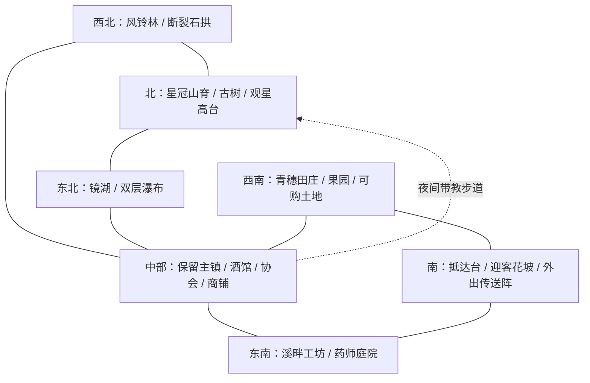

# 天空岛与居民主线 · 第一版设计稿

状态：待用户确认。本文的景观、土地、剧情和晋升调整尚未写入游戏。性能与取名问题独立修复，不以批准本稿为前提。

## 一、我们要做成什么样

玩家来到一座真正有人生活的空中岛屿：中心是熟悉的酒馆与小镇，向外走能到溪流、果园、牧场、山脊和古老遗迹。白天这些地方首先是好看的自然风景；夜里打开魔力视野，才看见它们其实被同一条魔脉连接。

推荐采用“一座主镇、两处小聚落、四片自然景区”。不再填满同样大小的建筑，也不把中心镇拆掉重建。每个区域有自己的地形、声音、工作和居民，路能让人自然找到目的地。

另外两个方向作为比较：全部扩成大城，服务集中但更拥挤、建造与运行成本高；主岛拆成大量碎岛，远景很奇幻，但新手跑图、多人同步和加载更复杂。因此本稿选连续主岛，少量近景浮石作点缀。

## 二、地图布局：云溪群落

现有生产蓝图是 **520×220×520**，约692万非空气方块、2183个方块实体。以这个范围重塑，不再无上限扩大。下图是方向关系，不是覆盖现有建筑的施工坐标；最终边界必须和产权及建筑清单叠图确认。

### 六处真正值得走过去的景观

| 区域 | 普通视野的景观与地形 | 魔力视野中的第二层 | 玩家实际用途 |
|---|---|---|---|
| 抵达花坡 | 门后先是一段低坡，穿过石拱才看见镇子；矮花、草坡、引路灯统一颜色 | 少量流光沿路去往镇里 | 第一次抵达、认路；不在加载时堆大特效 |
| 镜湖飞瀑 | 山泉进湖，分成两级瀑布，再流向岛边；有真实河床、浅滩与水源 | 湖面有缓慢潮汐，水系魔力顺水而行 | 水系教学、采集、钓鱼、药师支线 |
| 风铃林与石拱 | 三组树冠高低错落，林窗能望见远景；石拱与山体连成一体 | 风系魔力绕树冠回旋，石拱藏旧时代符号 | 采集、小谜题、第一次发现隐藏物 |
| 青穗田庄 | 缓坡梯田、篱笆、果园、磨坊及三至五栋农舍；田地有边界但不整片铺平 | 植物与动物的伴生共鸣能一眼看出 | 种植、养殖、土地展示、初级产魔 |
| 溪畔工坊 | 水边两至四栋小屋，药师庭院与公共练习院；工程区与住宅有绿带 | 晶纤与折光镜的流动能被观察追踪 | 魔力输送、制药、维修，公开体验设备 |
| 星冠高台 | 沿山脊上行，经过旧石阶与一株古树，最后才露出环形远眺平台 | 从整座岛向上汇聚的元素流、月华和星海；有明确流向，不做彩色围墙 | 首次F8教学、剧情回访、后期天象研究 |

### 地形与材质的具体改法

- 主镇地基不动，周边用约12至24格的坡地、矮墙、灌木与道路过渡，消除房屋直接接突兀方块平台的问题。
- 树按树群设计：高乔木、次层树、灌木、地被分层；树根接入土坡，禁止孤零零悬空树干或整片复制同一棵树。主色是自然绿与青蓝，紫色只用于少量异域植物。
- 岛边形成“草坡—露岩—尖根”的连贯轮廓，少量洞穴与垂藤打破单调；不把边缘做成一圈规则墙。
- 只保留两条主要落瀑。避免大量动态水源造成更新；远景装饰用稳定地形，近处流水保持可交互。
- 主路5格左右，支路3格左右；主路有连续方向感，岔口能看到下一个标志物。常用服务靠近镇中心，景区不承担反复跑腿的日常交付。
- 普通视野必须好看，魔力视野负责揭示另一层世界。白天、夜晚、开关光影都列入验收，不依赖过曝遮住模型问题。

### 可购买的土地

不把景区直接切成棋盘。土地放在田庄外缘与东南缓坡，主路、瀑布、观景线和现有产权保留。

| 土地类型 | 建议净可建范围 | 适合玩法 | 购买节奏 |
|---|---|---|---|
| 初居庭院 | 32×32，另留公共路与绿化边界 | 房屋、两块9×9魔田、少量动物 | 新手第一轮委托之后；提供短期免费借住，不强迫立即买房 |
| 林溪庄园 | 48×48 | 家庭、花园、魔药作坊、小型生产 | 精锐阶段；可以补差升级，建筑需要玩家确认迁移 |
| 田园大地块 | 64×64 | 多组动植物、完整魔力网络 | 第二次晋升后；预留住房区、工程区与自然水岸 |
| 公会庄园 | 96×96，放独立附属岛 | 多人共有生产基地 | 中后期另行开发，不挤进520格主岛 |

第一版建议先做4块32×32、2块48×48、2块64×64，合计16,896格净用地；这是容量预算，不是已经确认可施工的地块。还要留至少8格公共缓冲并扣除现有产权后复核。满服售罄时应开放附属居住岛，而不是复制占用原来的地块。地价以约3至5次同阶段日常委托净收益定标，暂不凭空填写铜币数；不能让一次性教程奖励买空所有地块。

看地时由米洛带去界桩，显示真实可建边界与面积。玩家可走进去看视野，随后确认付款；交易、权限与共享成员在服务端验证。不得因美化移走别人房屋或清空机器。

## 三、居民带教：前60至90分钟怎么走

时长是初玩估计，不是强制计时。熟悉的玩家可以跳过重复讲解，但仍用实际行为完成关键任务。

| 顺序 / 任务 | 谁带、去哪里 | 玩家实际做什么 | 如何判定完成 / 奖励 |
|---|---|---|---|
| 01 来到此世 | 初始人物面板 | 看属性、输入姓名、点击确认 | 服务端保存成功才关闭；不自动起名 |
| 02 一盏留给你的灯 | 抵达台接引居民→酒馆 | 跟随进镇，与Self交谈 | 到达并交谈；获得临时住处与基础补给 |
| 03 在这里留下名字 | Self指路→艾琳 | 登记冒险者，接一份采集委托 | 真正接单；委托栏入口与奖励说明 |
| 04 镇子如何生活 | 艾琳安排居民领路 | 经过铁匠、米洛与练习院；每站一句用途 | 到站互动；开放地图标记，不连播长对话 |
| 05 第一缕属于你的魔力 | 练习院导师 | 放玻璃瓶→向注入台供魔→拿到魔力瓶 | 材料确实消耗、产物确实入包；学会自身魔力与设备储能的区别 |
| 06 土地会呼吸 | 田庄园丁 | 制作土源、观察9×9转化；放流动魔力，种一株魔植 | 记录自己的放置、转化与种植；临时体验田无需买地 |
| 07 看得见的第一条回路 | 园丁→工坊导师 | 用已成熟示范植物、集露盏、双端晶纤给一盏灯供魔；拔掉一段再接回 | 灯因真实供能熄灭/点亮；奖励自己的入门材料。示范种成熟，不强迫等生长 |
| 08 今夜抬头看看 | 观星居民→星冠高台 | 散步、短对话，夜间按F8 | 玩家主动开视野；完成一次景观揭示，之后可自由重看 |
| 09 原来脚下还有一条河 | 仍在高台 | 看见远处田庄、湖泊、工坊的魔力流向；用视野找到近处隐藏符号 | 实际靠近调查；拿到第一条遗迹线索 |
| 10 带着准备出门 | 艾琳→地下城大门 | 做简单补给、整理备战栏，进入首层 | 真正进入；本轮教程不要求已有高级装备 |

### 第一次打开魔力视野：具体演出

居民不是到了地点就消失。上坡途中会停下来等玩家，聊一句镇里谁把魔力灯修好了；临近高台让出位置，镜头不强行转向。

抵达后先给玩家10秒左右看正常的夜景：镇里的暖灯、湖面月影、远处古树。居民说：“别急着找星星，试着看看风从哪里来。”屏幕边缘给一个小的F8提示。

打开后，近处花草先亮起轻微魔力，再出现中景湖泊和树冠的流动，最后远处的魔脉向星空舒展。主色青绿、银蓝、暖金，其他元素作局部层次；光流沿环境走，不遮满整个屏幕。声音同步展开，居民只说一句话，之后把观察时间留给玩家。首次教学期间免精神过载，不替玩家永久开视野。

单人可选择休息到晚上；多人不能替全服改时间。多人白天时可以先做田庄/工坊任务，夜间居民发来邀约；不愿等待的人可进独立的观星教学小场景体验，退出回到原处，主世界时间不变。这里是设计提案，需要后续实现该场景，并非现有功能。

### 跟随教学必须可靠

- 每站为独立检查点，断线重登接续；不跟到就停下来招呼，不能居民已经走完、玩家还在门口。
- 服务居民不离开自己的岗位。带路用接引居民或玩家专属带教实例；多人分别存进度，同队可一起看，奖励各自只发一次。
- 遇到寻路失败，先重新寻路，再提供“在下一站会合”，不把玩家强行传走。对话可重听，教程设备可重置，材料丢了可补教学用材料但不能刷钱。
- 弹窗不阻断战斗。开始前确认安全位置；教学开始、暂停、完成各有明确状态。
- FTB显示“当前目标、地点、导师、完成条件”，更详细解释放折叠说明。书负责回看，居民负责第一次体验。

## 四、主线总节奏：《看见世界的另一面》

核心悬念：空岛的魔脉正在失衡，四座地下城保存了不同的观测与调节方法。玩家从看懂一盏灯，逐步学会看懂一片生态，最终修复岛屿与远方遗迹之间的联系。不是开局就命令玩家造终极机器。

**当前实装边界**：代码目前只有“Lv10+100声望→精锐”的一次晋升；高阶晋升尚未开放。法杖有五档及Lv1/10/25/50/85的门槛。下面更高的职称、剧情试炼与新奖励均为拟新增，不能把名字直接写进FTB当作已完成的功能。

| 阶段 | 核心剧情与任务顺序 | 本阶段开放的系统 | 地下城节奏 | 晋升与阶段结束 |
|---|---|---|---|---|
| 序章：初来此世 | 完成上述01—10；在夜景中看见岛心魔脉缺了一段 | 名字、委托、基本施法、注入、种植、最小回路、F8、备战 | 任一适合新手的领域1—5层 | 回镇交首份调查报告；获得继续探索资格 |
| 第一章：让灯重新亮起 | 修好田庄路灯→做一件基础锻炉产物→绑定一只动物到集息器→采集回报 | 动物产魔无需强制喂食，喂食仅加成；魔药入门 | 首个5层Boss，随后任选另一领域首段 | 现有Lv10与100声望；追加实作要求应只读已完成记录，不要求重做；晋升精锐 |
| 第二章：有一处归所 | 看地/借用公共作坊二选一→建自己的回路→居民药师教控温、看漩涡、封盖、装瓶→帮居民配一份补给 | 土地、家庭支线、完整魔药基础、淤积与温泉 | 主攻领域6—10层；首次必须利用F8解谜的主线房 | 拟晋升“行者”：完成可靠供能与一份标准魔药；个人置业不是强制门槛 |
| 第三章：四地回响 | 四领域各取得一份不同的观测证据；分析它们为何指向同一条魔脉→跨区输送实验 | 折光镜、较大规模动植物生产、天路、组合药膳 | 各领域至少首段；玩家主攻领域推进11—15层 | 拟晋升“秘术师”，建议与Lv25法杖档同步；试炼包含战斗和读懂魔力流 |
| 第四章：掌控与代价 | 调查不稳定聚能塔→安装泄压装置→识别污染源→修复一次事故 | 高阶容器、过载、农用药变异、精密供能；基础池仍绝不过载 | 主攻领域16—20层；其余领域不强制刷同样层数 | 拟晋升“导师”，建议Lv50档；安全压制事故即可通过，不强迫召灾难Boss |
| 第五章：借来星空 | 白天观测日冕、夜晚观测月华→预测极光→完成露天实验→带居民再次上高台 | 天体收集、器灵温养、高阶魔药、机铠与零式补给 | 21—25层；取得区域终局线索 | 获得终局研究许可；晋升考核要验证操作而非交一堆矿石 |
| 终章：让世界继续发光 | 集齐四领域的关键观测记录→选定团队方案→完成主攻领域30层→修复空岛魔脉 | 传说/神级成长与世界后续事件 | 26—30层终局；其他领域30层保留各自完整结局 | 拟“星冠”称号，与Lv85装备档衔接；演出回到第一次观星地点 |
| 通关以后 | 居民生活、结婚育儿、庄园建设、收藏与稀有变异、挑战其他最终Boss | 自选研究、高维交易、可选过载Boss、末地PVP | 挑战词缀与合作远征 | 无强制日课，主线结局不关闭原有玩法 |

不把“魔法知识”“法杖品阶”“冒险职称”混成一个等级：知识决定会什么，装备决定承载能力，职称决定协会服务与主线资格。现有学习进度不重置。上述Lv25/50/85只是和现有装备档位衔接的建议，经验曲线须实测再定，不能靠额外刷级填满剧情间隔。

### 四领域的分工

| 领域主题 | 主要体验 | F8提供的信息 | 主线带回的知识 |
|---|---|---|---|
| 地牢 | 紧凑战斗、窄廊、机关门、破损工坊 | 断开的回路、伪装机关、敌人的蓄力 | 魔力如何传输与被截断 |
| 沙漠 | 高低差、折光室、日照庭院、风沙路线 | 镜面朝向、热流、真路与海市蜃楼差别 | 光与热如何转换 |
| 海底 | 水位房、潮汐桥、沉船、立体洞室 | 水流方向、隐藏空气囊、怪物潜行轨迹 | 流量、缓冲与稳定性 |
| 星眠幻庭（独角兽大门） | 林间平台、无形桥、星象小庭、奇遇 | 隐桥、相位符号、隐藏生物与宝箱 | 共鸣、感知与空间关系 |

沿用每领域30层、每5层存档与Boss；不强制四座地下城全部打满才能接着玩科技。主线需要四种不同见闻，不需要四次重复劳动。无形桥用不能绕过的窄长廊；星象房用开阔环台；水位房用竖向空间；每类房的形状服务机制。

### 主线之外如何生活

家庭不是科技门锁：未婚也能通关，伴侣的出发、归家、重伤关怀与聚餐跟玩家实际事件关联。农夫和药师能通过供应委托贡献声望；纯战斗玩家可借公共设备完成教学，然后用交易获得日常补给。高级独门装备仍需要对应研究，不靠跳过教程白送。

每段远征后给一个自然的回镇理由：交情报、看地、维修、调药、与居民吃饭。避免连续十次“交十个材料”；每一章至少有一个新操作、一次环境发现、一段居民关系变化。

## 五、任务实际怎么落地

建议任务状态：未发现→邀约→跟随→现场说明→玩家操作→服务端核验→结算→下一站。记录玩家UUID、任务ID、检查点、教学设备归属、奖励事务ID和已看演出，不能用客户端点击或NPC显示名字判定完成。

FTB新增一页“旅途主线”，纵向只连各章必经节点；种植、动物、魔力科技、魔药、家庭保留独立页并链接过去，避免一张网全是线。主线每步同时列“谁在等你 / 去哪里 / 亲手做什么 / 为什么现在做 / 奖励与下一步”。完成信号来自真实事件；旧任务ID与用户原有章节保持，新增内容不覆盖整本任务书。

推进实施前需要的具体表：每章任务ID和前置、NPC岗位与路线点、设备坐标及重置规则、物品消耗/奖励、服务端完成条件、FTB关联ID、单人/多人异常恢复。先把序章做成完整可玩的闭环，再按本总表逐章串接，不能只堆新物品。

## 六、性能约束与验收

本次日志已经出现133,261ms服务端延迟，且时间点落在天空岛候选区块勘察之间。修复首先处理同步区块等待，不能靠盲目加大内存掩盖阻塞。移出主世界的末地岛约580万方块，但现有空岛本身仍很大；不承诺只移动一个岛就解决所有卡顿。

景观版的目标：新世界可交互阶段不因本模组选址/施工产生连续长时间冻结；记录构建耗时、每tick耗时与GC；同机器同种子对照，不能拿换电脑后的FPS当优化结果。原生截图只能证明画面，不能证明生成速度。

施工只处理有限区块；背景生成给玩家活动让路；装饰优先静态模型而非大量展示实体。居民只在活动区更新寻路，远处特效按距离与可见性降级。首次F8演出有粒子预算与画质档，低档也保留构图、色彩和方向。地下城与末地大建筑不在登录时预热整座地图。

验收：新建世界、重登、中途退出建造、多人不同进度、已有产权、昼夜、光影开关、教学材料丢失、NPC被挡路，都必须验证。美化只针对获批的新生成方案；旧存档不自动重刷地形。

## 七、参考与待确认范围

借鉴的是构图方法，不下载地图直接套入整合包：

- [Floating Islands with Waterfalls](https://www.planetminecraft.com/project/floating-islands-with-waterfalls/)：两座岛通过瀑布产生联系。对应本稿的水源—湖泊—落瀑连续关系。
- [Wild Fantasy Terrain](https://chunkwright.com/packs/evergreen-terrain-fantasy)：浅谷、岛缘高地、分层植物及下悬岩根。对应本稿的地形层次；我们的视觉中心仍是居民小镇，不改成满地紫水晶。

请优先确认三个方向：**主镇+两小聚落的布局**、**居民实践带教+夜间首次F8演出**、**四地探索串联科技而不强制四座全通的主线**。地块数量、价格、职称名称和演出对白可在方向确定后细改。本稿获批前不开始这些地图与任务改造。
