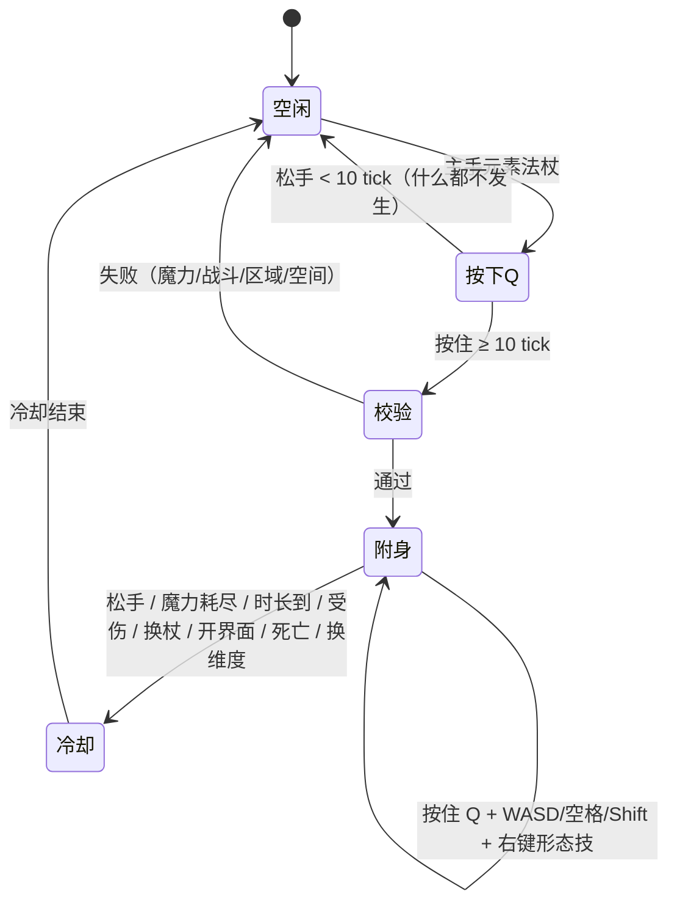

# 法杖元素附身 · 魔法师赶路设计稿

状态：**设计提案，未实装**。本文只定玩法、数值方向与接入点；批准后才动 Java、网络包和资源。  
需求来源：作者 2026-11-07——“魔法师要有自己特殊的赶路能力；放在魔法杖上，用和战士武器一样的键位；长按 Q 进入附身，法杖是什么元素，就是什么元素的赶路方式。”  
关键词：元素附身 / 化身 / 法杖行旅 / 七系移动形态

---

## 一、一句话

**手持元素法杖，长按 Q 让元素附在自己身上，化成该元素的形态赶路；松手退出。**  
形态由**法杖元素**决定，能发挥到几阶由**法杖阶位**与**元素亲和力**共同决定。

战士的“武器决定连招”，法师的“法杖决定怎么走路”。同样一把 Q，不新增一套陌生键位：

- 短按 Q：**什么都不做**（原先的“元素步”已删；见 3.3.1）。
- 长按 Q（≥0.5 秒）：**元素附身**，进入该元素的赶路形态。
- 按住 Q 维持，松手退出。
- 附身中右键：**形态技**（雷冲、影返、潜地、光跃等）。
- E 仍然是背包，Z 仍然留给战士蓄力，不抢。

> 设计上刻意不做“第八个法术键”。附身是**法杖自带的移动能力**，不是热键栏里的一个法术；因此不占 18 个配装槽，也不走 SpellEngine 的施法流程。

---

## 二、为什么现在能做，以及不能怎么做

### 2.1 已经具备的基础

| 现有系统 | 对本设计的价值 |
|---|---|
| 七元素、35 把元素法杖（7×5） | 法杖元素天然就是形态类型；`ElementWands.Wand` 已暴露 `design.element` / `design.tier` |
| 亲和力 1–6 → 可学阶 1–5 | `MagicStoneData.maxTierFor(element)` 已经是现成的“发挥上限”，不需要新造成长线 |
| 魔力、回魔、魔力同步 | 附身可以直接消耗魔力；`MagicStoneData.spendMana` + `MagicStoneNetwork.syncTo` 已有 |
| 战士 Q/E 长按状态机 | 已经解决“长按判定、自动重复、吞原版 Q、松手补发、KeepAlive”这些坑，语义可以照搬 |
| 风/光已有飞行 | 附身不是从零做飞行；但**必须接进同一个 `mayfly` 裁决点**，否则会重演“光翼被风每 tick 收走”的事故 |
| 城镇/住宅/副本/Boss 权限 | `TownProtection.denied`、`DungeonService`、`EarthArenaEncounter`、`ServerBossHud` 都能直接做拦截 |

### 2.2 不能做的事

1. **不能把附身做成“另一个飞行系统”**：`TNWindMechanics.onPlayerTick` 现在是 `mayfly` 的唯一裁决点；任何新系统自己 `setMayfly(true/false)` 都会和风/光打架。附身只提供“我也需要飞”的资格，最终仍由这个裁决点决定。
2. **不能把附身做成战斗形态**：附身中不能攻击、不能施法、不能交互；否则它就是“无敌逃跑/无伤切入”，会直接破坏战士与 Boss 的设计。
3. **不能做持续 noclip**：暗系的穿墙是“短距相位”，土系是“目标点潜地”，都不是按住 W 无限穿墙。持续 noclip 会穿基岩、穿副本、穿没加载的区块，且极难做碰撞安全。
4. **不能强迫加载区块**：土/光的目标点必须在已加载区块内；不为了赶路给玩家开 chunk ticket。
5. **不能覆盖现有法术**：`lightning_blink` 是雷系 2 阶的短距战斗闪现；`风速` 链和 `光耀` 已经是飞行法术。附身是**脱战的持续赶路**，不能把它们改成同一件事，也不能严格上位替代。

---

## 三、核心规则

### 3.1 法杖与形态

| 条件 | 规则 |
|---|---|
| 触发物品 | **主手**必须是 `ElementWands.Wand`（元素法杖） |
| 形态元素 | 取 `wand.design.element`，七系各一种形态 |
| 形态阶位 | `effectiveTier = min(wand.design.tier, MagicStoneData.maxTierFor(element))` |
| 亲和力为 0 | 不能附身；提示“没有该元素亲和” |
| 该元素未学过法术 | 默认不能附身；提示“先学会一个雷系法术”；可配置关闭 |
| 通用 `magic_wand` | **不能附身**（无元素）。它是施法入门杖，不是行旅杖 |
| 副手法杖 | 不触发；必须拿在主手，避免和盾/副手武器抢语义 |
| 切杖/换手 | 附身立即结束，进入完整冷却；不能靠切杖绕过冷却 |
| 附身中施法 | 禁止；右键变成“形态技”，数字键/左键被屏蔽 |

`maxTierFor` 的现有映射正好是：

| 亲和力 | 1 | 2 | 3 | 4 | 5 | 6 |
|---|---|---|---|---|---|---|
| 可发挥阶 | 1 | 2 | 3 | 4 | 5 | 5（6 只多“神级奇遇”，不额外给阶） |

因此：**神杖 + 亲和力 3 = 3 阶形态**。这不是削弱，而是让“法杖阶位”和“人物亲和”两个成长轴都参与；法杖决定“这根杖能承载多少”，亲和决定“这个人能引出多少”。

### 3.2 法师门槛

推荐加一条**软门槛**，默认开启、可配置关闭：

> **该元素至少学过 1 个法术** 才能附身。

判定用魔法石的 `learned` 集合：遍历 `SpellCatalog`，只要存在一个 `element == 法杖元素` 且非独立法术的已学条目，就通过。不要用 `getProgressMax(element) >= 1`，因为老存档/命令学习不一定会把 `progress` 补上；`learned` 才是权威。

理由：当前默认配置给所有玩家每系亲和 3（总和 21），`AdventureService` 又把冒险点数起点设成 4，所以“亲和总和”和“魔法点数”都区分不出法师/战士。真正有意义的信号是**有没有学过这个元素的法术**：学过才说明这个人跟这根杖有连接；纯战士拿杖也用不了，得先投入学习。

如果试玩觉得没必要，把 `travel.requireStudiedSpell=false` 即可；法杖 + 单系亲和力仍然在把关。

### 3.3 键位与 Q 的归属

| 输入 | 手持元素法杖时 | 手持战士武器时 | 空手/其他 |
|---|---|---|---|
| 短按 Q | 无动作（不位移/不丢杖） | 左斩击/连招起手 | 原版丢弃 |
| 长按 Q ≥0.5s | 元素附身 | 蓄力 | 原版丢弃 |
| 按住 Q | 维持附身 | 维持蓄势 | — |
| 松手 Q | 退出附身 | 释放/收势 | — |
| 右键 | 附身中：形态技；未附身：正常施法 | 正常攻击/使用 | 正常使用 |
| E | 背包（不接管） | 右斩击 | 背包 |
| Z | 不接管 | 蓄力 | 原版 |
| 数字键 | 附身中屏蔽；未附身正常施法 | 正常 | 正常 |

**判定窗口内的右键**：从按下 Q 到松手/进入附身之间，右键不施法、也不放形态技，避免“想等附身却先放了一个法术”。已经进入附身后，右键才是形态技。

**Q 丢物品怎么办**：手持法杖时，游戏内 Q 被旅行系统接管，不再丢法杖。要丢弃：
- 打开背包按 Q（背包界面里不接管）；
- 或 `Ctrl+Q` 保留原版“丢弃整组”；
- 或把法杖拖出背包。

客户端检测到 **Ctrl 按住时不吞 Q**，直接让原版处理“丢弃整组”；只在没有 Ctrl 时接管 Q。

这和战士拿剑时 Q 不能丢剑是同一个取舍，但给了明确的替代路径。键位提示必须读实际绑定（`LEFT.getTranslatedKeyMessage()`），不能把“Q”写死在 UI 里。

#### 3.3.1 短按 Q 什么都不做（2026-11-07 改）

原设计给短按 Q 配了“元素步”。作者试完之后否掉了：**「我不要元素步，丑死了」**。  
现在短按 Q 不位移、不丢杖、也不进附身；Q 只有两个语义：**按住 = 进入并维持附身，松手 = 退出**。
`STEP` 这个动作已经从网络包、服务端和数值表里删掉，不留半套代码。

**实现上不要注册第二个 Q**：直接复用 `WarriorComboKeys.LEFT` 这个 `KeyMapping`，两个处理器按主手武器互斥：
- 主手是战士武器 → 战士处理器接管；
- 主手是元素法杖 → 旅行处理器接管；
- 其他 → 原版。

这样控制页里只有一个 Q，不会出现两个按键冲突红字。代价是 `key.tnc.combo_left` 的显示名要从“左斩击”改成中性一点的“左战技 / 元素附身”；战士文档里的“Q”仍成立。

### 3.4 进入/退出的状态机



关键点：

- **短按不结算任何东西**：不足 10 tick 松手就是“点空了一下”，不扣魔力、不进冷却、不位移。
- 长按阈值沿用战士的 `ComboTracker.HOLD_TICKS`（10 tick = 0.5s），不要另写一个 8/12 tick 的魔法数字。
- **空中形态**（雷/暗/火/水/风）进入后**自动起飞**（`abilities.flying=true`），不需要双击空格；玩家按 Shift 可下降/落地，附身不结束。土/光是目标式，不自动起飞。
- 附身中松手 → 退出；没有“松手后还滑行 2 秒”的模糊地带。
- 因魔力/时长自动结束时，**必须等玩家先松开 Q 才能再次进入**，否则按住不放会反复进入。
- 客户端只发意图：`ENTER / SKILL / KEEPALIVE / EXIT`；服务端校验后生效。客户端可以立刻播特效，但状态以服务端同步为准。

### 3.5 为什么是“按住维持”，不是“按一下切换”

按住维持更安全：玩家不会因为忘记关而无限飞；松手即落地，符合“赶路工具”的直觉。  
但长距离赶路一直按 Q 会累，所以保留一个客户端选项：

- 默认：**按住维持**；
- 可选：**切换模式**（按一下进入，再按一下退出）。切换模式只改客户端输入状态机，服务端仍用 `ENTER/EXIT` 协议，不改校验。

第一版建议只做按住；切换模式作为无障碍/长距离选项放到第二阶段。

---

## 四、七系形态

### 4.1 总表

| 元素 | 形态 | 一句话动词 | 速度/距离（1→5 阶） | 续航 | 操控 | 穿障 | 主要弱点 |
|---|---|---|---|---|---|---|---|
| 雷 | **雷驰** | 化作一道闪电，沿视线高速贯行 | 14→22 m/s | 标准 | 中（有惯性） | 无 | 转向笨、入水短路 |
| 暗 | **幽行** | 化作黑夜之手，缓慢浮游，穿薄墙 | 6→9 m/s | +20% | 中 | 2→6 格相位 | 慢、不能攻击 |
| 火 | **焰行** | 化作烈焰，喷薄推进 | 12→19 m/s | −10% | 低（最难刹车） | 无 | 入水熄灭、雨中变慢 |
| 水 | **雾行** | 化作水雾，贴地流走 | 8→12 m/s（水面 ×1.8） | 标准 | 高 | 1→2 格薄缝 | 沙漠/下界变慢 |
| 风 | **御风** | 化作长风，御风而行 | 11→17 m/s | +20% | 最高 | 无 | 最快速度不如雷/火 |
| 土 | **土遁** | 没入土中，从目标地表破土而出 | 24→64 格/次 | 标准 | 目标式 | 穿地形（露天） | 只能到露天地表 |
| 光 | **光行** | 化作光束，抵达目光所及 | 16→45 格/次 | 标准 | 目标式 | 无（需视线） | 不能穿墙、需看见 |

速度是“建议首版”，不是最终平衡；所有形态都受同一套“脱战 + 魔力 + 冷却”约束。

### 4.2 雷 · 雷驰

**核心**：七系最快，直线最强。按 W 后速度在 0.5 秒内推到上限，镜头轻微拉伸，身后留下折线电弧；鼠标可以转向，但高速时转向有惯性，松 W 后还会向前滑一小段。

- 速度：14 / 16 / 18 / 20 / 22 m/s。
- 操控：转向速率约 120°/s；俯仰自由；侧移/后退推力较弱。
- 环境：雷雨 +20% 速度；进入水中立即结束（“短路”，不受伤）。
- 形态技 **雷冲**：1.5 秒内速度 +50%，只能沿当前视线方向微调；冷却 6 秒，消耗 8% 最大魔力。
- 视觉：青白→紫的电光外壳、折线拖尾、关节间跳弧、第一人称边缘电弧。
- 音效：入场雷暴、循环电弧、退出短促放电。
- **与 `lightning_blink` 的区别**：闪现是 2 阶法术，瞬间、短距、可战斗；雷驰是长按维持的持续高速，脱战、不能攻击。两者不互相替代。

### 4.3 暗 · 幽行

**核心**：不是“快”，是“没有路也能走”。幽行缓慢浮游，身体半透明，怪物不会主动锁定；撞到薄墙时自动相位到墙另一侧的安全空气。

- 速度：6 / 7 / 7.5 / 8.5 / 9 m/s；续航 +20%（12/17/22/29/36 秒）。
- 相位：最多 2 / 3 / 4 / 5 / 6 格；每次相位额外 2% 最大魔力，0.6 秒内置冷却。
- 不能穿：基岩、屏障、命令方块、结构方块、带方块实体的方块（箱子/熔炉/床）、门/栅栏等可交互方块、`#tnc:phase_blocked` 标签、城镇/住宅领地、未加载区块。
- 相位落点必须是 2 格高安全空气；找不到就停在墙前，不硬挤。
- 形态技 **影返**：每个附身一次，回到进入点并结束附身；消耗 10% 最大魔力。用来“探太深了，回去”。
- 视觉：半透明暗影轮廓、下半身烟雾、眼睛微光、阴影拖尾；屏幕暗角。
- 音效：低语/灵魂沙碎裂/末影人瞬移的轻响。
- **不做真隐身**：不挂 `concealment` 效果（会显示图标、60 秒、和现有法术纠缠），改为复用 `LivingChangeTargetEvent` 的“不主动索敌”逻辑；进入时清掉 32 格内怪物已有的目标（`mob.setTarget(null)`），玩家仍然可以被玩家打中，受伤即退出。

### 4.4 火 · 焰行

**核心**：起步最猛、刹车最难。像火箭一样沿视线推进，速度高、惯性大；免疫火焰与岩浆，可以贴岩浆面飞。

- 速度：12 / 13 / 15 / 17 / 19 m/s；续航 −10%（9/13/16/22/27 秒）。
- 进入时清火；期间免疫火焰/岩浆伤害。
- 环境：岩浆/下界 +10% 速度；雨中 −15%；入水立即结束（蒸汽，不受伤）。
- 形态技 **爆燃**：3 秒内速度 +35%，结束后 2 秒 −20% 速度（过热）；冷却 10 秒，消耗 8% 最大魔力。
- 视觉：火焰披风、余烬拖尾、热浪扭曲粒子、暖色屏幕；**不点燃方块、不造成伤害**。
- 音效：爆燃、持续火焰、蒸汽熄灭。
- 定位：适合直线跨越峡谷/岩浆湖，不适合精细钻洞。

### 4.5 水 · 雾行

**核心**：顺势而行。贴地/贴水面滑行，操控最跟手；水面和雨中速度大幅提升，能挤过 1–2 格薄缝。

- 速度：8 / 9 / 10 / 11 / 12 m/s；水面/雨中 ×1.8（14.4→21.6 m/s）。
- 续航：标准；水中呼吸，不消耗氧气。
- 薄缝：可穿过 1 / 1 / 1 / 2 / 2 格宽的缝隙；比暗系相位便宜，但只能过“缝”，不能过整面墙。
- 环境：雨中 +30%；沙漠/下界 −20%，且续航 −20%。
- 形态技 **顺流**：2 秒内水面/雨中 +40% 速度，其他地形 +15%；冷却 10 秒，消耗 7% 最大魔力。
- 视觉：水雾外壳、水滴拖尾、脚下涟漪、蓝色屏幕边缘。
- 音效：水流、气泡、踩水。
- 定位：海洋/河流/雨天的最优解；陆地上只是“好操控的悬浮”。

### 4.6 风 · 御风

**核心**：最听话、最省力。全向飞行，瞬间转向，没有惯性；速度不是最高，但续航最长、操控最好，适合长距离赶路和钻地形。

- 速度：11 / 12 / 14 / 15 / 17 m/s；续航 +20%（12/17/22/29/36 秒）；消耗 −20%。
- 操控：全 6 向，无惯性；Space 上升，Shift 下降；松开 W 立即停。
- 形态技 **乘风**：向上 8 格并悬停 1 秒；冷却 5 秒，消耗 5% 最大魔力。
- 视觉：半透明风壳、青白丝带、叶片/羽毛粒子、轻快屏幕边缘。
- 音效：持续风声、衣袂、风铃。
- **与风速链的区别**：风速链是战斗增益/短时飞行/永久飞行（4 阶起）；御风是脱战赶路形态，速度低于满层风速，不能攻击，受伤即退出。不能把风速的 `WIND_SPEED_III` 直接当御风用。

### 4.7 土 · 土遁

**核心**：不走表面，走地下。不是飞行，是“瞄准一个露天地表点，潜过去，从那里破土而出”。

- 操作：长按 Q 进入“瞄准”状态；准星指向一个地表点（客户端显示琥珀色落点环），右键 **潜地**；0.6–1.2 秒后从目标点破土。
- 距离：24 / 32 / 40 / 52 / 64 格；冷却 4 秒；消耗 10% 最大魔力。
- 目标条件：目标列必须有天空视野、最上层是可挖掘方块（土/石/沙/砾石等 `#tnc:burrowable`）、上方 2 格空气、已加载、不在领地/副本/Boss 场内、不在世界边界外。
- 入口条件：玩家必须站在露天可挖掘地面上；水中/空中/室内不能起手。
- 相机：**玩家不真的钻到地下**。起手后玩家留在原地、隐身、锁移动，屏幕切“地脉视野”（琥珀暗角 + 岩石流线 + 进度条）；地表用粒子画一条移动的土浪；到达后服务端把玩家传送到目标点。这样不会出现“相机在石头里全黑”的晕眩，也不需要把玩家塞进 1 格隧道。
- 形态技就是 **潜地** 本身；没有第二个技能。
- 视觉：土浪、碎石、扬尘、屏幕轻震。
- 音效：闷响、碎石、破土。
- 定位：山地/丘陵的“直线捷径”；不能进洞、不能进家、不能进副本。

### 4.8 光 · 光行

**核心**：点到点，必须看见。不是高速飞行，是“目光所及的瞬移”；可以连续闪，但每次都要视线。

- 操作：长按 Q 进入“瞄准”；准星指向可见点（白色菱形落点），右键 **光跃**；瞬移并留下光束。
- 距离：16 / 22 / 28 / 36 / 45 格；冷却 1.2 秒；消耗 8% 最大魔力。
- 条件：起点到目标必须无遮挡（`ClipContext` 视线）；目标点 2 格高安全空气；已加载；不在领地/副本/Boss 场；不穿墙、不穿基岩、不穿世界边界。
- 连续闪：附身持续时间内可多次右键；每次独立扣魔、独立冷却；没有“次数上限”，魔力就是上限。
- 落点保护：闪现后 1 秒无摔落伤害；若落点悬空，给 3 秒缓降。
- 视觉：白色光束、星点拖尾、残影、屏幕泛光。
- 音效：钟鸣、光爆、短促回响。
- 定位：精准跨峡谷/上高台/到视线无遮挡的开口，不是“无视地形的传送”；玻璃/栅栏是否挡视线按 `ClipContext.Block.COLLISION` 的实际结果走，不单独开洞。

### 4.9 形态速查（给 UI/文档用）

| 元素 | 形态 | 形态技 | 技能效果 | 消耗 | 冷却 |
|---|---|---|---|---|---|
| 雷 | 雷驰 | 雷冲 | 1.5s 速度 +50%，直线 | 8% | 6s |
| 暗 | 幽行 | 影返 | 回到入口，结束附身 | 10% | 每次附身一次 |
| 火 | 焰行 | 爆燃 | 3s 速度 +35%，之后 2s −20% | 8% | 10s |
| 水 | 雾行 | 顺流 | 2s 水面/雨中 +40%，否则 +15% | 7% | 10s |
| 风 | 御风 | 乘风 | 向上 8 格 + 悬停 1s | 5% | 5s |
| 土 | 土遁 | 潜地 | 目标地表潜行（核心） | 10% | 4s |
| 光 | 光行 | 光跃 | 视线瞬移（核心） | 8% | 1.2s |

### 4.10 元素步（已删除）

2026-11-07 作者否掉：「我不要元素步，丑死了」。短按 Q 现在什么都不做；七系的步距表、
`STEP` 动作、元素步冷却与 4% 魔力消耗全部从代码里删掉，不留可选开关。
元素法杖的机动性只由**附身本身**提供。

---

## 五、数值与代价

### 5.1 时长 / 冷却

| 阶 | 时长 | 冷却 | 说明 |
|---|---|---|---|
| 1 | 10s | 8s | 新手第一次体验，够跨一条河/一个山谷 |
| 2 | 14s | 10s | 勇者级，开始能跨区域 |
| 3 | 18s | 12s | 王级，主线中段 |
| 4 | 24s | 15s | 传说级，大地图自由行 |
| 5 | 30s | 20s | 神级，最长单次赶路 |

风/暗 +20% 时长；火 −10%；其余标准。冷却从**退出瞬间**开始，提前松手/受伤/耗尽都不退款。

### 5.2 魔力

| 阶 | 进入 | 持续消耗 |
|---|---|---|
| 1 | 8% 最大魔力 | 1.2% / 秒 |
| 2 | 8% | 1.5% / 秒 |
| 3 | 8% | 1.8% / 秒 |
| 4 | 8% | 2.1% / 秒 |
| 5 | 8% | 2.4% / 秒 |

- 风 ×0.8；火 ×1.15；暗 ×1.0；水 ×0.9；雷 ×1.0；**土/光 ×0.25**。
- 土/光的持续消耗故意压得很低：它们的主要开销是每次“潜地/光跃”，如果按 2.4%/s 烧，30 秒里魔力全花在瞄准上，根本跳不了几次。
- 以默认 210 魔力为例：1 阶进入约 17，持续约 2.5/s，10 秒约 42（20%）；5 阶进入约 17，持续约 5/s，30 秒约 167（80%）。  
  土/光 5 阶则是 17 + 0.6%/s×30（约 38）+ 单次技能；30 秒内能跳 6–9 次，而不是 2 次。
- 用 `double` 累加，每 10 tick 扣一次整数，避免小上限被每 tick 四舍五入吃光。
- **附身期间暂停回魔**：在 `MagicStone.tickManaRegen` 开头加“附身中直接 return”；退出后按原有“施法后延迟”再恢复。这样附身不是“边飞边回满”。
- 魔力不足以支付下一跳时：立即结束，给 3 秒“力竭”额外冷却；不扣成负数。
- 下界/末地是“无魔荒漠”，`ArcanaRealms.powered` 本来就不回魔；附身仍可用，但不回魔，提示“无魔区：谨慎使用”。是否直接禁用，见待确认问题。

### 5.3 战斗锁

- 进入前 5 秒内**造成或受到**过伤害 → 不能进入；提示“战斗中无法附身”。
- 附身中受到任何伤害 → 立即退出；不取消伤害、不给无敌。
- 摔落伤害不算战斗伤害；附身中与退出后 2 秒内取消摔落伤害，并给 10 秒缓降（或直到落地）。
- 附身中不能攻击/施法/交互，所以不存在“打一下再附身”的连招。
- 附身不是“战斗逃生”：被打就断，且冷却立即开始；雷/暗也不给战斗例外。

### 5.4 与其他移动方式的对比

| 方式 | 速度 | 持续 | 代价 | 战斗 | 定位 |
|---|---|---|---|---|---|
| 步行/疾跑 | 4.3 / 5.6 | 无限 | 无 | 可 | 基准 |
| 马 | 9–14 | 无限 | 鞍/地形 | 可 | 地面长途 |
| 鞘翅 | 20–30 | 看烟花 | 烟花/耐久/风险 | 弱 | 后期飞行 |
| 风速链 | 约 11–13+ | 5–15s / 永久 4 阶 | 魔力/冷却 | 可 | 战斗增益/飞行 |
| 光耀 | 约 11 | buff 时长 | 魔力/冷却 | 可 | 光系飞行 |
| 元素附身 | 6–24 | 10–30s | 魔力 + 冷却 + 脱战 | **不能** | 法师自由赶路 |

附身比马快、比鞘翅慢/灵活；比风速链更偏“赶路”而不是“战斗”；这样不会把已有法术全部扫进垃圾堆。

### 5.5 速度叠加规则

附身的速度必须**可预测**，不能出现“雷驰 × 雷速 × 迅捷 × 远行外衣 = 40 m/s”：

| 形态类型 | 速度来源 | 装备移速 | 战斗加速（雷速/风速/迅捷） |
|---|---|---|---|
| 空中（雷/暗/火/水/风） | `flyingSpeed`，由 `TravelForms` 表值换算 | **不生效** | **不叠加**，形态表值就是最终速度 |
| 土/光目标式 | 固定距离/固定时长 | 不影响 | 不影响 |

- `flyingSpeed = clamp(0.05 × targetSpeed / 10.9, 0.02, 0.14)`；退出恢复原值。
  - 例：雷 22 m/s → 约 0.101；暗 6 m/s → 约 0.0275；风 11 m/s → 约 0.0505。  
  - 下限必须是 0.02，不能沿用原版飞行的 0.05，否则暗/水会被“最低速度”抬到 10.9 m/s。
- **附身速度不读 `MOVEMENT_SPEED`**：不叠行旅兜帽/远行外衣/迅捷/雷速/风速，避免“表值 × 药水 × 装备”叠乘。
- 如果以后要让行旅套参与，统一走 `TravelForms.speedMultiplier(player)`，上限 +15%，**不要**给附身加 `MOVEMENT_SPEED` 修饰符；否则会和装备/药水的 `MULTIPLY_BASE` 打架。

---

## 六、安全、权限与边界

### 6.1 进入校验（服务端，顺序执行）

1. 主手是元素法杖，元素/阶位有效。
2. 该元素至少学过 1 个法术（默认；可关）。
3. 魔力 ≥ 进入消耗；冷却已好；不在“力竭”。
4. 5 秒内无战斗伤害。
5. 不在倒地/救援/副本恢复状态。
6. 不在副本维度/副本运行中。
7. 不在土之试炼/Boss 战场（`EarthArenaEncounter.participant`，或 48 格内有 `ServerBossHud.theme != null` 的存活 Boss）。
8. 不在演武场教学保护区内。
9. 不在载具/床上/旁观/死亡状态。
10. 头顶/身边有足够空间（2 格高），不在方块里。
11. 不在世界边界外。
12. 目标形态有足够魔力/空间（土/光在右键时再校验目标）。

失败要给**具体原因**，不要只说“不能使用”：

```
战斗中无法附身（4 秒后可再试）
地下城中无法附身
首领战中无法附身
魔力不足：需要 17，当前 9
附身冷却中：6 秒
这里没有足够空间
```

### 6.2 退出与清理

以下情况立即退出，并清理状态：

- 松手 Q / 客户端发 EXIT；
- 时长到 / 魔力耗尽 / 受到伤害；
- 主手换物品/换杖/丢弃法杖；
- 打开背包/聊天/任意界面（客户端发 EXIT）；
- 上载具/上床/死亡/重生/退出游戏/换维度；
- 服务器停止；
- 服务端反作弊判定速度异常。

退出时必须：

- 恢复进入前保存的 `mayfly`、`flying`、`flyingSpeed`、`noGravity`；
- 清掉相位/潜地/闪现的中间状态；
- 把玩家放到安全位置（若在方块里）；
- 给 10 秒缓降（空中退出时，或直到落地）；
- 让 `TNWindMechanics` 在下一 tick 重新裁决风/光/附身的飞行，**不要直接 `setMayfly(false)` 把光翼/风速收掉**。

### 6.3 穿墙/传送的硬边界

| 边界 | 规则 |
|---|---|
| 基岩/屏障/命令方块/结构方块 | 不能相位、不能作为土/光目标 |
| 带方块实体的方块 | 不能相位穿过（防隔墙开箱） |
| `#tnc:phase_blocked` | 数据包标签，给后续模组/副本的“禁穿方块”用 |
| 城镇/住宅/领地 | 相位/潜地/闪现的**落点**不能在里面；飞越可以 |
| 副本维度/副本运行 | 完全禁用附身 |
| Boss 战场 | 完全禁用附身 |
| 演武场教学 | 完全禁用附身 |
| 未加载区块 | 土/光目标必须已加载；不为赶路加载区块 |
| 世界边界 | 目标必须在边界内 |
| 虚空 | 不保护；附身不是免死金牌 |
| 他人玩家 | 可以被击中；受伤即退出；没有 PvP 无敌 |

### 6.4 反作弊

- 服务端记录每个附身玩家的“最后合法位置”；连续 5 tick 位移超过 `maxSpeed × 1.5 + 1` 就退出并拉回最后合法位置。
- 相位/闪现/潜地只接受服务端自己算出的落点；客户端只发“我想用技能”，不发坐标。
- 土/光的目标由服务端重新 raycast；客户端 marker 只是显示。
- 不接受客户端发来的“我进入了附身/我有这个阶位”；一切以主手物品 + 魔法石数据为准。
- 附身中检测 `player.isSleeping()`、`isPassenger()`、`isDeadOrDying()`，有就退出。

---

## 七、UI / HUD / 文案

### 7.1 法杖 tooltip

元素法杖的 tooltip 追加三行（按实际阶位动态生成）：

```
元素附身 · 雷驰
长按元素附身键（默认 Q）化身，松手退出；右键雷冲
当前发挥：3 阶（法杖 5 阶 / 雷亲和 3）
```

- “元素附身键”由客户端 tooltip 用 `LEFT.getTranslatedKeyMessage()` 替换；服务端 fallback 只写“长按元素附身键”，不要把 Q 写死。
- 法杖阶位 > 亲和力时，必须显示“为什么不是 5 阶”，否则玩家会以为 bug。
- 通用 `magic_wand`：`无元素法杖：只能施法，不能附身。`
- 亲和力 0：`雷亲和 0：无法引动雷之附身。`

### 7.2 附身 HUD

屏幕底部、魔力条上方，一条细长的**形态条**：

```
[雷] 雷驰 · 3 阶   ███████░░░  12.4s   松手退出
```

- 左侧元素图标 + 形态名 + 有效阶位；
- 中间剩余时长条，颜色随元素；
- 右侧“松手退出”提示，3 秒后淡出；
- 魔力不足/冷却时，形态条位置显示红色短提示；
- 右下角小字显示形态技与冷却（如“雷冲 就绪”），按键提示读实际 `keyUse` 绑定。

第一人称附加：

- 元素色暗角（不是全屏遮罩，中心保持透明）；
- 速度线（仅在高速移动时出现，可在设置里关）；
- FOV +6~10（可配置 0–10，晕 3D 玩家可关）。

### 7.3 魔法石界面

在现有魔法石 UI 增加一页 **“化身”**（不新增 K 键，不抢战士图鉴）：

| 列 | 内容 |
|---|---|
| 元素 | 七系图标 + 名称 |
| 形态 | 雷驰/幽行/焰行/雾行/御风/土遁/光行 |
| 法杖 | 已拥有该元素法杖的最高阶；没有则“未持有” |
| 亲和 | 当前亲和力 / 可发挥阶 |
| 状态 | 可附身 / 亲和不足 / 需要元素法杖 |
| 操作 | “长按附身键（默认 Q）· 右键形态技” |

底部固定说明：

> 化身是赶路能力：不能攻击/施法，受伤即退出，副本与首领战不可用。  
> 法杖阶位决定上限，亲和力决定你能引出多少。

再加一个**“禁用长按 Q 化身”**开关，给不想误触的玩家；关闭后 Q 完全恢复原版（丢弃整组）。

### 7.4 提示文案（中英 key 建议）

| key | 中文 |
|---|---|
| `travel.tnc.lightning` | 雷驰 |
| `travel.tnc.dark` | 幽行 |
| `travel.tnc.fire` | 焰行 |
| `travel.tnc.water` | 雾行 |
| `travel.tnc.wind` | 御风 |
| `travel.tnc.earth` | 土遁 |
| `travel.tnc.light` | 光行 |
| `message.tnc.travel.enter` | %s 附身 · 松手退出 |
| `message.tnc.travel.exit` | 附身结束 |
| `message.tnc.travel.blocked.combat` | 战斗中无法附身 |
| `message.tnc.travel.blocked.dungeon` | 地下城中无法附身 |
| `message.tnc.travel.blocked.boss` | 首领战中无法附身 |
| `message.tnc.travel.blocked.claim` | 此处被结界封锁 |
| `message.tnc.travel.no_mana` | 魔力不足：需要 %s，当前 %s |
| `message.tnc.travel.cooldown` | 附身冷却中：%s 秒 |
| `message.tnc.travel.exhausted` | 魔力耗尽，附身中断 |
| `message.tnc.travel.no_affinity` | 没有该元素亲和 |
| `message.tnc.travel.need_staff` | 需要主手元素法杖 |
| `message.tnc.travel.space` | 这里没有足够空间 |
| `message.tnc.travel.phase_blocked` | 这里穿不过去 |

---

## 八、视觉与音效

### 8.1 元素色

| 元素 | 主色 | 辅色 | 气质 |
|---|---|---|---|
| 雷 | `#7DF9FF` | `#B388FF` | 锐利、快、危险 |
| 暗 | `#2A0A3A` | `#8A2BE2` | 静、冷、无路可走 |
| 火 | `#FF6B1A` | `#FFD166` | 猛、热、停不下来 |
| 水 | `#4FC3F7` | `#B3E5FC` | 顺、柔、贴地 |
| 风 | `#A8E6CF` | `#E8F5E9` | 轻、自由、可控 |
| 土 | `#C19A6B` | `#8D6E63` | 稳、沉、从地下过 |
| 光 | `#FFF6B0` | `#FFFFFF` | 准、亮、点到点 |

### 8.2 表现分层（先做便宜的，再做贵的）

| 层 | 第一版 | 后续打磨 |
|---|---|---|
| 拖尾 | 一条元素色 ribbon（最近 20 个位置，宽度 0.25–0.6，渐隐） | 每系第二层丝带/残影 |
| 粒子 | 入场/退出爆发 + 移动时每 2 tick 少量粒子 | 元素专属粒子（雷弧/火星/水沫/叶片/土屑/星点） |
| 身体 | **七系已落地**（见 8.2.1）：雷=横雷＋往旁边放电；火=燃烧火球；水=激流；风=风球；土=裂纹；光=翅膀；暗=黑夜之手 | 七系专属壳/骨骼动画 |
| 屏幕 | 元素色暗角 + 速度线（可关） | 低血量/高速度的次级效果 |
| 相机 | FOV +6~10（可关） | 高速转弯轻微倾斜（晕 3D 可关） |
| 声音 | 复用原版/现有音效，每个形态 1 入场 + 1 循环 + 1 退出 | 七系专属音效包 |

**M1 的“替换”不是换骨骼模型**：在 `RenderPlayerEvent.Pre` 取消原版人形，再在 `RenderLevelStageEvent.AFTER_WEATHER` 用雷/暗法术**已经在用的同一份几何**画元素本体，第一人称同时隐藏手和法杖；服务端玩法、碰撞箱、目标判定完全不变。这样比 mixin 替换 `PlayerRenderer` 的骨骼/盔甲/手持物链路便宜得多，也能覆盖其他玩家（外观包 `tnc:travel` 同步 `entityId`）。不新增贴图：雷直接 `LightningBoltGeometry.bolt`（水平主轴），暗直接 `DarkCastFx.renderHand`。真正换骨骼模型仍留到打磨阶段。

#### 8.2.1 七系形态外观（2026-11-08 按作者口径定稿）

七系共用同一套“白芯 ＋ 元素色辉光”的画法（`LightningBoltGeometry.boltTinted` / `flashTinted`，
顶点色，零贴图），所以看起来是同一套语言的不同元素，而不是七套各画各的。

| 元素 | 壳 | 构成 | 拖尾粒子 |
|---|---|---|---|
| 雷 雷驰 | 横雷 | 穿过身体的水平主雷（顺运动方向前伸）＋ 上下两条细雷 ＋ 雷尖爆闪；**再往旁边放电**：8 个方向射线打到墙/怪就拉一道弧，每 tick 换种子噼啪乱跳 | `ELECTRIC_SPARK` |
| 火 焰行 | 燃烧的火球 | 三层脉动同心光斑 ＋ 6 根向上舔的火舌 ＋ 一圈横向火弧（球壳边） | `FLAME` + 少量 `SMOKE` |
| 水 雾行 | 激流 | 3 条绕身螺旋水线（顺运动方向拉长）＋ 前方水舌（速度越快越长）＋ 一圈水光环 | `SPLASH` + `BUBBLE` |
| 风 御风 | 风球 | 3 圈不同倾角/转向的风环 ＋ 球心亮芯 ＋ 5 条由外向内收的气流线；**服务端**把 6 格内非 Boss 的怪往玩家身上吸 | `CLOUD` + `SWEEP_ATTACK` |
| 土 土遁 | 裂纹 | 脚下 `groundWeb` 放射地裂 ＋ 身上 5 条绕身琥珀裂线（像石壳裂开露出熔线）＋ 4 条竖直裂线保人形 | `CRIT` + `SMOKE` |
| 光 光行 | 翅膀 | 两扇各 6 根光羽从肩根扇形张开（含次级羽枝）＋ 翼根亮斑 ＋ 头顶光点 ＋ 腰际光环；随呼吸扇动、速度越快翼展越大 | `END_ROD` + `FIREWORK` |
| 暗 幽行 | 黑夜之手 | `DarkCastFx.renderHand`（和施法前戏同一只线勾手）＋ 手周围 7 条朝身后拖的黑雾线 ＋ 高速时腕后两段实黑线 | `LARGE_SMOKE` + `SQUID_INK` |

**暗是唯一走 `LightningRenderTypes.DARK`（alpha 混合）的形态**：黑色在加色层里看不见，
其余六系都走 `BOLT`（加色自发光）。

#### 8.2.2 四层叠加（2026-11-08 视觉加强）

一个形态不是画一层，而是四层叠出来的，缺任何一层都会显得"贴图贴在身上"：

| 层 | 内容 | 为什么要这一层 |
|---|---|---|
| ① 运动残影 | `TravelTrail` 每 tick 记一个身体位置（16 点 ≈ 0.8 秒），沿历史画宽度/亮度递增的尾巴；七系各自配色，末端贴到插值后的当前位置 | 只按"当前速度"画直线，站着不动就没有、急转弯会折断；沿历史才有"甩出去"的读感 |
| ② 入场爆发 | 一圈横向 + 一圈纵向光环 + 中心爆闪，12 tick 内扩散到 2.8 格并收干；第一人称也画（潜行/附身唯一即时反馈） | 变身没有"啪"一下的瞬间，玩家会怀疑自己按键没生效 |
| ③ 形态壳 | §8.2.1 的七系本体 | 说明"我变成了什么" |
| ④ 环境层 | 雷=雷笼（`cage`，每 20 tick 亮 6 tick）／光=八道放射光线＋脚下光池／火=脚边热浪上卷＋火星／水=脚下两圈水花尾流／风=地面尘环／土=被带起的碎土／暗=墨滴下落 | 只有壳的话，飞过草地和水面一模一样，缺了"我经过的地方有反应" |

拖尾的细节按元素各挂一种：雷=小分叉、火=火星、水=白色泡沫线、风=旋转侧向丝、
土=横向裂纹、光=光羽散点、暗=黑雾段。

雷的“电旁边”只画弧、**不造成伤害**：附身是赶路，不是战斗（§5.3 战斗即退出）。
风的牵引**不吸 Boss**（`ServerBossHud.theme` 认得的不吸），避免把 Boss 拖进安全区。

### 8.3 环境特征（2026-11-09 作者口径）

附身不是"七种颜色的飞行"，每系和地形都有关系。规则集中在 `TravelForms.entryBlocked`
与 `TravelForms.environmentSpeed` 两个纯函数（可单测），服务端只负责读环境状态。

| 元素 | 环境规则 |
|---|---|
| 水 雾行 | **水里 1.45 倍**，岸上 0.82 倍（"水的在水里快，陆地上没那么快"） |
| 雷 雷驰 | 可飞、**入水 1.35 倍**、不能穿墙 |
| 火 焰行 | 火球形态：**在水里或下雨时进不去**；附身中碰到水/雨立刻熄灭退出 |
| 风 御风 | 可飞、**可穿墙**、牵引周围敌人；**泡在水里 60 tick 强制解除**（`WIND_WATER_DISSOLVE_TICKS`） |
| 土 土遁 | 不能快（9~15 格/秒），靠形态技潜地 |
| 光 光行 | **无条件**：任何时间、任何天气都能变翅膀 |
| 暗 幽行 | 可飞、穿墙、下水；**只能在夜里或地下附身**（白天 + 地表拒绝） |
| 全部 | **下界不能附身**，但拿着元素法杖时跳得更高（`LivingJumpEvent` 额外 +0.32） |

另：战士（没有魔法石）不能附身；某系亲和力为 0 时该系附不了（`effectiveTier` 返回 0）。

### 8.4 音效参考（实现时逐个验证 id 存在，避免静音）

| 形态 | 入场 | 循环 | 退出 |
|---|---|---|---|
| 雷驰 | 雷暴/放电 | 电弧噼啪 | 短促放电 |
| 幽行 | 灵魂沙/末影轻响 | 低频低语 | 烟雾消散 |
| 焰行 | 火焰爆燃 | 火焰呼呼 | 蒸汽 |
| 雾行 | 水花 | 水流/气泡 | 滴落 |
| 御风 | 风铃/衣袂 | 持续风声 | 风散 |
| 土遁 | 闷响/碎石 | 土石摩擦 | 破土 |
| 光行 | 钟鸣/光爆 | 高频嗡鸣 | 回声 |

### 8.4 美术资产清单（按优先级）

| 资产 | 规格 | 用途 | 优先级 |
|---|---|---|---|
| 雷/暗/火/水/风/土/光形态本体 | 程序化（无贴图） | 复用 `LightningBoltGeometry`（含 `boltTinted`/`flashTinted`）/ `DarkCastFx` / `groundWeb`，零新增美术 | P0（七系已做） |
| 7 个形态图标 | 32×32 PNG | 魔法石“化身”页、HUD | P0 |
| 7 条拖尾渐变 | 64×8 PNG 或程序生成 | ribbon | P0 |
| 7 个元素色暗角 | 程序生成 | 屏幕 | P0 |
| 7 个形态技图标 | 32×32 | HUD 右下 | P1 |
| 7 个身体外壳/轮廓 | 程序/着色器 | 第三人称 | P1 |
| 7 套入场/循环/退出音效 | ogg | 音频 | P2 |
| 图鉴插画 | 512×512 | 魔法石/手记 | P2 |

---

## 九、技术落点

> 以下是给实现阶段的接入图，不是本轮要改的代码。

### 9.1 新增包

```
com.tnc.tnc.travel
├─ TravelStaff.java           // 接口：element() / tier()；ElementWands.Wand 实现
├─ TravelForms.java           // 七系静态表：速度/时长/消耗/距离/颜色
├─ TravelRules.java           // 纯函数：阶位、消耗、冷却、距离、是否学过该元素；可单测
├─ TravelFormState.java       // 每个玩家一份服务端状态
├─ TravelFormService.java     // 进入/退出/tick/技能/同步
├─ TravelFormSafety.java      // 安全落点、相位、地表目标、视线
├─ TravelBlockers.java        // 副本/Boss/领地/演武场/边界
├─ TravelFormEvents.java      // 伤害、摔落、换物品、死亡、登出、换维度
├─ TravelCommands.java        // /tnc travel ...
├─ TravelNetwork.java         // C2S/S2C 频道
└─ client/
   ├─ TravelFormClient.java   // 输入状态机、状态镜像
   ├─ TravelHud.java          // 形态条、冷却、提示
   ├─ TravelTrailRenderer.java// ribbon + 粒子
   ├─ TravelOverlay.java      // 暗角、速度线、FOV
   └─ TravelLoopSound.java    // 循环音
```

### 9.2 法杖接口

```java
public interface TravelStaff {
    Element travelElement();
    int travelTier();
}
```

`ElementWands.Wand` 实现它，直接返回 `design.element()` / `design.tier()`；通用 `magic_wand` 不实现。  
这样旅行系统不依赖 `ElementWands` 的具体内部结构，后续若加“旅行法杖”也容易扩展。

### 9.3 服务端 tick 顺序

```
PlayerTickEvent.START
  └─ TravelFormService.tickStart(player)
       ├─ 校验主手/战斗锁/区域
       ├─ 扣持续魔力、检查时长
       ├─ 设置 flyingSpeed
       └─ 自动结束时 stop()

PlayerTickEvent.END
  └─ TNWindMechanics.onPlayerTick(player)
       └─ shouldFly = ... || TravelFormService.allowsFlight(player)
```

为什么放 START：旅行先决定“这一 tick 我要不要飞/多快”，风的单一裁决点在 END 读到 `allowsFlight`，不会把附身的 `mayfly` 收掉。  
`tickFootWind` 的早退逻辑不用动；旅行自己的粒子/拖尾是客户端/独立发包，不依赖风环。

### 9.4 飞行裁决的最小改动

在 `TNWindMechanics.onPlayerTick` 的 `shouldFly` 里加一项：

```java
boolean shouldFly = permanentFlight(player)
        || player.hasEffect(WIND_FLIGHT.get())
        || has(player, WIND_SPEED_III)
        || lightWings(player)
        || TravelFormService.allowsFlight(player); // ★ 附身
```

`TravelFormService.allowsFlight` 只对“空中形态”（雷/暗/火/水/风）返回 true；土/光是目标式，不需要 `mayfly`。  
**不要**让旅行系统自己 `setMayfly(false)`；退出时只恢复进入前保存的值，下一 tick 由这个裁决点决定风/光是否继续给飞。

### 9.5 魔力与同步

- 进入：`data.spendMana(entryCost)`；失败直接拒绝。
- 持续：每 10 tick 扣一次整数；`MagicStoneNetwork.syncTo(player)` 每 10 tick 同步一次（不要每 tick 发包）。
- 回魔：`MagicStone.tickManaRegen` 开头 `if (TravelFormService.active(player)) return;`。
- 退出时调用 `MagicStone.markCast(player)`，让回魔按原有“施法后延迟”再恢复；不要一退出就瞬间回满。
- 客户端 HUD 在两次同步之间按公式估算，避免魔力条一跳一跳。

### 9.6 网络

新频道 `tnc:travel`，当前版本 `2`（v2 加外观包），不要复用 `MagicStoneNetwork` 的 `30`：

| 包 | 方向 | 内容 |
|---|---|---|
| `TravelInputPacket` | C2S | `ENTER / SKILL / KEEPALIVE / EXIT`（短按已无动作） |
| `TravelStatePacket` | S2C | 玩家 UUID、元素、阶位、状态、结束 tick、魔力、冷却、技能冷却 |
| `TravelAppearancePacket` | S2C | `entityId + element + tier + active`，只给周围客户端画元素本体；不带坐标 |

S2C 在以下时机发：进入、退出、阶位变化、技能冷却、每 10 tick 的魔力/剩余时间；外观包只在进入/退出/新追踪者时发，不每 tick 刷。

### 9.7 客户端输入

- 复用 `WarriorComboKeys.LEFT`（Q）和 `Minecraft.options.keyUse`（右键），**不新增按键**。
- 只认 `isDown()` 的上升/下降沿，清掉 `consumeClick()` 的自动重复（照抄战士的 `drainClicks`）。
- `screen != null`、`overlay != null`、窗口失焦 → 发 EXIT，不接管。
- 主手不是法杖 → 不接管，Q 恢复原版丢弃。
- 长按阈值用 `ComboTracker.HOLD_TICKS`；KeepAlive 每 10 tick。
- 右键在附身中只发 `SKILL`，并取消 `InputEvent.InteractionKeyMappingTriggered` 的 use/attack，防止吃东西/施法/挥手。

**服务端不能只靠客户端屏蔽**：附身中还要在 `ManaGate.shouldBlock` / `CombatCasting` 入口拒绝施法，在 `PlayerInteractEvent`、`AttackEntityEvent`、`ItemTossEvent`、`LivingEntityUseItemEvent` 拒绝交互/攻击/丢弃/吃东西；否则改客户端就能边飞边打。进入附身时先 `CombatCasting.cancel(player)`、`player.stopUsingItem()`，把正在读条的技能/进食打断。

### 9.8 安全落点

`TravelFormSafety` 提供：

```java
Optional<Vec3> phaseTarget(ServerPlayer p, Vec3 dir, int maxBlocks);
Optional<BlockPos> surfaceTarget(ServerPlayer p, Vec3 look, int range);
Optional<Vec3> blinkTarget(ServerPlayer p, Vec3 look, int range);
boolean safeSpot(ServerLevel level, Vec3 pos, Entity entity);
```

- `phaseTarget`：沿移动方向逐格找第一面墙，再找墙后 2 格空气；墙厚 > max 或落点不安全 → empty。
- `surfaceTarget`：从目标 X/Z 找最高 motion-blocking 方块；要求天空视野、上方 2 格空气、`#tnc:burrowable`、已加载。
- `blinkTarget`：`level.clip` 到视线终点；命中方块则取贴面点；要求落点 2 格空气。
- `safeSpot`：`level.noCollision(entity, aabb)` + 不在液体/火焰/仙人掌/岩浆里。

### 9.9 数据与持久化

- 附身状态**不持久化**：登出/重启即清，避免“离线飞行”。
- 冷却写入 `MagicStoneData` 的 NBT（`TravelCooldownUntil`），和魔力一起保存/克隆/同步；登出不清零。用主世界 `gameTime`，不用当前维度时间，避免换维度倒退。  
  （如果坚持用 `player.getPersistentData()`，必须验证死亡克隆和跨维度复制；不要只放内存 map。）
- 形态阶位不单独存：每次从主手法杖 + 魔法石数据实时算，防止改 NBT 提权。
- 死亡清状态、保留冷却；重生不继承附身。

### 9.10 配置

只放全局开关/倍率，七系数值留在 `TravelForms` 表里，方便单测：

```toml
[travel]
enabled = true
requireStudiedSpell = true
entryHoldTicks = 10
combatLockTicks = 100
fallGraceTicks = 40
slowFallingTicks = 200
fovBoost = 5.0
allowInNetherEnd = true
debug = false
```

已落地的是前五项：`enabled` / `requireStudiedSpell` / `combatLockTicks` / `slowFallingTicks` / `fovBoost`
（`fovBoost` 只在客户端生效，0 = 关闭，按速度比例给，最大 20）。

### 9.11 命令

| 命令 | 作用 |
|---|---|
| `/tnc travel status` | 当前形态/阶位/剩余时长/冷却 |
| `/tnc travel list` | 七系形态与数值 |
| `/tnc travel test <element> <tier>` | 创造模式测试，不进物品栏 |
| `/tnc travel stop` | 强制退出 |
| `/tnc travel reload` | 重读配置 |

---

## 十、兼容、风险与取舍

### 10.1 与现有法术

| 现有 | 关系 |
|---|---|
| `lightning_blink` | 战斗短闪；雷驰是脱战持续高速。不替代、不加强 |
| `lightning_haste` / 雷速链 | 战斗加速；雷驰是形态速度。可叠加？**不叠加**：附身中不享受雷速链的额外速度，避免 22×1.5 |
| 风速链 / 风神降临 | 战斗飞行/永久飞行；御风是脱战形态，速度低于满层风速 |
| 光耀 / 光翼 | 战斗飞行；光行是目标式瞬移，不冲突；退出时不能收掉光翼 |
| `concealment` | 暗系幽行复用“不索敌”逻辑，但不挂 60 秒隐身效果 |
| 鞘翅 | 附身飞行期间鞘翅不触发；退出后仍可滑翔 |
| 脚下风环 | 附身中隐藏风环，避免和元素拖尾叠在一起；退出后风速链仍照常显示 |

### 10.2 与战士键位

- 共用 Q，但主手武器互斥；不会同时触发。
- 不抢 E、Z、Ctrl；战士步法/蓄力完全不受影响。
- 共用 `KeyMapping` 的显示名要改中性；控制页只有一个 Q。
- 如果玩家把 Q 改到别的键，旅行和战士一起改；Q 恢复原版丢弃。这是“同一键位”的自然结果。

### 10.3 性能

- 服务端只遍历“正在附身”的玩家（通常 0–4 人），不遍历全服。
- Boss 近邻检查每 20 tick 一次、半径 48，缓存结果；不在每 tick 扫实体。
- 相位最多检查 6 格；土/光只在右键时 raycast，最多 64 格。
- 粒子：自己全量，32 格内半量，64 格外不发；拖尾最多 20 个点。
- 不加载新区块；土/光目标必须在已加载区块。

### 10.4 主要风险

| 风险 | 处理 |
|---|---|
| 附身变成“无敌逃跑” | 脱战才能进、受伤立即断、不能攻击/施法、副本/Boss 禁用 |
| 暗系穿墙偷家 | 只穿薄墙、禁带方块实体方块、领地落点拒绝、`#tnc:phase_blocked` |
| 土/光跳过副本 | 副本维度/运行中完全禁用；目标必须已加载/有天空视野/视线 |
| 光系无限闪 | 每次扣 8% 魔力 + 1.2s 冷却；魔力就是上限 |
| 风/光飞行被收 | 接进 `TNWindMechanics` 单一裁决点；退出只恢复保存值，不直接清 mayfly |
| Q 丢法杖 | 背包内 Q / Ctrl+Q / 拖出；UI 明确提示 |
| 切换法杖绕冷却 | 任何主手变化立即退出并进入完整冷却 |
| 登出重置冷却 | 冷却写玩家持久数据，用主世界时间 |
| 第三人称看不见形态 | 拖尾 + 元素外壳 + 同步包；模型替换放后续 |
| 3D 晕眩 | FOV/速度线可关；土遁不做地下相机 |

### 10.5 明确不做

- 不做跨维度赶路；维度旅行仍走传送阵/副本门。
- 不做“化身战斗技能”（没有伤害、没有控制、没有吸血）。
- 不做“化身期间免伤/无敌”。
- 不做“化身期间自动回魔”。
- 不做“化身期间加载区块”。
- 不做“化身期间穿基岩/世界边界”。
- 不做“第八个法术热键”；不占 18 个配装槽。

---

## 十一、测试与验收

### 11.1 纯逻辑单测（`TravelRulesTest`）

- `effectiveTier = min(staffTier, affinityTier)`：1/1、5/3、5/5、6→5。
- 进入消耗、持续消耗、10 tick 取整不吞魔力。
- 时长/冷却/形态技冷却随阶位单调。
- 七系速度/距离表单调，不出现 5 阶比 4 阶慢。
- 风/暗 +20% 时长、火 −10%、风 −20% 消耗、火 +15% 消耗等修正只作用一次。
- 速度叠加：附身不读 `MOVEMENT_SPEED`，不吃装备/药水/雷速/风速；`flyingSpeed` 下限 0.02，暗/水不会被抬速。

### 11.2 GameTest / 服务端集成

| 测试 | 断言 |
|---|---|
| `enterRequiresElementStaff` | 通用 `magic_wand`/空手/副手法杖都不能进 |
| `studiedElementGate` | 未学过该元素法术拒绝；学过 1 个即通过；关配置后未学也能进 |
| `tierCappedByAffinity` | 5 阶杖 + 亲和 3 → 3 阶形态 |
| `manaEntryAndDrain` | 进入扣 8%，10 秒扣对应量；不足则拒绝/中断 |
| `durationAndCooldown` | 时长到自动退出；冷却从退出开始；按住 Q 不会自动重进 |
| `damageExits` | 受到 1 点伤害立即退出；伤害不被取消 |
| `combatLock` | 打怪/被打后 5 秒内不能进 |
| `switchStaffExits` | 主手换物品立即退出 + 完整冷却 |
| `logoutClears` | 登出清状态；重登不保留附身；冷却保留 |
| `deathClears` | 死亡清状态；重生不继承 |
| `windFlightNotStripped` | 风速飞行中进入/退出附身，风速飞行仍可用 |
| `lightFlightNotStripped` | 光翼飞行中进入/退出附身，光翼仍可用 |
| `phaseClaimDenied` | 城镇/住宅落点相位失败，玩家不被传送 |
| `phaseBedrockDenied` | 基岩/屏障/厚墙不能穿 |
| `earthNeedsSky` | 室内/洞穴/水中目标拒绝 |
| `earthTargetLoaded` | 未加载区块拒绝，不加载区块 |
| `lightNeedsLineOfSight` | 墙后目标拒绝 |
| `fallDamageCanceled` | 附身中/退出 2 秒内不摔伤；缓降覆盖落地，不出现高空摔死 |
| `dungeonBossBlocked` | 副本维度/土之试炼/Boss 近邻拒绝 |
| `twoPlayersIndependent` | 两个玩家同时附身，互不影响冷却/状态 |
| `creativeBypassesMana` | 创造模式不扣魔/冷却，但仍受副本/Boss 拦截 |

### 11.3 客户端验收

- 七系各录一段第三人称 + 第一人称：入场、巡航、形态技、退出。
- 720p / 1080p / 2K 下 HUD 不挡准星、不挡魔力条。
- 拖尾不穿墙（用深度测试/裁剪；至少不穿 1 格墙）。
- 屏幕暗角中心透明，不遮挡视线。
- 改键后 HUD 显示新键名，不出现硬编码“Q”。
- 晕 3D 选项关闭后，FOV/速度线不再出现。
- 低配机（无光影）粒子不糊屏；光影下不出现纯白过曝。

### 11.4 性能验收

- 4 人同时附身：服务端 tick 增量 < 0.5 ms（作者机基准）。
- 粒子/拖尾不造成持续 GC；拖尾对象复用。
- 土/光连续使用 20 次，无区块加载尖峰。
- 退出后 5 秒内 `mayfly`/`flyingSpeed` 回到基线，无残留。

---

## 十二、分阶段实施

| 阶段 | 内容 | 为什么这样排 |
|---|---|---|
| **M0 设计拍板** | 本文；确认七系、Q 语义、法师门槛、实施顺序 | 先避免“做完再推翻” |
| **M1 骨架 + 雷/暗** | 输入状态机、服务端校验、魔力/冷却、安全落点、飞行裁决、HUD、雷驰/幽行、单测 | 雷/暗是作者点名的两个旗舰；一个高速、一个穿墙，正好覆盖两套最难的安全逻辑 |
| **M2 风/光** | 御风、光行；接现有风/光飞行；Boss/副本/领地拦截完善 | 风/光已有飞行基础，但最容易和旧系统打架，单独一阶段 |
| **M3 火/水/土** | 焰行、雾行、土遁；火焰免疫、水面速度、地表潜地 | 土遁的相机/目标/安全最复杂，放后面 |
| **M4 打磨** | 形态技、t5 特权、音效、模型外壳、图鉴/教学、平衡 | 玩法先成立，再堆表现 |

第一版**不建议七系一起上**：输入/飞行/安全/权限的骨架必须先被雷/暗压测；否则七个形态一起调，出了问题很难定位是框架还是某个元素。

---

## 十三、待确认问题

请作者拍板以下 6 项；未拍板的按“推荐”执行。

1. **七系形态是否通过？**  
   推荐：通过。尤其确认 **土=目标地表潜行**、**光=视线瞬移** 这两个“不是飞行”的形态是否符合预期。

2. **按住维持，还是按一下切换？**  
   推荐：默认按住维持，松手退出；切换模式作为客户端选项放第二阶段。长距离一直按 Q 是否会累，需要试玩判断。

3. **法师门槛要不要？**  
   推荐：**该元素至少学过 1 个法术**，默认开启、可配置关闭。当前默认每人每系亲和 3、冒险点数起点 4，用亲和/点数都挡不住纯战士；用“学过这个元素”才真的把杖和魔法成长绑在一起。

4. **战斗中能不能进？受伤是不是立即断？**  
   推荐：不能进、受伤立即断。雷/暗也不给战斗例外；想在战斗里机动就短按 Q……但现在短按什么都不做，所以答案是**战斗中不能赶路**。

5. **先做雷/暗，还是七系一起？**  
   推荐：M1 雷/暗 → M2 风/光 → M3 火/水/土。雷/暗先验证“高速”和“穿墙”两条最难的路。

6. **通用 `magic_wand` 要不要能附身？**  
   推荐：不能。它是施法入门杖；能附身会让“元素法杖”的存在感变弱，也会让新手一上来就有七系形态。若希望新手也能体验，可给一把**绑定元素的 t1 旅行杖**作为教学奖励，而不是让通用杖全元素通用。

另外两个可选问题（不阻塞 M1）：

- 神杖（5 阶）是否要给“专属小特权”（雷冲双充、影返两次、御风带队友缓降、土/光带一人）？
- 下界/末地“无魔荒漠”是**允许但续航减半**，还是**直接禁用附身**？推荐允许但提示，避免玩家在无魔区被困。

---

## 十四、参考文件

| 文件 | 用途 |
|---|---|
| `design/TN-C-魔法系统设计.md` | 七元素、亲和力、法杖与魔力总纲 |
| `docs/spells/法术总表_按设计文档.md` | 七系法术链与现有移动法术 |
| `docs/spells/法术平衡-瞬发与蓄力-20261107.md` | 现有施法/冷却语言，附身不破坏它 |
| `docs/warrior/实用三连与Q蓄力-20261107.md` | Q 长按/短按/取消的既有语义 |
| `docs/warrior/战士系统总览-20261103.md` | 战士键位与网络包先例 |
| `src/main/java/com/tnc/tnc/adventure/ElementWands.java` | 35 把元素法杖、`Design`、`Wand` |
| `src/main/java/com/tnc/tnc/warrior/client/WarriorComboKeys.java` | Q 长按状态机、吞原版键、KeepAlive |
| `src/main/java/com/tnc/tnc/magic/TNWindMechanics.java` | `mayfly` 单一裁决点 |
| `src/main/java/com/tnc/tnc/light/TNLightChainMechanics.java` | 光翼飞行资格 |
| `src/main/java/com/tnc/tnc/magic/MagicStoneData.java` | 亲和力、阶位上限、魔力 |
| `src/main/java/com/tnc/tnc/magic/MagicStone.java` | 回魔 tick、施法后延迟 |
| `src/main/java/com/tnc/tnc/network/MagicStoneNetwork.java` | 魔力同步先例 |
| `src/main/java/com/tnc/tnc/home/TownProtection.java` | 城镇/住宅/演武场保护 |
| `src/main/java/com/tnc/tnc/dungeon/DungeonService.java` | 副本运行/恢复拦截 |
| `src/main/java/com/tnc/tnc/bosshud/ServerBossHud.java` | Boss 识别 |
| `src/main/java/com/tnc/tnc/equipment/MageGear.java` | 行旅兜帽/远行外衣移速；附身默认不叠，见 §5.5 |

---

## 十五、一页纸结论

- **形态 = 法杖元素**，**阶位 = min(法杖阶, 亲和力)**；通用杖不能附身；默认要求该元素学过 1 个法术。
- **长按 Q 进入并维持，松手退出**；短按 Q 无动作；右键 = 形态技；不抢 E/Z/Ctrl。
- 七系七种动词：雷驰（最快直线）、幽行（穿墙慢浮）、焰行（火箭惯性）、雾行（水面顺流）、御风（最听话续航）、土遁（地表潜行）、光行（视线瞬移）。
- 代价：8% 进入 + 1.2~2.4%/s 持续（土/光 0.3~0.6%/s，主要花在单次技能），10~30 秒，8~20 秒冷却，附身中不回魔。
- 规则：脱战才能进、受伤立即断、不能攻击/施法/交互、副本/Boss/领地目标禁用、不加载区块、不穿基岩。
- 技术：接 `TNWindMechanics` 的唯一 `mayfly` 裁决点；退出恢复保存值，不硬清风/光；服务端算落点，客户端只发意图。
- 实施：M1 雷/暗 → M2 风/光 → M3 火/水/土 → M4 打磨。

---

## 十六、落地记录

### 16.0 状态（2026-11-08）

- **七系全部开放**：长按 Q 七个元素法杖都能进入对应形态（`TravelForms.supported` 全 true）。
  原先“M1 只开雷/暗”的门槛已撤掉。
- **土 / 光这一版先按飞行形态放出来**（`EARTH_SPEED` 9→15、`LIGHT_SPEED` 16→24 格/秒，本次新增），
  目的是让七系外观都能直接试；原作设计里的“目标式位移”（土遁 24→64 格、光行 16→45 格）
  仍保留 `earthDistance`/`lightDistance` 表，等打磨阶段替换。
- **形态技七系齐全**：雷冲 / 影返 / 爆燃 / 顺流 / 乘风 / 潜地 / 光跃。前五系是加速段，
  土/光是目标式瞬移（`TravelSafety.burrowTarget` / `blinkTarget`，用 §4.7/§4.8 的距离表）。
- **进入/退出音效**：七系各一个原版 `SoundEvents`，不新增 ogg。
- **形态外观按 §8.2.1 七系定稿**（火球 / 激流 / 横雷＋旁放电 / 风球 / 裂纹 / 翅膀 / 黑夜之手＋黑雾）。

### 16.1 新增文件

| 文件 | 职责 |
|---|---|
| `travel/TravelStaff.java` | 元素法杖能力接口；只有 `ElementWands.Wand` 实现 |
| `travel/TravelForms.java` | 七系数值表：速度/时长/冷却/消耗/阶位/形态名；纯 Java，可单测 |
| `travel/TravelSafety.java` | 暗相位的落点射线与安全判定 |
| `travel/TravelBlockers.java` | 副本/Boss/试炼/演武场/倒地/边界等区域拦截 |
| `travel/TravelFormService.java` | 服务端状态机：进入/维持/退出/形态技/战斗锁定/风球牵引 |
| `travel/TravelFormEvents.java` | tick、受伤、目标抑制、交互封锁、登出清理 |
| `travel/TravelNetwork.java` + `TravelInputPacket` + `TravelStatePacket` + `TravelAppearancePacket` | `tnc:travel` v2 通道；输入只发意图，外观包把 `entityId`/元素发给周围客户端 |
| `travel/client/TravelKeys.java` | 复用 `WarriorComboKeys.LEFT`，不新建 Q 键位 |
| `travel/client/TravelHud.java` | 魔力条上方的附身时长/冷却条 |
| `travel/client/TravelAppearance.java` | 客户端外观缓存；本地玩家以状态包为准 |
| `travel/client/TravelFormRenderer.java` | 取消原版人形；七系壳（雷/火/水/风/土/光 走加色层，暗走 DARK 层） |
| `travel/TravelClientState.java` | 服务端状态包的客户端只读镜像 |
| `travel/TravelKeyHint.java` | tooltip 显示玩家实际改键后的键名 |

### 16.2 接入点

- `ElementWands.Wand implements TravelStaff`，tooltip 增加附身说明。
- `MagicStoneData` 新增 `TravelCooldownUntil`，随 `copyFrom`/NBT/`SyncMagicStone` 走。
- `TNWindMechanics.onPlayerTick` 的 `shouldFly` 增加
  `TravelFormService.allowsFlight(player)`；`tickFootWind` 在附身中不画风环。
- `MagicStone.tickManaRegen` 在附身中直接返回（不回魔）。
- `ManaGate.shouldBlock` 在附身中返回 true（第二道施法闸门）。
- `TNMod` 构造期注册 `TravelNetwork`。
- `LightningBoltGeometry` 增加 `boltTinted` / `flashTinted`（自定义配色，不改原有主题路径），
  七系形态共用这一套几何。

### 16.3 行为

- 长按 Q ≥ 10 tick：任意元素法杖进入对应形态；松手退出；右键形态技（七系各有）。
- 形态技：雷冲 1.5×/30tick、爆燃 1.6×/30、顺流 1.4×/40（顺带灭火）、乘风 1.3×/30（先上抬 0.85）、
  潜地（钻到前方地表，`canSeeSky` 保证不是封闭洞穴）、光跃（沿视线瞬移，撞墙停在墙前 0.6 格）、影返（每次附身一次）。
  冷却 雷/水 120、火 140、风 100、土 200、光 160 tick；消耗 `skillMana`（暗 10%，其余 8%）。
- 形态外观：见 §8.2.1；七系都复用现有法术几何、零新增贴图。
  第三人称/其他玩家都可见（`TravelAppearancePacket` 同步）；第一人称隐藏手和法杖。
- 短按 Q：什么都不做（元素步已删除）。
- 暗形态：持续拖尾、怪物不选取目标、撞墙时视线相位（最多 2~6 格）。
- 雷形态：高速飞行、入水短路、雷冲 1.5 倍速度 1.5 秒、旁放电只画弧不伤害。
- 风形态：6 格内非 Boss 怪物被吸向玩家（每 4 tick 一次 0.16 的速度修正）。
- 土/光：这一版是飞行形态（速度表见 §16.0），碰撞/落点规则和其它形态一致。
- 退出：恢复进入前 `mayfly/flying/flyingSpeed`，空中给 10 秒缓降，写冷却并 `markCast`。
- 受伤/进副本/靠近 Boss/开容器/切物品/掉线：立即退出；掉线也写冷却，防止重登绕过。
- 创造模式绕过魔力/冷却/学习门槛（方便测试），但仍受副本、Boss、领地落点、
  世界边界拦截；落点额外拒绝虚空、世界顶、下界基岩顶与未加载区块。

### 16.4 验证

- `TravelFormsTest`：阶位取 min、七系时长倍率、七系速度随阶位单调、
  低速不被 0.05 下限抬高、消耗倍率、进入/形态技消耗、相位表、七系全部开放。
- `gradlew compileJava` 与上述单测通过；外观资源已打进 JAR。
- 外观同步没有跑服务端单测（渲染只在客户端生效），需要进游戏用第三人称确认。
- 注意：本机 `runServer` 仍被**既有** `ArcanaWaterWalkMixin` 的映射目标缺失挡住
  （`LivingEntity#m_203441_`），与本次附身代码无关；游戏内实机验证需先修复/更新
  该 mixin 的运行环境。

### 16.5 后续

- 土/光：把“飞行形态”换成设计里的目标式位移（`earthDistance` / `lightDistance` 已用在形态技上）。
- 循环音效、屏幕暗角/速度线、FOV、形态图标。
- M4：雷驰惯性、暗影穿墙音效、t5 神杖特权、下界/末地续航策略。

