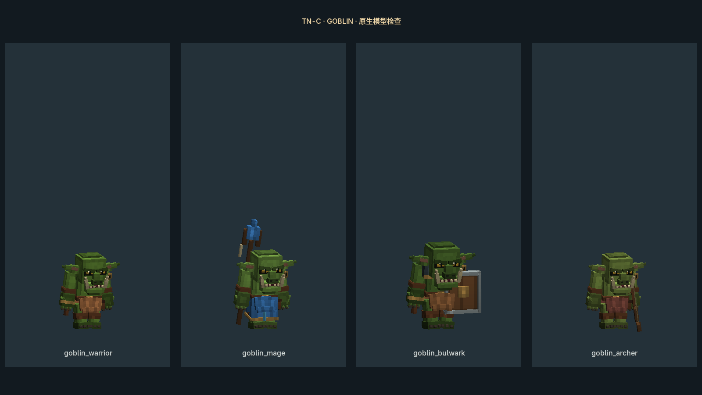
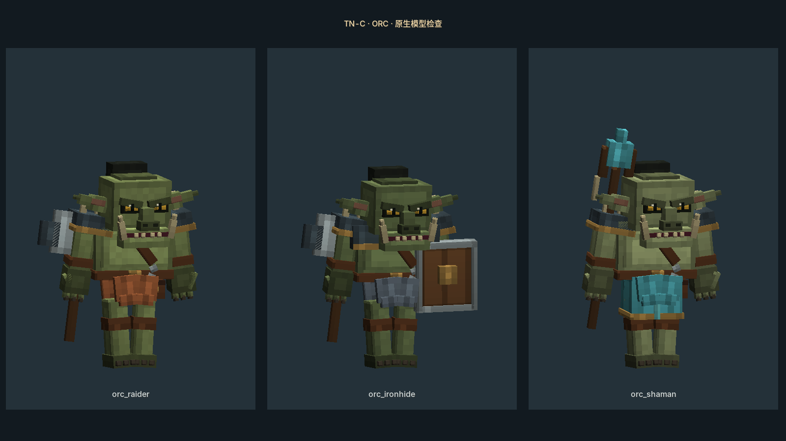
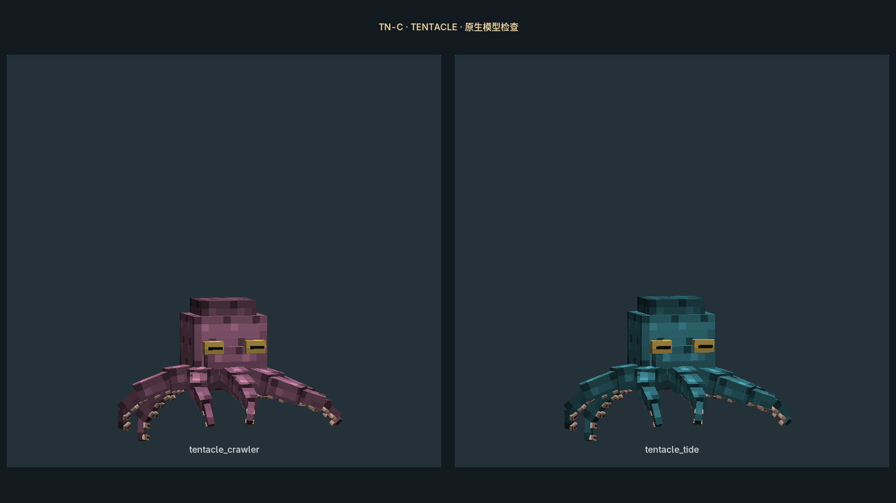
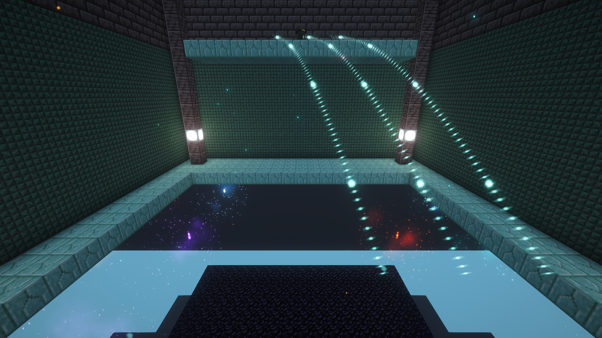

# 魔脉迷宫更新记录 · 2026-10-24

## 本轮内容

- 四地下城保留30层、每层8房、每5层存档；按领域和阶段分配23种机关奇遇，连接普通战斗房与主题通道。
- F8用于显现踏板、辨别宝箱与生态核心、观察供能、读回声及乐音、解折光和相位机关。房间保持服务器状态，每位玩家分别控制视界。
- 母巢实际生成魔物；切断供能、注入废液和制造过载会改变战斗。新增4种生态魔物，接入缩水捕捉与带回家生产。
- 28种旧魔物按10个家族重做模型、贴图和动作，附可编辑Blockbench源文件。队友另一套实体保留。
- 新增32任务章节《魔脉迷宫·双视界探险》，23项机关进度由实际完成触发。奖励支持防重复领取、离线领取和满背包后补发。

逐个房间的道具、操作、奖励及主题分配见[玩法与测试指南](魔脉迷宫玩法与测试指南-20261024.md)。独立Boss招式仍留给后续专门设计。

## 合并及验证

已合并截至 `aafa22e4` 的队友main更新，包含火山巨龟、雷霆狱链、风与水元素场地；合并提交 `f73e852b`。中英文语言文件按键合并，保留双方内容。

- 合并后414项单元测试、177项整合服务端GameTest全部通过。
- 农田流动魔力测试另有52项通过；修复了测试平台侧面进入原版水导致的误判，没有更改生产流体规则。
- 独立复核修复入口覆盖日晷门与斗场核心、多人棋盘绑定、水法重复降温、高处透镜不可达等问题。

最终本机JAR SHA256：`fa930399cce69d6814513af7c1d5ae42f7e6d408bdfceff8cf0f548c5117533f`。

完整整合包的原生客户端以开启光影、关闭光影各运行一轮，每轮60张截图，报告无捕获异常，且两轮JAR哈希均与上述最终包一致。检查包括10个旧魔物家族、4种生态魔物的4种状态及23房型的普通/F8镜头；实际FTB服务端加载了32任务的新章。固定镜头没有替代整段30层的人工游玩验收，日晷入口立墙遮住部分镜头；回声等需道具激活的完整交互由服务端用例和后续游玩共同验证。

2026-10-24 04:22 已安装到正式PCL实例 `元素觉醒1.4.3-魔改版-20260915`，并同步本地modpack镜像。只更新TN-C JAR与新章节，其余任务文件逐个哈希校验相同；未改存档。备份在仓库本机 `work/backups/leyline-20261024-042218`，安装报告为 `work/leyline-install-report.json`。

以下是最终JAR在完整整合包中的原生渲染截图。怪物图使用模型展示镜头；房间图使用隔离存档中的固定场景，不能替代整段游玩的交互验收。

## 给协作者的更新方式

关闭游戏，pull main后使用JDK17构建 `gradlew.bat jar`，再将 `build/libs/tnc-1.0.0.jar` 替换到自己PCL实例的 `mods/tnc-1.0.0.jar`。仓库的mods目录不提交这个二进制，单纯pull源码不会替换正在玩的JAR。

只将 `questbook/ftbquests/chapters/tnc_leyline_dungeons.snbt` 复制到实例的 `config/ftbquests/quests/chapters/tnc_leyline_dungeons.snbt`。不要用整份旧任务书覆盖自己修改过的章节。

管理员测试入口：`/dungeon enter desert`、`/dungeon enter crypt`、`/dungeon enter tide`、`/dungeon enter astral`。普通游玩通过野外大门进入，F8切换魔力视。
