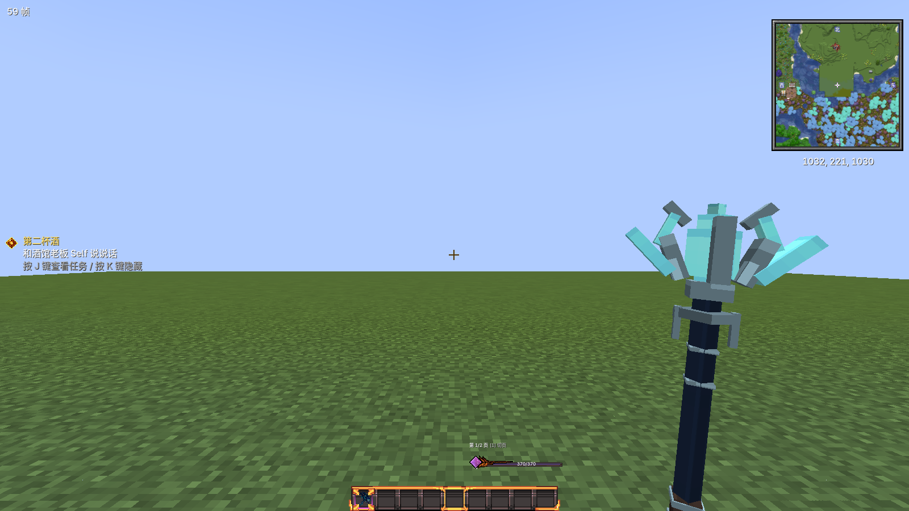
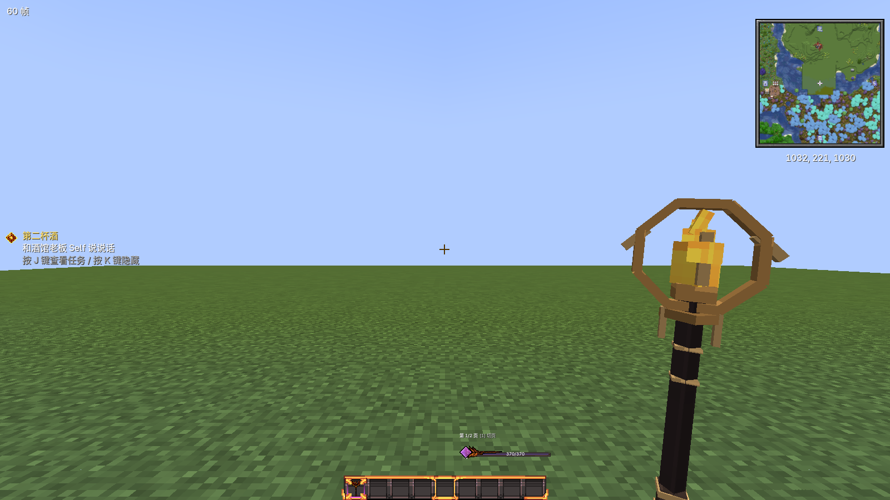
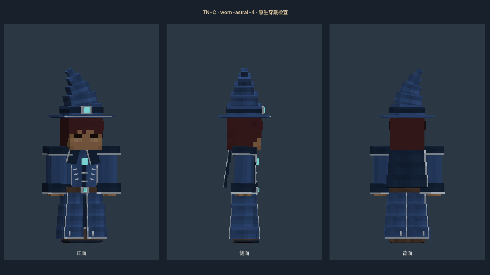
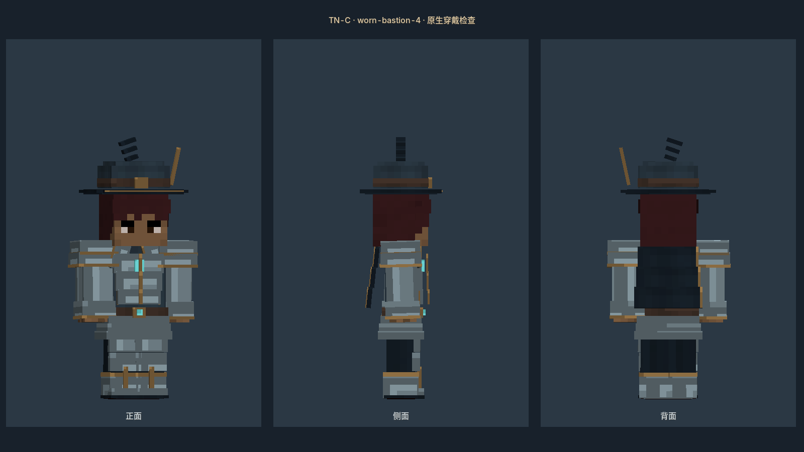
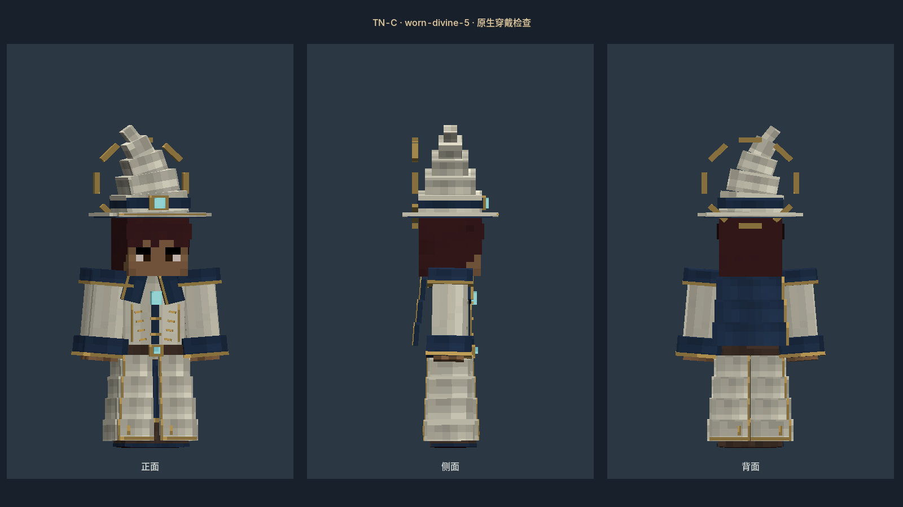
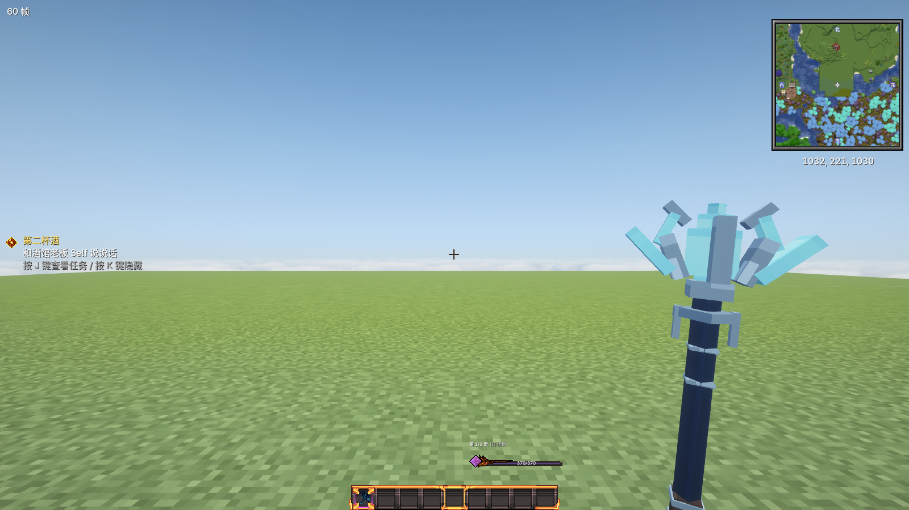

# 法杖与穿戴装备立体重做 · 2026-10-24

本轮重做实际拿在手上、穿在身上的模型。保留原有物品图标、物品ID、属性、阶级以及“帽子＋全身装”两槽系统。

## 法杖

36支法杖包含基础杖与七系五阶。每支都有独立的立体握柄、缠带、镶环、杖身与元素杖头。水系采用龙角晶簇，火系采用日轮，雷系采用分叉导体，风系采用羽刃，土系采用岩核，光系采用星芒，暗系采用钩月。最高阶另有前后层次，不靠放大一张平面图表现阶级。

第一人称改为屏幕侧边近竖直握持，降低尺寸并收直倾角。左右手分别遵循游戏的镜像规则；第三人称以握柄中心定位。物品栏和展示框继续使用原图标，手持与掉落使用立体模型。

## 穿戴装备

34件穿戴模型包含四款常规帽装各四阶，以及单独的神装帽袍。

|款式|实际穿戴结构|
|---|---|
|壁垒战甲|分层胸板、肩甲、腰甲、护胫和金属包边|
|星织长袍|交叠领襟、宽袖、分片长摆、内衬和高阶披风|
|秘纹锁甲|锁环衬料、罩衣、较短衣摆和法冠|
|远行外衣|包覆兜帽、斜跨背带、腰包、短外摆|
|归墟神装|象牙白、深蓝与旧金的独立冠袍及光环结构|

衣摆与裤腿分别建模。行走时克制摆动，潜行时对齐实际髋部并抵消躯干前倾，坐姿下前摆抬起、侧摆外让。纹理按各部件独立展开，包含布褶、缝线、包边、金属和晶体材质。

## 编辑源文件

- `model-source/equipment/wands/`：36个可直接打开的Blockbench工程。
- `model-source/equipment/armor/`：34个可直接打开的Blockbench工程。
- 每个工程内嵌真实手持/穿戴贴图，导入时同步模型与该贴图。
- 完整操作见[Blockbench编辑说明](../tools/Blockbench法杖与装备编辑说明-20261004.md)。

穿戴模型支持资源重载后清空缓存，方便以后修改。不要用旧的像素轮廓生成脚本覆盖已编辑的工程。

## 最终验证与安装

最终构建通过416项单元测试，无失败、报错或跳过；70个Blockbench工程完成往返导入验证；74张原图标保持字节一致。完整整合包无光影85个原生场景、开启Complementary Unbound r5.6.1光影85个原生场景均通过，总计170张截图。原生检查覆盖36支法杖、34件穿戴模型、最高阶副手、FOV 60/90、装备三视图、行走/潜行/坐姿以及原物品图标。

最终JAR SHA-256：`879af65b7be72202182565c154224b122dbdd12dbefad355f324fef982d1aa25`。

截图使用游戏实际的物品手持渲染、装备渲染和测试玩家。三视图由原生背包实体渲染器呈现；行走、潜行使用隔离测试玩家的移动输入，坐姿使用实际乘坐状态。此验证不等同于覆盖所有战斗动作、第三方动画包和全部光影组合。

安装只替换正式PCL实例和仓库同名镜像里的TN-C JAR，并备份旧版。存档、任务书与其他配置不在写入范围内。同伙拉取源码后仍需构建并更新自己运行实例的JAR。
