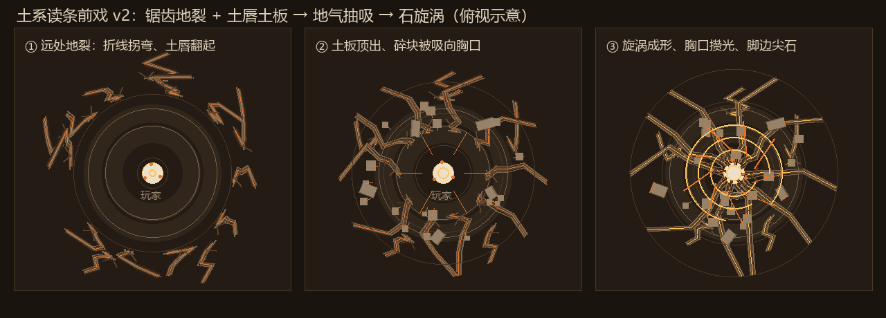

# 土系读条前戏（2026-11-06）

> 作者：「土法术的前戏你有没有想法，我想的是地面的裂纹逐渐向玩家脚下靠近然后土块土粒子从裂缝中冒出，汇聚到玩家身上形成一个漩涡然后施法，你有别的吗，你做做」
>
> 第二版反馈：「前戏的土裂缝太假了，非常的假，然后前戏也太简单了，我觉得你照着你的想法去优化一下，丰富一下，然后武器幻化当然不错，当时你好像把他拉长了，我希望保持他原有的比例，可以放大的其实」

*（上图：①远处地裂 → ②土块顶出裂缝 → ③旋涡成形、裂缝收到脚边。俯视示意，实机几何是现画的线，不是模型。）*

---

## 1. 一句话

读条期间，施法者四周的地面**被撕开**一圈放射状岩缝：每一条都是带惯性的锯齿折线，缝两侧的土被顶起来形成土唇，
缝里卡着碎石、旁边崩出小裂；缝尖一格一格爬到脚边。石头从缝里被顶起来、又被吸向胸口，半途地面压出一圈圈尘环，
身上卷起石旋涡，胸口攒着一团土光；最后 0.12 秒脚边顶出尖石，释放瞬间炸开碎石与三重尘环。

## 2. 时间轴（`ratio` 来自 `SpellCast.Process.progress()`）

土系五条链（`earth_shot` / `earth_ball` / `rock_cannon` / `ten_thousand_rocks` / `earth_god_spear`）共用一套，
按 `learn.tier` 分档。读条本身只有 **0.6 秒（12 tick）**，所以整段做得快而密，释放后再补 16 tick 的余波。

| ratio | 发生什么 |
| --- | --- |
| 0.00 | 远处裂缝出现（起点半径 `R×0.78~1.0`，`R = 4.8 + 0.85×档`，上限 9.5 格）；贴地尘雾带同时浮现 |
| 全程 | 每 12 tick 有一圈地面尘环从脚下往外推开（3 圈错相位） |
| 0 → 0.85 | 缝尖从外圈爬到脚边（加速曲线，`R×(1-0.93×reach)`，最终 ≤1.2 格）；缝越靠近脚边越宽 |
| 0.16 → 0.42 | 3~5 块土板从缝里被顶起来（高 `0.30~0.72` 格，带倾斜） |
| 0.64 → 0.94 | 土板又慢慢沉回去（`sink`），像被吸走前先塌一下 |
| 全程 | 缝里隔帧冒 `BLOCK` 土块／石块粒子；`tnc:earth_dust` 沿切线被吸向胸口 |
| 0.00 → 0.40 | 几何碎块先"顶出地面"（竖直上升 `0.35~0.9` 格） |
| 0.40 → 0.85 | 碎块被吸向胸口：位置从地面点 lerp 到绕身旋涡点（`pull = smoothstep((ratio-0.40)/0.45)`） |
| 0.00 → 1.00 | 地面法阵：1 圈（t1-2）／2 圈（t3）／3 圈（t4-5）＋ `8+3×档` 根刻度 |
| 全程 | 6 条地气从缝尖往胸口抽（短线沿连线走）；胸口土光越大越亮，3 颗火星绕着转 |
| 全程 | 石旋涡：`1/1/2/3/3` 圈倾斜石环 + `7+2×档` 条螺旋上升石屑 |
| t4 起 | 身侧 `4`（t4）／`6`（t5）块浮石随旋涡转，每块套一圈金环 |
| t5, ratio > 0.45 | 头顶凝出金色**巨枪虚影**（按原枪比例整体放大，见 §6） |
| ratio > 0.86 | 脚边 8 根尖石顶出来（`0.32~0.54` 格高） |
| 读条结束 | 释放余波 16 tick：三重尘环外扩 + 12 条放射状碎石 + 竖向余烬（t4+）+ 碎石／尘土粒子 |

## 3. 裂缝本身（第二版重做）

第一版是 4 段圆弧＋角度抖动，看着像"飘在地上的丝带"，所以整条重写：

- **折线**：每条 7 个点 / 6 段（`CRACK_POINTS = 7`）。方向不是每段独立随机，而是**带惯性的随机游走**
  （`drift = drift×0.58 + jag×0.52`）：大多时候顺着一路偏一点，偶尔一个大折角 —— 这才像地面被撕开。
- **半径**：用加速曲线 `ease = t²×(0.45+0.55t)` 往脚下收，前半段慢、后半段突然窜到脚边，缝尖是"爬"过来的。
- **缝宽**：`(0.048+0.011×档) × (1-0.70t) × (0.68+0.64×抖动)`，越靠缝尖越细，段与段之间还有粗细变化。
- **缝底**：比缝宽 1.75 倍的柔黑描一层（y 略低），先做一个"地下是空的"凹陷。
- **缝芯**：深褐 `(0.17,0.12,0.08)`，宽为缝宽。
- **土唇**：缝两侧各一条，内缘贴地（宽 `0.50w`）、外缘抬高 `0.026~0.036` 格并外扩到 `2.1w`，
  颜色比地面亮一点 —— 这是"看着不像贴纸"的关键：缝边界不再是一条线，而是一道被顶起来的土坡。
- **缝里碎石**：每条的 3 个点上半埋着小石块（不跟着旋涡走），像从地下翻出来的。
- **卫星碎纹**：主缝旁再崩 2 道很短的小裂，长度 `0.22+0.10×档`。
- **分叉**：偶数条必分叉，t4 起全部再撕一条（长度 `1.05+0.22×档`，越靠尖端越细）。
- **亮部**：只画**缝内**一条偏侧的余烬边（不是外轮廓），alpha 随读条 `0.20→0.82`；缝尖一颗余烬点。
  外轮廓描边是最像贴纸的画法，所以彻底去掉了。

## 4. 土块、土板与粒子

- **几何碎块**：每条裂缝 3 块，共 `18~48` 块；尺寸 `0.075~0.165` 格，灰褐；
  前半段从地面往上顶，后半段被旋涡拉成螺旋（半径 `2.1→0.5`，高度到胸口 `身高×0.56`）。
- **土板**（新）：从 3~5 条缝里顶起来的薄石盒（5 个面），高 `0.30~0.72` 格、带倾斜，
  0.16 起长、0.64 起塌回去；比悬空小方块更像"地真的翻了"。
- **真实粒子**：`BLOCK`（`coarse_dirt` / `stone`）隔帧从缝尖附近喷出，`0.22~0.50` 的向上初速；
  另有 `tnc:earth_dust` 沿切线被吸向胸口，`2 + 档/2` 颗/tick（`MINIMAL` 粒子设置下减到 1 颗）。
- 总量控制：每条裂缝隔帧发射（`(now + i) & 1`），所以不会变成沙尘暴；`MINIMAL` 下几何照画、粒子减半。

## 5. 石旋涡

- 圈数 `1/1/2/3/3`，半径 `(1.55 + 0.45r) × (1.15 - 0.35p)`，高度 `0.28 + 0.30r`，带 `±0.22 rad` 倾斜；
- 每圈两层：石灰色宽环（`0.016~0.024`）＋ 外侧一圈极细金线；
- 螺旋：`7+2×档` 条（9~17 条），从 `2.25→1.30` 半径、`0.18→(0.18+rise)` 高度盘旋，随进度整体收紧；
- 旋涡在 `ratio ≈ 0.85` 时最紧，正好接上释放余波。

## 6. 「还有别的吗」——第二版加厚的东西

| # | 效果 | 从哪档开始 | 为什么 |
| --- | --- | --- | --- |
| 1 | **贴地尘雾带**：两条很宽的暗环贴着地慢慢转 | t1 | 读条一开始地面就该"不干净"；这一层负责体积，不抢裂缝 |
| 2 | **地面尘环脉冲**：每 12 tick 从脚下推出去一圈 | t1 | 把"地面在被压"演出来，也给裂缝一个节奏 |
| 3 | **土板顶起再塌** | t1 | 裂缝不只是线，得有东西真的从里面出来 |
| 4 | **胸口气团**：两颗交叉圆盘＋一圈余烬＋3 颗绕转火星 | t1 | 汇聚的终点要看得见，不然"吸到身上"没有落点 |
| 5 | **地气抽吸**：6 条短线沿缝尖→胸口连线往上游 | t1 | 粒子之外再给一条"看得见的流"，方向更明确 |
| 6 | **缝缘跑金光 → 改成缝内余烬边** | t1 | 描外轮廓像贴纸；现在光从缝里透出来，缝才像"深处有热" |
| 7 | **地面法阵**：石环 + 刻度，随读条张开 | t1（圈数分档） | 给脚下一个人造物参照，旋涡才有着落点 |
| 8 | **浮石**：几块石头离地悬在身侧，随旋涡转 | t4 | 高阶要"重"；浮石是土系里最直观的"重量被抬起来" |
| 9 | **脚边尖石**：最后 0.12 顶出 8 根 | t1（随读条） | 释放前最后一下"地面反扑"，接住释放余波 |
| 10 | **土神之枪虚影**：按原枪比例整体放大，指向准星 | t5 | 呼应"土刺换巨剑"；这次只放大、不拉长 |

另外补了两个感官层：**地鸣**（t3 起，每 `12/8/5` tick 推一下镜头，`0.05+0.045×档` 度，越接近释放越密）
和**土黄尘幕**（屏幕下缘尘线 + 四周压暗，t1 很轻、t5 最重）。

### 6.1 神枪的比例（这次改对的地方）

第一版是「长度 `4.2×form` 单独涨、枪头 `0.34+0.18×form`」，form 越大越细长，所以看起来被拉长了。
现在只保留一个自由度：`length = 4.4 + 2.8×form`（4.4→7.2 格），其余全部由它按固定比例推出来：

- 半宽 = `length × 0.0669`（实测原枪模型 16 长 / 2.14 宽 → 半宽比 0.0669）
- 枪头长 = `length × 0.30`
- 枪杆半径 = `length × 0.018`

长宽比在任何 form 下都恒定，等于"把原来那把枪整体放大"。`EarthCastFxTest.spearSilhouetteKeepsItsProportionsWhenScaledUp`
就是钉这三个比例的。

## 7. 分档差异（不做"小号 t5"）

| 档 | 裂缝 | 土板 | 法阵 | 旋涡 | 浮石 | 神枪 | 地鸣 | 屏幕 |
| --- | --- | --- | --- | --- | --- | --- | --- | --- |
| t1 | 6 | 3 | 1 圈 | 1 圈 | — | — | — | 0.18 |
| t2 | 8 | 3 | 1 圈 | 1 圈 | — | — | — | 0.32 |
| t3 | 10 | 4 | 2 圈 | 2 圈 | — | — | 有 | 0.55 |
| t4 | 13 | 5 | 3 圈 | 3 圈 | 4 块 | — | 有 | 0.80 |
| t5 | 16 | 5 | 3 圈 | 3 圈 | 6 块 | 有 | 有 | 1.00 |

低阶读条短、结构少、不震屏；t5 才有浮石 + 神枪 + 满屏尘幕。

## 8. 实现位置

- `src/main/java/com/tnc/tnc/client/EarthCastFx.java`（约 1230 行）：客户端 tick／世界渲染／GUI 三段；
  只读 `SpellCast.Process.progress()`，不生成服务端实体、不改读条时长、不改伤害。
- 裂缝几何：`crackPath`（锯齿折线）、`crackWidth`（逐点收细）、`crackSegments`（缝底/缝芯/土唇 or 缝内余烬边）、
  `crackLips`、`crackBranch`；暗部薄板 `darkBox`；增料层 `dustBand` / `groundPulses` / `risingSlabs` /
  `inhaleStreaks` / `chestOrb` / `footSpikes`。所有几何都是每帧现算的四边形，没有模型、没有贴图。
- **暗部几何不能借 `WaterGeometry` 的 `quad/stroke/disk/ringColor`**：那些是给 `RenderType.lightning()`
  （`POSITION_COLOR`）写的，只填位置＋颜色；而 `LightningRenderTypes.DARK` 是 `NEW_ENTITY`，还要
  uv／overlay／light／normal，少填一个就抛 `Not filled all elements of the vertex` ——
  **真机 2026-11-06 03:41 就是这么崩的**（`crackCore → WaterGeometry.stroke → 崩`）。现在暗色这一遍
  全部走本类的 `darkVertex/darkQuad/darkStroke/darkDisk/darkRing/darkCube/darkBox`，每个顶点六件套写全；
  亮部仍用 `WaterGeometry`（加色层格式一致）。`EarthCastFxTest.darkGeometryFillsEveryVertexElement`
  用动态代理录下顶点调用序列，守住"每个 `endVertex` 之前六个元素都写了"。
- 兜底：`onRenderWorld` 外层 `try/catch(Throwable)`，画错就 `renderBroken=true` 关掉这套前戏并打一条
  `TN-C/earthfx` 错误日志 —— 几何写错最多损失特效，不会再把客户端带走。
- 另一个坑：`MultiBufferSource.immediate` 的缓冲一次只认一种渲染类型，**第二遍取 `lightning()` 之前必须先把
  `DARK` 收尾**——第一版只在"有东西要画"时才 `endBatch`，空帧会把渲染类型卡在 `DARK` 上直接抛
  `Trying to use multiple render types`。现在两遍都无条件 `endBatch`（空批次是 no-op），先用 `casts.isEmpty()`
  早退，不再进缓冲。
- 服务端一行没动：释放后的落点／伤害／音效仍是上一轮的 `EarthAttackMechanics`。

## 9. 验证

- `gradlew compileJava`：通过（`BUILD SUCCESSFUL`）。
- `EarthCastFxTest`（6 个用例）：裂缝条数随档递增、方向铺满整圈、缝尖向脚下单调收缩且最终 ≤1.2 格、
  `reach` 单调、**折线真的在拐弯且向尖端收细**、**神枪三个比例跨 form 恒定**、暗色顶点完整性回归 —— 6/6 通过。
- 全量 `gradlew test`：792 个用例，只有 1 个失败——`YanDarkSpellAudioTest.castingAnnouncesWhichSpellIsComing`，
  它断言的是队友正在改的 `YanDarkBossEntity.castRandomSpell()` 里的报点音效，**与本轮土系前戏无关**
  （单独重跑同样失败，说明是队友那侧的进行中改动，不是并发打断）。
- 概念图脚本：`tools/earth_cast_concept.py`（PIL 画的俯视三段示意图，不是截图）。
- **崩溃复盘（2026-11-06 03:41，客户端直接崩到桌面）**：`crash-2026-11-06_03.41.15-client.txt`
  `java.lang.IllegalStateException: Not filled all elements of the vertex`，
  栈顶 `WaterGeometry.vertex → quad → stroke → EarthCastFx.crackCore → ritualDark`。
  根因就是上面那条"暗部借了水的顶点写法"；03:26 队友整包构建把这段代码带进了实例，一放土法就崩。
  修完后暗色顶点六件套齐全，并加了回归测试。
- 打包（第二版）：`build/libs/tnc-1.0.0.jar`，199,057,506 字节，
  SHA-256 `CFE2B89B43906631FD3AF311F5178B9E36DBC099468D4ED694040E4328B439A8`，04:35:26 构建；
  `tools/install-to-pack.ps1` 安装到运行实例后 `identical: True`，`verify_mod_jar.ps1` 全 `[ok]`；
  `modpack` 镜像同步到同一 SHA；稳定副本 `work\tnc-earth-cast-CFE2B89B.jar`。
- 没做到的部分（照实说）：本环境没法进游戏看画面，所以"像不像"只能靠几何参数和这段文字判断。
  真机上如果还觉得假，最可能的三处是：土唇太高（`crackLips` 里的 `lift0/lift1`）、缝太宽（`crackWidth` 的
  `0.048`）、缝内余烬边太长（`crackSegments` 亮部）；如果觉得还是简单，下一步可以加"随手一拍地面抬手的动作"
  或者把读条时长从 0.6 秒提到 0.9 秒，让每一层有时间被看见。
