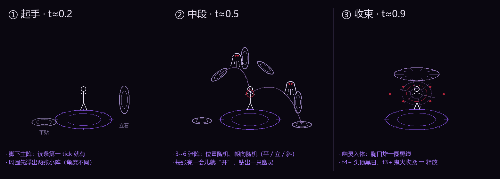

# 暗系读条前戏（2026-11-06）

> **2026-11-06 修正**：作者反馈「也可以优化一下 / 雷锲出现的太突兀」⇒ 阵改成断弧+爪痕、整体淡入、放大挪远、t4+ 阵边伸手，详见 [暗手与缠绕龙修正-20261106.md](暗手与缠绕龙修正-20261106.md) §2。

> 作者：「暗法术的前戏你有没有想法，我想的是周围随机出现不同角度的小法阵，然后跑出幽灵飞进玩家的身体，还有别的吗，你做做」

*（上图：①起手 → ②中段 → ③收束。示意图只解释思路，实机几何是现画的线，不是模型。）*

---

## 1. 一句话

读条期间在黑系施法者周围**随机浮出 3~6 张朝向各不相同的小法阵**，每张亮一会儿就"开"掉，
**线勾的幽灵**从阵心钻出来、沿弧线飞进施法者胸口；入体那一下胸口炸一圈黑线。
另外加了主阵、鬼火、黑日、地面爬线、心跳和释放墨爆 —— 让低阶也有仪式感，高阶才"满配"。

## 2. 三段式时间轴

全部由 `SpellCast.Process.progress().ratio()` 驱动（不新增服务端实体、不改读条时长）：

| ratio | 发生什么 |
| --- | --- |
| 0.00 | 脚下主阵亮起（半径 `1.55 + 档×0.38`），随进度张开、旋转加速 |
| 0.08 / 0.224 / 0.368 / 0.512 / 0.656 / 0.80 | 第 1~6 张小阵依次出现（t1~t2 只到第 3 张，t3=4、t4=5、t5=6） |
| 每张阵出生后 ~30%（最多 6 tick） | 阵心先亮一下（`darkBead` 渐亮） |
| 出生后 60% 寿命 **或** ratio > 0.88 | 阵"开"，放出一只幽灵（短读条也保证放得出来） |
| 幽灵出生 ~12~17 tick | 沿二次贝塞尔飞进胸口 → 胸口黑环爆发＋墨粒子 |
| ratio > 0.88 | 剩下的阵全部开掉（收束） |
| 读条结束 | 释放墨爆：三重黑线环外扩 ＋ 10 条放射线 ＋ 墨/烟粒子 ＋ 屏幕暗一下 |

## 3. 小法阵：位置随机、**朝向随机**

`DarkCastFx.spawnCircle()`，每张阵独立抽：

| 概率 | 朝向 | 读起来 |
| --- | --- | --- |
| 34% | 法线 `(0,1,0)` | **平贴地面**（会吸附到脚边高度） |
| 38% | 水平方向 + 随机 ±0.55 仰角 | **立着朝外**（像一扇小门） |
| 28% | 随机偏 0.5~1.2 rad | **斜着插进地里** |

位置：绕施法者 `2.15 + i×0.22` 格（t4+ ×1.12），高度 `+0.55 ~ +1.8` 随机；
半径 `0.48 + 档×0.10`。每张阵 = 外圈 28 段 ＋ 内圈 14 段 ＋ 7 根刻度（t5 的 6 张阵 ≈ 300 条弧）。

## 4. 幽灵

线勾，不用模型（和 §9 的线手、§10 的黑雾手同一套语言）：

- **兜帽** 6 段压扁圆 ＋ 两条帽边；
- **肩线** 三段（中间略塌）；
- **袍** 3 条：每条两节，往下摆开、随 `sin(time)` 轻摆；
- **手臂** 2×2 节，伸向前方（+Z）——"伸手来抓"；
- **眼** 两颗血珠（全身唯一的红）＋ 胸口一点暗光。

飞行：`from`（阵心）→ `ctrl`（中点抬高 0.55~1.3 ＋ 随机侧偏）→ `to`（胸口 `身高×0.62`），
二次贝塞尔；身后 16% 路程画一段**拖尾残影**（`darkBolt`，alpha 0.45）；
入体那一帧：胸口 `seal()` 黑环 ＋ 5 条放射线 ＋ 墨粒子。

## 5. 「还有别的吗」——额外加的六样

| # | 效果 | 从哪档开始 |
| --- | --- | --- |
| 1 | **脚下主阵**：双环反转 ＋ 刻度，读条全程在 | t1 |
| 2 | **地面爬线**：主阵边缘 6~16 条黑线往外爬再缩回 | t1 |
| 3 | **鬼火**：`3+档` 颗血珠绕身，越接近释放收得越紧（1.75→1.0 格） | t3 |
| 4 | **黑日**：头顶 0.78+0.1×档 的黑环 ＋ 8 根向内扎的尖齿，慢转 | t4 |
| 5 | **心跳**：t5 读条每 18/11/7 tick 推一下镜头 | t5 |
| 6 | **释放墨爆**：三重环＋放射线＋墨烟＋屏幕暗闪（t3+ 带震屏） | 释放时 |

屏幕：紫黑暗角（`0x06030A / 0x0B0512`）＋ 底部一条暗紫潮线，和水法的蓝、光法的过曝明确区分。

## 6. 覆盖哪些法术

按 `spell.group` 判定（和 `DarkFogMechanics`、`TNSpellClientVisuals` 同一套判据）：

`dark_hand`、`dark_sacrifice`、`dark_summon`、`dark_fog`、`dark_dragon` ✓

- **黑暗巨人**：它不走 SpellEngine，只同步 `isCasting` ⇒ 用本地计时估 `70 tick` 的进度，
  同一条仪式在 8.5 格半径上播一遍（`BOSS_CAST_TICKS` 可调）；
- **衍（`yan_dark`）**：他自己的两段式仪式（§1）**保留**，那是施法者本人的东西，
  这里补的是"读条期间身边的仪式场"，两者叠在一起正好更满 ✓；
- 其它系（雷/光/水/火/风/土）完全不受影响（`DARK_GROUPS` 之外直接 return）。

## 7. 为什么全在客户端 / 为什么用 `DARK` 层

和 `WaterCastFx`、`LightCastFx` 同一套：只读 `progress()`，**不生成服务端实体、不碰伤害**。
读条前戏是"这个人自己看到的仪式"，每个玩家各看各的（随机角度也不打架）✓；
释放后的持久法阵仍由服务端的 `TNMagicCircleEntity` 铺，别的玩家照样看得见 ✓。

幽灵是"黑芯＋血边"，必须走 `LightningRenderTypes.DARK`（普通 alpha 混合）——
`BOLT` 是加色，会把黑芯加没 ✗（和 §9/§10 同一个坑）。

## 8. 想调手感

| 想要 | 改哪 |
| --- | --- |
| 阵更多/更少 | `CastState.circlesWanted()`（t1~t2=3、t3=4、t4=5、t5=6） |
| 阵出现更早/更晚 | `update()` 里 `at = .08F + i * (.72F / wanted)` |
| 幽灵飞得更快 | `spawnGhost()` 的 `life = 12 + tier` |
| 幽灵更大/更小 | `spawnGhost()` 的 `scale = .55 + .06×tier` |
| 幽灵弧线更高 | `ctrl` 的 `+0.55~1.30` 那两项 |
| 黑日在哪一档出现 | `ritual()` 里 `if (tier >= 4)` |
| 屏幕更黑 | `blackVignette()` 的三个系数 / `onRenderGui` 的颜色 |
| 巨人读条时长估错了 | `BOSS_CAST_TICKS = 70` |

## 9. 装机

| 项 | 值 |
| --- | --- |
| JAR | 198,998,668 字节 |
| SHA-256 | `4A4CAB5C7B9BE90DF9B22C31428CD50D136319FD3CCBA7D02EC6D49799EC9E83` |
| 稳定副本 | `work/tnc-dark-cast-4A4CAB5C.jar` |
| 校验 | 装前 `java` = 0；装后回读哈希一致 ✓ |

> 累积包：§8 黑线血线、§9 线手/血线、§10 黑雾手、§11 巨人领域雾、本节的暗系读条前戏 ✓。
> **完整重启**生效。

## 10. 实机验收清单

1. 放一发 `黑夜之手`（t1）：应该看到脚下主阵 ＋ 3 张小阵（至少一张是立着的）＋ 3 只幽灵入体；
2. 放 `吞光领域`（t5）：6 张阵、鬼火绕身、头顶黑日、心跳推镜、释放墨爆；
3. 立着的阵要能看出"是一扇门"（不是贴地的圈）—— 如果全平贴了，说明 `kind` 的随机分布被打断了；
4. 幽灵入体要在**胸口**（不是头顶/脚下）；
5. 读条很短的法术也要放得出幽灵（ratio > 0.88 强制开阵那条兜底）。
