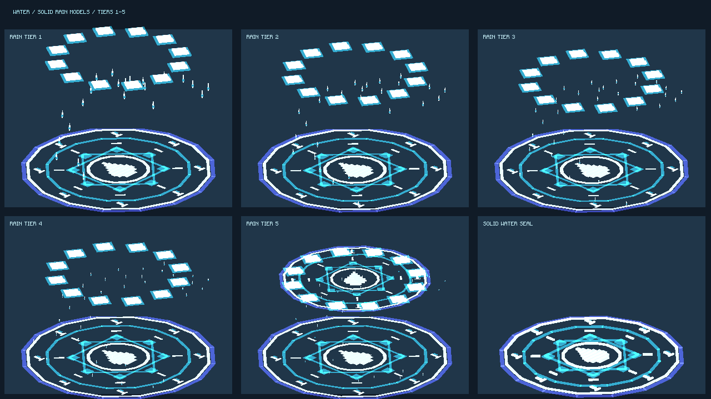
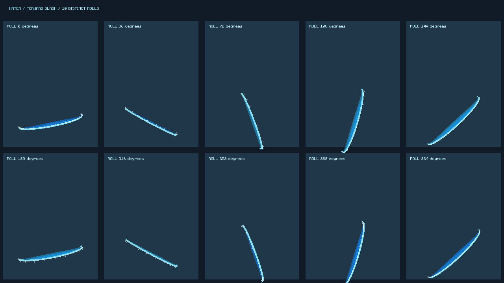

# 水法十连斩与实体法阵

## 本次表现与玩法

- 海浪斩击：释放时立即发射第 1 道，之后每 2 tick 发射 1 道，总计 10 道；控制实体 20 tick 结束。每道沿发射时的瞄准方向前进，包含上下瞄准；滚转分别为 0、36、72…324 度，飞行中保持各自角度。弧面中央凸向前方，不再向四周释放 26 道斩击。单道的伤害和 28 tick 寿命保持原值。
- 雨滴链：领域实体绘制原生烘焙模型，直接走 Minecraft 的 BakedModel；不调用 Spell Engine 的模型渲染接口。雨滴、上层雨冠和地面法阵都有模型厚度与贴图。雨滴模型使用发光材质，模型附近生成 GLOW 粒子，地面保留水花与治疗反馈。
- 水系法阵：共同入口替换为新的海蓝、青色、白色实体模型，包含多层环、八角纹样、刻纹和中央水滴。水球链使用朝向施法方向的阵，水缚链各档使用地面阵，海啸和灭世之海保留脚下阵；海浪斩击加入手前阵；雨滴链全部档位有与领域同尺度的地面阵，天洪另有上层阵。

模型文件：`src/main/resources/assets/tnc/models/water/`。生成器：`tools/gen_water_solid_models.py`。主渲染入口：`WaterSolidModels`、`WaterRainVisuals`。这些是实体上的模型表现，不往存档里放置永久方块。

## 验证与性能预算

- 朝向、十连斩节奏、雨滴范围和已有几何预算：14 个 JUnit 测试通过。
- 实际开发客户端：5 档雨滴链、3 个模型、10 种斩击角度均已绘制，2 张截图，失败列表为空。追加复测确认模型发光层可见，无紫黑材质。
- 全套 GameTest：268 个完成，267 个通过；唯一失败是此前已有的夜葫芦遮阴种植测试，水法测试均通过。未以此宣称整个项目全绿。
- 每个领域近处最多 46 个雨滴模型，远处最多 22 个；不会为每滴雨新建服务端实体、发网络包。雨冠 36 个方块模型元素，法阵 120 个元素。实机整合包的帧率仍需玩家复测。

## 装机

已安装至 PCL2 元素觉醒实例。实例原 jar 于 2026-10-12 更新，因此以该最新 jar 为基底，仅替换水法范围内的代码和新模型：实际变动 16 个条目，其余 15,394 个条目逐字节一致。没有替换材质包或用户存档。

安装 SHA256：`88b6a8de4d16fcefcc79eba8d99f3e09fee0599f6e74484ec21670646c947210`。

本机备份：`work/water-model-rework-20261013/tnc-before-water-update.jar`；安装及逐项验证记录在同目录的 `install-receipt.json`、`package-receipt.json`；客户端记录为 `client-validation.json`。复现选择性打包使用 `tools/prepare_water_model_update.py`，会拒绝改写原包、覆盖现有输出、签名包或准备期间已经变化的基底。
