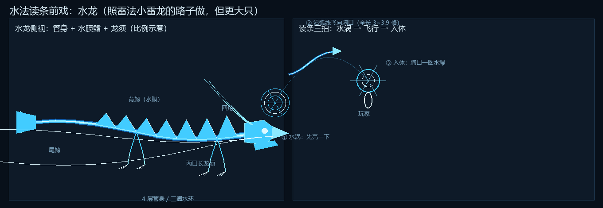

# 水法读条前戏：水龙（2026-11-06）

> 作者：「弄完你去抄一下雷法新做的雷龙，抄一下，做一个水龙出来，要比较大只的水龙」

*（上图：左＝水龙的部件与比例示意；右＝读条三拍：水涡 → 沿弧线飞进胸口 → 入体水爆。示意图，实机是即时几何。）*

---

## 1. 一句话

水法读条时，施法者周围的地面会先亮起一口小小的**水涡**，一条**水龙**从涡心窜出来，沿弧线飞进施法者胸口，
入体那一下炸一圈水；档位越高放得越多、越大。抄的是雷法新做的小雷龙那套「小法阵 → 龙 → 入体」的节奏，
换成了水的身子和更大的体型。

## 2. 抄了什么、没抄什么

| 项 | 雷法小雷龙（`LightningCastFx.smallDragon`） | 水龙（`WaterDragonFx`） |
| --- | --- | --- |
| 出场 | 每张小雷阵亮一会儿就"开"，一条龙从阵心窜出 | 读条跨过阈值就亮一口水涡，龙从涡心窜出 |
| 飞行 | 二次贝塞尔，弧线飞进胸口 | 同一套贝塞尔，弧线飞进胸口（控制点更高） |
| 入体 | 胸口爆闪 + 6 条放射电弧 | 胸口一圈水爆 + 6 道水花 |
| 触发 | 每张阵 55% 寿命；t4+ 一张阵放两条 | t1~t3 一条（34%）、t4 两条（34%/64%）、t5 三条（22%/46%/70%） |
| 画法 | 电弧**线勾**（`LightningBoltGeometry`，加色） | **圆管**建模（`WaterGeometry.tube`，四层叠加，加色） |
| 尺寸 | `scale = .28 + .025×档` ⇒ 全长约 0.75 格 | `scale = 1.08 + .08×档` ⇒ 全长 **3.0~3.9 格**（4~5 倍） |
| 颜色 | 金／蓝／紫三主题，白芯 | 深蓝外辉光 → 青 → 浅青 → 浪白芯 |

**没抄**的：雷龙身上的电弧套、电光闪烁、雷声。水龙用「水管 + 水膜鳍 + 水珠 + 三圈水环」代替，
因为直接把电弧画成蓝色只会像"蓝色的雷"，不像水。

## 3. 水龙长什么样（`WaterDragonFx.dragonGeometry`）

- **脊干 12 节**：每节 4 层圆管（半径 `0.150→0.088` 递减，乘体型）
  外层深蓝 α .07（宽×2.25）→ 青 α .16（×1.55）→ 浅青 α .28（×1.0）→ 浪白芯 α .60（×0.42）。
  四层在加色混合下自然形成"白芯 + 彩色光晕 + 半透明边缘"，远看是一管发光的水，不是一根线。
- **游动**：每节位置带 `sin(age×0.55 − t×4.6)` 的横向摆动和竖向起伏，头和尾相位不同 ⇒ 整条龙在扭。
- **背鳍 7 片**：半透明水膜（α .14）＋ 每片一条亮脊线（α .28），鳍尖再连一条浪白边。
- **尾鳍**：5 根扇骨 + 一片水膜，尾尖一颗更亮的珠子。
- **头**：颅、吻、可张合的下颚（角度 `0.10 + 0.07·sin(age×0.5)`）、两对眉骨、
  一对朝外的眼（青底 α .30 + 浪白芯 α .85）、**两对四支角**（各 5 节锥形管，逐节摆）、
  **两口 14 节长龙须**（不同相位，往后飘）、上下各 4 颗牙、每侧 3 片鳃鳍（α .12 水膜）。
- **四条腿**：两段 ＋ 每足 3 根白爪（收在肚子下面，飞行姿势）。
- **水环**：身上套 3 圈垂直于脊线的细环（α .16），＋ 4 颗绕身浮动的**水珠**（`droplet`）。

## 4. 出场与飞行

| 阶段 | 时长 | 内容 |
| --- | --- | --- |
| 水涡 | 出生后 9 tick | 地面双环（半径 `0.55×体型` 张开）＋ 6 条旋转吸水臂 ＋ 4 条小水柱 |
| 飞行 | 17~22 tick | 沿贝塞尔从水涡（玩家周围 `3.2~5.4` 格）经一个高于两端的控制点飞进胸口（`身高×0.62`） |
| 入体 | 14 tick | 胸口两圈扩散水环 ＋ 6 道水花；t4+ 额外推一下镜头（`.10+.02×档` 度） |
| 拖尾 | 全程 | 每 tick 2 颗 `SPLASH`/`BUBBLE`，沿脊线后方偏移甩出 |

出生 8% 淡入、最后 30% 淡出（`fade()`）⇒ 不会硬生生出现/消失。

## 5. 体型（作者要"比较大只"）

| 档 | 体型 `scale` | 全长（格） | 每条读条放几条 |
| --- | --- | --- | --- |
| t1 | 1.08 | 3.02 | 1 |
| t2 | 1.16 | 3.25 | 1 |
| t3 | 1.24 | 3.47 | 1 |
| t4 | 1.32 | 3.70 | 2 |
| t5 | 1.40 | 3.92 | 3 |

全长只有一个自由度：`length = 2.8 × scale`（`WaterDragonFx.lengthFor`）。
所有部件都以 `scale` 乘出来，**不存在"只拉长不放大"**——上一把土神枪就是被那样拉长过，这次用测试钉住了
（`WaterDragonFxTest.waterDragonIsBiggerThanTheLightningWindupDragon` / `scaleGrowsWithTierAndLengthIsOneUniformScale`）。

## 6. 实现位置与技术路线

- `src/main/java/com/tnc/tnc/client/WaterDragonFx.java`（新，约 700 行）：客户端 tick ＋ `AFTER_WEATHER` 世界渲染。
  只读 `SpellCast.Process.progress()`，**不生成服务端实体、不改读条时长、不改伤害、不写方块**；
  其他玩家各自本地算，所以联机时每个人都能看到同样的水龙（不需要网络包）。
- 和水法前戏（`WaterCastFx`）**同一个渲染阶段、同一层缓冲类型**：`AFTER_WEATHER` + `RenderType.lightning()`。
  > 为什么不是实体渲染阶段：`RenderType.lightning()` 输出到 `WEATHER_TARGET`，天气缓冲合成之后再画就等于没画
  > （雷系踩过这个坑，见 `LightningRenderTypes` 注释）。`AFTER_WEATHER` 阶段天气缓冲还没合成，所以能看见。
- 几何全部是即时生成的四边形（`WaterGeometry.tube/quad/disk/ringColor/droplet`，包内可见 ⇒ 同包直接调），
  不读模型、不读贴图，顶点只写位置＋颜色（`POSITION_COLOR`）。
- 读条扫描带兜底：`spell_engine` 不在 → 直接 idle 并打一条日志；扫描抛异常 → 永久关掉这套并打
  `TN-C/waterdragon` 警告；渲染抛 `Throwable` → `renderBroken` 关掉，不会再把客户端带走。

## 7. 验证

- `gradlew test --tests com.tnc.tnc.client.WaterDragonFxTest`：**4/4 通过**
  （比小雷龙大 3.5 倍以上、体型/全长单调且比例恒定、每档至少一条且阈值有序递增、
  贝塞尔两端点正好是出生点与胸口、寿命在 17~26 tick 内）。
- `EarthCastFxTest` 同轮重跑：**6/6 通过**（土系前戏没有回归）。
- 全量 `gradlew test`：队友正在改 `TNWaterSpellEntity` / `DragonRoarCombo`（水法龙吼连招），
  整包 `compileJava` 在那两个文件里有他们**进行中**的语法错误（`变量已定义`、`LivingEntity→ServerPlayer`），
  与本轮新增文件无关；等他们提交后再跑全量。
- 装机：本轮打包 `build/libs/tnc-1.0.0.jar`，199,107,200 字节，
  SHA-256 `429215CBB7EC0495991E63249553673405F874C2A3502960B779137D4F5B7931`，04:54:48 构建；
  稳定副本 `work\tnc-water-dragon-429215CB.jar`。构建时游戏与队友的 Gradle 进程还在跑，第一次
  `install-to-pack.ps1` **拒绝覆盖**（不会去动正在用的 JAR）；改用 `-Wait` 挂后台等进程退出，
  04:5x 自动装入：实例副本与构建产物**同一个 SHA**，`verify_mod_jar.ps1` 全 `[ok]`
  （`installed copy is identical to the build output` / `mod jar verification passed`），
  `modpack` 镜像也已同步到同一 SHA。**需要完全退出游戏再启动**才会加载这版。

> ⚠️ 本轮打包过程：`assemble` 第一次编译失败不是我的文件 —— `TNWaterSpellEntity.java:233`（重复定义）
> 和 `DragonRoarCombo.java:10`（类型不匹配）都是队友 4:48~4:50 的进行中改动。我没有动他们的文件，
> 等他们修好后重新构建再装机。

## 8. 真机上怎么确认 / 怎么调

1. 放任意水法（推荐 t5「龙滅」，读条长、能放三条）：地面先亮水涡 → 龙窜出来 → 飞进胸口 → 胸口水爆。
2. 想更大：`scaleFor` 的 `1.08 + .08×档`（改第一个数改底噪，第二个改档位间差异）；
   想更长但更细：单独改 `lengthFor` 的 `2.8` —— **但那会破坏"整体缩放"**，测试会跟着红，别单改。
3. 龙太多/太少：`spawnCountFor`；出现得太晚：`spawnRatioFor` 的 `base`。
4. 太亮/太淡：`dragonGeometry` 里四层管的 α（`.07/.16/.28/.60`）；只想让它"更水"一点，
   先降最外层的深蓝、加 `C_R/C_G/C_B` 的青色比例。

**没做到的部分**：本环境进不了游戏，所以"像不像水龙、大小合不合适"只能靠几何参数和这张示意图判断；
真机第一次看到时最可能要调的是体型（`scaleFor`）和龙须长度（`whisker` 的 `.30/.55`）——太长的须会像两条线。
