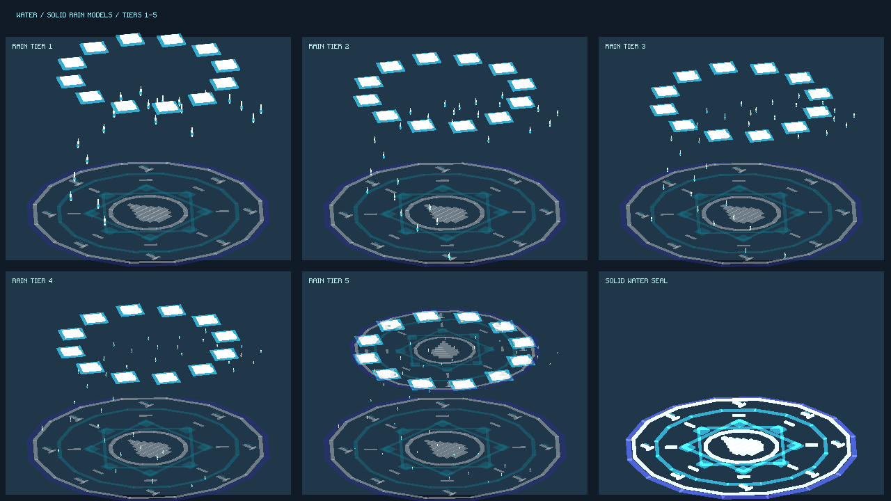
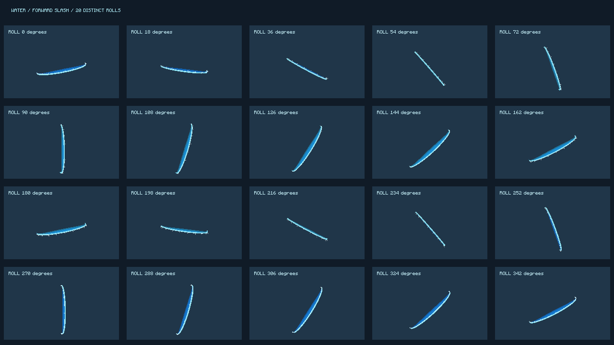

# 水牢固定、20 连斩与透明雨阵

- 水缚系牢笼固定在施法位置，不再跟随目标坐标更新。对实际身高低于 4 格的敌人记录原地位置；瞄准目标在施法时立即锁定，范围内其他敌人在进入领域时锁定。每个世界 tick 结束后复位受击/跳跃位移、清除运动速度并停止寻路。4 格及以上敌人不会获得位置锁定或束缚减速，原伤害效果保持。
- 束缚不关闭敌人 AI；法术消失立即释放，目标死亡或变为不符合身高条件时清理，世界卸载时移除缓存。短租约和 UUID/位置记录不持有实体或世界的强引用。
- 海浪斩击立即射出第 1 道，随后每 tick 一道，约 1 秒射完 20 道；滚转为 0、18、36…342 度。弧面朝向发射前方，单道伤害与寿命保持。
- 雨滴链地面法阵和天洪上层法阵设为 **75% 透明、25% 不透明**。顶点 alpha 为 `.25`，使用带贴图的自发光 alpha 混合渲染层；雨滴模型和粒子的亮度保持。

## 验证

5 个相关 JUnit 测试通过，覆盖 20 道不同角度、发射节奏、严格 4 格边界、透明度参数和雨滴范围。服务器 GameTest 覆盖受击位移复位、巨大敌人免位置锁定、移除牢笼即释放，以及施法后首次领域 tick 前的即时锁定。完整测试唯一已知失败仍为夜葫芦遮阴种植案例；水法案例通过。

实际开发客户端完成 5 档雨滴、20 种斩击角度和透明阵显示验证，失败列表为空。开发客户端截图证明模型及透明效果，不代替整合包帧率测量。

## 装机方式

以实例最新 TN-C jar 为基底，仅更新水法条目，逐项校验其余条目字节不变；既有资源包、用户存档和其他专题更新保持。备份、候选 jar、哈希与逐项校验记录在 `work/water-restraint-update-20261013/`，最终版本记录为 `package-receipt-final.json` 与 `install-receipt-final.json`。
