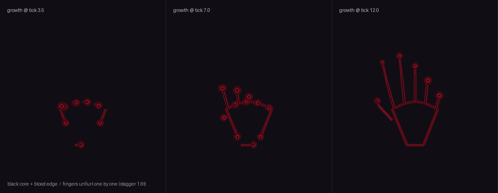

# 衍 boss 施法前戏与暗系法阵（2026-11-05 第四批）

> 作者原话：「同样的，我希望你优化一下衍boss的施法，但是有点区别就是，衍是有黑暗元素的，
> 所以你懂吧，但是不要雷锲」

结果：黑暗衍（`tnc:yan_dark`，公孙衍）的四个技能全部改成**两段式**——
先在落点铺一圈**暗系仪式阵**（黑心 ＋ 往里勾的影子爪 ＋ 黑雾），前戏走完才真正放招；
**没有雷锲、没有雷网、没有任何 ThunderSeal 实体** ✓。

---

## 1. 老问题：出手没有前戏

`YanDarkBossEntity.castRandomSpell()` 以前是"冷却一到 → 一声 `WITHER_SHOOT` → **同一 tick** 技能落地" ✗。
玩家唯一的预警是声音，画面上的阵是**伤害已经结算之后**才铺的（天打五雷轰那条），
所以观感是"凭空挨打"，不是"他在憋大招"。

## 2. 新流程：前戏 → 出手

```
castCooldown 到 0
  └─ castRandomSpell()
       ├─ 触发施法动作 playmagic_1/2
       └─ beginDarkRitual(kind)
            ├─ 主阵：立刻出现在**落点**（这就是报点）
            ├─ 卫星 j 阵：按 DarkRitualSequence.ignitionTick 一颗颗点亮
            ├─ 门环：按 gateTick 一道道立起来（面朝阵心）
            ├─ 出手前 6 tick：黑雾炸开
            └─ pendingTicks = telegraphTicks(rite)
aiStep() 每 tick
  └─ pendingKind >= 0 ⇒ getNavigation().stop()（站定蓄力）⇒ 倒计时归零 ⇒ executeDarkRitual(kind) ⇒ 真放招
```

- 蓄力期间 boss **不走位**（`navigation().stop()`），也**不会插别的技能**（提前 return ✓）；
- 阵铺在**目标脚下**（移位那档铺在自己脚下，代表"他要走"✓），玩家一眼看出"这招要砸这里" ✓；
- 前戏里的阵、雾、门环**都只是表现**，伤害仍然只在 `castStorm / castHeavenlyThunder / castGodDescent` 里结算 ✓。

## 3. 四档仪式（`DarkRitualSequence`，纯数值、不碰 MC）

| 档 | 技能 | 前戏 | 主阵半径 | 样式 | 小阵 | 门环 | 前戏雾 |
| --- | --- | --- | --- | --- | --- | --- | --- |
| `WHISPER` 低语 | 闪电移位 | 18 tick | 7 格 | 13 低阶 | 2 | 0 | 26 颗 |
| `VEIL` 幕 | 雷暴 | 24 tick | 10 格 | 13 低阶 | 3 | 2 | 42 颗 |
| `ECLIPSE` 蚀 | 天打五雷轰 | 32 tick | 13 格 | 14 高阶 | 5 | 3 | 64 颗 |
| `SOVEREIGN` 君临 | 神在投篮 | 42 tick | 17 格 | 14 高阶 | 7 | 5 | 90 颗 |

- 小阵在第 10%～55% 的前戏里依次点亮，门环在 45%～85% 里依次立起；
- 阵的总寿命 = 前戏 ＋ 40 tick（出手后还留一会儿才散 ✓）；
- 卫星轨道 0.40R / 0.72R 交替、角度按黄金角散开，每次都不完全一样 ✓。

## 4. 暗系阵长什么样（`DarkSealRenderer`，样式 13 / 14）

和光系"日轮"、雷系"霆狱"都不一样，暗系要的是**"地上开了一个口子"**：

| 元素 | 画法 |
| --- | --- |
| 底图 | `dark_circle.png`（暗紫符文盘，反向旋转，和光/雷正转相反 ✓） |
| 黑心 | `black_circle.png` 压在阵心（0.62R、α 0.55）⇒ 一潭不反光的黑 ✓ |
| 主环 / 内环 | 24～30 段 / 18 段短雷几何，暗紫（`LightningTheme.DARK`），内外环反向转 |
| 勾爪 | 6（低阶）/ 12（高阶）道**两折**的爪：外段暗紫粗、内段亮紫细，末端随 `pull` 往中心拉 ✓ |
| 外环（仅高阶） | 1.14R 环 ＋ 20 道刻痕 |
| 内拉弧（仅高阶） | 8 道从主环往中心的弧，和 `pull` 同拍（像在吸东西 ✓） |
| 阵心 | 一只暗核 ＋ 一点亮紫芯（"眼"✓） |

> 配色只用暗紫 ＋ 亮紫两档，**不做金色/蓝色** —— 那是雷法/光法的记号 ✗。

## 5. 明确没有的东西（作者要求）

- **没有雷锲**：不生成 `ThunderSealEntity`，没有 4 格禁锢、没有雷索、没有"钉住"逻辑 ✓；
- **没有雷网**：不用 `STYLE_LIGHTNING`（7 号，那套铺地网）；天打五雷轰里原来那张旧雷阵已删，
  改由前戏的暗阵承担 ✓；
- 没有新增伤害/数值改动：五个技能的伤害、半径、球速、天气全部维持原样 ✓。

## 6. 装机

| 项 | 值 |
| --- | --- |
| 大小 | 198,627,812 字节 |
| SHA-256 | `472A07431D6BC0B67C33E5A0337D2B39D0370F4598120D8A6429B3EC45C32D85` |
| 装机时间 | 2026-11-06 00:03 |
| 稳定副本 | `work/tnc-dark-ritual-472A0743.jar` |
| 构建 | `gradlew build -x test --offline --no-daemon`（隔离 buildDir，见雷电文档 §7） |

> 必须**完整重启游戏**才生效。旧存档不用重建；boss 是普通实体，不会因为这次改动卡住 ✓。

## 7. 验收清单（待实机）

- [ ] 衍放技能前，**目标脚下先亮一个暗紫阵**，Bos 站定不动、做出施法动作
- [ ] 前戏里小阵一颗颗亮、门环一道道立，越大的招前戏越长（18/24/32/42 tick）
- [ ] 隐身/背对时也能从声音分辨：蓄能是低沉 `WITHER_SHOOT`，落点是 `SOUL_ESCAPE`，出手才是各技能的报点声
- [ ] 阵是"黑心 ＋ 勾爪 ＋ 黑雾"，不是雷网的蛛网感，也不是光法的白金光
- [ ] 完全没有雷锲（地上没有雷楔、敌人不会被定身）
- [ ] 打二阶段（「· 神降」）时前戏照常，且不会和登神光环打架

---

## 8. 顺着的思路：横着来的闪电 ＝ 黑线 ＋ 血线

作者 2026-11-05：「其实闪电要是横着来是不是就是黑线和血线了，你觉得呢」——**是**，而且这正是暗系最该用的记号。
理由很直白：竖着从天上劈下来的叫"雷"，玩家对它的期待是**白芯亮边**；
而横着慢慢游过去的一条，读起来就是"某种黑红色的东西在爬/在流血"，天然属于暗魔法。

### 8.1 做了什么

| 改动 | 位置 | 说明 |
| --- | --- | --- |
| 新增 `LightningRenderTypes.DARK` | `client/lightning/` | **普通 alpha 混合**（`SRC_ALPHA, ONE_MINUS_SRC_ALPHA`）。黑线必须靠"遮住"画面才叫黑 —— 加色层里黑色等于没画 ✗ |
| 新增 `darkBolt` / `darkArc` / `darkRing` | `LightningBoltGeometry` | 四层：**血雾**（宽/极暗）→ **血线**（暗红）→ **黑芯**（细/几乎纯黑/高 alpha）→ 一线血高光 |
| 暗系电弧改画黑线 | `TNLightningArcRenderer` | `theme == DARK` 时不再画白芯电弧；命中落点从"雷网 + 地光"换成**两圈往回收的黑线环** ✓ |
| 黑阵上方加"游动的线" | `DarkSealRenderer` | 低阶 3 条 / 高阶 5 条，从阵心甩到环外、边转边起伏 —— 阵像被几根线吊着/缠着 ✓ |

配色只两档：**黑**（0.015, 0.010, 0.030）＋ **血**（0.62, 0.03, 0.07），血雾再压暗一档。
不做亮红（夜里像火法 ✗），不做纯黑线（没有血边会在暗处糊成剪影 ✗）。

### 8.2 会影响哪些东西

- 黑暗衍前戏里的门环/勾爪/阵心都照旧（那是"阵"）；
- 所有 **`LightningTheme.DARK` 的电弧**（boss 的法术连线、雷锲 t5 的雷索、登神 t5 的暗紫电弧）现在都是黑线血线 ✓；
- **竖着劈的落雷不换**：那些走 `asDark()` 的暗色模型（`flash_dark` / `lightingball_dark` / `god_dark`），
  是"暗系落雷"的既有观感，和横着的线正好分工 ✓。

### 8.3 装机（含黑线/血线这一版）

| 项 | 值 |
| --- | --- |
| 大小 | 198,629,350 字节 |
| SHA-256 | `6B26C831C6820F7EEA9970EB1D6B290066D7EC293AA5A54F8E6BC54F3E163303` |
| 装机时间 | 2026-11-06 00:12 |
| 稳定副本 | `work/tnc-dark-lines-6B26C831.jar` |
| 校验 | 装前 `java` = 0；装后回读哈希一致；`javap` 确认 `LightningRenderTypes.DARK`、`darkBolt/darkArc/darkRing` 在包里 ✓ |

> 这份也包含 §2–§7 的全部内容（`DarkSealRenderer` / `DarkRitualSequence` / boss 两段式施法），
> 以及上一版（`472A0743`）的全部改动 ⇒ 直接覆盖即可，不需要回退 ✓。

---

## 9. 暗魔法"线化"：去掉手模型，改成黑线勾的手 ＋ 一节一节的血线

作者 2026-11-05：
- 「那你去优化暗魔法试试，然后那个手模型可以去掉我觉得，我比较想是就是我们的这个黑线简单勾勒一个手，
  你有看过超凡蜘蛛侠2吗，就是最后钟楼蜘蛛侠为了救格温伸出蛛丝，那个蛛丝的顶端展开五根线，像手一样」
- 「献祭的血线也是同理」
- 「不过我不希望像雷电一样瞬间就过去，你可以一节一节过去」

### 9.1 生长：`growth`（0..1）

`LightningBoltGeometry.darkBolt / darkArc` 各加了一个 `growth` 重载：
按<b>弧长比例</b>把折线剪短（最后一点是插值出来的），线头再点一颗 `darkBead`（黑芯＋血边的"血珠"）⇒
**看得出这条线正在往前爬**，而不是"啪"一声整条出现 ✓。

### 9.2 黑手：`NightHand` 不再用模型

`TNNightGripRenderer` 里原来那次 `CustomModels.render(DARK_HAND)` **删掉**，改成 `renderLineHand()`：

| 部件 | 画法 |
| --- | --- |
| 指根弧 | 5 段 `darkArc` 连成掌心上缘 |
| 掌缘 ×2 ＋ 腕口 | 3 段 `darkArc`，收到手腕 |
| 五指 | 每根 **两节**（掌→中节→指尖），`darkArc` 各一段；指尖一颗血珠 |
| 拇指 | 从掌侧斜挑出去的两节 |
| 背上的索 | 从施法者后背到手腕的 `darkBolt`，也按 growth 爬过来 |

- 五根手指**错开 1.6 tick** 起长、每根 8 tick 长完 ⇒ 指尖像蛛丝末端那样"唰"地展开五根 ✓
  （就是《超凡蜘蛛侠 2》钟楼那一下的读感）。


- 坐标：手腕在原点、手指朝 +Y、掌心朝 +Z；原来"补引擎 −0.5、抬半高"的平移都删了 ✓
  （天降那支仍补 0.5 居中）。
- 相机量用**位姿矩阵求逆**（`inv · (0,0,0)`）拿 ⇒ 不管外面转多少度、缩多少倍，线永远正对相机 ✓。

### 9.3 献祭血线：`DarkSiphonRenderer`

从"一根实心管 `NightHandGeometry.tube`"换成：

- 第 i 条线晚 `STAGGER = 2` tick 出发 ⇒ 多条血线是**一串一串**铺过去的，不是同时出现 ✓；
- 每条线 `GROW_TICKS = 14` tick 从受害者长到施法者，线头带血珠；
- 长满后，`DarkSiphonRules.BEADS` 颗血珠沿 `flow()` 往施法者那边**流** ⇒ "血被抽走了" ✓；
- 粗细/透明度：`0.030 + tier × 0.006`，暗黑巨人 ×10（Boss 那条更粗），粗了自动降 alpha，免得 t5 像一堵墙 ✗。

### 9.4 想调手感时的旋钮

| 想要 | 改哪 |
| --- | --- |
| 手指伸得更"一根根" | `FINGER_STAGGER` 1.6 → 3 |
| 手指伸得更快/更慢 | `FINGER_GROW` 8 → 5 / 12 |
| 血线长过去更快 | `DarkSiphonRenderer.GROW_TICKS` 14 → 8 |
| 血线更"一串串" | `STAGGER` 2 → 4 |
| 血珠更多/更少 | `DarkSiphonRules.BEADS` 8 |
| 更黑 / 更红 | `LightningBoltGeometry.DARK_CORE` / `BLOOD` |

### 9.5 装机（线化这一版）

| 项 | 值 |
| --- | --- |
| 大小 | 198,637,798 字节 |
| SHA-256 | `4E61F15DE5AD6DE37F3F7D92516241B559E36344CB50911B82D68BC860CBD71E` |
| 稳定副本 | `work/tnc-line-hand-4E61F15D.jar` |
| 校验 | 装前 `java` = 0；装后回读哈希一致 ✓ |

> ⚠️ 飞出去那一下（投射物还在天上飞）仍走引擎的 `dark_hand` 模型 —— 那一段是引擎实体，
> 本仓库换渲染器要改引擎的 `SpellProjectile` 渲染，风险大；但它在空中只有零点几秒，
> 真正"看得久"的是抓住之后这只手，那一只已经是黑线了 ✓。

---

## 10. 黑雾：中心冒出手，把敌人抓紧雾里

作者 2026-11-05：「黑雾加一点那个就是，中心是不是会冒出手，把敌人抓紧黑雾之中」

### 10.1 视觉：`DarkMistRenderer` + `DarkHandLines`

- 手本体抽成 **`client/DarkHandLines.java`**：黑手（`TNNightGripRenderer`）和黑雾里的手共用
  **同一份骨架**，否则会像两种东西 ✗。
- 雾心冒出 **3 只**无主之手（domain 大雾只留 2 只）：错开时间、从地下 `-0.55` 升起，
  `clench` 在 0.06–0.3 之间"呼吸"；
- 雾里的敌人（最多 **4 个**，按距离取近的）身上各抓 **一只**：
  - 手腕在目标脚下 `-0.72`，手指朝上、朝雾心倾 14°——"伸手过来把他兜住"；
  - `clench ≈ 0.82–0.96` 脉动 ⇒ 五指在收拢（抓住），不是张开摆着；
  - **手臂**：从雾心 `(0,0.3,0)` 到手腕的一条 `darkBolt`，`g > 0.45` 才开始长 ⇒ 一节一节接上 ✓；
  - 距离衰减 `nearFade`：48 格外淡到 0，免得远处看着像穿墙 ✗。

### 10.2 为什么单独开一层 `DARK_OVERLAY`（不测深度）

黑雾的雾片是 `entityTranslucent`、**会写深度**，而雾心正好被好几张雾片盖着 ⇒
用普通的 `DARK` 画出来的手会被整片雾挡没 ✗（作者要的就是"从雾里冒出来"）。
所以给雾中手单独一层 `DARK_OVERLAY`：其余参数和 `DARK` 一样，只把深度测试关掉，
再用 alpha 距离衰减兜住"穿墙"的问题 ✓。

### 10.3 手感：`DarkFogCloudEntity.gripIntruders()`

每 `GRIP_INTERVAL = 6` tick：

| 效果 | 数值 |
| --- | --- |
| 往雾心拽 | 水平推力 `0.10 × min(1, 距离/半径)`，`hurtMarked` 让服务端把速度同步给客户端 ⇒ 玩家也会被拽 ✓ |
| 重减速 | `MOVEMENT_SLOWDOWN` 40 tick、等级 `min(4, 档位)`，持续刷新 ⇒ 走不出去 ✓ |
| 压跳 | 向上速度砍到 35% ⇒ 跳不出雾 ✓ |

不拽施法者本人和队友（`isAlliedTo`），不锁 AI —— 敌人被按在雾里，但**还能还手** ✓。
只对暗雾生效（`isDarkFog()`），别的 cloud 法术不受影响 ✓。

### 10.4 想调手感

| 想要 | 改哪 |
| --- | --- |
| 更多/更少无主之手 | `DarkMistRenderer.IDLE_HANDS_MAX` 3 |
| 同时抓几个人 | `GRAB_HANDS_MAX` 4 |
| 拽得更狠 | `gripIntruders` 里 `0.10` → 0.18 |
| 抓得更紧 | `MOVEMENT_SLOWDOWN` 的 `Math.min(4, tier)` |
| 手更早/更晚出现 | `(age - 4.0 - i*9.0)/12.0` 那三个数 |

### 10.5 装机（黑雾手这一版）

| 项 | 值 |
| --- | --- |
| 大小 | 198,665,541 字节 |
| SHA-256 | `0947F85536CF947C5C1623F2A4343F4B75BC6E484F1DDF68B0C942392B67DD8D` |
| 稳定副本 | `work/tnc-fog-hands-0947F855.jar` |
| 校验 | 装前 `java` = 0；装后回读哈希一致 ✓ |

> 累积包：含 §8 黑线血线、§9 线手/血线、§10 黑雾手，以及 00:03 的 boss 两段式施法 ✓。

---

## 11. 连着黑暗 Boss 一起改（巨人领域雾）

作者 2026-11-05：「那你记得连着黑暗boss的也一起改了」

### 11.1 谁是谁

黑暗巨人（`TNDarkGiantEntity`）的「吞噬光」施法走 `TNDarkGiantCasting.fog()`：
`new TNDarkGiantFog(...)` ＋ `prepare(spell)` 把 **半径 ×30**（`cloud.volume.radius *= 30`）。
它是 `DarkFogCloudEntity` 的子类、用的还是 `tnc:fog` 这个实体类型 ⇒
渲染器就是 `DarkMistRenderer`、`gripIntruders()` 也照跑 —— **不用额外接线** ✓。
但"同一套数值"在 150 格领域里会出问题，所以加了 domain 分支：

### 11.2 视觉（`radius > 64` 分支）

| 项 | 普通雾 | 巨人领域 |
| --- | --- | --- |
| 雾心的手 | 3 只，距离 `radius × 0.20 + i × radius × 0.06` | **6 只**，固定距离 `2.6 + i × 2.0` 格（不然会被放到几十格外的雾皮上 ✗） |
| 手的大小 | ×0.70 | **×1.70** |
| 抓人的手 | `0.52 + 0.07×档` | **`0.95 + 0.07×档`** |
| 手臂 | 全程都画 | **只在 20 格内画**（几十格的手臂会横穿半个屏幕 ✗） |
| 巨人自己 | — | **不抓**（`candidate instanceof TNDarkGiantEntity` 直接跳过） |

### 11.3 手感（`gripIntruders` 的 domain 分支）

| 项 | 普通雾 | 巨人领域 |
| --- | --- | --- |
| 判定间隔 | 6 tick | **12 tick** |
| 往雾心推 | 0.10 | **0.06**（范围太大，推力必须软） |
| 减速等级 | `min(4, 档)` | **`min(3, 档)`** |
| 抓谁 | 所有非队友活体 | **只抓玩家**（`owner` 不是玩家时跳过所有 `Monster` ⇒ BOSS 自己召的黑暗之王/领主不会被按进雾里 ✗） |

### 11.4 其他暗 Boss 视觉：自动继承

巨人和衍（`tnc:yan_dark`）身上这几样**不用单独改**，因为它们都走同一条路：

- 黑夜之手（`TNNightGripEntity`）⇒ 已经是线手 ✓；
- 吸血/献祭（`TNDarkDrainEntity`）⇒ 已经是"一节一节"的血线＋流动血珠 ✓；
- 暗阵（`STYLE_DARK_MINOR/GRAND`）⇒ `DarkSealRenderer` ＋ 游动黑线 ✓；
- 竖劈落雷 ⇒ 仍是 `flash_dark` / `lightingball_dark` / `god_dark` 三个暗模型（刻意保留）✓。

### 11.5 装机（Boss 领域雾这一版）

| 项 | 值 |
| --- | --- |
| 大小 | 198,666,410 字节 |
| SHA-256 | `3534725C2A6E0A49960EB1EBD869D582638FE4D9441654FCF0310C9062E8B0F4` |
| 稳定副本 | `work/tnc-boss-fog-3534725C.jar` |
| 校验 | 装前 `java` = 0；装后回读哈希一致 ✓ |

> 实机验收建议：进巨人领域后看 ①中心附近有没有 6 只大手（不是散在雾皮上）；
> ②自己被抓住时脚下那只手是握紧的、手臂只在 20 格内出现；③BOSS 和它召的小怪**没有**被按在地上。


