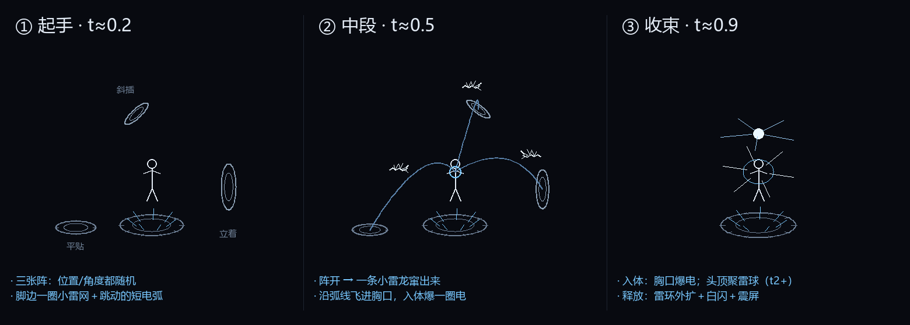

# 雷系读条前戏（2026-11-06）

> **2026-11-06 修正**：作者反馈「太小家碧玉」⇒ 阵挪到 4.3~5.9 格外、阵和龙都放大近一倍、脚边加了雷刺和外扩雷网，详见 [暗手与缠绕龙修正-20261106.md](暗手与缠绕龙修正-20261106.md) §1。

> 作者：「雷法的前戏你也可以优化做做，我希望是周围随机出现三个不同角度的小法阵，然后跑出我们的小雷龙飞进玩家的身体，脚边出现小闪电这样」



*（示意图只解释思路：①起手 → ②中段 → ③收束。实机几何是现画的电弧，不是模型。）*

---

## 1. 三件事，一条一条对上

| 作者要的 | 做法 |
| --- | --- |
| **周围随机出现三个不同角度的小法阵** | 固定 **3** 张（不按档位加数量），位置绕身 `2.05~2.6` 格随机，朝向 34% 平贴 / 36% 立着朝外 / 30% 斜插 |
| **跑出我们的小雷龙飞进玩家的身体** | 每张阵亮一会儿就"开"，一条**线勾小雷龙**从阵心窜出、沿弧线飞进施法者胸口；入体爆一圈电；t4+ 一张阵能放两条 |
| **脚边出现小闪电** | 全程脚下一圈小雷网（半径 `.85+.07×档`）＋ `3+档` 条不断跳位置的短电弧（每 2 tick 换一批，像静电在脚边爬） |

## 2. 时间轴

| ratio | 发生什么 |
| --- | --- |
| 0.00 | 脚边雷网 ＋ 短电弧亮起；头顶聚雷球（t2+）开始有电 |
| 0.10 / 0.22 / 0.34 | 第 1 / 2 / 3 张小阵出现（读条前半段三张就位） |
| 每张阵 55% 寿命 **或** ratio > 0.9 | 阵开 → 一条小雷龙窜出 |
| t4+：82% 寿命 | 同一张阵再放第二条龙（一张阵两条，高阶更密） |
| 龙出生 13+档 tick | 沿二次贝塞尔飞进胸口 → 胸口爆闪＋6 条放射电弧＋电火花 |
| ratio > 0.9 | 剩下没开的阵全部开掉（短读条兜底） |
| 读条结束 | 释放：脚下雷环外扩 ＋ 8 条放射电弧 ＋ 地光 ＋ 白闪 ＋ 震屏 |

## 3. 小雷龙长什么样

线勾，不用模型（§9 的线手、§10 的黑雾手、暗系幽灵都是这一套语言）：

- **头**：白闪（`billboardFlash`）＋ 双角 ＋ 上下颚 ＋ 两颗眼点；
- **脊**：6 节，从吻部到尾巴，越往后越细、带 `sin(age·0.55)` 的游动；
- **翼**：两对（前翼两段、后翼一段），全部扫向后方；
- **腿**：4 条收在肚子下面的小折线（在飞，腿是收着的）；
- **尾**：分叉两条；
- **电套**：3 条绕身的弧，种子每 3 tick 换一次 ⇒ 电光在龙身上爬。

体型 `scale = .28 + .025×档` ⇒ 全长约 0.75 格（大雷龙 45 格，这里只是"一条电光串成的小龙"）。
飞行时按**速度方向**摆姿势（局部 +Z = 前进），所以不会出现"倒着飞/横着飞"✗。

## 4. 额外加的（不喧宾夺主）

| # | 效果 | 条件 |
| --- | --- | --- |
| 1 | **头顶聚雷球**：白闪核心 ＋ `3+档` 条电弧往球心收，随进度变大 | t2+ |
| 2 | **身侧爆电**：从躯干往斜上方炸出去的短弧，每 3 tick 换一批 | t1+（数量随档位） |
| 3 | **释放**：雷环外扩 ＋ 地光 ＋ 白闪 ＋ 震屏（`.10+.04×档`） | 释放 |
| 4 | **屏幕**：入体/释放时极短**白闪** ＋ 很淡的蓝黑暗角（t2 以下几乎没有） | 入体/释放 |

雷系**不压暗画面**（它是加色的亮，不是暗系的"吃掉光"），所以暗角只有 `.10~.34` 的蓝黑，白闪也不超过 58/255 alpha —— 不会像光法那样过曝 ✗。

## 5. 为什么按学派判，而不是组

雷系五条链（雷场／雷速／雷球／登神／雷击）在数据文件里**不一定有 `spell.group`**（暗系有 `dark_*`，雷系是零散法术＋机制），所以：

```java
spell.school.id.getPath().contains("lightning")   // spell_power:lightning
   || spell.group.contains("lightning")           // 兜底
```

好处：以后加新雷法术自动吃到，不用回来补名单 ✓。

## 6. 为什么走 `BOLT` 层（和暗系相反）

雷是**加色**的（白芯 ＋ 主题色外沿），必须走 `LightningRenderTypes.BOLT`；
黑线那种走 `DARK` 层的做法会把白芯画没 ✗ —— 和 §9/§10 正好是镜像关系。

和现有雷系视觉不打架：`TNSpellClientVisuals` 里只有雷速的 FOV 和落雷震屏，**没有读条前戏**，
所以不会出现两套仪式叠在一起 ✓。

## 7. 想调手感

| 想要 | 改哪 |
| --- | --- |
| 阵更多（不止三个） | `CIRCLES` 常量 ＋ `update()` 里 `at = .10F + i * .12F` |
| 阵出现更早 | 同上，把 `.10F` 调小 |
| 龙飞得更快 | `spawnDragon()` 的 `life = 13 + tier` |
| 龙更大 | `spawnDragon()` 的 `scale = .28F + .025F×档` |
| 龙入体位置（胸口高低） | `spawnDragon()` 里 `getBbHeight() * .62` |
| 脚边电更密 | `footLightning()` 的 `sparks = 3 + tier`、`snap = time/2` |
| 聚雷球高度/档位 | `ritual()` 里 `if (tier >= 2)` 与 `2.0D` |
| 白闪太亮/太暗 | `spawnBurst()` 的 `.55F * strength`、GUI 里 `whiteFlash * 58` |

## 8. 装机

| 项 | 值 |
| --- | --- |
| JAR | 199,039,109 字节 |
| SHA-256 | `99BAFE3A5C2AF75B95018713347A70CA6CE10B6A0D39699CFFDF8359CE93AC48` |
| 稳定副本 | `work/tnc-light-cast-99BAFE3A.jar` |
| 校验 | 装前 `java` = 0；装后回读哈希一致；`javap` 确认 `LightningCastFx.onClientTick/onRenderWorld/smallDragon/footLightning` 在包里 ✓ |
| 累积 | 含 01:53 暗系读条前戏、01:37 巨人领域雾、00:47 黑雾手 等全部内容 |

## 9. 实机验收清单

1. 放 `雷击`（t1）：脚边有小雷网＋跳动的短电弧；四周浮出 **3** 张阵（至少一张立着、一张斜着）；
2. 三张阵各放出一条小雷龙，从阵心飞进胸口，胸口炸一圈电；
3. `雷暴`（t4）：阵里能放出第二条龙；头顶有聚雷球；
4. 放 `闪电登神`（t5）：白闪、震屏、雷环外扩；
5. 立着的阵要能看出是"门"，不是平贴的圈；
6. 读条很短的法术也要放得出龙（ratio > 0.9 强制开阵）。
