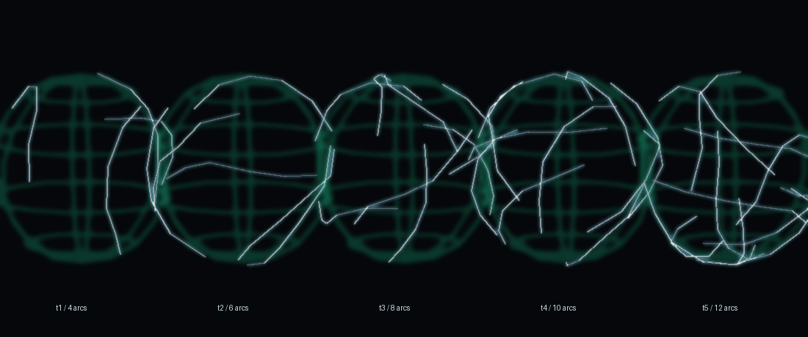

# 风刃：不转 + 加大；雷球：游走闪电 + 持续电击

2026-11-10 · 作者两句话：

> 「发射出的风刃不要一直旋转，就顺着龙卷风的风向直射出去就行，然后体积加大」
>
> 「然后雷球的建模和特效可以优化一下，雷球上面有游走的闪电，去掉大部分混乱的粒子特效，
> 雷球的建模也可以再精致一点，自发光，t级越高游走闪电越多，并且会自己持续电周围的敌人」

---

# 一、风刃：不再自转 + 加大

| | 之前 | 现在 |
| --- | --- | --- |
| 自转 | 18~28°/tick（飞出去在打转） | **0**（固定朝向，顺着风向直射） |
| 尺寸倍率 | 2.4（跨度 2.8 格） | **3.8**（跨度 **4.5 格**，判定半径 **2.1 格**） |
| 朝向 | 发射时的 yaw / pitch | 不变 ✓（刃口始终顺着风向） |

- 改的地方：`TNTornadoEntity.fireBlades` 里 `setSpinRate(0.0F)`；
  `TNWindBladeEntity.SPELL_BLADE_SIZE` 2.4 → 3.8。
- **风守卫 Boss 那两发（2.6 / 4.2 倍、26°/tick）没动** —— 那是它自己的招式参数 ✓。
- 闸门：`WindBladeQiTest` 加了"龙卷风必须 `setSpinRate(0.0F)`"和"跨度 3~6 格"两条。

---

# 二、雷球：球面游走闪电 + 自己电周围

## 1. 为什么不能只改 JSON

三颗雷球（`thunder_orb` / `great_thunder_orb` / `explosive_thunder_orb`）是
**SpellEngine 自己的投射物** `SpellProjectile`：模型由 JSON 的 `client_data.model` 决定（静态），
"噼啪"全靠 `travel_particles` 撒粒子 ✗。

- 静态模型 ⇒ 闪电不可能"游走" ✗
- 粒子 ⇒ 就是作者说的"混乱的粒子特效" ✗
- 而"飞行途中持续电周围"**JSON 根本没有这个口子** ✗（JSON 只能描述命中瞬间）

所以分两头做：**JSON 管"球本身"，Java 管"球外面那层电"**。

## 2. JSON（5 个雷球法术）

用 `work/trim_orb_jsons.py` 统一改：

| 改动 | 之前 | 现在 |
| --- | --- | --- |
| `model.light_emission` | 只有 t2/t3 有 `RADIATE` | **全部 `RADIATE`**（自发光 ✓） |
| `model.rotate_degrees_per_tick` | 没写（引擎默认） | **0**（球不再自己转，闪电才是动的） |
| `client_data.travel_particles` | t1 8 颗 / t2 6 颗 / t3 21 颗 / t4 36 颗 | **全部删掉** ✓ |
| `impact[].particles[].count` | 最多 87 颗 | **封顶 8**，每组最多 2 批 |

## 3. 球面那层电（客户端）

新增 `client/ThunderOrbAura`（纯几何）+ `client/ThunderOrbAuraRenderer`（画）：

- **经纬线**：4 条纬线 + 3 条经线 ⇒ 球有清晰轮廓、静止时也像"一个发光的球" ✓
- **游走闪电**：每条从球面随机一点出发，每步在切平面里随机拐 ≤31°、再投回球面 ⇒
  一条贴着球爬的折线 ✓；**条数 = `OrbStormRules.arcs(tier)`（t1=4 …… t5=12）** ✓
- **亮晕**：`billboardFlash`（自发光那层）✓
- 每 2 tick 换一次种子 ⇒ 闪电一直在爬 ✓
- 半径按 JSON 的 `model.scale` 算（13/16 × 0.5 × scale）⇒ t1 球 0.56 格、t3 球 3.5 格，
  线始终贴在球面上 ✓（写死 1 格会让大球的线缩在球心里 ✗）

画的是 `LightningRenderTypes.BOLT` + `LightningBoltGeometry.polyline`
—— 和龙卷风、风刃、闪电同一套加色光带 ✓。

## 4. "自己持续电周围的敌人"（服务端）

新增 `magic/OrbStormService`：

- 挂在引擎的 `SpellEvents.PROJECTILE_SHOOT` 上（**投射物刚生成**时回调，带 entity + spellInfo ✓）
- 只认 `tnc:*` 且 `group == "orb"` 的法术 ✓
- 每 tick 看一眼：球没了就取消登记；到点了就以**球心**为圆心电一圈：

| 档 | t1 | t2 | t3 | t4 | t5 |
| --- | --- | --- | --- | --- | --- |
| 半径（格） | 3.2 | 3.6 | 3.9 | 4.3 | 4.6 |
| 伤害 | 3.0 | 3.9 | 4.8 | 5.7 | 6.6 |
| 间隔（tick） | 10 | 9 | 8 | 7 | 6 |

- 打出伤害前 `invulnerableTime = 0` ⇒ 球的高频小电击**不会吞掉玩家自己的刀** ✓
  （和领域那次同一个坑）
- 判敌走"非施法者 / 非队友"那一套 ⇒ 不误伤队友 ✓
- 每次最多电 6 个目标（免得刷屏）✓，被打到的目标会拉一条 `arcLine` 电弧 ⇒
  看得见"是这颗球在电" ✓

## 5. 闸门

| 测试 | 条数 | 守什么 |
| --- | --- | --- |
| `OrbStormRulesTest` | 4 | 档位越高：闪电更多、半径更大、伤害更高、间隔更短；数值夹在合理区间；tier 夹在 1..5；只认 `orb` 组 |
| `ThunderOrbAuraTest` | 4 | 经纬线每点都在球面上、环闭合；游走闪电贴球面且**真的在动**、换种子会换路径；预算随条数增长且 ≤8000；`polyline` 顶点格式填满（防 2026-11-10 那次崩溃复发） |
| `WindBladeQiTest` | 6 | 新增"龙卷风 `setSpinRate(0.0F)`"与"跨度 3~6 格" |

回归：`client.*` + `magic.*` + `warrior.*` + `world.wind.*` **489 用例 / 119 套件全绿**。

## 6. 实装

| 项 | 值 |
| --- | --- |
| 构建 | 200,699,341 B · 19:57:36 · SHA `583ACA43…B6A0AE` |
| 装入 | 19:57:49（装时 0 个 java 进程），回读逐字节一致 |
| 备份 | `…jar.bak-20261110-195748` |
| 包内确认 | `OrbStormRules` / `ThunderOrbAura` 在；`SPELL_BLADE_SIZE = 3.8`；`thunder_orb.json` 无 `travel_particles`、有 `RADIATE` |

**需要完整重启游戏生效**（客户端渲染 + 数据包）。

## 7. 进游戏要验

1. 风法 t3+：龙卷风吐出的刃**不打转**了，直着飞；一片比之前明显大（约 4.5 格宽）
2. 打一发 `thunder_orb`：球周围是一圈**经纬线** + 几条白蓝色闪电在球面上爬，**没有**乱飞的电花
3. 连放 t1→t3：闪电条数肉眼可见变多（4 / 6 / 8），球本身也更大
4. 把球往怪堆里丢：球飞过时旁边的怪会被**持续电**（有电弧拉过去），且不会"一出生就电死一群"
5. 自己的近战伤害没被球的电击吃掉（`invulnerableTime = 0` 那条）

## 8. 待定

1. 经纬线现在 4+3 条，要不要减到 3+2（更像"电球"而不是"地球仪"）
2. 游走闪电要不要在命中瞬间炸开一圈（现在命中仍是 JSON 的 impact）
3. `cataclysm_thunder_orb` / `god_descent` 没有 `client_data.model`（不是投射物球），
   这次只清了它们的粒子；要不要也给它们做球
