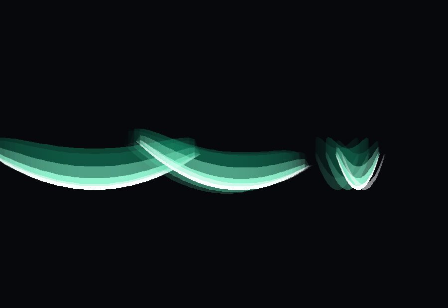

# 风刃改成「战士剑气」＋体积统一

2026-11-09 · 作者：「这个风刃也改一改，其实可以改成战士那里的剑气你觉得如何，体积统一一下」



（左：正面；中：斜 35° 带残影；右：接近侧面 —— 这时候只剩"刃口"，就是靠那圈侧面撑住体积的。）

## 我的看法：该改

三条理由：

1. **不像一个体系** ✗ —— 战士的剑气是"四层渐隐的月牙光带"（`WarriorWaveRenderer`），
   风刃却是一张烘焙模型贴半透明图；两个都是"斩出去的一片"，画法却完全不同 ✓ 改完就统一了。
2. **尺寸失控** ✗ —— 旧表 t3/t4/t5 = 5 / 10 / 20 倍，模型跨度 1.179 格 ⇒ t5 的刃有 **23.6 格**宽，
   比龙卷风（t5 约 15 格高、6.7 格半径）本体还宽 ✗。
3. **模型路线的好处到顶了** —— 月牙模型只能"贴一张图 + 缩放"，想加残影、想做渐隐边、
   想让刃口有厚度，都得改模型；而光带几何这些是白送的 ✓

## 改了什么

| | 之前 | 现在 |
| --- | --- | --- |
| 视觉 | 烘焙模型 `tnc:projectile/windblade`（贴图月牙） | **程序化弯月**：`client/WindBladeQi` 直接生成顶点 |
| 分层 | 一张贴图 | **四层**：外辉光 → 主色 → 白芯 → 极细高光（和战士同一套比例） |
| 尾迹 | 无 | **两道残影**（沿飞行方向往后拖，alpha 0.26 / 0.12） |
| 厚度 | 模型本身有厚度 | **刃口**：外缘沿 Z 撑一道薄带 ⇒ 侧看不会变成一张纸 ✗ |
| 颜色 | 贴图 | 和龙卷风同源：白芯 / 青绿 `#9EFFDB` / 深青 `#1AB885` ✓ |
| 淡入淡出 | 到点直接消失 | 出生 2 tick 淡入、最后 6 tick 淡出 |
| 尺寸 | 5 / 10 / 20 倍 | **三档统一** `SPELL_BLADE_SIZE = 2.4` ⇒ 跨度 **2.83 格** |

### 统一后的数字

| 量 | 值 | 参照 |
| --- | --- | --- |
| 月牙跨度 | 1.179 × 2.4 = **2.83 格** | 战士剑气半宽 1.2 ⇒ 2.4 格（同量级 ✓） |
| 月牙半宽（渲染几何用） | `BASE_SPAN × 倍率 ÷ 2` = **1.41 格** | 渲染器直接用，**不再乘 poseScale** ✗ |
| 命中半径 | `1.1 × √2.4` = **1.70 格**（仍封顶 5 格） | 以前 t5 是 4.9 格 |
| 顶点 | 40 段 × 7 层 × 4 = **1120** / 片 | 一片一帧，远低于 3000 的闸门 |

> ⚠️ **只统一风法这一路** ✗：风守卫 Boss 那两发（2.6 / 4.2 倍）是它自己的招式参数，照旧 ✓。

## 一个坑：判定和画面必须同源

旧版是"模型跨度 × poseScale"；新版几何直接按**世界尺寸**生成 ⇒ 渲染器里
**不能再 `poseStack.scale`** ✗ —— 多乘一次，画面会比判定大一圈，
又回到"打中了但看着没打到"的老毛病 ✗。所以尺寸只从
`TNWindBladeEntity.halfSpanBlocks()` 出来一次 ✓。

## 闸门

新增 `WindBladeQiTest`（**5 条**）：

- 顶点有限、数量 == `WindBladeQi.vertices()`、≤ 3000、alpha ∈ [0,1]
- **形状**：中间比 1/4 处厚、两端收成尖（tip < middle × 0.35）、整体带弧度（中间往 −Y 收、两端回到中轴）、左右对称
- alpha = 0 或尺寸 = 0 时**不发顶点**
- **体积统一**：`TNTornadoEntity` 必须用 `TNWindBladeEntity.SPELL_BLADE_SIZE`、跨度落在 2~4 格、
  `halfSpanBlocks()` 存在、判定仍是 `√尺寸 + 封顶`
- 渲染器必须走 `WindBladeQi.draw`，且**不许**再出现 `CustomModels.render`

> ⚠️ 测试里**不能**调 `TNWindBladeEntity.hitRadiusFor(...)` ✗ —— 类方法会触发静态初始化
> （注册 `SynchedEntityData`），单元测试里直接 `ExceptionInInitializerError` ✗；
> 所以那一条改成源码扫描。

## 实装

| 项 | 值 |
| --- | --- |
| 构建 | 200,660,937 B · 21:33:19 · SHA `2174F11A…4C2B47` |
| 装入 | 21:33:34（装时 0 个 java 进程），回读逐字节一致；**随后队友 21:33:26 的构建又装了一版覆盖它**（200,664,075 B、SHA `E3AE63AA…`）—— 已核对那一版里 `WindBladeQi` / `SPELL_BLADE_SIZE` / `MODEL_BASE_RADIUS` 都在，等于"我的改动 + 队友的改动" ✓ |
| 备份 | `…jar.bak-20261109-213334` |
| 回归 | `client.*` + `magic.*` + `warrior.*` + `world.wind.*` **459 用例 / 112 套件全绿** |

**需要完整重启游戏生效**（客户端渲染器）。

## 进游戏要验

1. 龙卷风吐出来的刃：应该是一片**白芯青边的弯月**，后面拖两道淡影，和战士剑气一眼同族
2. **三档一样大**：t3 / t4 / t5 的刃跨度都是约 2.8 格（以前 t5 比龙卷风还宽）
3. 侧着看（刃几乎侧对镜头）：应该还能看到"刃口"那道细边，不是一张纸
4. 命中判定：刃飞过去打到怪的距离，应该和看到的大小对得上（不再偏大半格）
5. 风守卫 Boss 的刃（2.6 / 4.2 倍那两发）也换成了新画法，但**大小不变** ✓

## 待定

1. 弧度（`BOW = 0.34`）要不要更弯一点，像真正的"月牙"
2. 残影要不要改成三条（现在两条）
3. 旧模型 `tnc:projectile/windblade` 现在只剩 Canglan 审计还引用；要不要一并清掉

---

# 崩溃修复（2026-11-10 03:00）

作者：「报错了」

## 现象

游戏在**渲染风刃**那一刻直接崩（客户端），报告 `Description: Rendering entity in world`：

```
java.lang.IllegalStateException: Not filled all elements of the vertex
  at com.mojang.blaze3d.vertex.BufferBuilder.endVertex(BufferBuilder.java:264)
  at com.tnc.tnc.client.WindBladeQi.vertex(WindBladeQi.java:160)
  at com.tnc.tnc.client.WindBladeQi.band(WindBladeQi.java:103)
  at com.tnc.tnc.client.WindBladeQi.draw(WindBladeQi.java:72)
  at com.tnc.tnc.client.TNWindBladeRenderer.render(TNWindBladeRenderer.java:65)
```

## 根因：顶点只填了一半

`LightningRenderTypes.BOLT`（和雷电光带共用的加色层）的顶点格式是
**position + color + uv + overlay + uv2 + normal** 六项。
我写 `WindBladeQi.vertex` 时只发了 `position + color` 就 `endVertex()` ✗ ——
`BufferBuilder` 发现少了元素，当场抛 `IllegalStateException` ✗。

（`LightningBoltGeometry.vertex` 之所以没事，是因为它把 `uv(0.5,0.5)` /
`overlayCoords(NO_OVERLAY)` / `uv2(FULL_BRIGHT)` / `normal(0,1,0)` 全填了；
我抄几何时漏了这四句 ✗。）

## 修法

`WindBladeQi.vertex` 补齐成和雷电完全一致：

```java
vc.vertex(m, x, y, z)
  .color(r, g, b, a)
  .uv(0.5F, 0.5F)                                   // 白贴图正中间的白点
  .overlayCoords(OverlayTexture.NO_OVERLAY)
  .uv2(LightTexture.FULL_BRIGHT)                    // 加色层不吃光照
  .normal(0.0F, 1.0F, 0.0F)
  .endVertex();
```

## 为什么要加闸门（这条最值得记）

原来的测试用的是"随便记一下顶点"的假消费者 —— 只记 position/alpha，**根本不管格式全不全**，
所以测试全绿、进游戏就崩 ✗。

现在 `WindBladeQiTest` 换成**较真的假消费者**：每个顶点少任何一个元素，
`endVertex()` 就抛 `Not filled all elements of the vertex`（和真 `BufferBuilder` 一样）✓。
新增测试 `everyVertexFillsTheWholeFormat`（6 条中的第 6 条），专门守这一条。

> 结论：**用别人的 render type，就得把它的顶点格式填满** ✓。
> 只发 position + color 在 `RenderType.lines()` 那种格式里没问题，在
> `POSITION_COLOR_TEXTURE_OVERLAY_LIGHT_NORMAL` 里就是必崩 ✗。

## 实装

| 项 | 值 |
| --- | --- |
| 构建 | 200,685,834 B · 03:08:27 · SHA `2EDAB64F…C6FCCD5` |
| 装入 | 03:08:43（构建时游戏开着 ⇒ 后台等到退出才替换；备份 `…jar.bak-20261110-030843`；回读逐字节一致；包内 `javap` 确认 `WindBladeQi` 引用了 `OverlayTexture` ⇒ 修复在里面） |
| 回归 | `client.*` + `magic.*` + `warrior.*` + `world.wind.*` **471 用例 / 114 套件全绿** |