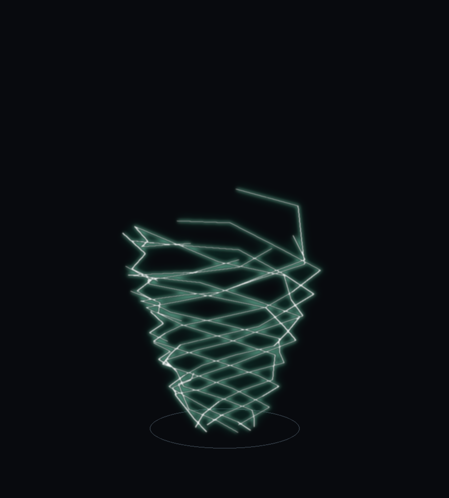
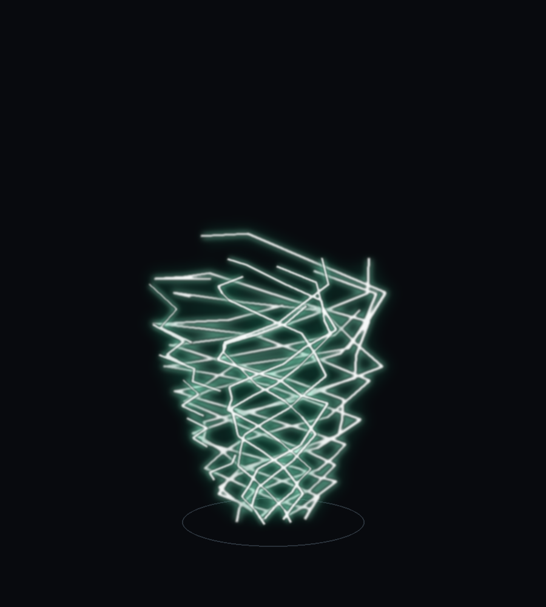
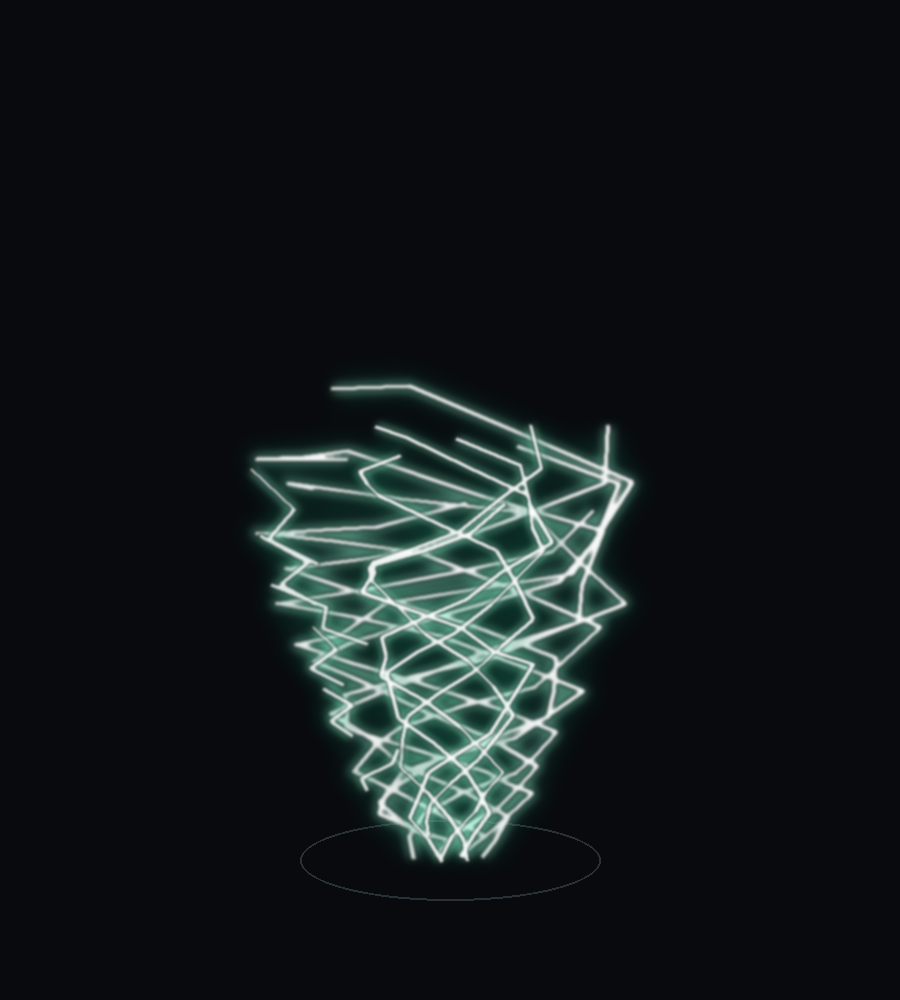

# 风法龙卷风：从"薄板模型"改成"闪电那种线"

2026-11-09 · 作者原话：

> 「你可以优化一下风法的龙卷风吗，我想做成就是，我们的闪电嘛，他不是一个一个线吗，
> 我想这个线螺旋缠绕起来变成龙卷风，你看过鬼灭之刃吗，就是那种感觉，可以有明确的锐角，
> 龙卷风极具那种线条特色」

（上图是离线用同一套几何画出来的预览，生成脚本见 `assets/风法龙卷风-预览脚本-20261109.py`，
参数与 `TornadoLineShape` 完全一致 —— 不进游戏也能改形状看效果 ✓）

---

## 1. 改了什么

| | 之前 | 现在 |
| --- | --- | --- |
| 视觉主体 | 烘焙模型 `tnc:projectile/wind_tornado`（7 层 × 4 片薄板 + 贴图色块） | **一束螺旋折线**（7 根 + 6 道风切），一个模型都不画 |
| 线的来源 | —— | `TornadoLineShape` 纯数学算折点，`WindTornadoLines` 画光带 |
| 折角 | 薄板边缘 = 光滑直边 | 每根线只有 17 段 ⇒ 每段约 36°，再叠半径锯齿 ⇒ **明确的锐角** |
| 渲染 | SpellEngine `CustomModels.render`（引擎的方块模型空间） | `LightningRenderTypes.BOLT` + `LightningBoltGeometry.polyline`（和闪电同一套加色光带） |
| 自转 | `poseStack.rotate` | 烘进顶点（光带要朝向相机，旋转会让侧向量算错 ✗） |
| 淡入淡出 | 无（模型到点直接消失） | 出生 4 tick 淡入、消散 10 tick 淡出 |

## 2. 形状是怎么"极具线条特色"的

`TornadoLineShape` 只有 5 个旋钮，全部在类顶部：

| 常量 | 值 | 作用 |
| --- | --- | --- |
| `STRANDS` | 7 | 几根线缠在一起（一根像弹簧 ✗） |
| `TURNS` | 1.70 | 一根线绕几圈 |
| `SEGMENTS` | 17 | 一根线几段 ⇒ **段数越少折角越大** |
| `KINK` | 0.14 | 半径锯齿幅度（外挑 / 内收交替） |
| `SPUR` | 0.26 | 偶发"刃尖"向外挑多少（越靠顶概率越低） |

另外三个细节，都是照着"线条感"调的：

1. **漏斗收口**：半径 `bottom + (top − bottom) · u^0.72`，底部 0.25 格、顶部 0.84 格（模型单位 /16）
2. **顶口收拢**：每根线到顶的高度不同（0.84~1.0 倍）＋ 顶部 18% 往内收 ⇒ 顶口不会变成一圈"帽檐" ✗
3. **刃尖往上挑**：挑上去的高度会累积着衰减 ⇒ y 始终单调往上（不会出现"倒流"的一小段 ✗）

## 3. 和粒子的关系（这条最容易穿帮）

龙卷风身上原来就有一层风粒子（`TNTornadoEntity.spawnSwirlParticles`，作者 2026-10-10：
「最好是混着粒子旋转，单独板板旋转很丑」）。粒子角度写的是 `−(spin + twist·u)`，
twist 原来取模型的 135°。

这一轮线绕 **1.7 圈 = 612°** ⇒ 粒子必须跟着改成
`TornadoLineShape.totalTwist()`，否则粒子会**逆着线走**，一眼穿帮 ✗。
两处现在读同一个常量（`angleAt()` / `totalTwist()`），以后改 `TURNS` 粒子自动跟上 ✓。

## 4. 线宽

`CORE_WIDTH_RATIO = 0.018` ⇒ 白芯半径 = 高度 × 0.018（世界单位）：

| 档位 | 尺寸倍率 | 世界高度 | 白芯半径 | 外辉光半径 |
| --- | --- | --- | --- | --- |
| t3 | 2 | ≈3.9 格 | 0.07 格 | 0.24 格 |
| t4 | 5 | ≈9.7 格 | 0.17 格 | 0.59 格 |
| t5 | 8 | ≈15.5 格 | 0.28 格 | 0.94 格 |

三层宽度比照抄雷电（外辉光 3.4× / 主色 1.5× / 白芯 0.5×）⇒ 风和雷是同一个美术体系 ✓。

## 5. 闸门

新增 `TornadoLineShapeTest`（**8 条**，纯数学 + 假 VertexConsumer，不启动游戏）：

- 7 根线、每根 18 点、y 从 0 一路往上、没有 NaN
- 下 1/3 明显比上 1/3 窄（漏斗）—— ⚠️ 不能用"首点/末点"比：首点可能正好是刃尖
- **锐角**：中位拐角 ≥ 25°、最大 ≥ 60°、≥10° 的折点占 55% 以上、≥30° 的占 1/4 以上
- 半径必须来回锯齿（否则轮廓是平滑锥 ✗）
- 自转是纯旋转：`(x,z) → (z,−x)`（和粒子同向）
- 6 道风切是 V 形、拐角 ≥ 15°、不出漏斗
- 顶点预算 ≤ 4000（实测 2952），且 `draw()` 的返回值 == 实际发出顶点数
- `alpha = 0` 时不发顶点

回归：`magic.*` + `client.*` + `world.wind.*` **244 用例 / 59 套件全绿**。

## 6. 实装

| 项 | 值 |
| --- | --- |
| 构建 | 200,653,879 B · 01:53:49 · SHA `94C6D646…C2DFB5` |
| 装入 | 01:54:14（装前 0 个 java 进程），回读逐字节一致 |
| 备份 | `…jar.bak-20261109-015414` |
| 包内确认 | `TornadoLineShape` / `WindTornadoLines` 在，`TNTornadoRenderer` 已不再走模型 |

**需要完整重启游戏生效**（客户端渲染器改了）。

## 7. 进游戏要验

1. 放一次风系 t3 以上的"狂风/大风"：出来的应该是一束**青白色螺旋线**，能看清每一节是折的
2. 靠近看：粒子仍然贴着那条螺旋往上卷（不是逆着走）
3. 转到侧面/背面看：线始终是"有厚度的带子"，不会变成侧立的纸片
4. t3 / t5 各放一次：线宽应该跟着龙卷风一起变，不是 t3 糊成一团、t5 细成蛛丝
5. 出招瞬间 / 消散瞬间：淡入淡出，不会"啪"一下

## 8. 待定

1. 现在 7 根线 + 6 道风切；要不要再加一层**很淡的外轮廓线**（更像"风壁"）？
2. 顶端那几根线会甩到漏斗外面（预览图右上那条长线）—— 保留（像风尾）还是收掉？
3. 苍岚军神（`CanglanTempestEntity`）的龙卷风**还是模型** —— 要不要也换成这套线？
4. 颜色现在是青白（#9EFFDB / #1AB885）；要不要更冷一点（接近雷的紫白）？

---

# 第二轮：两层 + 加粗（2026-11-09 17:55）

作者：「做成两层，里一层外一层，然后线条变粗一些」

## 1. 两层

`TornadoLineShape` 现在有一个 `Shell` 记录，两层参数全在类顶部：

| 参数 | 外层 `OUTER` | 内层 `INNER` |
| --- | --- | --- |
| 半径比例 | 1.00 | **0.55**（套在里面） |
| 线数 | 7 | 5 |
| 圈数比例 | 1.00（1.7 圈） | 0.92（1.56 圈，两层不同步才不像同心管） |
| 相位偏移 | 0° | **72°**（错开） |
| 线宽比例 | 1.00 | 0.80 |
| 不透明度 | 1.00 | 0.95 |
| **白芯白度** | 1.00（纯白） | **0.30**（偏青绿） |
| 锯齿种子盐 | 0 | 977（两层的折点不同） |

⚠️ **为什么内层芯色不能也是纯白**：加色混合下两层白线会糊成"一根发光的管子"，
里外根本分不出来 ✗。内层芯色按 0.30 从青绿往白插值 ⇒ 外面是白线、里面透出绿线，
一眼能看出"里一层外一层" ✓（预览图里能看到外圈白、内圈绿）。

渲染顺序：**先外层后内层**（`SHELLS` 的顺序）—— 加色混合不遮挡，顺序只影响叠加亮度 ✓。

## 2. 加粗

`CORE_WIDTH_RATIO` **0.018 → 0.028**（约 +55%）：

| 档位 | 世界高度 | 白芯半径 | 外辉光半径 |
| --- | --- | --- | --- |
| t3 | ≈3.9 格 | 0.11 格 | 0.37 格 |
| t4 | ≈9.7 格 | 0.27 格 | 0.92 格 |
| t5 | ≈15.5 格 | 0.43 格 | 1.48 格 |

两层都按这个基准走（内层 ×0.80）。加粗和"两层"是配套的：细线套两层会互相穿帮、
看起来像乱麻 ✗；粗一点才压得住两层 ✓。

## 3. 顶点预算

| | 一层版 | 两层版 |
| --- | --- | --- |
| 螺旋线 | 7 根 × 17 段 | 12 根 × 17 段 |
| 风切 | 6 道 × 3 段 | 6 道 × 3 段 |
| 顶点 | 2952 | **5328** |
| 闸门上限 | 4000 | **6500** |

每帧 5300 个加色顶点，和雷暴/雷龙那种场面是同一量级 ✓。

## 4. 闸门（8 → 9 条）

新增 `thereAreTwoNestedShells`：

- `SHELLS` 必须正好两层
- 内层半径比例必须 < 外层的 0.80 倍（不然看着还是一层）
- 内层至少 4 根线（不然里层是空的）
- 两层圈数必须不同（不然像同心管）
- 内层白度必须低于外层（不然糊成一根白管）
- **几何验证**：内层每一个点的半径都小于外层的最大半径（真的套在里面）

顶点预算闸门 4000 → 6500；其余 8 条不变（都跑在外层上）。

## 5. 实装

| 项 | 值 |
| --- | --- |
| 构建 | 200,656,162 B · 17:55:21 · SHA `6FDDCF67…ED17015` |
| 装入 | 17:55:34（装前 0 个 java 进程），回读逐字节一致 |
| 备份 | `…jar.bak-20261109-175533` |
| 回归 | `magic.*` + `client.*` + `world.wind.*` **245 用例 / 59 套件全绿** |

**需要完整重启游戏生效**（客户端渲染器）。

## 6. 进游戏要验

1. 转一圈看：**外面一层白线、里面一层绿线**，两层都看得见（不是一根白管）
2. 线明显比上一版粗（t5 白芯约 0.43 格半径）
3. 两层转速不同步（外 1.7 圈 / 内 1.56 圈）⇒ 有"两层互相搓"的感觉
4. 贴近看不会看到里外穿插成乱麻
5. 帧数：一次两发 t5（`TORNADO_COUNT[2] = 2`）时，一帧约 1 万个顶点，看有没有掉帧

## 7. 待定

1. 内层要不要再暗一点（现在 0.95 不透明度，已经挺亮）
2. 要不要加第三层"最里面的细芯"（3 根、半径 0.3）
3. 苍岚军神那只还是老模型
---

# 第三轮：根部收窄（2026-11-09 18:05）

作者：「根部可以半径再小一点」

## 1. 改了哪两个数

| | 之前 | 现在 |
| --- | --- | --- |
| `MODEL_BASE_RADIUS`（单位 = 1/16 格） | 4.0 | **2.4** |
| 接地半径（t3 / t4 / t5，格） | 0.50 / 1.25 / 2.00 | **0.30 / 0.75 / 1.20** |
| `MODEL_TOP_RADIUS` | 13.5 | 13.5（**顶口不动**） |

顶上不收，只收根 ⇒ 锥度更陡，落地那一小截更像"从地上抽起来"的 ✓。

两层一起收（内层本来就是外层的 0.55 倍）⇒ 里外仍然套得住 ✓。

## 2. 粒子也跟着收（这条容易漏）

`TNTornadoEntity.spawnSwirlParticles` 原来算半径是**直线插值**：
`baseR + (topR − baseR) · u` —— 和光带的 `bottom + (top − bottom) · u^0.72` 不是同一条曲线。
以前差得不多看不出来；现在根部收窄 40%，直线插值会在接地那一小截明显**凸出去** ✗。

现在粒子改成同一句 `TornadoLineShape.profile(u, baseR, topR)` ⇒ 线、粒子、"风刃出生点"
三者根部是同一个宽度 ✓。

## 3. 闸门

9 条不变（`BOTTOM` 是从 `MODEL_BASE_RADIUS` 算的 ⇒ 自动跟着收）：

- 漏斗"下 1/3 比上 1/3 窄"这条现在余量更大了 ✓
- 两层"内层每个点半径 < 外层最大半径"仍然成立 ✓

## 4. 实装

| 项 | 值 |
| --- | --- |
| 构建 | 200,656,192 B · 18:04:41 · SHA `673F2616…AEDAB954` |
| 装入 | 18:05:00（构建时游戏还开着 ⇒ 等它退出后才替换；回读逐字节一致；备份 `…jar.bak-20261109-180500`） |
| 回归 | `magic.*` + `client.*` + `world.wind.*` **245 用例 / 59 套件全绿** |

**需要完整重启游戏生效**。

## 5. 进游戏要验

1. 贴地看：漏斗根部应该细得像一个"抽口"（t5 约 2.4 格直径），不再是一个大圆盘
2. 根部粒子不应该比线更外扩（现在同一条曲线）
3. 锥度更陡之后，两层的里外关系还看得出来（外白内绿）

## 6. 待定

1. 根部还能不能更细（比如 2.0）—— 太细会和"卷人"的手感脱节
2. 要不要给根部加一圈贴地的小旋纹（像尘卷）