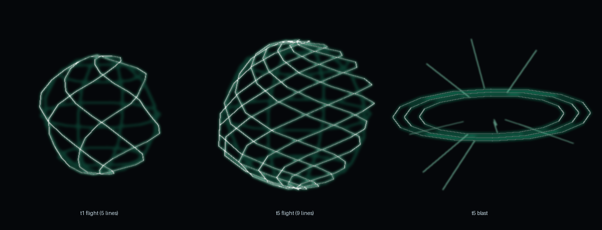
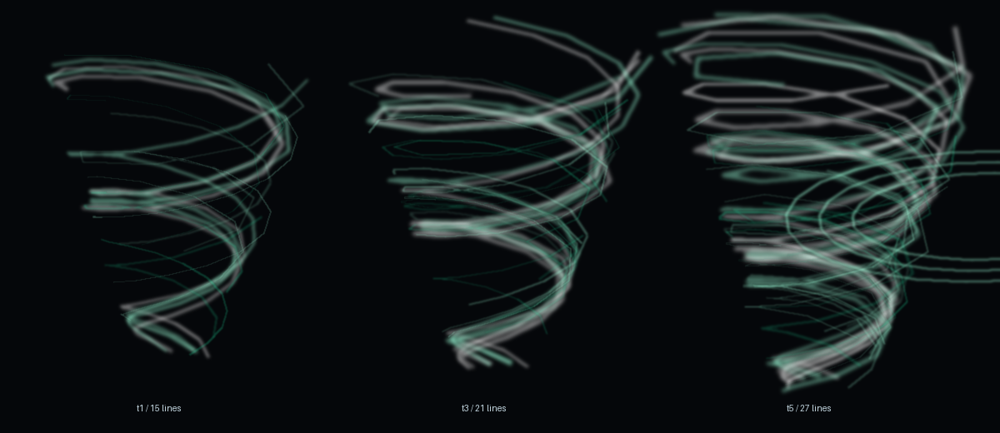

# 风球：色带模型 → 螺旋风线

2026-11-10 · 作者：「风球也可以优化一下」

## 1. 之前是什么

`WindChainRenderers.Ball` 调 `WindConstructModels.orb(...)`：几片**带贴图的
"核心 / 笼子"色带**贴在一个球面上，加两圈向内收的环 ✗。

问题：

- **静态**：一个球在"贴图上转"，看不出风在卷 ✗
- **糊**：色带互相叠，远看是一坨绿 ✗
- **不是一个体系**：龙卷风 / 风刃 / 雷球都已经换成"线"了，风球还是色带 ✗

## 2. 现在是什么

| 阶段 | 画法 |
| --- | --- |
| 飞行 / 吸住 | **一束从南极绕到北极的风线**（`WindBallLines.swirl`）+ 很淡的经纬轮廓 |
| 压缩 | 球半径急速变小（`WindChainRules.ballSize`），线跟着挤 ⇒ 越吸越紧；压缩 >55% 时补一下"亮芯" |
| 炸开 | **冲击波环**（`shockRings`，0.35→2.2 倍半径）+ **径向风痕**（`streaks`，10 条） |

- 线数按档：**t1 = 5 根 …… t5 = 9 根**（`strands(tier) = 4 + tier`）✓
- 绕圈数：1.37 → 2.25 圈（档越高越密）✓
- 转速：飞行 22°/tick、**压缩 34°/tick**（越紧转越快）、炸开 8°/tick（冲击波才是主体）✓
- 颜色沿用风系那套（白芯 / `#9EFFDB` / `#1AB885`）⇒ 和龙卷风、风刃完全一致 ✓
- 线宽按**半径比例**（`radius × 0.018`，下限 0.012 格）：t1 球 2 格、t5 球 67.5 格，
  固定线宽会一边太粗、一边看不见 ✗

## 3. 顶点预算

| 档 | 风线 | 轮廓 | 合计段数 | 顶点 |
| --- | --- | --- | --- | --- |
| t1 飞行 | 5 × 16 | 5 × 14 | 150 | 3600 |
| t5 飞行 | 9 × 16 | 5 × 14 | 214 | 5136 |
| t5 炸开 | —— | —— | 3 × 16 + 10 | 1296 |

（都 ≤ 闸门上限 8000 ✓；炸开时反而更省，因为不再画整球。）

## 4. 闸门

新增 `WindBallLinesTest`（**6 条**）：

- 风线每点到球心距离 ≈ 半径（±18% 的呼吸摆动），**起点南极、终点北极** ✓
- 档越高线越多、绕圈越密（t1=5 → t5=9）✓
- 自转真的换位置（不是死球）✓
- 轮廓线在球面上且首尾闭合 ✓
- 冲击波**往外扩**（1.5 倍以上，且不超过 2.4 倍半径）、风痕方向朝外 ✓
- 线宽与半径成比例、有下限；预算随档位/爆炸增长且 ≤8000 ✓

回归：`client.*` + `magic.*` + `warrior.*` + `world.wind.*` **496 用例 / 120 套件全绿**。

## 5. 实装

| 项 | 值 |
| --- | --- |
| 构建（第一版：纯线） | 200,703,513 B · 20:08:47 · SHA `20247450…312E78` |
| 装入 | 20:09:02（构建时游戏开着 ⇒ 后台等到退出才替换；备份 `…jar.bak-20261110-200902`；回读逐字节一致） |
| 回归 | 496 用例 / 120 套件全绿 |

**需要完整启动游戏生效**。

## 6. 进游戏要验

1. 放 `wind_ball_1`：球应该由**几根白绿色的螺旋线**绕成，能看清线在转（不是一坨色带）
2. 放到 `wind_ball_5`：线明显更密（9 根）、球也大得多，但线宽看起来仍是同一种线
3. 吸住怪物压缩时：球越缩越小、线越挤越亮，最后一下"亮芯"
4. 炸开那 12 tick：应该看到**往外扩的环 + 放射状风痕**，不是原来的"笼子"翻倒
5. 帧数：t5 的球 67.5 格半径，一次 5000 多个加色顶点 —— 看看会不会掉帧

## 7. 待定

1. 冲击波环现在是水平三圈，要不要改成球面扩散（更像"爆"）
2. 压缩阶段要不要加"往中心吸的短线"（现在只有球本身在缩）
3. `WindConstructModels` 里那套 `orb(...)` 现在已经没人调了，要不要删掉

---

# 第二轮（作者纠正）：线条要"叠在原有特效上"，不是替换

作者：「你应该是在原有的特效上加上这个线条去优化」

## 我第一版做错在哪

第一版把 `WindConstructModels.orb(...)`（核心/笼子色带 + 内收环）**整个删掉**，只留线条 ✗ ——
那套色带是作者早就认可的画面，删了等于"重新做了一版"，不是"优化" ✗。

## 现在的层次（先原有，再线条）

| 阶段 | 原有效果（保留 ✓） | 新叠上去的线条 |
| --- | --- | --- |
| 飞行 / 吸住 | `WindConstructModels.orb(2, age, ...)`：核心球 + 3 条互相 60° 的大圆笼子 + 内收环 + 风刃 | `WindBallLines.swirl` 螺旋风线（半径略大于模型 ⇒ 像风裹在球外面转） |
| 压缩 | 同上（球本身随 `ballSize` 缩） | 风线跟着挤 + 压缩 >55% 时的亮芯 |
| 炸开 | 原有**翻倒的 `cage`**（`Axis.XP 80°` + 自转 + 渐隐） | 冲击波环 + 径向风痕 |

顺序很重要：**先画原有效果，再把线条叠上去**（线压在上面才有"外裹"感 ✓）。

## 坐标系上的坑

原模型用 `poseStack.scale(radius, radius, radius)` 画（模型是单位球）；
线条按**世界尺度**算（几何直接用 `WindBallEntity.radius()`）⇒ 线条**不能**再吃那次缩放 ✗，
所以是 `pushPose → scale → 画原有 → popPose → 用单位矩阵画线条` ✓。

## 闸门

`WindBallLinesTest` 加第 7 条 `theRendererLayersTheLinesOnTopOfTheOriginalEffects`：

- 渲染器里必须同时出现 `WindConstructModels.orb(`、`WindConstructModels.draw("cage"`、
  `WindBallLines.swirl(`、`WindBallLines.shockRings(` ✓
- `orb(` 的位置必须**在** `swirl(` 之前（顺序错了就红）✓

这条闸门就是防下次又"用新的替换旧的" ✗。
## 第二轮的实装

| 项 | 值 |
| --- | --- |
| 构建 | 200,706,333 B · 21:23:12 · SHA `5853B916…D3C97E` |
| 装入 | 21:23:43（构建时游戏开着 ⇒ 等到退出才替换；备份 `…jar.bak-20261110-212343`；回读逐字节一致） |
| 回归 | `client.*` + `magic.*` + `warrior.*` + `world.wind.*` **497 用例 / 120 套件全绿**（含新增的第 7 条"必须叠加"闸门） |

**下次启动游戏即生效。** 这一版进游戏应该同时看到：原有的色带球（核心 + 大圆笼子 + 内收环）**在**，
外面多了一层转得很快的白绿螺旋风线；炸开时原来的翻倒笼子**在**，外面又多了冲击波环和风痕。
---

# 第三轮（作者再纠正）：不要"围成球"，要漩涡；线条三倍、且不要一样的线

作者：「风系的那个线条，你既然是在原来改动上弄，那就没必要还是那样组成一个球，你可以给我漩涡的那种感觉。
并且线条数可以变为现在的三倍，不过我不要一样的线条，你可以多做一些渐变线条」
（另：**龙卷风不用改** —— 这一轮一行都没碰 `TNTornadoEntity` / `TornadoLineShape` / `WindTornadoLines` ✓）

## 1. 从"球壳"改成"漩涡"

| | 上一版 | 现在 |
| --- | --- | --- |
| 形状 | 两根线从南极绕到北极 ⇒ 又围出一个球 ✗ | **螺旋漏斗**：下窄上宽、绕轴打旋 ✓ |
| 半径 | 球面固定 R | `R·(0.28 → 1.05·u)`（下口 0.28R、上口 1.05R） |
| 高度 | 0 | `±1.2R`（总高 2.4R，竖着才是漩涡 ✓） |
| 为什么改 | 风球身上**本来就有球的色带模型**，线再围一个球是重复 ✗ | 线条只当"外面裹的一层漩涡" ✓ |

## 2. 三倍数量

`count(tier) = 3 × (4 + tier)` ⇒ **t1 = 15 条、t2 = 18、t3 = 21、t4 = 24、t5 = 27**（上一版是 5~9 条）✓

## 3. 渐变：每条线都不一样

`WindBallLines.vortex` 每条线自带三组随机量：

| 参数 | 主线（1/3） | 淡线（2/3） |
| --- | --- | --- |
| 线宽倍率 | 1.15 ~ 1.70 | 0.45 ~ 0.90 |
| 亮度倍率 | 0.80 ~ 1.00 | 0.30 ~ 0.70 |
| 配色 | 白（55%）/ 青绿 | 深青（55%）/ 青绿 |
| 分段 | 24 段（铺满整个高度） | 10 段（**只占 30~55% 高度的短风丝**） |
| 圈数 | 基准 1.91~2.55 | ×1.12，且每根再 ×0.82~1.32 |

- 淡线做"短风丝"是必须的：淡线只有 10 段，如果铺满 2.4 圈，每段跨 86°，
  折线会被拉成大斜线 ✗；截短之后每段只跨 ~25°，才像风 ✓
- 三档配色 + 两档宽度 + 两档亮度 ⇒ 近处亮白细丝、中段青绿、外圈深青宽扫 ✓

## 4. 预算

| | 段数 | 顶点 |
| --- | --- | --- |
| t1 漩涡（15 条：5 主 + 10 淡） | 5×24 + 10×10 = 220 | 5280 |
| t5 漩涡（27 条：9 主 + 18 淡） | 9×24 + 18×10 = 396 | **9504** |
| t5 炸开（冲击波 3 环 + 10 风痕） | 3×24 + 10 | 1776 |

闸门上限 12000 ✓（t5 是"升空风暴"，一颗球 9500 个加色顶点，可接受）。

## 5. 闸门（7 条）

`WindBallLinesTest`：

- 是漩涡不是球：**主线**从负高度绕到正高度、上口半径 ≥ 下口 1.8 倍；任何线都不跑出口径
- 条数正好三倍（t1=15 / t5=27），档越高越多
- **渐变**：线宽 ≥6 种、亮度 ≥5 种、配色 ≥2 档；主线比淡线粗 1.5 倍、亮 1.4 倍以上
- 自转真的换位置；冲击波往外扩；预算 ≤12000
- 渲染器仍然"原有特效 + 漩涡"两层，且 `orb(` 必须排在 `vortex(` 之前