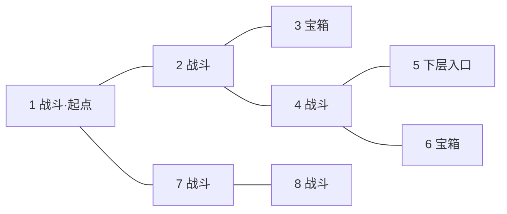
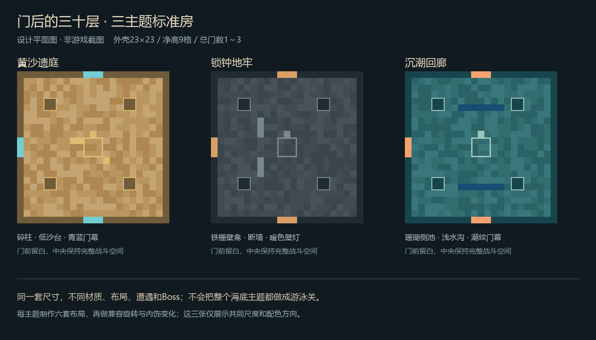

# 随机房间地下城 · 玩法与建筑设计

2026-10-18设计原稿；2026-10-19按用户后续确认补充以下实装口径。下文未覆盖的首领机制仍是未来提案，不代表已经完成。

## 后续确认与本轮实装口径（优先于原稿）

- 独角兽门也启用，新增第四主题**星眠幻庭**。四主题各30层，独立维度 `tnc:rift_dungeons`。
- 用户要求先完成杂兵和地下城，专属Boss机制以后再设计。因此当前每五层是明确标注“基础版”的守关试炼，不把原稿十二个专属首领计为已完成。
- 单人每五层段一次倒地自救；多人无限次倒地、禁止自救、只能队友救，全员同时倒地才失败。失败保留背包装备与经验，扣本段未结算遗币20%。普通下层、退出和重登不恢复单人机会。
- 十类28种杂兵使用独立家族几何与配色、职业武器、基础动作和AI，Blockbench源文件已提供。
- 当前八房拓扑采用连通树，最多三门；六种室内布置已区分，标准房中心间距40格，普通走廊内长约17格，大型守关房为49×49。扩展环路暂未启用。
- 六种奇遇、宝匣、三种当段祝福、行商、五层存档、个人奖励、队伍邀请、酒馆报告和新增FTB章节在本轮范围内。四种主题材料先作为收藏／交易战利品，专属工坊配方和种养奖励联动留待细化。
- 断线重登进入确认保护状态，不能攻击、被锁定或交互；点击提示或 `/dungeon resume` 继续。原来已倒地的玩家保持倒地，不能通过重连自救。
- 运行包新增一个章节，原有任务书逐文件保留；天空岛、家庭系统和用户世界建筑不改。
- 具体测试入口、规则、队友更新与素材来源见 [地下城测试与队友更新](../../地下城测试与队友更新-20261019.md)。下文保留最初三主题及完整Boss提案供后续设计使用。

## 1. 已确认的核心

- 一个主题地下城有 **30 层**，第 **5、10、15、20、25、30 层**有 Boss；每个主题有不同的最终 Boss。
- 一层由有限数量的方形房间组成。进入房间后可能遇到战斗、宝箱或通往下一层的入口；选门影响探索顺序。
- 单个房间共有 **1～3 个门，包含来路**。可以回头，岔路不会把玩家永久关死。
- 普通层采用“5 间战斗 + 2 间宝箱 + 1 间下层入口”的八房间组合作为基准。
- 房间结构简单，少量内饰，但主题、照明、空间层次与战斗可读性需要认真设计。
- 地下城使用独立维度；主世界的大门建筑作为进入入口。
- **用户已确认：每打败一位 Boss 保存进度，可分段挑战。** 解锁的起始楼层为 1／6／11／16／21／26。
- **用户已确认：死亡保留装备与背包，重打当前五层段，损失少量本段新得的地下城代币。**
- **用户已确认：入口是野外的大门，作用等同传送阵，进入后前往独立地下城维度。**

这里的“层”是挑战进度编号，不需要在地底真实叠出三十层。世界高度、房间高度和 Boss 体型因此不互相限制。

## 2. 推荐的随机方式

### 三种可选实现

| 方式 | 体验 | 取舍 |
|---|---|---|
| **有限房间图 + 实际房间与走廊，推荐** | 选门、走岔路、回头寻路；清过的地方仍在 | 空间关系明确，容易理解与测试 |
| 门门传送，进入后才决定目标房间 | 像不断抽下一张房间牌 | 更省空间，但来路和方向感较弱，容易变成开门抽奖 |
| 一张固定大迷宫，只随机刷怪和宝箱 | 好做地图记忆 | 重复挑战路线相似，不符合这次最重要的随机探索 |

推荐采用第一种：每次开始一个五层挑战段，先确定本段的种子与房间连接；走过的门始终通往同一个地方。下一次重新挑战该段才重新生成。

### 房间图必须满足的规则

1. 所有房间连通，下层入口一定从起点可达。
2. 第一间为普通战斗房，确保每层至少打一场，不会连续无战斗直降三十层。门外另有安全落脚小平台，不计入八间。
3. 其余房间类型随机分配，入口不会永远放在最远处；有时第二间就找到，有时要探索到最后。
4. 每个房间实际总门数为 1～3；不需要的墙面不生成假门。
5. 基础拓扑是一棵有岔路的树；部分层可增加一条满足三门上限的环路，改变绕行路线。不会用环路制造无解机关。
6. 房间通关一次后保持清空，宝箱领取一次后保持开启。来回走不会重新刷怪或重新发奖励。
7. 未探索门外保持未知；探索后显示来路、已清理和未探索状态。玩家可以根据自己的记录寻找剩余岔路。

“最差走完八间就能找到出口”，准确指 **访问最多八间不同的房间**。岔路需要折返，实际穿门次数可能大于八。小地图应把已走路径画清楚，避免让玩家在空房里迷路。

### 八房间示例

下面只是某次生成结果，游戏中不会提前揭示宝箱与出口位置：

玩家可以 1→2→4→5 快速下层，也可能先绕去 7、8 或 3、6。探索额外房间换取战利品，提前找到出口则有权立即离开。

## 3. 每层内容与节奏

第一版先把八房间规则做稳定。数据结构允许调整为 6～10 间，但不同时给每层叠加几十种随机规则。

| 层的类型 | 八房间构成 | 下层规则 |
|---|---|---|
| 普通层 | 5 战斗、2 宝箱、1 出口 | 找到出口即可下层 |
| 奇遇变体普通层 | 4 战斗、2 宝箱、1 事件、1 出口 | 一间战斗替换为事件，不强迫清全层 |
| Boss 层 | 4 战斗、2 宝箱、1 整备、1 Boss | 击败 Boss 后在其房内打开出口并保存进度 |

事件层概率建议 25%，每层最多一个，先保证战斗和寻门是主体验。第 30 层 Boss 后为主题通关宝库与返程门，不再生成第 31 层。

普通战斗房以 20～45 秒有效战斗为调优目标；一个五层段目标 15～25 分钟，探索较多时可更长。三十层通过六次分段游玩完成，不要求一次通宵。

同一层保留“快速下层”和“多拿几间奖励”的取舍。宝箱里有补给、修复资源与本段祝福，继续探索有价值；不通过强制收集三把钥匙取消玩家运气好时提前下层的乐趣。

## 4. 房间建筑：少而精的模块

### 统一规格

- 标准房外壳 **23×23**，净空间约 **21×21**，净高 **9 格**。大部分墙面完整，顶部封闭，避免普通房刷出后被太阳烧死。
- 门洞宽 3、高 4；短走廊宽 3、高 4，长度 5～9 格。门洞有统一的主题门框。
- 每个主题至少六套标准房布局：空心中央台、四角碎柱、两侧壁龛、低矮断墙、对称双平台、环形浅沟。
- 一套布局再随机旋转、镜像，并从兼容的内饰点位选择少量装饰。旋转只是增加变化，不能拿它冒充六套不同房间。
- 通道、出生点、门前至少留出两到三格可通行空间。低台高一格且设台阶，不能让没有位移法术的玩家卡住。
- 战斗道具大多是低矮掩体，中央保留至少 9×9 的主要战区。远程敌人有站位，近战敌人能到玩家身边。
- 宝箱房沿用房间外壳，布置更安静；中央宝箱台、四周两到三件装饰和明显照明，不做满墙豪华装修。
- Boss 使用独立 **49×49～65×65** 场地、净高 20～28 格。最终尺寸根据 Boss 实际模型与技能范围验收，不能为凑标准格把大型首领缩成玩具。

### 三个主题的美术

| 主题 | 建议名称 | 主材与色彩 | 少量特色内饰 | 光与声音 |
|---|---|---|---|---|
| 沙漠 | **黄沙遗庭** | 平滑砂岩、切制砂岩、少量红砂岩，暗铜与青蓝点缀 | 半埋石柱、碎陶罐、低沙台、墙上小块几何嵌纹 | 暖色壁灯，间歇细沙与低风声 |
| 地牢 | **锁钟地牢** | 深板岩砖、苔石砖、铁栅、旧木与暗红布 | 断锁链、空囚笼、书架角、废弃看守桌 | 克制的暖灯与远处钟响，入口路线有可辨识亮点 |
| 海底 | **沉潮回廊** | 海晶石、暗海晶石、浅色石英边线、玻璃，蓝绿与珊瑚橙 | 玻璃后的深水、侧边珊瑚池、古旧水闸、贝壳状浮雕 | 蓝绿微光、水声、远处游过的影子 |

海底普通房默认可以正常走路与施法；部分变体有浅水沟或侧边水池。完整水下战斗放在明确提示的特殊房，避免整条路线都受游泳与水下呼吸限制。

所有房间都是我们新做的建筑模块。第三方大门只用于入口，不把别人的门当我们的原创建筑宣传。

## 5. 战斗不能只是随机塞几只怪

刷怪组合从“主题 + 深度段 + 房间布局 + 遭遇模板”中抽取。怪物只能出现在提前验证的刷怪点，不生成在墙里、玩家脚下或门外。

| 遭遇模板 | 内容 | 玩家体验 |
|---|---|---|
| 前压 | 一组近战，侧后方一名脆弱远程 | 先处理远程或拉开近战 |
| 两翼 | 两侧小队错开出现，中间留活动空间 | 看位置而不是只对门口轰炸 |
| 看守与随从 | 一名可辨识精英加少量随从 | 优先级选择 |
| 短波次 | 两波，第二波有明显法阵提示 | 有喘息，不突然刷在背后 |
| 阵地 | 可破坏的房内增援晶柱加守卫 | 拆目标能减少后续压力，不影响是否能通关 |
| 敌术预警 | 同类敌人配合一次主题地面攻击 | 预警清楚，留安全区，不要求某个指定元素 |

普通房通常同时 3～6 名活动敌人，波次房总数约 6～10；单人以此为起点，不用几十只怪堆卡顿。刷怪法阵提前约一秒显现。玩家进房后封锁门内侧，离门洞安全距离后才开始，不能把人夹在门块里。

队伍统一整备后开战；迟到队友进入已封门房需经实例校验的安全入场点，不能给其旁路直通未清房间。清场后所有门一起开，清场判断只计算该房遭遇登记的敌人。怪物掉进无效位置、离开边界或丢失时应恢复战斗进度，不让玩家永远困在一间空房。

主题怪物先从已装模组的可用实体中挑选并实测。若给原版或模组怪物设置精英能力，应明确叫“精英变体”；只有有独立模型、动画和 AI 的才标为原创生物。

## 6. 三十层的阶段变化

| 层数 | 重点 | 新内容 |
|---|---|---|
| 1～5 | 认识主题与选门 | 简单组合、基础宝箱、首位守关者 |
| 6～10 | 多目标与站位 | 波次遭遇、第二种房间危险、第二位守关者 |
| 11～15 | 处理不同机制 | 强化精英、增援晶柱、第三位守关者 |
| 16～20 | 已学机制组合 | 更多布局组合，第一位守关者的进阶战斗 |
| 21～25 | 资源管理与路线取舍 | 高价值岔路，第二位守关者的进阶战斗 |
| 26～30 | 主题收束 | 最后阶段组合、独立最终 Boss、主题宝库 |

不只靠涨血量做阶段变化，也不每五层引入一套全新操作。前三个五层段逐步教规则，后半程把规则组合起来。标准难度按主题与层数固定；玩家装备变好后应该打得更轻松。

通关后可选择带词缀的更高难度，作为后续扩展。第一版不靠读取玩家最强武器实时抬怪物血量，抵消装备成长。

## 7. Boss 提案

每个主题先设计三名守关者和一名最终 Boss，共 **12 个不同首领**；20、25 层复用前两位守关者的模型，添加新的战斗阶段和场地交互。不是制作十八名毫无关联的新 Boss，也不能只是同一只怪改六个名字。

以下均为原创候选名与机制，**尚无对应新实体、模型或动画**。这份地下城提案不改写编剧已经定稿的正史人物与结局。

| 主题 | 5／20 层 | 10／25 层 | 15 层 | 30 层最终 Boss |
|---|---|---|---|---|
| 黄沙遗庭 | **巡砂甲卫**：重盾正面进攻，冲锋撞柱后露出空档；进阶版会分两段转向 | **流砂织者**：沙流把安全区缓慢推移，玩家打断蓄力可固定一侧沙流；进阶版出现两路交错沙流 | **埋日石像**：两只石手和核心轮换施法，先躲招再打暴露部位 | **沙冕执政官**：黄沙王座上的独立首领；旋转日轮、砂墙切区、王座坍落后三阶段交替 |
| 锁钟地牢 | **断链狱卒**：锁链横扫、拉近与砸地，链锚破坏后短暂失衡；进阶版使用双链 | **烛面审判者**：真身与烛影调换，观察面具和投影；进阶版增加可辨识的假蓄力 | **铁棺搬运者**：背棺前进，停下开棺时释放阵地攻击，侧翼有窗口 | **锁钟典狱长**：中央大钟决定三种攻击节拍；每轮只有部分区域危险，敲断场边锁扣能改变下一轮节拍 |
| 沉潮回廊 | **礁壳卫士**：横向冲撞与落水冲击，诱导碰撞场边礁柱露出腹部；进阶版加入回冲 | **回声鳐**：低空盘旋，按波纹节奏放出声浪，不飞到玩家无法攻击的天顶；进阶版增加第二条声浪轨迹 | **双潮侍从**：两只不同轮廓的护卫交替推进，击破一方后另一方进入短强化 | **沉渊司祭**：潮汐法环、升降水面、深水投影；主要战斗仍留有可站立平台，不把战斗变成持续憋气 |

三位最终首领必须有独立可识别外观、攻击预备动作和阶段变化。设计验收优先看“看得懂、躲得开、有输出窗口”，再加震撼特效。

已有灾变首领可作为另一种实现路线：沙漠远古遗骸、海底利维坦等进入特制大型竞技房。不过这些首领原本的场地、召唤和破坏行为需要实测，不能直接塞进 21×21 房间就宣称完成。现阶段推荐先按上述原创首领设计美术与机制；如要优先快速可玩，可另行选择现成首领路线。

公孙衍、Chiller Lynn 等正史人物不作为这里可反复刷取的最终奖励靶子；独立城堡维度也保留自己的用途。

## 8. 宝箱、奇遇与重复游玩的意义

### 宝箱不只装原版垃圾

| 类别 | 例子 | 用途 |
|---|---|---|
| 当段补给 | 少量料理、修复材料、法力恢复消耗品 | 支持再探索几间房 |
| 主题材料 | 日轮砂片、旧钟铜、潮纹贝晶，均为拟议新物品 | 对应主题装饰、法术特效外观或工坊配方 |
| 收藏 | 不同石板、壁饰、微型首领摆件 | 带回 RouchNao 的房子陈列 |
| 种养联系 | 少量稀有种子、饲养配方线索、厨房用香料 | 为经营提供新方向，实际种养仍要玩家去做 |
| 当段祝福 | 从三个简单效果中选一个 | 改变这五层的战斗手感，不新增永久神装通胀 |

祝福只作用于当前五层段，例：清房后缓慢恢复少量法力、首次受到攻击出现一层短护盾、移动施法短暂提高移速。同类效果有上限，不提供无限免费魔力；保存中途进度时保留祝福，重新开段时重抽。

### 首批六种奇遇

1. **迷路的行商**：出售少量补给与一个主题收藏；不用把全镇商店搬进来。
2. **三盏许愿灯**：选一盏获取当段祝福，另外两盏熄灭。
3. **沉睡的补给匣**：免费拿普通补给，或主动唤醒守卫挑战获得更好奖励。
4. **断路测绘员**：点亮本层一间尚未探索房的位置；不直接把出口强制标出来。
5. **会说话的旧门环**：给一条真实的路径提示与短笑话，不增加复杂长对话。
6. **归途石碑**：安全返回主世界，保存这次挑战的现状；下次可以继续，也可明确选择重新开段。

奇遇先服务选路、补给和魔法感，不能又变成玩家要背十种机器合成表。

## 9. 存档、退出与重打

### 永久进度与本次挑战分开

- **永久记录**：这个玩家／队伍已解锁哪个五层段、哪些 Boss 首次完成、收藏与首次奖励是否领过。
- **本次挑战记录**：实例编号、随机种子、当前房间、已清房间、已开箱子、当前祝福和怪物状态。
- 击败第 5 层 Boss 后解锁第 6 层入口，以此类推；第 30 层记录主题完成。
- 正常下线或退出可恢复同一挑战，不因重登重新抽箱子、刷新祝福或获得满血 Boss 奖励。
- 主动“重新挑战本段”会生成新布局；旧实例关闭，已领取过的首次通关奖励不再次发放。
- 战斗中断线时保存原房状态，回来先落在受保护的入场位置，确认后继续；不能一上线就被围杀。

### 死亡规则：已确认方向，建议数值

死亡保留装备、背包和经验，安全返回野外大门，当前五层段重置；永久解锁仍在，下次从最近已解锁的段首重打。不会让保留旧层房间状态与“重打当前段”同时生效。

建议只扣 **当前五层段尚未结算遗币的20%，向下取整**。例如之前已存下70遗币，本段新捡30，死亡扣6；旧70与本段剩余24都保留。银行铜币与存款完全不参与这个计算，也不掉落装备让玩家跑尸。

遗币作为地下城专用代币，主要兑换主题装饰、收藏和补给，不自动兑换成银行铜币。Boss 存档点将本段遗币结算为已保留余额；正常退出并选择继续时，未结算部分仍留在同一挑战中。主动放弃／重新开段采用同一20%结算规则，避免用反复退出重开绕过本段风险。行商先扣本段未结算遗币，已花掉的部分不再计算死亡损失。

界面只显示“本段遗币30，失败损失6”，不要求玩家理解后台账本。经验保留与20%比例属于本稿建议数值；装备背包保留和少量本段代币损失是用户已确认方向。

## 10. 独立维度与多人

推荐新增静态维度 **`tnc:rift_dungeons`**，三个主题都在其中使用互相隔离的实例区域。玩家看到的是完整封闭的主题房间，不是空中散落的测试盒子。

同一实例中各“层”放在分离的横向区域，通过楼梯光门进入下一层。这样不受世界高度限制，也不会一次加载三十层的全部怪物。后台只常驻玩家所在房间及必要邻区；房间建筑分批生成，准备完成后才放行传送。

标准房按网格放置，门只接相邻房间，走廊不交叉穿墙；Boss 房预留独立大面积边界，作为该层可达的末端节点，不能挤在标准房网格里压坏邻房。拓扑与建筑实际坐标一并校验。

实例按挑战编号和队伍绑定。两支队伍可以在同一主题打相同层数而互不影响；不为每个玩家动态新增一个维度。单人与 2～4 人协作为首批目标，开战人数固定参与本段平衡，进出门不能反复重算 Boss 血量。

队伍内各成员保留自己的首通奖励与解锁记录；只给实际参与战斗的玩家记进度。已解锁高层的朋友可以带低层玩家体验，但低层玩家不能直接跳过前序五层段的永久解锁。奖励领取由服务器核实实例、参与者与房间状态。

地下城内保护外壳与功能方块，不能挖墙逃课、放传送阵绕 Boss 或搬走宝箱。普通战斗破坏物由我们控制，Boss 和法术也不能打穿房间外壳。进入前显示这一规则，消耗正常战斗物品；退出回到进入时的大门安全落脚点。

## 11. 下载的大门怎么用

四份 ZIP 均附带 `.nbt`、`.litematic` 和 `.schem`，已经解析 NBT：方块命名空间只有 `minecraft`，没有附带实体。

| 文件 | 实际 NBT 尺寸 X×Y×Z | 建议用途 |
|---|---|---|
| `BWolfNPv5-54` | 53×54×63 | 黄沙遗庭入口：黑色狼像与暖砂岩基座形成对比 |
| `SkullNPv18-53` | 95×53×42 | 锁钟地牢入口：骷髅石门 |
| `GuardianNPv4-76` | 70×76×46 | 沉潮回廊入口：守卫者像，配海岸或湖边平台 |
| `DarkUnicornNPv3-62` | 52×62×80 | 保留作未来第四主题或公共地下城大厅入口，不为用完素材硬加第四个三十层主题 |

入口不是一个摆在镇中心的小方块。这些是大型野外地标，配地基、短路和安全传送区。先制作可单独放置的入口模板，选址与世界生成独立配置，不覆盖正在装修的天空岛，也不自动改造现有主世界建筑。

建筑原有黑曜石框只作为门框；真正的地下城传送触发区域由 TN-C 放置并绑定主题，不能点火后误进下界。门中心建议有该主题的轻薄流动门幕与低强度粒子，靠近显示主题、已解锁进度和队伍操作。

出处记录：随包说明出现作者 **MazaVili**，独角兽包附 [作者页面](https://www.patreon.com/MazaVili) 与使用说明。保留作者信息；本轮不把第三方原始 ZIP 或建筑文件上传仓库。后续发布包的素材清单单独记录来源和分发范围。

## 12. 与酒馆、FTB 和经济结合

第一次在酒馆委托栏领取地下城勘察，指向真实大门位置。进入大门后选择已经解锁的五层段；通关一个段落回酒馆交一次探索记录。正常再挑战直接从门进入，不必每次跑 NPC 做手续。

FTB 独立页建议叫 **「门后的三十层」**：地下城说明 → 首次进入 → 选门与回头 → 第一份宝箱 → 第一次守关 → 三个主题分支，各分支只列 5／10／15／20／25／30 六个里程碑。房间变化写在帮助页，不画出两百多个节点。本轮保持用户任务书不变。

收益的核心是主题材料、收藏与战斗玩法。铜币是辅助：建议每个五层段首次奖励约 200～600 铜，重复通关普通段约 30～90 铜，深层另按实际耗时调优。这里只是初始经济参数，需和当前委托、种养出售收益比较后确定；不把每次开门都变成发高额工资。

收藏可以做主题装修套装与首领纪念物，为买房、装修增加长期目标。地下城提供少量稀有种养起点，不能一箱倒出玩家种几个小时的全部农产品，削弱生活玩法。

## 13. 制作边界与验收

完整方案覆盖三主题、各三十层；底层生成与存档系统共用，建筑、美术、遭遇、首领数据分别配置。后续即使增加第四主题，也不用再造一套随机门和传送系统。

正式制作前需要选定首领路线：本稿推荐原创三主题守关者与最终首领；现有模组首领替代路线是缩短首批制作时间的备选。无论选哪条，都先做一段五层的可玩闭环检查空间、战斗和传送，再沿同一套规则填满三十层；这属于内部验证顺序，不能把只有五层的测试版称为整套地下城交付。

必须验证：

1. 大量随机种子都满足连通、门数 1～3、出口可达、房间配额正确、Boss 层出口条件正确。
2. 清场、开箱和传送状态保存后可恢复；反复进门、重登、崩溃重启不刷重复奖励或丢进度。
3. 普通怪、精英、最终 Boss 都能在实际房间寻路与命中；无位移技能的玩家也能走遍所有必要路线。
4. 多人分队、掉线、入场顺序和同时领取奖励互不串实例。
5. 分段死亡规则、返程、大门被破坏或坐标失效都有安全恢复位置。
6. 标准单人、四人队伍、连续连发法术与魔力视下检查性能；不靠无限堆怪、密集透明粒子营造难度。
7. 检查所有房间和大门的原生游戏截图，不能只用物品图标或概念图替代建筑验收。
8. 原有天空岛、独立城堡、任务书和队友的主线成果保持完整。

本轮依据：用户地下城描述、分段存档和死亡规则选择，以及野外大门传送用途确认；本机四份门蓝图；现有 `HeroskandRealm`、`BossCommissions` 和首领委托矩阵。没有假定现成地下城随机系统已经实现。
