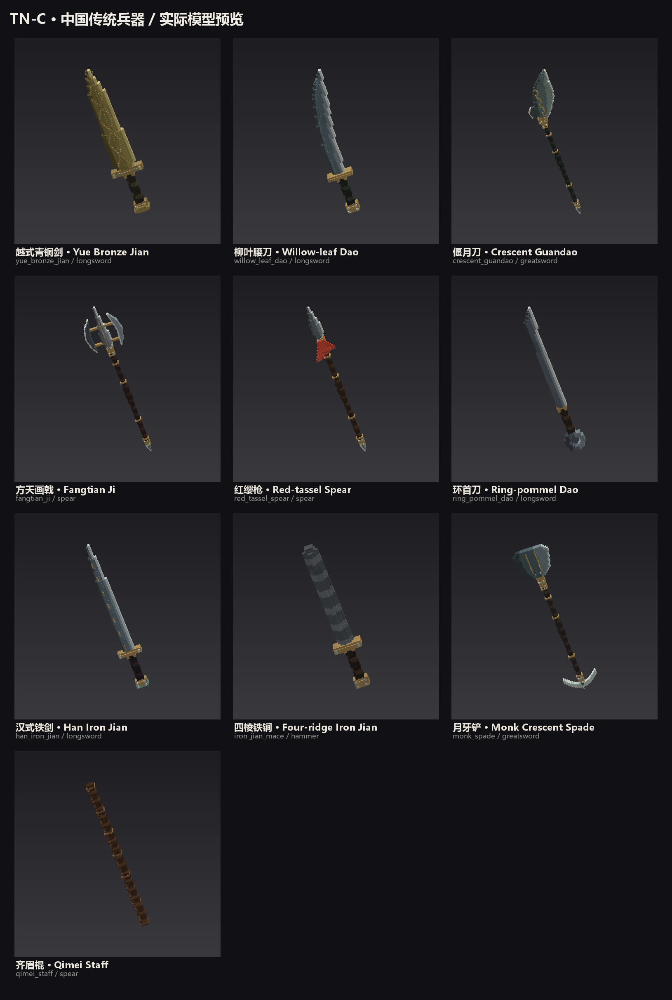
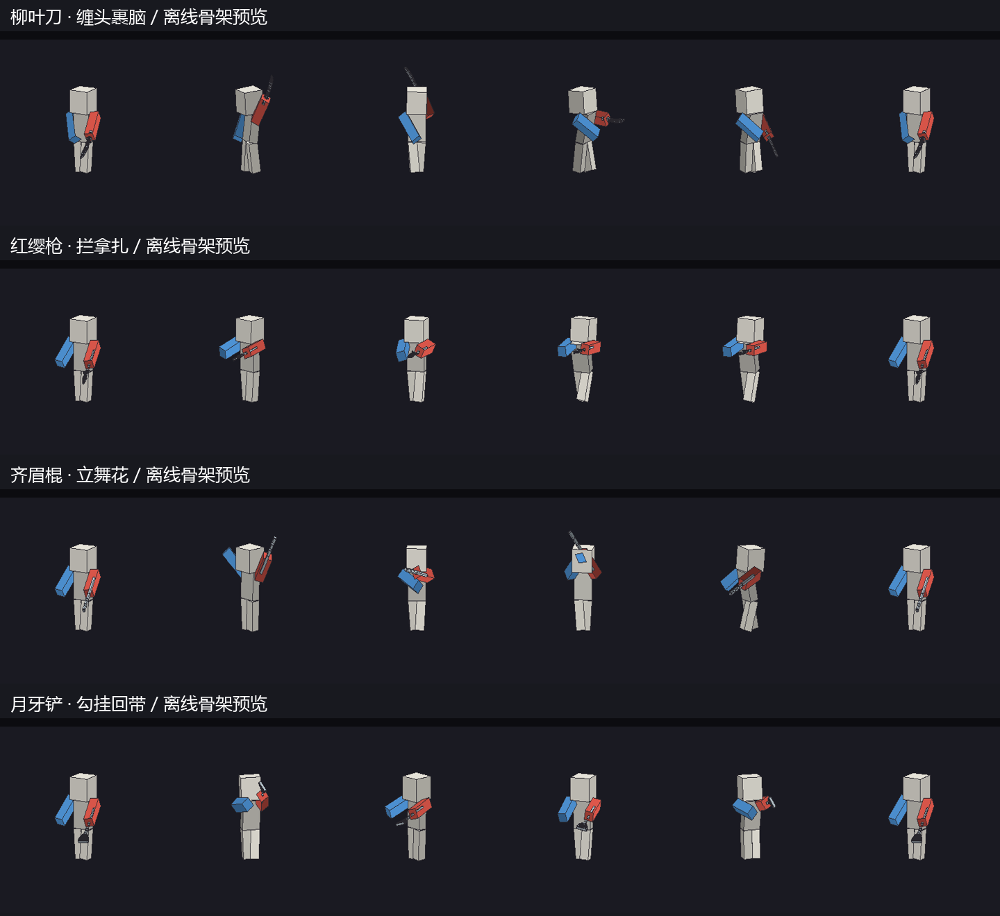

# 中国传统兵器（2026-11-05）

本轮新增十把可合成武器，沿用现有战士家族、Q/E 连招、Z 蓄力、双手姿态与虚影机制。用户追加要求后，补齐十种兵器各自的招式：57 个具名连招变体和 30 个普攻动作，共 87 份全身关键帧。输入、解锁、冷却和存档中的稳定技能 ID 仍共用既有体系。实际游戏模型由 `tools/weapons/traditional_weapons.py` 生成，沿用现有 quarter-unit 方块锻造与 128×128 有限色阶图集。

| 名称 / ID | 家族 | 实际基础伤害 | 攻速 | 耐久 | 详细模型 / 虚影块数 |
|---|---|---:|---:|---:|---:|
| 越式青铜剑 `yue_bronze_jian` | 长剑，单手 | 7 | 1.8 | 720 | 945 / 32 |
| 柳叶腰刀 `willow_leaf_dao` | 长剑，单手 | 7 | 2.0 | 800 | 711 / 31 |
| 偃月刀 `crescent_guandao` | 重剑，双手 | 9 | 1.0 | 1100 | 1459 / 37 |
| 方天画戟 `fangtian_ji` | 长枪，双手 | 8 | 1.2 | 1100 | 1168 / 50 |
| 红缨枪 `red_tassel_spear` | 长枪，双手 | 7 | 1.5 | 900 | 948 / 46 |
| 环首刀 `ring_pommel_dao` | 长剑，单手 | 7 | 1.7 | 900 | 551 / 43 |
| 汉式铁剑 `han_iron_jian` | 长剑，单手 | 7 | 1.8 | 850 | 773 / 36 |
| 四棱铁锏 `iron_jian_mace` | 锤，双手 | 8 | 1.2 | 1250 | 581 / 30 |
| 月牙铲 `monk_spade` | 重剑，双手 | 8 | 1.1 | 1000 | 1330 / 35 |
| 齐眉棍 `qimei_staff` | 长枪，双手 | 5 | 1.9 | 700 | 943 / 8 |

伤害 = 玩家基础 1 + 铁质等级 2 + SwordItem 附加值。偃月刀选用重剑的劈斩/横扫动作，而非以突刺为主的枪动作。武器基础属性保持现有武器池的范围。

## 形制与参考

- [湖北省博物馆：越王勾践剑](https://www.hbww.org.cn/zgzb/p/4694.html)、[故宫：越王者旨於赐剑](https://www.dpm.org.cn/collection/bronze/230196.html)：青铜剑采用直身双刃、收尖、短格、分层剑首的轮廓。模型加入菱纹、双面脊线和青绿嵌饰；这是越式设计，不是对某一件文物的等比例复刻，未伪刻文物铭文。
- [大都会博物馆：清腰刀 36.25.1477a,b](https://www.metmuseum.org/art/collection/search/31110)、[馆刊：Some Notable Sabers of the Qing Dynasty](https://resources.metmuseum.org/resources/metpublications/pdf/Notable_Sabers_of_the_Qing_Dynasty_at_MMA_The_Metropolitan_Museum_Journal_v_36_2001.pdf)：柳叶腰刀采用渐弯的窄长单刃、短握柄和盘形护手，细槽沿刀背弧线延伸。颜色取青灰钢、旧金包件和深绿缠柄。
- [故宫博物院：武备仪仗](https://www.dpm.org.cn/collection/defenses.html)及[清宫武备资料](https://www.dpm.org.cn/Uploads/File/2024/09/25/u66f373f3bd682.pdf)：作为长短兵器类别及材料背景。偃月刀采用经典长杆、宽弧刃、背钩、金属吞口和尾鐏，云纹为本项目设计。
- [国立传统艺术中心：戟（方天画戟）](https://collections.culture.tw/Object?RNO=MTEyMDAwMDYwOTA%3D&SYSUID=17)：参考戏曲兵器的月牙翅与戟头组合。本轮采用双耳轮廓、中央矛尖、两条跨接梁和真实镂空；属于经典演义/戏曲视觉，不宣称为吕布所用实物的考古复原。
- 红缨枪取经典枪尖、木杆、枪缨、尾鐏构成。叶形钢尖、细长枪脊、金属箍、13 束阶梯红缨均为独立体积；缨束目前为静态模型，未实现布料摆动。

第二批形制参考：[南昌市博物馆汉环首铁刀](https://www.nchbwg.cn/product/241.html)、[国家博物馆秦汉文明展玉具铁剑](https://www.chnmuseum.cn/Portals/0/web/zt/20170916qhwm/pc/index.html)、[新华军事锏专题](https://www.xinhuanet.com.cn/milpro/20250327/7ef653b01dde4969b1b91d64f4612215/c.html)、[月牙铲头馆藏](https://tcmb.culture.tw/zh-tw/detail?id=131000003193&indexCode=MOCCOLLECTIONS)。环首刀的环为真实空心；铁锏保留钝头四棱，无刀刃；月牙铲前为宽铲，尾部为横置月牙；齐眉棍采用通体木色和木节。铁锏采用当前锤类双手动作，是游戏适配，不宣称复刻传统双锏套路。

十把武器各有独立贴图。金属纹样、脊线和缠柄可从侧面观察；每把均生成轻量虚影，握点与实物完全一致，避免每次放大虚影重复提交上千个方块。刀光增加匹配兵器材料的颜色，不改队友正在调整的拖尾算法。



## 武术招式适配

动作参考[教育部体育教育主干课程教学指导纲要](https://www.moe.gov.cn/srcsite/A17/moe_938/s3273/200409/t20040929_80791.html)、[国际武联武术套路竞赛规则](https://iwuf.org/wp-content/uploads/2018/12/Rules_of_Taolu-Chinese.pdf)、[北京大学少林棍术介绍](https://pe.pku.edu.cn/info/1401/14408.htm)。这些来源说明基本器械方法；本项目把基本方法编成游戏连招，不冒称某门派的完整传统套路，也不将现代剑术倒称为汉代实战复原。

- 剑：刺、挂、撩、点、腕花。青铜剑偏紧凑直刺，汉剑偏长线穿刺与左右挂撩。
- 刀：劈、斩、撩、缠头、裹脑和云刀。腰刀的环绕过肩轨迹与环首刀的短促连劈分开制作。
- 枪：外拦、内拿、收枪送扎，另有回马扎枪。直刺为 35° 窄扇面，回枪与拿枪有独立关键帧。
- 棍：劈接戳、横架、立舞花和转身低扫。舞花走左右立圆，扫棍用 230° 扇面；与枪的直刺在服务端命中范围上实际不同。
- 偃月刀、画戟、铲和锏：分别强调重劈拖刀、月牙勾挂、推铲回带、钝器短打；长柄副手参与动作，单手剑的副手保持平衡。

完整列表见 `model-source/traditional-weapons/martial-moves.md`。键位继续统一：QZE 主攻、EQE（末 E 长按）振刀、EQZ 破振刀、QEZ / ZQE / ZZQ 为兵器特色，枪类只有前五槽。保留原磨砺与训练解锁、耐久消耗、伤害倍率和冷却；兵器变体改名称、动作描述、骨骼关键帧、攻击半径/扇面与位移。技能 ID 不变，换武器不能绕过同族技能冷却。

命中时点沿用既有终结技结算；连劈、拦拿扎等表现中的准备/衔接动作不会额外增加伤害次数，本轮没有加入逐段多次伤害时轴。

服务端侧面命中测试暴露并修复了旧 `inArc` 把 181–359° 扇面错误压成 180° 的问题。现在 230° 的扫击按真实半角结算，35° 枪刺仍保持窄扇面，360° 全周判定保持原语义。

K 图鉴、HUD 接招提示、连招触发提示和 `/tempering combo` 显示当前所持兵器的招式；F3+H 高级物品提示列出整套按键。第一人称、第三人称和整身转向共用同一武器关键帧选择。协议沿用当前工程的 29，没有增加动作枚举；仍需双方使用包含本批模型和动作的版本。

生成器：`python tools/weapons/martial_arts.py`。数据：`assets/tnc/warrior/traditional_martial_arts.json`；关键帧：`assets/tnc/animations/entity/traditional_martial_arts.json`。使用 `python tools/weapons/preview_martial.py` 可生成下列离线骨架预览，预览使用对应虚影模型，不是客户端截图。



## 获取与制作

创造模式 TN-C 页签已按家族加入全部十把；生存合成分组为 `tnc_weapons`。

| 武器 | 配方（三行，自上而下；空格为空位） |
|---|---|
| 青铜剑 | ` G ` / ` I ` / ` S ` |
| 柳叶刀 | ` II` / ` GI` / ` S ` |
| 偃月刀 | ` II` / ` SG` / ` S ` |
| 方天戟 | `IGI` / ` I ` / ` S ` |
| 红缨枪 | ` I ` / `RSR` / ` S ` |
| 环首刀 | ` II` / ` SI` / ` G ` |
| 汉式铁剑 | ` I ` / ` I ` / ` GS` |
| 四棱铁锏 | ` II` / ` II` / ` GS` |
| 月牙铲 | `III` / ` S ` / `GSG` |
| 齐眉棍 | ` S ` / ` S ` / ` S ` |

I = 铁锭（Forge 标签），G = 金锭（Forge 标签），S = 木棍，R = 红色羊毛。青铜剑使用现有铁/金材料表示青铜工艺，以兼容整合包且不添加独立冶炼链。

试玩：`/give @s tnc:yue_bronze_jian`，替换为表中其他 ID。检查背包图标、第一人称左右手、F5 双手、Q/E 连招、Z 蓄力松手、虚影方向与普通附魔显示。

## 源文件与验证入口

生成器只覆盖本批十把武器的模型、贴图、预览及清单，不重画旧武器。修改美术后执行：

```powershell
python tools/weapons/traditional_weapons.py
python tools/weapons/martial_arts.py
python tools/weapons/validate_traditional.py
python tools/weapons/validate_assets.py
.\gradlew.bat test --tests 'com.tnc.tnc.warrior.*' jar --console=plain
.\gradlew.bat runGameTestServer -PwarriorTests --console=plain
```

资源检查覆盖详细/虚影二十份模型、有效坐标、正体积、不透明 UV、双手握点、虚影挂载一致性、家族标签、翻译与配方键。`WarriorMartialArtsTest` 核对十套招式的冷却索引、解锁/伤害/振刀语义保持、57 份连招和 30 份普攻关键帧存在。`TraditionalWeaponGameTests` 在真实服务端注册表和已加载数据包中核对十把武器的分类、耐久与配方输出，并检查窄扇面枪刺不命中侧面、宽扇面棍扫可以命中侧面。

测试启动修正：`-PwarriorTests` 现在自动配置 Mixin 开发映射并加入 GeckoLib 运行依赖，避免未进入 GameTest 就因既有水上行走 Mixin 或缺失 GeoEntity 而终止；生产 JAR 不打包该依赖。

本轮没有拉取源码或安装到正式游戏实例。生成的图片是生产资源的离线预览，真实客户端的光影、握持和战斗观感仍需试玩；存档和任务未修改。

## 最终验证记录

- 资源检查：十把武器，9409 个详细方块、二十份详细/虚影模型通过；旧武器 26 份资源检查通过。
- 战士 JUnit：195 项通过；真实服务端 GameTest：54 项全部通过，包括十武器配方/家族、枪刺与棍扫侧面判定。
- 十份新配方与现有 TN-C 有序合成配方（含镜像）无冲突。
- 开发构建 `build/libs/tnc-1.0.0.jar` 内本批模型、贴图、配方、57 个招式规格和 87 份动作与生产资源逐字节相符。
- JAR SHA-256：`b98a5b519304c1189e5dc9b374f28a65607462ea2a2b83903fe97d8f404cf542`。此为当前工作区开发构建，未安装到正式实例；不代表其他系统的完整回归。
- 日志：`work/traditional-martial-confirmed-20261105.log`；离线预览不替代真实客户端验收。
