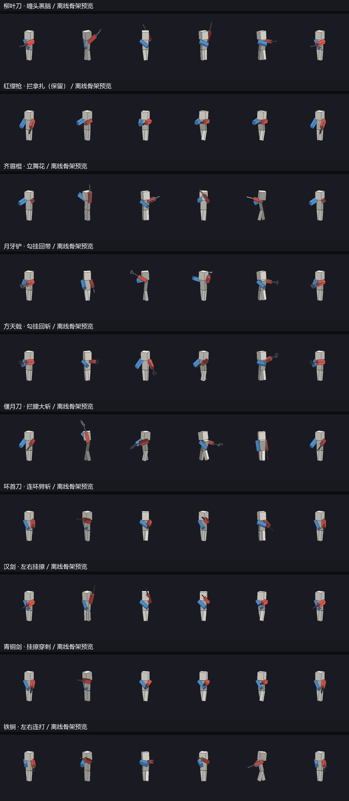

# 传统兵器横向动作、剑气恢复与八倍成长

本轮按用户反馈降低动作重复性，并保留已经认可的红缨枪。调整范围是十种传统兵器中的另外九种，红缨枪 5 个连招与 3 个普攻的关键帧逐项保持一致。

## 动作

此前多把武器共用 `ROUTES`，只调幅度与名称；第一人称还把手臂角压缩成小角度，横向变化不明显。现在 `tools/weapons/martial_signatures.py` 为九种武器定义独立引器/释放/回收路线，区分主攻、振刀、破架、特色、撤步和反向动作。

| 兵器 | 重点表现 |
|---|---|
| 柳叶刀 | 贴肩绕背、缠头裹脑后横斩 |
| 环首刀 | 两次方向明确的短促连劈 |
| 青铜剑 | 贴身挂开、横撩接直刺 |
| 汉剑 | 高低换线、左右挂撩后穿刺 |
| 偃月刀 | 长时间引器、沉腰大横斩、明显回收 |
| 方天戟 | 向外勾挂、向内回带、翻刃横斩 |
| 月牙铲 | 宽面推带、铲尾勾回、交替换端 |
| 铁锏 | 左右短打、护手参与防守，减少长器械式抡圆 |
| 齐眉棍 | 左右立舞花、上下换把和低扫 |

参考[国际武联技法规定](https://iwuf.org/wp-content/uploads/2018/12/Rules_of_Taolu-Chinese.pdf)与[北京大学棍术课程说明](https://elective.pku.edu.cn/elective2008/edu/pku/stu/elective/controller/courseDetail/getCourseDetail.do?course_seq_no=BZ2021104130260_17921&kclx=BK)。属于基于基本技法的游戏夸张，不宣称还原某门派的完整套路。

第一人称 `WarriorMartialViewMotion` 从同一套实际手臂/身体关键帧采样横向位移、俯仰、偏航和侧倾，以起手姿势为零点，收势回到零点；左右手镜像，武器横向位移限制在 ±0.38。它只改手持模型矩阵，不旋转镜头或修改瞄准。红缨枪沿用原第一人称路径。

生成：`python tools/weapons/martial_arts.py`；预览：`python tools/weapons/preview_martial.py`。预览使用生产关键帧与对应虚影几何，为离线骨架验收，不是游戏截图。

## 剑气

排查发现 `WarriorWaves.tick` 已没有调用点，旧注释仍指向已删除的 `WarriorCombatEffects.arrowTick`。现在剑气拥有自己的服务器 LevelTick 订阅，推进、命中、到期删除与服务器停止清理不再依赖箭或粒子逻辑。

同时修正可读性：原空中弧面沿上下方向和前进方向展开，从施放者正前方看几乎只有薄边。现在横向带少量倾角展开，复用 `WarriorTrailRenderType` 与 `WarriorTrailAppearance` 的透明自发光层、武器外壳色与元素亮芯；增加暗轮廓、细亮刃和短后影，保留垂直薄脊的体积。剑气从客户端收到包时开始播放，避免服务器/客户端时钟差和延迟把短寿命效果直接跳过。

所有近战的攻击型终结技都有对应剑气或地波；振刀、破振刀、后撤与弓技能不额外生成。已有规格保持，补齐未登记的攻击招式。剑气在服务端阻挡于实体方块，并沿用近战友军/PVP/宠物过滤和视线检查；每个目标每道剑气至多命中一次。

## 八倍成长

统一来源为 `WarriorReach.MIN_PEAK=3 / MAX_PEAK=8`。磨砺 0 / 5000 / 10000 对应攻击峰值 3 / 5.5 / 8；待机与收势仍回到 1。重武器实体、轻武器虚影、原版鼠标触及、Q/E、终结技、蓄力与反击均读取同一曲线。同步包保留对旧范围的读取兼容，客户端储存的倍率仍封顶 8。无需迁移磨砺数据或存档。

## 验证与交付边界

检查包含九种特色动作的屏幕横向跨度、左右手镜像、动作起止归零，八倍峰值与判定一致性，以及真实 LevelTick 推进剑气、只命中一次和到期清理。运行日志：`work/warrior-verified-pass-20261106.log`。本轮使用 `work/warrior-verify-project-20261106` 独立工程快照，避免与其他聊天同时构建互相覆盖；其中附带文档和教官模型等单测夹具。

本轮未安装到实际游戏实例，未改存档和任务；第一人称视野占比、光影材质和实际打击手感仍待真实客户端试玩。

最终验收：201 项战士 JUnit 单测通过，6 项剑气/八倍范围 GameTest 全部通过（`work/warrior-server-diagnostic-20261106.log`）。真实事件在第 2 tick 记录剑气命中一次，随后到期清理；其他五项检查原版鼠标、Q/E、终结技、蓄力、反击及剑/枪的放大范围。

开发产物：`work/warrior-martial-release-20261106/tnc-1.0.0.jar`；SHA-256：`b3d76c7d758d57a456060b81663eb4462e242697e8dfd7c7428023e908ce9d2a`。JAR 内生产关键帧与当前源资源逐字节一致，8 份红缨枪动作与本轮开始时完全一致，新类字节码为 Java 17。未安装游戏实例，未进行真实客户端验收。
