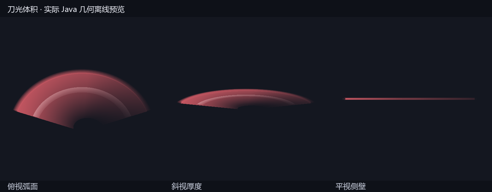

# 刀光体积与攻击虚影优化（2026-11-05）

本轮处理：快速挥舞时刀光断层、渲染开销偏高、刀光只有薄片、不同武器缺少配色辨识，以及虚影闲置时常驻。

## 最终表现

- 放大武器虚影只在攻击时出现；普通持握、长按蓄力、振刀架势都不显示。35 ms 淡入，收招后约 90 ms 淡出。原有微型龙/晶石等武器装饰仍保留，两者是不同的视觉结构。
- 刀光从真实 held-item 渲染挂载采样，包含武器自己的 item transform 和握点，左右主手共用。读取模型极端点估算剑尖；没有握点元数据的原版/贴图武器从实际烘焙顶点取边界，避免使用会被模型再次缩放的家族长度向量。
- 相邻采样以球面弧线插值方向，再恢复实际武器长度，快速大角度转动不会把轨迹中段插到剑身里面。低帧率时仍可补弧；一帧内超过半圈的旋转无法仅凭两个端点唯一恢复，不能替代真实帧率改善。
- 刀光是带正反表面、内外侧壁和端盖的扫掠体积，外缘羽化，内部有较亮的刃芯。长剑厚约 0.075 格，重剑 0.11 格，战锤 0.15 格，长枪 0.06 格；尾端随寿命收薄。
- 普通 alpha 混合保留武器颜色，深度测试正常，不写不透明深度。双面类型直接绘制一次，不再把每张片子正反重复提交。

| 武器 | 刀光外壳 |
|---|---|
| 龙之剑 | 赤金/玫红 |
| 霜月太刀 | 冰蓝 |
| 晨星细剑 | 晨金 |
| 赤霄斩马刀 | 赤橙 |
| 收割巨镰 | 紫晶 |
| 裂地战锤 | 金琥珀 |
| 破天戟 | 青蓝 |
| 普通重剑 | 钢蓝 |
| 普通战锤 | 古铜 |
| 长枪/风遗物长枪 | 青玉 |

灌注只改变亮芯颜色，保留武器外壳色；不会让所有冰灌注武器都变成相同的刀光。

## 渲染预算

- 实际武器模型不降细节。七把放大半透明虚影使用独立的轮廓模型，原 343–1541 块降为 14–78 块；握点和所有显示变换逐项对照一致。
- 近景至多 96 个插值截面，12 格外降为 40 个；32 格外不绘制这套刀光。单条近景扫掠最多 667 个四边形，远景最多 275 个。旧方案按 320 截面、外层/羽化/内芯/剑尖线和正反重复提交估算约 2500 个四边形。
- 原始轨迹最多 64 点，最密约 133 Hz；同一帧重复渲染不堆积样本。插值结果缓存，只有轨迹变化或远近预算切换时重建。
- 修复细分预算逐段四舍五入可能使总数超限的问题，改为整体整数配额分配。模型握点/剑尖元数据缓存，并在模型烘焙阶段预读七把武器，减少首次挥舞时读大 JSON 的开销。
- 换武器、换维度、登出、资源重载、远距离瞬移或长时间采样中断会清理轨迹。闲置时不绘制原先的常驻刃口薄片，也不重复绘制整把高细节虚影。

这些是代码与几何数量的上限检查，不是实机 FPS 提升的测量结果；尚未测客户端帧时间、Oculus/光影兼容和多人同屏观感。

## 验证

- JDK 17 独立源码副本构建、重混淆 JAR 成功。
- 战士单元测试 172 项通过，0 失败。新增覆盖快速 150°/180° 转动不缩短剑身、15/30/60/144/360 FPS 输入的严格顶点预算、三维侧壁、寿命完全消失、1000 组随机细分预算，以及闲置/架势/蓄力隐藏和武器配色区分。
- 七个低细节虚影资源的正体积、UV、范围、握点和 display 对照通过。
- 预览使用 `WarriorTrailVolumeTest` 从实际运行几何导出的数据；不是游戏截图。
- 本轮仅客户端视觉、纯数学和模型资源改动；未改伤害、攻速、连招按键或网络协议（仍为 27）。

## 安装与试玩

- 使用此前安装包为基底，只更新本轮 28 个 class/资源条目；工具逐字节核对其余条目保持不变，保留其他线程已经安装的内容。
- 实际实例：`E:\download\正式版 2.12.6.1\.minecraft\versions\元素觉醒1.4.3-魔改版-20260915`。
- 本轮安装 JAR SHA-256：`2171AE34ECB25CE5F9038ABCF3E2790129E7D47D91A472F342B7AE648858E5C7`。
- 旧包备份：实例 `backups/tnc-warrior-20261105-023643`。安装后哈希一致，存档未修改。
- 实际 ModernFix 配置仍只有一条有效 `mixin.perf.dynamic_resources=true`，保留原配置。
- 构建日志：`work/warrior-smooth-trail-final-20261105.log`。发布核对日志：`work/warrior-smooth-trail-verification-20261105.log`。
- 完整重启游戏，在 F5 下依次测试静止握持、走路、长按 Z、振刀：均不应有放大武器虚影；松手攻击、左右斩、旋转连招时出现，收招后迅速淡出。轮换七把元素武器，核对颜色、双手定位和侧视厚度。实机帧时间与观感仍待试玩确认。
