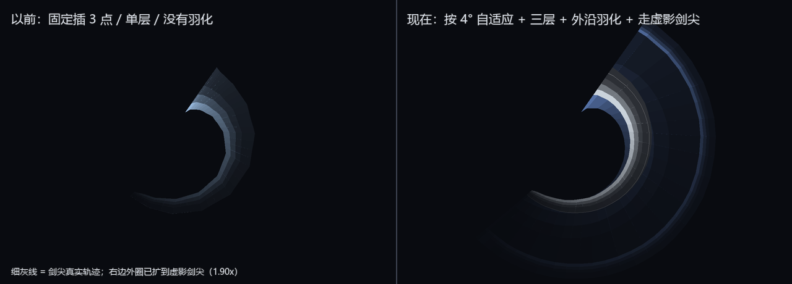

# 战士 · 刀光（剑尖光带）2026-11-01

> 目标：做出「影之刃零 / 黑神话」那种**刀光剑影**——连续的斩气贴着剑走，而不是一串会断开的粒子点。

## 一 为什么不用粒子

第一版是服务端 `ServerLevel#sendParticles` 撒 `dust`：

- 粒子是**离散的点**：60 fps 下两帧之间位移 0.3 格，点与点之间必然有缝，挥快了就是"一串珠子"；
- 每 tick 都要发网络包，远处玩家看到的是"重放"，跳帧时会看到断点；
- 想画"刃口"这种连续面，粒子数量要翻十倍才勉强，性能不划算。

光带是**连续的三角面**：一帧一个顶点列，相邻帧之间接成四边形，天生没有缝。
这也正是动作游戏里"刀光"的通行做法（记录骨骼末端最近 N 帧 → 连成 ribbon）。

## 二 架构

```
PlayerRenderer（default / slim 各一个）
  └─ WarriorTrailLayer            ← EntityRenderersEvent.AddLayers 挂上去
       ├─ WarriorTrail.sample()   读骨骼 → 记下这一帧的握把/剑尖世界坐标
       └─ WarriorTrail.render()   把历史连成四边形，加色混合画出去
WarriorPoseRender                ← RenderPlayerEvent.Pre/Post，根骨骼转身（回旋斩）
```

### 为什么挂在 RenderLayer 上

`RenderLayer` 是在**模型已经摆好姿势之后**执行的，拿到的 `PoseStack` 带好了玩家的朝向/缩放，
`getParentModel()` 就是当帧的骨骼。于是可以直接：

```java
poseStack.pushPose();
arm.translateAndRotate(poseStack);          // 骨骼当前世界变换
Vec3 hand = (±1/16, 0.125, -0.625);         // 手心（和 ItemInHandLayer 同一套偏移）
Vec3 tip  = hand.add(BLADE_DIR.scale(reach));
Matrix4f m = poseStack.last().pose();
poseStack.popPose();
```

`m` 是**相机空间**的矩阵，所以要把结果转回世界坐标（+ 相机位置）再存进历史；
渲染时再减掉当帧相机位置。这样镜头移动时历史不会跟着漂。

### 武器模型放大与剑长同步（2026-11-02）

用户："武器都长得太小个了"。三个物品模型的 `display` 一起放大，**剑长常量必须跟着改**，
否则刀光会比剑短一截、看起来"光从剑尖前面就断了"。

| 物品 | 第三人称缩放 | `WarriorBladeGeometry.length` |
| --- | --- | --- |
| ~~`tnc:sword`（Blockbench 3D）~~ 2026-11-03 已删除 | 0.97 → **1.45 / 1.5 / 1.5** | LONGSWORD 0.92 → **1.30** |
| `tnc:greatsword`（平面贴图） | 1.34 → **1.85** | GREATSWORD 1.16 → **1.62** |
| `tnc:hammer`（平面贴图） | 1.0 → **1.7**（新加 display 块） | HAMMER 1.02 → **1.42** |
| `tnc:bow` | 1.0 → **1.25** | BOW 保持 0（没有剑身） |
| 没有家族的短刃（斧等） | — | 0.80 → **1.05** |

平面贴图武器本来没有 `display` 块（继承 `item/handheld` 的 0.85），放大时要把父模型里的
rotation/translation 一起抄过来，只改 `scale`，否则武器会变成平躺在手里。
`WarriorBladeGeometryTest` 钉住了"重剑 > 长剑 > 短刃"和长剑 ≥ 1.2。
### 剑长与方向

- 剑长按武器家族取 `WarriorBladeGeometry.length(family)`：重剑 1.16 / 锤 1.02 / 剑 0.92 格，弓为 0（不画）。
- 方向固定为手臂坐标系里的 `(0, 0.45, -0.89)`（向前、略向上）。手臂怎么摆，这个方向就怎么跟着转，
  所以劈、扫、回旋都会自然变形，**不需要给每个动作单独配轨迹**。

### 渲染

- `RenderType.lightning()`：顶点色 + `LIGHTNING_TRANSPARENCY`（`SRC_ALPHA, ONE`，加色混合），
  无贴图、无光照，天然是"发光"的观感。
- 每个四边形正反各发一遍，避免背面剔除导致从某个角度看光带消失。
- 颜色按武器家族给：长剑冷白偏青、重剑钢白带金边、战锤暖白偏橙（`Tint`）；
  武器带元素灌注（`TncWeaponElement`）时优先用元素色 —— 风刃剑是青绿、火附魔是橙红。
  灌注标记在物品 NBT 上，客户端拿的是同一份数据，**不用加网络包**。
- 越老的段越透明、越窄（握把端往剑尖收），做出"斩气挥散"的感觉。

### 让它好看的三层结构（2026-11-01 第三版）

1. **外圈斩气**：从剑身某处起、偏暗偏宽、衰减快（指数 1.5），负责"斩气的体积"；
2. **内芯刃口**：更靠剑尖起、接近纯白、更窄更亮、衰减慢（指数 0.8），负责"刃口那条亮线"；
3. **剑影**：贴着**剑尖**走的一条细亮线（`dir × 视线` 让给镜头），再在靠近当前帧的位置
   垫一条 2.8 倍宽的淡光。斩气是面，剑影是线 —— 缺了这条线就只是"一片亮"，不像刀。

三层都是加色，重叠处自然更亮，再乘**挥速系数**（0.35～1.35）：慢慢比划只有淡淡一条弧，
全力一斩整条烧白。

### 顶点更厚（2026-11-01 第四版，打击感）

刀光"软"的根因是整条弧一样厚、一样白。现在在**当前刃口**那一段做两件事：

- **往外鼓**：最后几段沿剑身方向多伸出 13%（`bulge = 1 + 0.13·head`，`head` 是
  `(i/n)^4` 的权重），顶点比剑尖还外一点点，读起来"劈进肉里"；
- **压白加厚**：前端少掺白（`whiteScale × (1-0.30·head)`），让刃色/元素色压过白光；
  亮度再乘 `1 + 0.40·head`；剑影线本身也从 0.010 加到 0.030 宽（尾部细、顶点粗）。

结果：尾巴是收掉的一条细线，越靠近当前剑尖越厚越"深"，整刀有了力度差 ——
这是"顶点更深更厚"的实现方式。

### 衔接：每段两端各取自己的透明度（2026-11-02 第五版）

以前是"整段一个 fade"：第 i 段全用一个亮度，第 i+1 段又全用另一个亮度，
所以一条光带的**段与段之间是硬台阶**——这就是"影之间衔接不够流畅"的真正原因
（不是采样点太少，采样点再密，段内也是平的）。

现在 `ribbon(...)` 每段用两个透明度：`fadeA` 取上一段样本的年龄、`fadeB` 取这一段的年龄，
`quad(...)` 的 4 个顶点按 `fadeA / fadeB` 分别写入。一条光带从尾巴到刃口是连续变亮的，
中间不再有色阶。

### 武器特性：有没有刃决定画法（2026-11-02 第五版）

用户原话："锤子怎么也是剑影"。原因是常驻的 `bladeGlow` 对**所有**可挥武器都画了两层：
外层宽光晕 + 内层细亮线。那条细亮线就是"刃"，锤子根本没有刃，看着自然像把大剑。

`Profile` 新增 `edgeLine`：

| 家族 | edgeLine | 画法 |
| --- | --- | --- |
| 长剑 | true | 宽光晕（2.6×）+ 细刃口线 |
| 重剑 | true | 同上，光晕更厚更亮 |
| 锤 | **false** | 只有一层又宽又软的暖光（3.6×），没有刃口线 |

挥砍的斩气本身也早就分开了（见 `Profile`：锤没有剑尖拖尾、光带更短更厚、颜色偏暖）。
### 流畅度（2026-11-03 重做：按转角细分 + 共享端点）

用户的反馈是"人家的刀光剑影怎么那么顺滑"，顺着这句把几处硬伤挖出来改了：

| 毛病 | 以前 | 现在 |
|---|---|---|
| 快挥时一圈只剩十几个点，成了多边形 | 固定每两帧插 3 个点 | **按转角自适应**：每段最多 4°、最多拆 12 段（`WarriorTrailCurve`）—— 慢慢比划不浪费顶点，一秒两圈也够圆 |
| 段与段之间颜色是"跳"的 | 每段自己的透明度，端点没和下段对齐 | 每段两端各取自己的权重，且**相邻段共享的那条截线用完全相同的坐标与颜色**，插值连续 |
| 收招瞬间整条尾巴凭空消失 | 不在挥就 `TRAILS.remove(id)` | 停止采样但**继续按寿命淡出**，尾巴"收"进去；整条过期才丢数据 |
| 起手第一帧直接满亮度，"跳"出来 | 无 | 头部 90 ms 淡入（`headRamp`） |
| 亮度跟着两帧之间的抖动一起闪 | 直接用最近两帧算挥速 | 挥速系数做**指数低通**，而且混合系数按**帧间隔**算（时间常数 45 ms，60 fps 下等效 0.31）—— 写死每帧 0.35 的话，120 Hz 高刷屏上亮度会被抹得比 60 Hz 钝一倍 |
| 外沿是一刀切的硬边（尤其虚影那么大一片时） | 斩气到剑尖外沿就"停" | **外沿羽化**：虚影那层再往外多铺 14% 剑长，透明度线性收到 0（`GHOST_FEATHER`） |
| 极端快挥时顶点数会翻好几倍 | 无上限 | `MAX_SAMPLES = 320` 点/层，超了按 `WarriorTrailCurve#limit` **整体降密**（不是从尾巴砍点，形状不变） |
| 半透明虚影把斩气压暗 | 刀光先画、虚影后画 | **虚影先画、刀光后画**（`WarriorTrailLayer`）：加色的光盖在虚影上，才是"虚影在发光" |

> 2026-11-03 还试过自己造一个"三角形带 + 不剔除 + 不写深度"的 `RenderType`（理论上段与段
> 共享顶点最省），结论是**在 Forge 上做不了**：那套 `RenderStateShard` 常量是 `protected`、
> `RenderType.create` 是包内可见，唯一能读它们的办法是把工具类塞进 `net.minecraft.client.renderer`，
> 而 Forge 用 JPMS 装 mod —— `runGameTestServer` 直接报
> `ResolutionException: Module minecraft contains package net.minecraft.client.renderer, module tnc exports package ...`。
> 已退回原版 `RenderType.lightning()`（加色 + 顶点色），平滑度靠采样密度解决。

### 顺滑到什么程度：离线几何预览



这张图是 `tools/trail_preview.py` 把 `WarriorTrail` / `WarriorTrailCurve` 的几何**照抄一遍**
重画的：同一次挥砍（12 帧、约 195°），左边是"固定插 3 点 + 单层"，右边是"按 4° 自适应 + 三层 +
外沿羽化 + 走虚影剑尖（1.90x）"。能直接看出两件事：左边的折线在多边形的每一条弦上都有明显的
台阶，右边的大弧线是圆的；右边的外沿是渐隐的，左边是切出来的硬边。

**这不是游戏截图**（本机起不来客户端，见下），颜色和亮度是近似值；真实观感还是要在游戏里看。

### 对照：史诗战斗（Epic Fight）到底是怎么画的（2026-11-03 拆包）

用户点名"人家的刀光剑影怎么那么顺滑"，包在
`E:\download\正式版 2.12.6.1\.minecraft\versions\Immersive Fight 4.2.3\mods\epicfight-forge-20.14.4-1.20.1.jar`
（另有一份 `epic-fight-20.14.17` 在 NightfallCraft）。`javap` 拆开看：

| 项 | Epic Fight | 我们（现在） |
|---|---|---|
| 载体 | **粒子**：`AbstractTrailParticle extends TextureSheetParticle`，每帧往 `List<TrailEdge>` 里压一条边 | `WarriorTrail` 自己存样本队列 |
| 一条边 | `TrailEdge(Vec3 start, Vec3 end, int lifetime)` —— 两个点（剑根 / 剑尖）+ 自己的寿命 | `Sample(hilt, tip, ghostTip, at)` —— 多了虚影剑尖 |
| 采样 | `makeTrailEdges(List<Vec3> base, List<Vec3> tip, out)`：从动画骨架取两组点，**每 tick 一组**，边之间不做插值 | 每帧取一次，**帧间按转角插 1–12 段**（所以我们的曲线比它更密） |
| 混合 | `blendFunc(SRC_ALPHA, ONE_MINUS_SRC_ALPHA)`（普通 alpha），`depthMask(false)`，`disableCull()` | `RenderType.lightning()`：`SRC_ALPHA, ONE`（加色） |
| 几何 | `Mode.QUADS` + 带 UV 的顶点格式，**每段一个四边形** | 同样每段一个四边形（结论一致：四边形不是问题） |
| 柔边 | **靠贴图**：`TRAIL_EFFECT` 是「按 `TrailInfo#texturePath` 取一张渐隐贴图 + clamp-to-edge」 | 没有贴图，靠径向/时间两重 alpha 渐隐 |
| 亮度 | 普通 alpha 混合，重叠处会变"厚"而不是变白 | 加色，重叠处趋近纯白（更硬，但更"法术感"） |

结论：**我们的形态和它是一路的**（每段四边形 + 边列表 + 逐边寿命），差的是
① 采样密度（已补上，现在比它密）② 边缘柔化（它用贴图，我们用双层 alpha）
③ 混合模式（它 alpha、我们加色）。
第 ③ 条是有意的：加色更符合"剑气流"，且和剑气/刀波/龙共用一套观感；
真觉得太硬的话，下一步是给光带加一张 32×64 的渐变贴图（`RenderType.entityTranslucent` 路线），
那是新增贴图资源的事，不是几何的事。


`WarriorTrailCurve` 单独拆出来（纯数学、只依赖 `Vec3`），因为它有"每段 ≤ 4°"这种能被钉死的
不变量：`WarriorTrailCurveTest` 遍历 0–180° 验证"段数 × 4° ≥ 转角"（撞 12 段上限后按上限）、
退化/NaN 输入不许抛。

### 刀光以虚影为主（2026-11-03）

有虚影之后，画面主体应该是**放大后的虚影**，而不是真剑：

- **外圈斩气**（宽、暗、衰减快的那一层）终点走**虚影剑尖**：握把不变，剑尖按虚影倍率推出去
  （`Sample#ghostTip`）。磨砺越高虚影越大，斩气就越大 —— 放大了多少，斩气就厚多少；
- **内芯亮线**（窄、亮）仍然贴着**真剑尖**，所以真剑的刃口始终看得清，不会糊成一片；
- 虚影的倍率在别人屏幕上也能读到（`WarriorPhantomRenderer#scaleFor` 读同步过来的
  `WarriorPhantomScales`），所以别人也看得到你的斩气有多大；
- 虚影倍率同时在 2026-11-03 **加倍**：`WarriorPhantom.MAX_GROWTH` 0.45 → **0.90**
  （练满 1.45 → **1.90** 倍）。判定半径用的是同一个系数，所以连招手长也跟着到 +90%。

### 不同武器就是不同的东西

刀光参数按武器家族取整套 `Profile`，**不只是换颜色**：

| 武器 | 剪影 | 外圈 | 内芯 | 剑影 | 寿命(普通/终结技) | 采样 |
|---|---|---|---|---|---|---|
| 长剑 | 细、快、脆 | 从 18% 起，0.50 | 54% 起，1.00 | 有，0.60 | 200 / 320 ms | 16 / 26 |
| 重剑 | 宽、厚、慢，一片"风压面" | 从 2% 起，0.66 | 24% 起，0.82 | 有，0.66 | 280 / 440 ms | 20 / 30 |
| 战锤 | 暖而钝的一团闷光 | 从 0% 起，0.78 | 62% 起，0.62 | **无**（钝器没有刃） | 165 / 250 ms | 14 / 20 |

`WarriorTrailCurveTest` 钉住"重剑比长剑久、锤子没有剑影、三套参数不能抄成一样"。

终结技/架势（分量 1）动作更大更慢，用各自 Profile 的"终结技"那一档寿命与采样数。

## 三 什么时候有光

- **常驻**：手持本 mod 的近战武器就有一条刃口辉光（不挥也有），挥起来按速度变亮；
- **光带**：`player.swinging`（原版挥砍）**或**客户端有连招动作（`WarriorAnimationClient.active(id) != null`）；
- 剑尖这一帧移动不到 2 cm 就不采样（站着、慢走不会在剑上糊一团）；
- **收招不再"啪"一下清空**（2026-11-03）：停止采样，尾巴按各自寿命自己淡出去；
  整条都过期了才丢掉数据，所以收招是"收进去"而不是"消失"。

一个玩家最多约 60 个点 × 2 层 + 剑影，纯顶点色、无贴图；改成三角形带之后顶点数还少了一半
（原来每段正反各发一遍），开销可以忽略。

## 四 可调参数

**每把武器的整套参数**在 `WarriorTrail` 顶部的三个 `Profile` 常量里（见上表），
想单独调某把武器的手感就改它自己那一行，不会串到别的武器。

| 参数 | 作用 | 手感 |
|---|---|---|
| `life` / `finisherLife` | 光带寿命（普通 / 终结技） | 调大 = 尾巴更长更"糊"，调小 = 更干脆 |
| `samples` / `finisherSamples` | 最多几帧 | 和寿命一起决定弧线长度 |
| `outerAlpha` / `coreAlpha` | 外圈 / 内芯的峰值亮度 | 太大在暗环境里会过曝（顶点写了两遍，双面渲染时实际约 ×2） |
| `outerStart` / `coreStart` | 从剑身百分之几开始铺 | 越小越"裹住整把剑"，越大越靠前段 |
| `tipStreak` / `tipStreakAlpha` | 剑影开不开、多亮 | 钝器关掉才有"钝"的感觉 |
| `headBoost` | 当前刃口额外提亮 | 打击感的主要来源之一 |
| `WarriorTrailCurve.MAX_SEGMENT_DEGREES` | 相邻两帧之间最多转几度（4°） | 越小越顺，四边形数量线性涨 |
| `WarriorTrailCurve.MAX_SUBDIVISIONS` | 一段最多拆几段（12） | 顶点数上限，防止一帧转 180° 时爆量 |
| `HILT_RATIO` | 握把端暗到什么程度 | 越大整条越"实"，越小越虚 |
| `GLOW_IDLE` / `GLOW_SWING` | 常驻辉光的亮度（站桩 / 挥砍） | 站桩太亮会像发光棒 |
| `GLOW_WIDTH` | 常驻辉光半宽（格） | 0.02 左右比较像刃口，0.05 就是光剑 |
| `BLADE_DIR` | 剑在手里的朝向 | 剑看起来"歪"就调这个 |
| `HAND_FORWARD` / `HAND_DOWN` | 手心位置 | 同上，一般不用动 |

## 五 冲刺残影（速度线，`WarriorDash`）

战斗步法键（默认左 Ctrl）把人瞬间甩出去的那一下，在身后留三道淡光带。

- **为什么不画人物分身**：复制玩家模型要么重入 `PlayerRenderer`（会把所有渲染层、包括
  本 mod 的刀光层再跑一遍，容易递归或糊成一坨），要么改矩阵再画一次（拿不到半透明材质）。
  速度线传达的是同样的信息（"这一下很快"），但只是几片加色四边形。
- **触发**：水平速度 `≥ TRIGGER_SPEED`（0.55 格/tick）。疾跑 0.28、冲刺 1.9，
  门槛卡在中间，所以平常跑动不会满屏拉线；被爆炸/击飞推走也照样出线，画面统一。
- **停止采样会保留**：速度掉下去后旧点继续按 240 ms 淡完，不会一刀剪断。
- **画法**：三道高度（0.35 / 0.90 / 1.45），中间那道最亮；每片都面向镜头
  （`移动方向 × 视线`），越老越细，尾巴尖收掉。
- 单测 `WarriorDashTriggerTest` 钉住"疾跑不出、冲刺必出"这条线。

## 六 光箭（弓的连招箭；`glowArrow` 已于 2026-11-03 删除）

弓的连招射出去的箭不是普通箭：

- `setCritArrow(true)` + `setPierceLevel(1)`：必定暴击、穿一支，`setBaseDamage(5.2 × 倍率)`；
- `setGlowingTag(true)`：箭本身带发光轮廓；
- **元素色光尾已删除（2026-11-03）**：原来 `glowArrow` 会记住箭的实体 id + 到期 tick，
  `arrowTick` 每 tick 补一颗元素粒子拉出一条拖光。用户要求不要粒子特效后，这段连同
  `arrowTick` 里的箭分支、`ARROWS` 表一起删了；现在箭靠暴击星 + 发光轮廓辨认，
  颜色跟着武器灌注走（`WarriorEffectStyle`），不再有粒子尾巴。

## 七 命中火花（`WarriorCombatEffects#hitSpark`）

只在**真的造成伤害**（`hurt(...)` 返回 true）时出现，不是施放特效。

- 从被打中的那一点，沿**这一刀的挥向**甩出 7 颗（重武器 12 颗）`ELECTRIC_SPARK`，
  再掺几颗元素色的 `dust`（跟着 `/tempering effects` 与武器灌注走）；
- 方向靠 `sendParticles` 的 `count = 0` 重载：这时 `xDist/yDist/zDist` 是**初速度**，
  所以火花是朝一个方向飞出去的，不是原地炸开一团；
- 重武器另补一圈短促的 `CRIT` 白星，读起来"更重"；
- 普通三段斩、所有近战终结技都会走它，所以"打到没打到"一眼能看出来。

## 八 与其它光效的关系

- 剑身辉光/剑尖拖尾的服务端粒子版（`bladeGlow`）**2026-11-03 已删除**：这件事现在由
  客户端的 `WarriorTrail` 做（采样真实骨骼画光带），服务端不再参与。
- 终结技的环形刀光粒子也撤了，只留声音（`WarriorCombatEffects#finisherSound`）——
  先把动作看清楚。
- **龙之剑的龙**走客户端渲染（`WarriorDragonRenderer`），服务端只剩一声龙吼；
  以前那条用粒子拼的龙同样整段删除，没有开关。
- 盾反/格挡的火花仍走服务端粒子（小、短、只在真的挡住时出现），和刀光不冲突
  （命中火花沿用同一套 `style()` 取色）。

## 九 已知边界

- 第一人称看不到刀光（`RenderPlayerEvent` 只在第三人称/旁观触发）；
- 其它玩家的刀光走的是各客户端自己采样骨骼，坐标一致但采样帧率随各自客户端，
  所以两个人看到的尾巴末端可能差一两帧——视觉上无感；
- 加色混合在极亮背景（雪地正午）里对比度会下降，必要时把 `TIP_ALPHA` 提到 0.6；

## 十 测试

- `WarriorPoseRender.rootYaw` / `WarriorPose.rootYaw`：保证根骨骼 yaw 交给整只模型
  （单测：旋身斩 687.5°、左手取反、起手 0）。
- `WarriorDashTriggerTest`：疾跑不出残影、步法冲刺必出。
- `WarriorTrailCurveTest`：Catmull-Rom 端点/不过冲、**自适应细分**（遍历 0–180° 验证每段 ≤ 4°，
  撞 12 段上限后按上限、NaN/退化输入返回 1）、**顶点预算**（`limit` 等比降密、每段至少 1、
  预算够用就不动）、**五个家族的参数梯子**（厚度 锤>重剑>长剑>枪、余味 重剑>长剑>枪>锤、
  弧线长度 重剑>枪>长剑>锤；弓退回长剑那套）、三把武器的参数不能抄成一样。
- 渲染层本身没有自动化测试（需要客户端），排查时看两件事：
  1. `latest.log` 里 `TN-C: 连招关键帧 15 条` —— 动作数据加载了；
  2. 挥剑时第三人称有没有光带 —— 没有的话先确认挂的是新 jar（`logs/latest.log` 第一行时间）。
