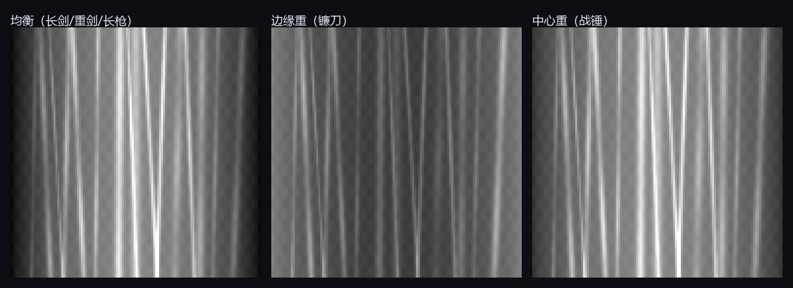
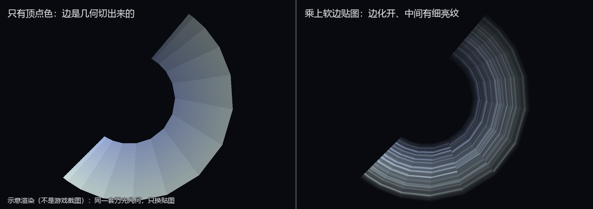

# 刀光软边贴图（2026-11-13）

## 一句话

刀光从"纯顶点色的四边形"换成**乘一张横向渐隐贴图**：光带两侧的边化开了，中间多了几条细亮纹，
不再是"一块贴纸"。这也是参考作品里刀光看起来"顺滑、有质感"最直接的一条：
几何决定走向，**贴图决定边**。

## 参考作品里在做的事

用户给的参考（抖音「像素小宝 / vibe知识大赏：游戏里的刀光是怎么做的」）打不开 —— 这个环境只能
取网页 HTML，抖音短链会跳到需要 App/JS 的落地页，抓不到画面。所以按下面对**同类刀光做法**的
拆解来对齐（这些做法和 Epic Fight 的实现是同一套，早先已经拆包确认过，见
`刀光剑影-20261101.md` 的对照表）：

| 要素 | 参考实现 | 我们之前 | 现在 |
|---|---|---|---|
| 走向 | 采样武器骨骼起点/终点连成带子 | 已具备（`WarriorTrailVolume`，扫掠体积） | 不变 |
| 边 | **渐变贴图**：横向两侧渐隐 + 中间细纹 | 边由四边形直接切出（贴图是纯白 `beam_white.png`，UV 恒为 `.5,.5`） | **换成 `trail_plume.png`，并按几何算 UV** |
| 混合 | 普通 alpha（重叠变厚不变白） | 已是 `entityTranslucentEmissive` 普通 alpha | 不变 |
| 亮度层次 | 贴图中间实、两侧虚 + 内芯更亮 | 只靠顶点 alpha | 贴图给两侧 + 中间丝线，顶点 alpha 给沿长度衰减，内芯仍在 |

## 改了什么

- **三张同材质、不同重心的贴图**（`assets/tnc/textures/particle/trail_plume{,_edge,_core}.png`，各 128×128）：

  | 文件 | 重心 | 给谁 | 用户原话 |
  |---|---|---|---|
  | `trail_plume.png` | 中间实、两侧羽化 + 斜丝 | 长剑 / 重剑 / 长枪 | — |
  | `trail_plume_edge.png` | 中间压到 0.45、**两头亮** | **镰刀**（`doom_scythe` 等） | "镰刀的刀光重边缘" |
  | `trail_plume_core.png` | 中间满、两侧收到 0.35 | **战锤** | "锤子重中心" |

  三张共用同一套斜丝布局（固定种子可复现），只有重心曲线不同，所以是同一种材质的不同分布。

  
  镰刀按**武器 id** 认而不是家族：`doom_scythe` 在数据上挂在重剑 tag 下，按家族挑会和普通重剑混一起。
  生成器 `tools/gen_trail_texture.py`（`--check` 逐张校验重心、丝数量、斜移、两侧羽化）。
- **三档亮度互相折算**（`WarriorTrail.plumeGain`）：三张图的平均 alpha 不同（均衡 0.459 / 边缘 0.363 /
  中心 0.514），不折算的话换个重心就整体暗一档；边缘 ×1.26、中心 ×0.89。
- **战锤下砸的"扩散影"**（`WarriorSlamRipple`）：砸下去那一刻在落点铺一圈**向外扩散、越扩越淡**的环
  （半径 0.55 → 4.2 格，380 ms，环同时变宽 0.16 → 0.62 格，透明度 `(1-t)^1.6`）。
  触发只**看几何** —— 轨迹最后 120 ms 内锤尖高度掉了 0.45 格以上就算下砸，所以不管哪个连招、
  哪把锤（id 里带 `hammer`/`maul` 也算）都会出，以后加新下砸动作也不会漏。每 420 ms 最多一次。
  环用同一套贴图/渲染类型画，不引入粒子；第一人称不画。
- **新贴图** `assets/tnc/textures/particle/trail_plume.png`（128×128）：
  横向是"**一组斜向细丝**"——15 条位置/粗细/亮度都不同（固定种子，可复现）的高斯丝，
  每条丝沿 v 有自己的**坡度**和**明暗起伏**；垫在 `sin(πu)^0.6 × 0.52` 的底光上，两侧羽化到 9/255。
  丝线在世界上就是**沿着挥砍轨迹斜着走过去、一路明暗变化**的细纹，所以中间不再是一整块，
  也不会像平行丝那样变成"靶环/等高线"。
  生成器 `tools/gen_trail_texture.py`（`--check` 校验尺寸、丝数量、亮度起伏、**斜移**、两侧羽化）。
- **v 不再是常量，而是沿轨迹的累积弧长**：`WarriorTrailUVConsumer` 每片四边形推进一次
  "上一片的中心到这里走了多远"，`v = fract(弧长 × 频率)`。
  为什么不用"四边形序号"：一段刀光会发 7 片，序号会让 v 每片跳一次、丝线被切成一段段；
  为什么不用"世界坐标"：那样花纹是钉在世界上、刀从花纹里"穿过去"，看着像在游动。
  累积弧长两全：同一段的 7 片 v 几乎不变，只有真的沿轨迹前进才推进 —— **花纹贴在刀上随刀走**。
- **每种武器的丝线疏密不同**（`WarriorTrail.plumeFrequency`）：锤 0.18、重剑 0.22、长剑 0.30、
  长枪 0.46（每格多少个贴图周期）。颜色之外这是第二条身份线索：锤是一大片疏风压，枪是一道密快光。
- **新顶点消费者** `WarriorTrailUVConsumer`：把每个顶点的 u 按几何算出来。
  `WarriorTrailVolume` 每段发 7 个四边形，但 `Sink` 只传位置和颜色；消费者从四边形自己的两条边里
  取"更长的那条"当"横跨光带"的方向（主面片那条是剑身方向，比一个时间步长大一个量级），
  后面的片沿用上一片的方向，避免每段转一次导致花纹跳。**第一片没有参照时取贴图中间**（最实的那行）。
- **专用渲染类型** `WarriorTrailRenderType.PLUME`：只给刀光用这张贴图；剑气、刀波、终结技、
  武器纹饰继续用原来的纯白贴图（它们的四边形语义不同，不该被羽化）。
- **亮度补偿** `WarriorTrail.PLUME_GAIN = 1.30`：贴图平均 alpha 只有 0.63（中间 1.0、两侧到 0），
  不补会整体淡一圈；补 1.30 而不是 1/0.63=1.58，是有意留一点层次。想要更亮/更淡只改这一个数。
- **构建闸门**：`tools/verify_mod_jar.ps1` 现在会检查 jar 里有 `trail_plume.png` 和
  `WarriorTrailUVConsumer.class`，并跑 `gen_trail_texture.py --check`。

## 效果示意（不是游戏截图）

同一套刀光几何，只换贴图：左边两侧是几何切出来的硬边（还能看到一段段的亮度台阶），
右边边是化开的、中间是一条条**斜着走、明暗变化**的细丝。图由 `tools/trail_soft_edge_preview.py`
用**真实贴图**离线重绘（2 倍超采样）——它是示意渲染，不是游戏内截图；真实观感（尤其与光影/辉光
叠加后）要在客户端里看。

## 流畅度（这次专门盯了一遍）

丝线好看不能以"跳动/抖动"为代价，所以这轮同时确认了三件和流畅有关的事：

1. **花纹跟着刀走**：v 用累积弧长（见上），刀怎么挥花纹怎么走，不会"从固定花纹里穿过去"。
2. **采样平滑**：`WarriorTrailVolume.resample` 每段按 **3°** 再细分（上限 24 段），一帧转 150° 也不会
   把轨迹插到剑身里面；细分预算超出时按 `WarriorTrailCurve#limit` **整体降密**，不是从尾巴砍点 ——
   形状不变，只是密一点疏一点。
3. **不逐帧堆积**：同一帧重复渲染不加样本（7.5 ms 去重 + 同位置 0.0005 格去重），高刷屏上不会
   因为样本翻倍而变卡或花纹抖。

## 各武器的差别

颜色由 `WarriorTrailAppearance` 给（16 把武器 + 家族底色 + 灌注亮芯 + 领域重上色），
丝线疏密由 `WarriorTrail.plumeFrequency` 给：

| 家族 | 每格贴图周期 | 观感 |
|---|---|---|
| 战锤 | 0.18 | 丝又长又疏，一大片风压 |
| 重剑 | 0.22 | 疏，厚 |
| 长剑 | 0.30 | 中等 |
| 长枪 | 0.46 | 又细又密，一道快光 |

## 验证

- `gradlew test --offline`：新增 `TrailPlumeTextureTest` 4 项 —— 贴图确实进 jar、尺寸、
  两侧都羽化、中间有丝（局部峰 ≥6、亮度起伏 ≥18）、**丝是斜的**（上下两行剖面位移 ≥1px、
  至少 1/3 的列沿 v 有明暗变化）。
- `verify_mod_jar.ps1`：jar 内资源与 class 到位，贴图 `--check` 通过。
- 服务端 GameTest 与本次改动无关：这批失败在**我改动之前就存在**（用 `git stash` 去掉本次改动
  重跑 `tools/test-warrior.ps1 -ServerOnly`，失败的仍是同样 4 项），根因是磨砺 1000 时
  `WarriorReach` 的倍率已经是 3.5（不是测试里写的 1.30），而测试里的木桩位置（2.9 / 5.5 格）
  是按 1.3 倍摆的。详见交接文档待办。

## 想再往前一步的话

- 丝线现在是"贴在轨迹上"的，同一把剑挥同一个动作，花纹每次都一样。要更像"活着"，可以给 v 再叠一层
  **随时间缓慢滚动**（`v += time * 0.05`），代价是失去"贴住刀身"的稳定感。
- 每片四边形只有 4 个顶点，u 在片内是线性插值的，所以丝线在片与片的接缝处会有很轻微的折角；
  段越密越看不出来（现在近景最多 96 个截面）。
- 真要做成参考作品那种"刀光带粒子火星"的效果，就回到粒子路线了；用户明确不要粒子，所以没做。
