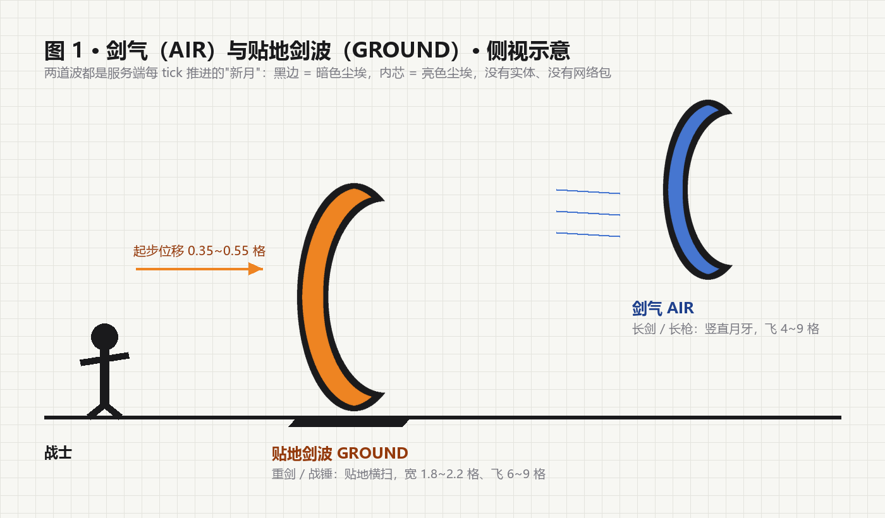
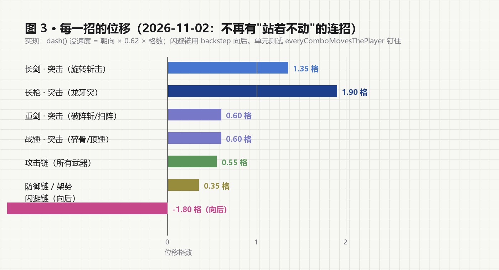
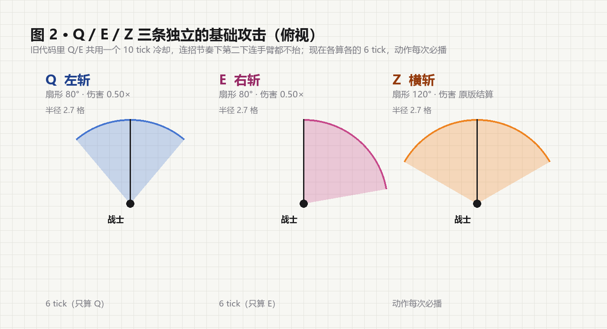

# 剑气、贴地剑波与基础攻击（2026-11-02）

> 用户："我希望每个连招都能有位移，然后剑的一些连招加上剑气之类的，然后重剑什么的可以加上我画的例图的那种贴地剑波，然后好像按 qe 并没有独立的普攻，按 z 是有横斩的"

四件事，全做了：**每招都有位移**、**剑系连招带剑气**、**重武器贴地剑波**、**Q/E/Z 各有独立普攻**。




---

## 一 每招都有位移

以前只有突击链和闪避链会动：攻击链站桩、防御链站定、重武器的突击链干脆不位移。
现在按链给了一个统一的最小位移（`WarriorCombos` 里的 `dash` 字段，单位：格）：

| 链 | 位移 | 说明 |
| --- | --- | --- |
| 攻击链 | 0.55 | 出刀时向前垫半步，贴住目标 |
| 防御链 | 0.35 | 架/打断要能贴上，但不能把目标推走 |
| 突击链 | 0.60 ~ 1.90 | 长剑 1.35、长枪 1.90（最远）、重剑/战锤 0.60 |
| 闪避链 | `backstep` 1.8 ~ 2.5 | 向后（`dash` 为 0，位移由后撤负责） |

实现上仍然是 `dash()`：`setDeltaMovement(朝向 × 0.62 × 格数)` + `hurtMarked`，客户端立刻收到这个速度，
所以是"人真的往前滑了半步"，不是瞬移。




单元测试新增 `everyComboMovesThePlayer`：**任何一招 `dash > 0` 或 `backstep > 0`**，少一条就红。
原来那条"重剑/战锤的突击链不该有位移"改成"位移 ≤ 1.0 格"，重武器依然靠范围而不是冲撞。

---

## 二 剑气（AIR）与贴地剑波（GROUND）

新文件 `WarriorWaves`。两种形态，同一套结算：

| 形态 | 形状 | 谁在用 |
| --- | --- | --- |
| **AIR** 剑气 | 竖直月牙，脱手后向前飞，上下 1.15 格高 | 长剑破锋式/旋转斩击/逆鳞斩/燕返、长枪破军刺/龙牙突 |
| **GROUND** 贴地剑波 | 贴地新月，横向铺开 1.8~2.2 格，慢而重 | 重剑破阵斩/山崩/裂地/扫阵、战锤震地/崩山 |

对着用户那张例图：GROUND 形态画了两层粒子 —— **外圈暗色**（`Dust 1.5`，暗褐/近黑）包着
**内芯亮色**（`Dust 1.1`，橙金），远看就是"黑边 + 橙芯"的一条月牙；地面形态还会额外撒
`CAMPFIRE_COSY_SMOKE` 当扬尘，看起来是贴着地皮掀过去的。

### 怎么实现的（没有实体、没有网络包）

```java
static void onFinisher(ServerPlayer player, WarriorSkill skill)   // 终结技落地时登记一道波
static void tick(ServerLevel level, long now)                     // 每 tick 推进 + 结算
```

- 波不是实体，是服务端内存里的一个 `Wave`：起点、朝向、速度、已走距离、命中的实体 id 集合。
- 每 tick：`center = origin + dir × (speed × age)`；超过 `range` 就丢弃。
- 判定：`AABB` 里所有活着的实体，沿朝向 `-0.8 ~ +1.4` 格、横向 ≤ `halfWidth` 算被扫到；
  同一道波对同一实体只结算一次（`Set<Integer> hit`）。
- 命中后沿朝向推一下（GROUND 0.75、AIR 0.45），复用 `hitSpark` 火花。
- 生命周期结束就没了 —— **存档里不会留任何东西**，也不会因为区块卸载而"卡住一道波"。

tick 挂在哪：直接复用 `WarriorCombatEffects#arrowTick`（本来就有的 `LevelTickEvent` 处理器）。
顺手把它的短路顺序改了一下：以前是 `ARROWS.isEmpty()` 就直接 return，现在先推剑气再判空，
否则没有光箭在飞的时候剑气根本不会动。

### 参数表

| 招式 | 形态 | 距离 | 速度/格每 tick | 伤害× | 半宽 |
| --- | --- | --- | --- | --- | --- |
| 破锋式 | AIR | 5.0 | 0.95 | 0.55 | 1.0 |
| 旋转斩击 | AIR | 4.2 | 1.05 | 0.45 | 1.3 |
| 逆鳞斩 | AIR | 6.0 | 1.10 | 0.60 | 1.1 |
| 燕返 | AIR | 7.0 | 1.20 | 0.70 | 1.2 |
| 破阵斩 | GROUND | 7.0 | 0.55 | 0.80 | 1.8 |
| 山崩 | GROUND | 7.0 | 0.50 | 0.90 | 1.9 |
| 裂地 | GROUND | 9.0 | 0.60 | 1.00 | 2.2 |
| 扫阵 | GROUND | 6.0 | 0.60 | 0.70 | 1.8 |
| 震地 | GROUND | 7.0 | 0.55 | 0.85 | 2.0 |
| 崩山 | GROUND | 8.0 | 0.55 | 0.95 | 2.1 |
| 破军刺 | AIR | 7.0 | 1.35 | 0.60 | 0.7 |
| 龙牙突 | AIR | 8.0 | 1.45 | 0.55 | 0.7 |

伤害 = 玩家攻击力 × 该倍率；长枪的波又细又快（半宽 0.7），是"一道线扎过去"。

---

## 三 Q/E/Z 各有独立的基础攻击

用户的原话是"按 qe 并没有独立的普攻，按 z 是有横斩的"。查下来不是没做，是**不对称**：

```java
// 旧代码
if (move == HORIZONTAL) {                  // Z：无条件播横斩
    if (family.melee() && !performing) broadcast(SLASH_HORIZONTAL);
} else if (family.melee() && elapsed(now, state.lastSlash) >= SLASH_COOLDOWN) {  // Q/E：要等 10 tick
    state.lastSlash = now;
    slash(player, move, !performing);
}
```

Q/E 共用**一个** 10 tick 冷却，而按连招的节奏本来就是一秒内连点两三下 —— 于是第二、第三下
连手臂都不抬（`slash()` 没被调用，`player.swing()` 也没执行），看起来就是"按了没反应"。
Z 因为走的是原版左键，永远有动作。

现在改成 `basicAttack(...)`：

| 键 | 动作 | 判定 | 伤害 | 冷却 |
| --- | --- | --- | --- | --- |
| Q 左斩 | `SLASH_LEFT` | 80° | 0.50× | 6 tick（**只算 Q 自己**） |
| E 右斩 | `SLASH_RIGHT` | 80° | 0.50× | 6 tick（**只算 E 自己**） |
| Z 横斩 | `SLASH_HORIZONTAL` | 120° | 原版结算 | — |

- **动作每次必播**（除非终结技正在演），左右交替点就是连着两刀。
- 伤害分键记冷却（`State#lastSlashByMove`），所以"Q E Q E"能连着出四次判定，
  但"狂点 Q"不会把伤害翻倍。
- Z 的伤害仍然交给原版（`WarriorComboService` 里不补第二下），只额外补横斩动作。
- 三种键的挥砍音高也不同（1.15 / 0.95 / 0.85）。




---

## 四 验证

- 单元测试：**93 项全绿**（新增 `everyComboMovesThePlayer`，改了两条旧断言）。
- GameTest：**37/37 通过**（`greatswordAssaultHitsWideWithoutDisplacement` 的断言从
  "不该位移"改成"只该垫一小步、且必须 > 0"，测试名保持不变 —— 改名会打乱字母序）。
- jar：197,314,903 B，SHA256 `9750D3AF4EEBB9D299D2807DB96321AE88E1922D574AB5B905D0512D88A3BAD3`，
  备份 `backups/tnc-wave-basic-20261102-032606/mods/`。

## 五 想再调的三个旋钮

1. **剑气太飘/太短**：`WarriorWaves.SPECS` 里改 `range` 与 `speed`（速度越慢看起来越"重"）。
2. **贴地剑波不够宽**：改 `halfWidth`（判定）与 `drawCrescent` 里的 `spread`（画面上铺多宽）。
3. **基础攻击太频繁**：`WarriorComboService.BASIC_ATTACK_COOLDOWN`。
