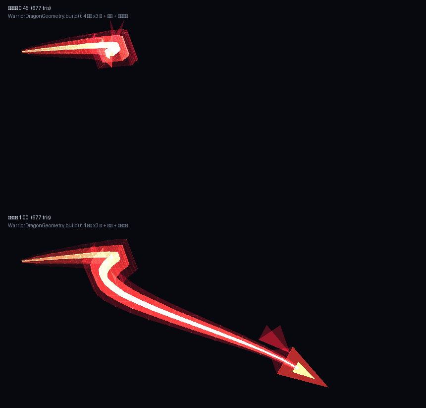

# TN-C 战士系统 · 入门手册 & 武器图鉴

> 面向玩家：从"拿到一把剑"到"能打出连招、看得出自己打出了什么"。
> 面向后续开发者/美术：第八节是交接单，写明换美术只动哪几个文件、贴图什么规格。
>
> 版本：2026-11-03（本次新增 6 把武器，重做龙之剑；删除旧试作之剑 `tnc:sword`）

---

## 一、一分钟速览

| 你想干的事 | 按什么 | 说明 |
| --- | --- | --- |
| 打开**武器图鉴** | `K` | 六条武器线、每条线的招式、解锁条件与进度 |
| 左斩击 / 右斩击 | `Q` / `E` | 连招的两种"起手"，**长按**是另一套（架势） |
| 普通攻击 | 鼠标左键 | 有独立动作与刀光 |
| 战斗步法 | 左 `Ctrl` | 按下即打断自己当前动作；短按冲一大段；长按小步加速 |
| 自救 / 救倒地队友 | （见按键设置的"自救/救援"） | 按住生效 |

战士**不花磨砺点数买招式**：磨砺值只负责成长与减伤，招式靠**条件开放**（磨砺值到线、
训练课完成次数、盾牌试炼毕业、最佳评分）。所以图鉴里没有"投点数"按钮，只有
"已达成 / 进行中（还差多少）/ 规划中"三种状态。

---

## 二、六条武器线（图鉴页签）

图鉴底部有六个页签，顺序就是推荐阅读顺序：

| 页签 | 定位 | 现在能玩到什么 |
| --- | --- | --- |
| 剑 | 直刺、横扫、反击 | 长剑/太刀/细剑/龙之剑，29 套连招里最完整的一条线 |
| 盾 | 挡、格、压制（盾牌自身不耗耐久） | 格挡、盾击、压制 |
| 重武器 | 斧、重剑、战锤共用"重武器"的反击与压制 | 重剑、斩马刀、巨镰、战锤 |
| 长柄 | 长枪：距离更长、突刺更远 | 长枪、破天戟 |
| 弓 | 远程 | 尚未开课（页签列出来是怕玩家以为漏了） |
| 风刃 | 风灌注武器的主动能力 | 风遗物系列 |

> 一条武器线"有没有开课"是算出来的：`WarriorCodex.Weapon#anyImplemented()`。
> 全是规划中的页签，点进去会明确写"尚未开课"，不会骗玩家去练不存在的东西。

---

## 三、武器图鉴（11 把）

"实际伤害"= 玩家基础 1 + 武器附加值；"攻速"= 4 + 攻速修正（次/秒）。

### 长剑线（`tnc:longswords`，单手）

| 武器 | 实际伤害 | 攻速 | 耐久 | 手感 |
| --- | --- | --- | --- | --- |
| 龙之剑 `dragon_sword` | 9 | 1.5 | 1400 | 旗舰，收尾有龙吼与龙虚影；重而稳 |
| 霜月太刀 `frost_katana` | 7 | 2.0 | 800 | 快，适合打连段；**本次新增** |
| 晨星细剑 `star_rapier` | 5 | 2.4 | 520 | 最快、伤害最低，靠连招节奏吃饭；**本次新增** |

### 重武器线（`tnc:greatswords` / `tnc:hammers`，**双手**）

| 武器 | 实际伤害 | 攻速 | 耐久 | 手感 |
| --- | --- | --- | --- | --- |
| 重剑 `greatsword` | 8 | 1.0 | 900 | 基准双手剑 |
| 赤霄斩马刀 `crimson_warblade` | 9 | 1.0 | 1000 | 单刃大开大合；**本次新增** |
| 收割巨镰 `doom_scythe` | 8 | 1.1 | 950 | 慢、范围大；**本次新增** |
| 战锤 `hammer` | 7 | 0.8 | 1100 | 最慢的重击 |
| 裂地战锤 `earthshaker_hammer` | 8 | 0.8 | 1200 | 更重的锤，砸地感更强；**本次新增** |

### 长柄线（`tnc:spears`，**双手**）

| 武器 | 实际伤害 | 攻速 | 耐久 | 手感 |
| --- | --- | --- | --- | --- |
| 风遗物长枪 `spear` | 7 | 1.4 | 1000 | 基准枪，突刺更远 |
| 破天戟 `sky_halberd` | 8 | 1.3 | 1100 | 枪斧合一，横扫更宽；**本次新增** |

### 远程

| 武器 | 耐久 | 说明 |
| --- | --- | --- |
| 长弓 `bow` | 500 | 弓线尚未开课，只有基础射击 |

> 伤害口径：实际伤害 = 1（空手）+ 2（铁质物品等级加成）+ 武器附加值；
> 攻速 = 4 + 攻速修正（次/秒）。上表已算完，使用时直接对比原版就行
> （原版铁剑 6、钻石剑 7、下界合金剑 8）。

**获取**：创造模式物品栏的 TN-C 页签里有全部 11 把，并按武器线排好了顺序
（长剑 → 重武器 → 长柄 → 弓）。生存模式有 **10 把**能做，配方都在 `data/tnc/recipes/`
（铁锭/金锭/木棍，配方书里统一归在 `tnc_weapons` 分组）；**唯一没有配方的是风遗物长枪
`spear`** —— 它是风系遗物，只能靠创造模式或事件拿到，长枪这条线的生存武器是破天戟。
新武器都归入**已有家族**，所以直接能用现成的 29 套连招，不需要为每把新武器单独写动画或连招数据。

**提示框**：主手/物品栏里指着任意一把 TN-C 武器，下面会多一行「长剑 · 单手」这样的归类；
按 F3+H 打开高级提示后会再多一行键位提示（Q/E/Ctrl/K）。


---

## 四、连招怎么出

一次输入有三种语义，客户端按键状态机把它们分开打包发给服务端
（`WarriorComboInputPacket`：`TAP / HOLD / RELEASE / KEEPALIVE`）：

1. **单击**（按下就松）→ `TAP`，进入连招树的下一步；
2. **长按**（超过阈值）→ `HOLD`，进入"保持"分支（多数武器上就是**架势/格挡**姿态）；
3. **松手** → `RELEASE`，结束保持；
4. 长按期间每 10 tick 补一个 `KEEPALIVE`，掉线/卡顿时服务端会在 40 tick 后自动收掉，
   不会让你永远卡在格挡里。

要点：

* 两个起手键（`Q`/`E`)各带一条链，链与链在第三、四段会汇合；
* 每套连招有自己的**位移**（前冲/侧闪/原地），不是所有段都能位移；
* 连招表本身在代码里（`WarriorCombos`），图鉴界面显示的是"能不能用 + 差多少"；
* 所有连招都经过服务端校验，客户端只负责发"我按了什么"，**伤害与位移判定全在服务端**。

---

## 五、三件"看起来像特效、其实是机制"的东西（外加龙与粒子）

### 1. 剑气（sword-qi）
重击/收尾段会从刃口甩出一道能量刃，独立飞行、独立判定。它吃的是**这一击的伤害档位**，
不是固定伤害值，所以换武器会明显感觉到剑气变强/变弱。

### 2. 贴地刀波（blade wave）
横扫类招式在地面生成一条**贴地滑行**的波浪，只在下落/横扫收尾出现。它的判定是地面判定，
对空中的敌人不打，对站着的敌人是一条线。

### 3. 武器虚影（phantom）
收尾/大招时在角色手上渲染一把"武器残影"，用来表现"这一下是蓄力的"。
它是**纯客户端渲染**，没有实体、没有判定：

* 残影与手完全绑定（位置、朝向、缩放都跟着武器走——照抄原版 `ItemInHandLayer` 的变换）；
* **倍率**：磨砺 0 时和真剑等大（1.00），练满 **1.90** 倍（`WarriorPhantom.MAX_GROWTH = 0.90`，
  2026-11-03 按要求加倍，原来 1.45）。同一个系数也乘在连招判定半径上，所以"看得见多大就摸得到多远"；
* 刀光的外圈斩气就走在虚影剑尖上，虚影长大了斩气跟着变大；
* 想关掉：启动参数加 `-Dtnc.phantom.off=true`；
* 如果残影位置看起来不对，先确认是不是别的 mod 改了手部渲染，
  再看 `logs/latest.log` 里有没有 `[tnc]` 前缀的渲染调试行。

### 4. 龙（dragon，2026-11-03 重做）

拿龙之剑放终结技，会有一条**龙**沿你的朝向冲出去：蛇形摆动、龙头收成菱形带一对后掠角，
三层嵌套（暗红外壳 / 赤红龙身 / 金色脊线）叠加发光，冲出 7.5 格后淡出，配一声龙吼。

它是**客户端渲染的真实几何体**（`WarriorDragonRenderer` + `WarriorDragonGeometry`），不是粒子：

* 龙身是四棱管，截面按平行传输逐段旋转（弧线顶点不会拧成蝴蝶结），28 段 × 4 面 × 3 层；
* **无翼**：中途试过加膜状翼，离线预览里是一块块浮在旁边的暗红色块；中式龙本来也是蛇身，
  靠龙身 / 龙头 / 双角认，加翼反而像贴上去的装饰；
* 触发不新增网络包：服务端只广播动作，客户端看到"龙之剑 + 终结技动作"就自己起一条；
  所以别人的屏幕上也能看到，协议号不用动；
* 服务端那边只剩一声龙吼 —— 之前那条"用尘埃粒子拼的龙"整段删掉了，没有开关、没有残留。

形状可以离线看：`python tools/dragon_preview.py` 把**渲染器真会画的那批三角形**
（单测 `WarriorDragonGeometryTest` 从 `WarriorDragonGeometry.build` 直接导出）画成
`docs/previews/dragon-render-20261103.png`，不用起客户端。



### 5. 粒子：只留"打实了"的
战斗表现全部走**模型 / 光带 / 渲染层**，粒子只保留"打中了"的小反馈：

| 效果 | 现在 | 实现 |
| --- | --- | --- |
| 挥砍弧光、剑尖拖尾 | 渲染 | `WarriorTrail`（采样真实骨骼画光带；2026-11-03 改三角形带 + 按转角细分） |
| 剑气、贴地刀波 | 渲染 | `WarriorWaveRenderer`（实体化的刃形长条，有判定） |
| 武器虚影 | 渲染 | `WarriorPhantomRenderer`（挂手上的残影；倍率 2026-11-03 加倍到 1.90） |
| 龙 | 渲染 | `WarriorDragonRenderer`（本文上一节） |
| 命中火花、格挡光圈、反击闪光 | **粒子（保留）** | 只在真的打中/挡住那一瞬出现，半径 < 1 格、持续 < 0.5 秒 |
| 终结技环形刀光 | 删于 11-01 | 只有声音 |
| 施放刀光（挥砍弧）、龙身、箭的光尾 | **删于 11-03** | 粒子代码整段移除，不留注释开关 |

判断标准：**"施放特效"占屏幕的一律不要，并且要用渲染做真的；"打中了"的小火花留着。**
箭头不再拖粒子尾巴：暴击星 + 发光轮廓已经够读。

**刀光是以虚影为主的**（2026-11-03）：外圈那片大的斩气终点走**虚影剑尖**，贴身的那条亮芯走真剑尖 ——
虚影长多大，斩气就扫多大；细节见 [`刀光剑影-20261101.md`](刀光剑影-20261101.md)。

---

## 六、架势与双手握持

* **长按保持架势**：长剑线的"振刀/格挡"动作支持**按住不动就一直保持**，
  松开才收；保持期间附带减伤（抗性提升 II）。
* **双手握持**：重剑、战锤、长枪（含斩马刀、巨镰、裂地战锤、破天戟）在**普通攻击**时
  也是双手持握（左手会跟到武器上），不会出现"短按一下突然变单手"的割裂感。
* 左手持剑的玩家（主手在左手）会跳过双手镜像，避免左右手打架。

---

## 七、常见问题

| 现象 | 先查什么 |
| --- | --- |
| 按 `Q`/`E` 没反应 | 手上是不是战士武器？空手/非法杖/非弓的武器不进入战士连招 |
| 长按被识别成一串短按 | 已修（旧版用 `consumeClick()` 会被 GLFW 自动重复喂成连点）；若复现，看 `[tnc] input move=… family=… gap=…` 的 gap 是否恒等于 1 tick |
| 打不出特效 | 特效只在特定段位触发；先看图鉴里这条链解锁没有，再看服务端有没有拒绝（`[tnc] slash` 日志） |
| 虚影位置/朝向怪 | 见第五节；确认没有别的 mod 改手部渲染层 |
| 武器没有连招 | 检查它有没有进对应标签（`data/tnc/tags/items/{longswords,greatswords,hammers,spears}.json`）|

---

## 八、交接单：给美术 / 后续开发者

### 8.1 一把武器 = 三个文件

| 文件 | 作用 |
| --- | --- |
| `src/main/resources/assets/tnc/models/item/<id>.json` | 3D 模型：若干长方体 + 每个面的 UV + 手持显示变换 |
| `src/main/resources/assets/tnc/textures/item/<id>.png` | 贴图（**128×128**，见下） |
| `data/tnc/recipes/<id>.json`、`lang/{zh_cn,en_us}.json`、`data/tnc/tags/items/*.json` | 配方、名字、归入哪条武器线 |

### 8.2 贴图规格（重要，别直接重画）

* **画布 128×128**，`texture_size: [128, 128]`；
* **1 个模型单位 = 4 像素**（`TEXEL = 4`），整把武器在一张图上**连续画完**，
  模型各段只是从这张图上"切"出自己那块 UV —— 所以**分段之间不会有接缝色差**；
* 坐标口径：`X = 宽`、`Y = 厚`、`Z = 长`；**握把在 z≈0，刃沿 +Z 伸出**，
  也就是贴图的 v 越大 = 越靠刀尖；
* 侧面（±X）取该段中间列的颜色，端面（±Z）取中间行的颜色 —— 这是刻意的，
  目的是让接缝不露亮边；对向面的 UV 允许左右/上下镜像（MC 就是靠这个翻转贴图），
  所以 `uv[0] > uv[2]` 是合法的，不要"修正"它；
* 每把武器的 UV 对照图在 `docs/previews/atlas-<id>.png`（生成器会写），
  上面标了每块零件的矩形；**手绘贴图必须遵守这些矩形**，否则 3D 上会串图。

### 8.3 生成器（改颜色/改形体用它，别手改 JSON）

```
python tools/weapons/weapon_gen.py
```

* 数据都在脚本顶部的 `PALETTES`（7 套配色）与 `WEAPONS`（每把武器的零件表 / 剖面控制点）里；
* 跑一次同时产出：模型 JSON、128×128 贴图、单价预览图 `docs/previews/weapon-<id>.png`、
  全家福 `docs/previews/weapons-20261103.png`、UV 对照图；
* 刀身用"剖面控制点"描述：`(z, 左边, 右边)`，脚本按 `step` 切片生成方块，
  想改刀刃胖瘦只改这几个数；
* 弯刀/镰刀/戟这类**不能用一个宽度函数描述**的，用旋转方块 `("id", box, style, mode, ("y", 角度, 原点))`。

### 8.4 想加一把新武器

1. 打开图鉴确认它属于哪条线（剑/重武器/长柄）；
2. 在 `WEAPONS` 里复制一份最接近的，改 `id`、`zh/en`、`palette`、`profile`；
3. 跑生成器 → 得到模型 + 贴图 + 预览；
4. `TNMod` 里 `ITEMS.register("<id>", …)`，并加进创造栏 `output.accept(...)`；
5. 加进对应的武器线标签（否则会被当成默认长剑）；
6. 加 `lang` 两条（中/英）+ 配方；
7. `gradlew test assemble` 跑通即可 —— **不需要新写连招**。

### 8.5 验收

```
gradlew test --offline               # 单元测试（当前 691 项 / 0 失败）
tools/test-warrior.ps1 -ServerOnly   # 37 个 GameTest（服务端）
tools/verify_mod_jar.ps1             # 产物自检
python tools/dragon_preview.py       # 龙的形状离线出图（不用起客户端）
```

客户端画面只能进游戏看：`logs/latest.log` 里 `[tnc]` 开头的行是排查用的调试输出。
能起客户端的机器还可以用 `tools/test-warrior-mesh.ps1` 按固定机位自动拍图
（刀身、虚影、刀波、龙共 7 张）。

### 8.6 美术状态（2026-11-03）

这批武器的模型/贴图/生成器在 01:43 由美术侧重做并交付：贴图升级到 **128×128**
（1 模型单位 = 4 像素），全部模型改成 22.5° 整数倍旋转、零件数 14–78 不等。
交接时的契约、属性表与打包流程见 [`work/warrior-art-handoff.md`](../../work/warrior-art-handoff.md)。

仓库自检 `tools/gen_coin_models.py --check` 只接受 22.5 的整数倍旋转角，
非整数倍会让 `verify_mod_jar.ps1` 直接报"不要安装这个构建"——加新武器时注意。

**关于预览图上那排"刻度"**：`weapons-20261103.png` 放大看，带刃武器沿刃长有一排等距
亮暗交替，容易被误认为是贴图坏了。实测结论是**预览渲染器造成的**：逐行条带贴图在 8 倍
放大下把 1 个纹素的差异画成了刻度；把贴图对应像素改掉之后，用同一个渲染函数重出的预览
**逐像素完全一致**，而且刃面 UV 只采样 61..65 列、根本读不到那几列纯白。
游戏里走 GPU 采样会被线性过滤抹平，**不要用这张 8× 放大图判断游戏内观感**。
完整的验证数据见交接文档 §9。
