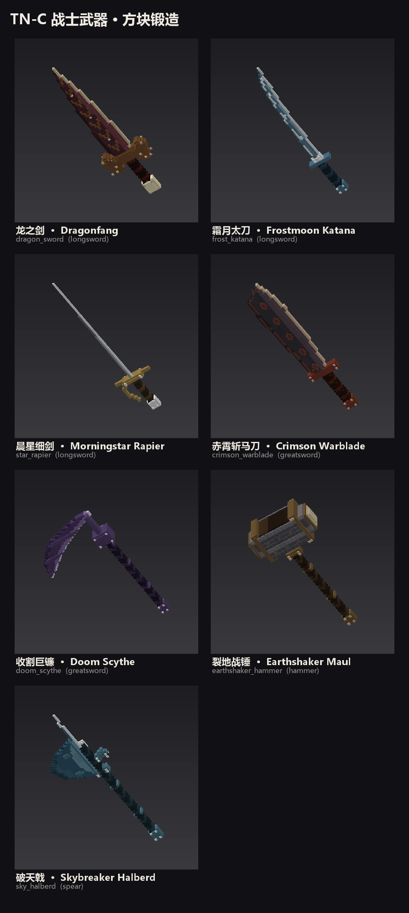
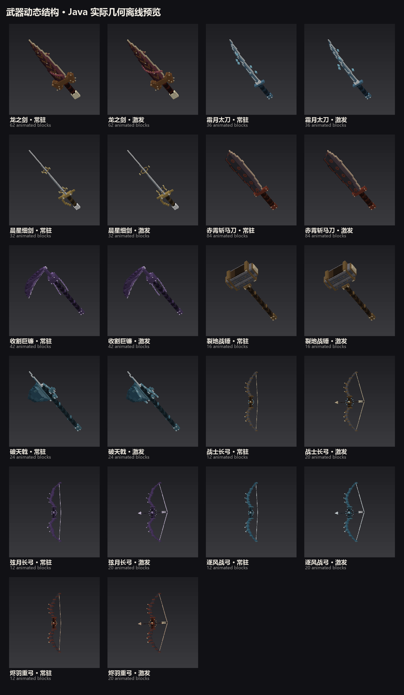
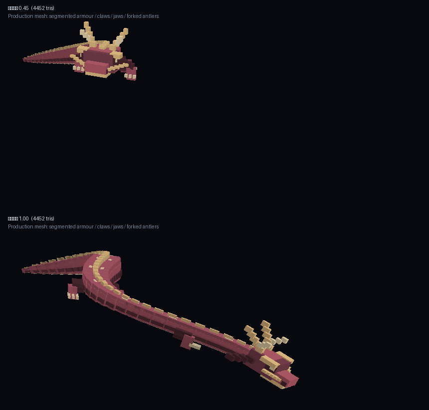
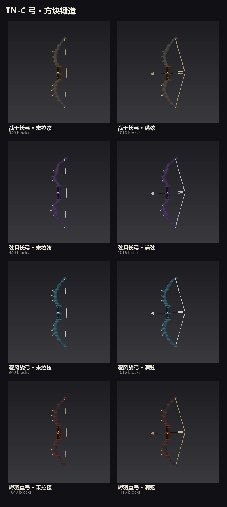
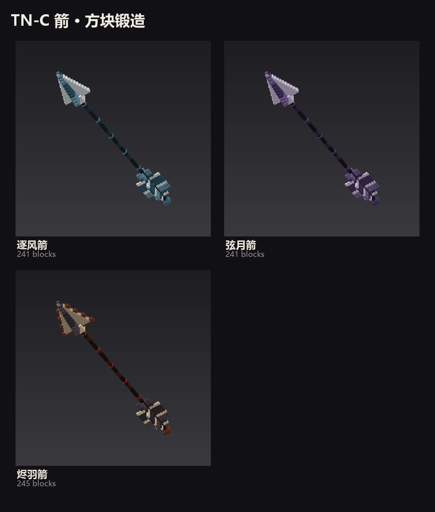

# 方块武器、动态结构与弓箭（2026-11-05）

保留 01:32 版的七把近战武器配色和握持变换，增加真实方块层次；贴图改为 128×128 的有限色阶材质图集。模型、贴图、预览均由 `tools/weapons/weapon_gen.py` 生成；不是概念图替代游戏资源。

## 近战武器

| 武器 | 物品 ID | 原版块数 → 本轮块数 |
|---|---|---|
| 龙之剑 | `dragon_sword` | 69 → 1366 |
| 霜月太刀 | `frost_katana` | 70 → 737 |
| 晨星细剑 | `star_rapier` | 78 → 343 |
| 赤霄斩马刀 | `crimson_warblade` | 69 → 1541 |
| 收割巨镰 | `doom_scythe` | 35 → 1117 |
| 裂地战锤 | `earthshaker_hammer` | 14 → 1492 |
| 破天戟 | `sky_halberd` | 48 → 1015 |

立体细节包括阶梯刃口、双面凸起刻纹、背脊、铆钉、分节皮革缠带和战锤装甲。内侧完全重合的面已剔除。图集按材质分离，护手/宝石不会再污染刀身 UV；每个小模型像素采样对应材质像素，避免把一整块描边贴图反复缩到小方块上造成编织噪点。

## 动态结构

- 龙剑：沿剑身盘绕的分节小龙；终结技重做为带分节甲片、腹甲、龙角、上下颌、眼、须、爪的方块长龙。大龙 4452 个三角形，最多同时 6 条，18 tick 后消失。
- 太刀：分层冰晶沿刃环行；细剑：双层晨星金属环。
- 斩马刀：四枚浮动赤铜印框；巨镰：交错链节与镰颈晶石。
- 战锤：升降装甲符文；长戟：分节流线翼刃。
- 弓：箭台周围旋转结构，拉弓激发箭轴方向的汇聚结构。

常驻结构使用实际武器的 item transform，在同一挂载矩阵内绘制；第一人称、第三人称、左右手均走同一入口。32 格外省略常驻结构。每件最多 84 个额外动态方块。使用有深度测试的普通透明混合，保留颜色与体积；龙的三角形转为合法四顶点提交，修复旧代码把三顶点直接送入 QUADS 的问题。蓄力原有的元素汇聚粒子仍保留。

## 弓与箭

现有 `tnc:bow` 重做成立体弓，新增：

| 弓 | 箭 | 配色 |
|---|---|---|
| `tnc:moon_bow` 弦月长弓 | `tnc:moon_arrow` 弦月箭 | 紫晶/浅银 |
| `tnc:storm_bow` 逐风战弓 | `tnc:storm_arrow` 逐风箭 | 青蓝/银白 |
| `tnc:ember_bow` 烬羽重弓 | `tnc:ember_arrow` 烬羽箭 | 赤铜/暖金 |

每把弓有未拉弦和 3 档拉弦模型，移动弓梢、连续 V 形弦、搭箭与箭尾同时对齐；每份约 940–1116 块。箭体为 241–245 块的真实立体箭头、箭杆、四向阶梯箭羽，飞行时有短小的连续方块尾迹与箭头环。

新弓沿用弓家族连招，以及长按 Z、松手才射、伤害随蓄力持续增长且可受击打断的规则。普通右键射击也显示匹配箭型。箭型用实体同步数据发送给其他客户端，并保存到 NBT；实体仍沿用原版箭物理、伤害、附魔、拾取流程。药水箭、光灵箭和第三方箭保留原实体效果。三套新箭的区分是造型和动态效果，不额外附加新的伤害增益。

合成：战士长弓 + 紫水晶碎片/海晶砂粒/烈焰粉 → 对应弓；4 支原版箭 + 对应材料 → 4 支对应箭。创造模式页也已加入。

## 验证和试玩

- `python tools/weapons/validate_assets.py`：26 份模型，24690 个真实元素，91205 个提交四边形；坐标、正体积、UV 范围、采样不透明、弓覆盖资源与七把旧武器握点检查通过。
- 战士单测 167 项；第一轮服务端 GameTest 52 项通过。
- 本轮 Java 从 HEAD + 本轮改动的独立源码副本构建，排除队友正在修改的新土/雷/墨龙内容。安装产物通过 `tools/weapons/package_update.py`，以原已安装的 SHA-256 `885D2E9341D3581A2D3A007D3D7DC7DB6A81371B8BB1EDB02A25E4CADAECFE71` 为基包，仅替换本轮归属的 class 和资源条目，逐字节核对其余条目未变，从而保留此前已安装的墨龙表现、6 首本地音乐及声音定义。最终独立源码构建的 167 项单测和 52 项服务端测试均通过；服务端回归已扩展到三把新弓。
- 协议 27；联机双方应更新同版。未进行真实客户端的材质、光影、握持和听感验收，本文图片都是生产资源/实际 Java 几何的离线渲染。

试玩可 `/give @s tnc:moon_bow`，同理使用上表其他 ID；背包放箭，分别测试右键、Q/E/Z 长按、松手单发、长按期间没有自动射击、受击打断。F5 核对双手动作和动态结构是否跟随武器。保存后重进世界检查插地箭的外观与拾取；射药水箭确认效果未丢失。

## 正式实例核对（2026-11-05）

- 远端核对基线：`4a3f9332`，本轮开始推送前远端没有更新提交。
- 实际目录：`E:\download\正式版 2.12.6.1\.minecraft\versions\元素觉醒1.4.3-魔改版-20260915`。
- 另一条工作流已同步安装了包含本轮武器的整包。检测到安装版本变化后，本线程停止替换，逐项核对 88 个本轮 class/资源条目，全部与经过验证的本轮产物逐字节相同，因此保留该整包，没有覆盖其他已装更新。
- 最终实例 JAR SHA-256：`99E5FA72DF58728BF3B38D4B4B1E972CD8D88D66B9BE69E7A169EAF3733B408A`。证据副本哈希相同。
- `tools/verify_mod_jar.ps1` 用 Windows PowerShell 5.1 对证据副本和真实实例运行，结果 `mod jar verification passed`；新物品、模型、贴图、客户端类与 Java 17 字节码检查通过；正式实例共 281 个模组。
- ModernFix 实例配置核对：恰好一条有效 `mixin.perf.dynamic_resources=true`，保留原文件，没有改其他配置。
- 日志：`work/warrior-pixel-release-gametests-20261105.log`、`work/warrior-pixel-installed-verification-20261105.log`；安装核对记录：`work/warrior-pixel-installed-evidence/receipt.json`。
- 没有修改存档、FTB 任务或结束玩家游戏。完整重启游戏后使用；真实客户端的握持、材质和动态观感仍待试玩。
