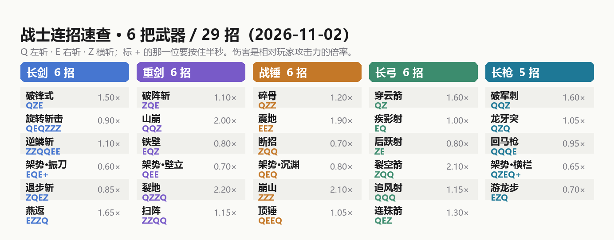

# 武器内容扩充（2026-11-02）

> 用户："你现在可以丰富每个武器的内容了，我觉得连招都有点少，看你自己想法多添加些没事，你也可以多做些武器"

这一轮把目录从 **15 招 / 4 把武器** 扩到 **29 招 / 6 把武器**：
每把老武器补到 5~6 招，新增长枪（风遗物长枪）和龙之剑。

---



## 一 目录总表

键位：**Q** = 左斩（`LEFT`）、**E** = 右斩（`RIGHT`）、**Z** = 横斩（`HORIZONTAL`）。
`+` 表示这一位要**按住半秒**。耐久 = 释放一次的武器耐久消耗。

### 长剑 任意剑类 / 战士长剑（6 招）

> 2026-11-03 更正：试作之剑 `tnc:sword` 已删除，本节的"长剑"指原版剑 +
> `tnc:dragon_sword` / `tnc:frost_katana` / `tnc:star_rapier`；另外键位已收敛为
> **Q 左斩 / E 右斩 / Ctrl 战步 / 鼠标左键普攻**，下表的 `Z 横斩` 是当时的设计稿。

| 槽 | 名称 | 顺序 | 链 | 伤害× | 半径 | 角度 | 耐久 |
| --- | --- | --- | --- | --- | --- | --- | --- |
| 0 | 破锋式 | ZZZ | 攻击 | 1.50 | 3.0 | 80° | 2 |
| 1 | 旋转斩击 | QEZ | 突击 | 0.90 | 3.6 | 360° | 3 |
| 2 | 逆鳞斩 | EQZ | 防御 | 1.10 | 3.2 | 100° | 4 |
| 3 | 架势·振刀 | EQE+ | 防御 | 0.60 | 3.0 | 120° | 2 |
| 4 | 退步斩 | ZQE | 闪避 | 0.85 | 3.0 | 130° | 2 |
| 5 | 燕返 | ZZQ | 攻击 | 1.65 | 3.2 | 150° | 2 |

退步斩是长剑**第一条闪避链**：`evadeTicks=9`（短时无敌）+ `backstep=1.8`（后撤），
和弓的闪避链同一种结算，只是近身招式。燕返是四段慢连，数值上是长剑最高伤害。

### 重剑 `tnc:greatsword`（6 招）

| 槽 | 名称 | 顺序 | 链 | 伤害× | 半径 | 角度 | 耐久 |
| --- | --- | --- | --- | --- | --- | --- | --- |
| 0 | 破阵斩 | QEZ | 突击 | 1.10 | 4.0 | 140° | 3 |
| 1 | 山崩 | ZZZ | 攻击 | 2.00 | 3.2 | 90° | 4 |
| 2 | 铁壁 | EQZ | 防御 | 0.80 | 3.0 | 100° | 2 |
| 3 | 架势·壁立 | EQE | 防御 | 0.70 | 3.0 | 180° | 3 |
| 4 | 裂地 | ZQE | 攻击 | 2.20 | 3.8 | 220° | 5 |
| 5 | 扫阵 | ZZQ | 突击 | 1.15 | 3.8 | 180° | 3 |

重剑的位移比长剑**小**（突击链 0.60 对 1.35）：这条武器特性是"用范围换突进"，被单元测试钉着
（`weaponTraitsAreExpressedByTheChains`）。裂地是现在全武器最高单发伤害，代价是 280 tick 冷却 + 5 耐久。

> 2026-11-02 更新：现在**每一招都有位移**（攻击链 0.55 / 防御链 0.35），重剑也不例外，
> 只是突击链的冲撞幅度远小于长剑。见 [剑气与剑波-20261102.md](剑气与剑波-20261102.md)。

### 战锤 `tnc:hammer`（6 招）

| 槽 | 名称 | 顺序 | 链 | 伤害× | 半径 | 角度 | 耐久 |
| --- | --- | --- | --- | --- | --- | --- | --- |
| 0 | 碎骨 | QEZ | 突击 | 1.20 | 3.4 | 120° | 3 |
| 1 | 震地 | ZZZ | 攻击 | 1.90 | 4.0 | 360° | 4 |
| 2 | 断招 | EQZ | 防御 | 0.70 | 3.6 | 100° | 2 |
| 3 | 架势·沉渊 | EQE | 防御 | 0.80 | 3.4 | 120° | 4 |
| 4 | 崩山 | ZQE | 攻击 | 2.10 | 4.2 | 360° | 5 |
| 5 | 顶锤 | ZZQ | 突击 | 1.05 | 3.8 | 150° | 3 |

崩山是原地 360° 三连砸（半径 4.2，全武器最大），顶锤只往前垫 0.6 格 —— 锤靠范围把人砸退。

### 长弓 `tnc:bow`（6 招，全是射击）

| 槽 | 名称 | 顺序 | 链 | 伤害× | 命中框 |
| --- | --- | --- | --- | --- | --- |
| 0 | 穿云箭 | ZZZ | 攻击 | 1.60 | 直线 20° |
| 1 | 疾影射 | QEZ | 突击 | 1.00 | 突进 1.2 格 |
| 2 | 后跃射 | ZQE | 闪避 | 0.80 | 后撤 1.5 格 + 无敌 |
| 3 | 裂空箭 | EQE | 攻击 | 2.10 | 最高伤害 |
| 4 | 追风射 | EQZ | 突击 | 1.15 | 侧滑 1.2 格 |
| 5 | 连珠箭 | ZZQ | 突击 | 1.30 | 速射，不位移 |

### 长枪 `tnc:spear`（新武器，5 招）

| 槽 | 名称 | 顺序 | 链 | 伤害× | 半径 | 角度 | 耐久 |
| --- | --- | --- | --- | --- | --- | --- | --- |
| 0 | 破军刺 | ZZZ | 攻击 | 1.60 | 3.9 | 90° | 2 |
| 1 | 龙牙突 | QEZ | 突击 | 1.05 | 3.2 | 80° | 2 |
| 2 | 回马枪 | EQZ | 防御 | 0.95 | 3.5 | 170° | 3 |
| 3 | 架势·横栏 | QZEQ+ | 防御 | 0.65 | 3.6 | 150° | 3 |
| 4 | 游龙步 | ZQE | 闪避 | 0.70 | 3.2 | 110° | 2 |

**长枪的武器特性**：扇形最窄（80~90°）但半径最长（3.9），是"一条线捅进去"而不是"扫一片"。
突击链 `dash=1.9`（全武器最远），配合 3.9 的判定距离，一次龙牙突能扎到 6 格外的敌人。
刀光配色也给了一条独立的青玉色（`Tint.JADE`），光带 profile 是"细、亮、掉得快"。

---

## 二 新武器怎么做的

### 长枪：直接复用风系 boss 的模型贴图

```json
// assets/tnc/models/item/spear.json
{ "parent": "tnc:item/wind_relic_spear" }
```

父模型是风系 boss 那把枪（`assets/tnc/models/item/wind_relic_spear.json` → `tnc:wind/arsenal/spear`），
所以**不复制贴图、不复制 cubes**，两边永远一致；boss 那把枪以后改样子，玩家手里这把跟着变。

注册（`TNMod`）：

```java
public static final RegistryObject<Item> SPEAR = ITEMS.register("spear",
        () -> new SwordItem(Tiers.IRON, 4, -2.6F, new Item.Properties().durability(1000)));
```

家族判定靠标签而不是类：`data/tnc/tags/items/spears.json` 里只有 `tnc:spear`，
`WarriorWeaponFamily.of()` **先查标签再查 `SwordItem`**，所以这把剑类武器会被判成"长枪"而不是"长剑"。
以后要加别的长柄（戟、薙刀），只要往这个标签里加一行，判定和连招都不用改。

### 龙之剑：长剑家族 + 龙虚影

- 物品 `tnc:dragon_sword`：`SwordItem`，附加值 6（铁质等级再 +2，实际 9 点伤害；普通铁剑 6）、
  耐久 1400，属于**长剑家族**，所以上面 6 条长剑连招它全都能打。2026-11-03 补了工作台配方
  （铁锭 + 金锭 + 木棍）。
- 模型在 2026-11-03 由美术侧重做成独立的 128×128 手绘 3D 模型（龙首护手 + 熔金剑格 +
  红宝石剑首），**不再**是试作之剑的复刻——试作之剑 `tnc:sword` 已连同模型贴图一并删除。
- **龙**：`WarriorCombatEffects#dragonRoar`（服务端）+ `WarriorDragonRenderer` / `WarriorDragonGeometry`（客户端）。
  第一版是纯粒子拼的（龙骨 `END_ROD`、暗红尘埃龙身、两侧斜线龙翼、龙头炸 `FLASH`），
  **2026-11-03 用户要求不要粒子特效，那段代码整段删除、没有开关**；现在改成客户端渲染的
  真实几何体：四棱管龙身（截面平行传输）× 3 层（暗红外壳 / 赤红龙身 / 金色脊线）
  + 菱形龙头 + 一对后掠角，**无翼**（试过加膜状翼，预览里是一块块浮在旁边的色块；
  中式龙本来就是蛇身，不靠翼认），沿玩家朝向蛇形冲出 7.5 格、18 tick 淡出，服务端只留一声龙吼。
  触发不新增网络包：客户端看到"龙之剑 + 终结技动作"（`WarriorAnimation#finisher`）就自己起龙，
  所以别人的屏幕上也看得到，协议号不动。
  形状可离线核对：`python tools/dragon_preview.py`（读 `build/tnc-dragon-quads.csv`，
  就是渲染器画的那批三角形），出图 `docs/previews/dragon-render-20261103.png`。

长度跟着招式半径走（`radius × 1.6`，夹在 3~9 格），所以破锋式是短扑、裂地/崩山那种大招是整条龙窜出去。

**为什么用粒子而不是实体/渲染器**：不新增实体类型、不加网络包、客户端不用装任何东西，
存档里也不会留一堆龙实体。代价是它不是"真模型"，远看是一道光形。

---

## 三 踩到的两个"前后缀"坑（写新连招必看）

不变量：**同一把武器内，任何一招都不能是另一招的前缀或后缀**（`WarriorCombosTest#noSequenceIsPrefixOrSuffixOfAnother`）。
原因是同一串输入会同时命中两招，玩家分不清。这一轮撞了两次：

1. `QQZ` 作为弓的突击链 → **以 `QZ` 结尾**，而弓已经有 `QZ`（穿云箭）。改成 `QQQ`。
2. 长剑新链 `ZQEZ` 让 `ZQ` 第一次成为合法前缀，于是 `ComboTrackerTest` 里"QZQ 只保留后缀 Q"
   那个场景不成立了（现在会保留 `ZQ`）。这不是 bug 而是规则的正常结果 —— 把测试场景改成
   `QZZ`（整段不是前缀、后缀 `ZZ` 是逆鳞斩开头），规则本身不动。

还有一条产品规则：**重剑/战锤的突击链不位移**（`weaponTraitsAreExpressedByTheChains` 钉着）。
所以新加的两条重武器突击链最后都改成 `dash=0`、靠范围（3.8 半径 / 150~180°）说话。

---

## 四 测试与安装

- 单元测试 **91 项全绿**（`gradlew test --tests "com.tnc.tnc.warrior.*"`）。
- GameTest **37/37 通过**，测试总数没有增加：长枪的家族判定折进了原有的
  `eachWeaponFamilyAcceptsItsOwnItems`（加了一个 `Case`），避免改动字母序引发顺序依赖的连锁失败。
- jar：`build/libs/tnc-1.0.0.jar`，197,305,589 B，已装到整合包，
  SHA256 `39C26DA6DCEB1942C30C9D841BE504AA66DD2E7F75C80735270BD46988791BEE`，
  备份 `backups/tnc-spear-dragon-20261102-023139/mods/`，`tools/verify_mod_jar.ps1` 通过。

## 五 再加一把武器的清单

1. 家族：`WarriorWeaponFamily` 加枚举（中文名 + 标签名 + `assaultDisplacement`）。
2. 标签：`data/tnc/tags/items/<复数>.json`。
3. 物品：`TNMod` 注册 + 创造标签页 `output.accept(...)` + `lang` 两条 + 模型/贴图。
4. 连招：`WarriorCombos` 至少突击 + 攻击 + 防御/闪避三条；每族内不成前后缀。
5. 图鉴：`WarriorCodex` 每条一个 `entry(...)`（`Weapon` 页签 + `temper()` 门槛），
   否则 `WarriorCombosTest#everyComboHasAnImplementedCodexEntry` 会红。
6. 视觉：`WarriorBladeGeometry.length()` 给剑长、`WarriorTrail` 给 `Profile` + `Tint`。
7. 测试：`WarriorCombosTest` 里 `expectedCodexWeapon` / 数量断言 / 家族位移断言。
