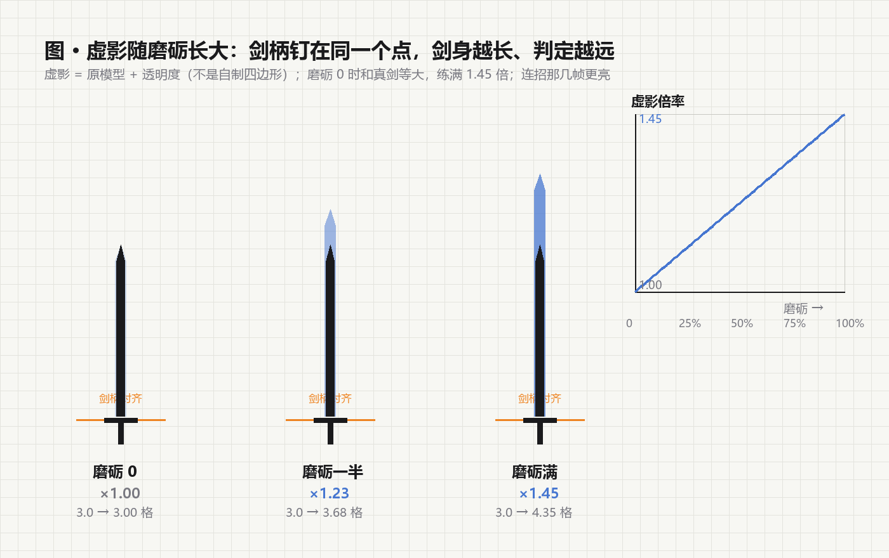

# 虚影与手长（2026-11-02）

> 用户："我希望随着磨砺值的增加，首先，剑一直都有虚影跟着，只是磨砺值为 0 时虚影跟剑等大，但是随磨砺值增加挥剑的虚影会越来越大，也就是攻击范围越来越大，只有在释放出连招时才会显示虚影，虚影的比如剑柄，虚影剑柄和真实剑柄位置要一样，弓这种就是弓不变，但是箭附带虚影"
>
> 补充："这样能弥补战士的攻击范围，也能更平衡，手更长"
>
> 定调："虚影就是原模型加透明度"



---

## 一 一句话规格

| 项 | 取值 |
| --- | --- |
| 虚影长相 | **那把武器的原模型**再画一遍，只加透明度（不是自制四边形、不是粒子） |
| 磨砺 0 | 倍率 **1.00** —— 和真剑等大，薄薄一层 |
| 磨砺满 | 倍率 **1.90**（`WarriorPhantom.MAX_GROWTH = 0.90`，2026-11-03 加倍；原来是 1.45 / 0.45） |
| 放大锚点 | **剑柄**：剑柄钉在真剑柄上，只让剑身往下长 |
| 什么时候亮 | 平时淡（alpha 0.14~0.40）；连招那几帧亮一档并轻微脉动 |
| 判定 | 连招半径 × 同一倍率（3.0 格 → **5.7 格**）；轻击仍是 2.7 格 |
| 弓 | 弓身不变；虚影挂在**箭**上（每 tick 画一圈更大的淡箭形） |

两个数值是同一个来源：`WarriorPhantom.scale(points, cap)`。客户端和服务端各算一遍，
不新增网络包 —— 客户端读的是 `TemperingClient` 早就同步好的那份镜像。

## 二 客户端怎么画的（原模型 + 透明度）

`client/WarriorPhantomRenderer`：

```java
// 和原版 ItemInHandLayer 一模一样的手部变换，一个字都不能差
((ArmedModel) model).translateToHand(arm, poseStack);
poseStack.mulPose(Axis.XP.rotationDegrees(-90.0F));
poseStack.mulPose(Axis.YP.rotationDegrees(180.0F));
poseStack.translate((left ? -1.0F : 1.0F) / 16.0F, 0.125F, -0.625F);
poseStack.translate(-(draw - 1.0) * t.x(), -(draw - 1.0) * t.y(), -(draw - 1.0) * t.z());
poseStack.scale((float) draw, (float) draw, (float) draw);
itemRenderer.renderStatic(player, stack, context, left, poseStack,
        ghost(buffer, alpha), player.level(), packedLight, OverlayTexture.NO_OVERLAY, player.getId());
```

四个坑，都踩过了：

0. **位置 / 朝向必须照抄原版手部变换**。第一版是自己估的
   “手心偏移”（`translateAndRotate` + `(1/16, 0.125, -0.625)`），少了原版那两个
   `-90°/° 180°` 的旋转，结果虚影歪到玩家左侧、方向也不对
   （2026-11-03 截图：一大坨黑影漂在旁边）。现在直接把
   `ItemInHandLayer#renderArmWithItem` 那四行原样搬过来，再加上本 mod 的放大。
1. **放大要围绕剑柄**：物品模型的显示变换自带一个平移 T
   （`sword.json` 的 thirdperson 是 `[-7, 6.25, 1.25]`，读进来时 ÷16）。直接 `scale(s)`
   会把 T 也放大，剑柄就会飘出去。所以先 `translate(-(s-1)·T)` 再 `scale(s)`：
   `-(s-1)T + s·(T + 模型) = T + s·模型` —— T 不变（剑柄不动），模型被放大。
2. **透明度**：物品模型走的是 `entityCutout`（不透明裁剪），直接画不会有 alpha。
   这里把 `RenderType` 换成 `entityTranslucentCull(block atlas)`
   （就是 `Sheets.translucentItemSheet()` 用的那一个，顶点格式完全一致），
   再用 `VertexConsumerWrapper` 只把顶点 alpha 乘上系数（颜色、UV、光照全透传）。
3. **不能和真模型 z-fighting**：实际画的时候倍率取 `max(scale, 1.02)`（剑柄处看不出来）。

## 三 服务端怎么算的（手更长）

`WarriorComboService#melee`：

```java
double reach = WarriorPhantom.scale(player);
for (LivingEntity target : targets(player, skill.radius() * reach)) { ... }
```

剑气/剑波也跟着变长（`WarriorWaves` 的 `range × reach`），所以"虚影有多大，能打到多远"
在近战和远程两条线上是一致的。

**轻击（Q/E）故意不放大**（仍是 2.7 格）：GameTest 里"2.9 格外的木桩只有终结技能打到"
这条不变量还得成立，而且轻击是节奏件，不该随成长变成小终结技。

## 四 弓：弓不变，箭带虚影

`WarriorCombatEffects#ghostArrow`：每 tick 沿着箭的朝向画一遍更大的箭形
（箭杆 5 点 + 尾羽 2 点 + 箭头 1 点，1.7 倍长），颜色用元素色。
真箭照旧，虚影只是"后面那圈更大的淡影"，弓身模型一点没动。

## 五 验证

- 单元测试：`WarriorPhantomTest` 5 项 —— 0 磨砺等大、满磨砺 1.90、线性（一半磨砺 1.45）、夹紧、单调不减。
- GameTest：`sixInputSpinFiresOnlyOnTheLastInput` 里加了两条断言
  （磨砺 1000/3000 → 倍率 1.15；4.5 格外的木桩连 1.15 倍后的 4.14 也够不到，不该被扫到）。
  **37 项仍是 37 项**，一条都没改名。
- jar：197,321,120 B，SHA256 `59961EF511DFE3F2B3F26AEDBBE4018490E1B6570F8B576B9CD199070BA23AEE`，
  备份 `backups/tnc-phantom-20261102-034754/mods/`。

## 六 想再调的旋钮

| 想改 | 改哪 |
| --- | --- |
| 虚影最大能长多大 / 手能多长 | `WarriorPhantom.MAX_GROWTH`（改一个数，画面和判定同时变） |
| 平时太淡 / 太亮 | `WarriorPhantomRenderer.alpha` 的 0.14 与 0.40 |
| 连招时不够亮 | 同上，`0.40 + 0.34 * grown` 这一支 |
| 箭的虚影太大 | `WarriorCombatEffects#ghostArrow` 里的 `scale = 1.7` |

---

## 七 2026-11-02 晚 · “一按 Q/E 就掉线” 的排查

现场：22:36 开机，22:42:47 进世界，22:44:27 存档停服，22:44:34 游戏退出。
`latest.log` / `debug.log` 里 **没有任何异常、没有 kick、没有 crash-report**，
尾巴是一次干净的 `Stopping server` → `Stopping!`。所以不能从日志直接定位，
按“能把人弄下线的那几个点”逐个加了保护：

| 位置 | 原来的风险 | 现在 |
| --- | --- | --- |
| 虚影渲染（渲染线程） | 中间抛异常就不弹栈，PoseStack 不平衡 → 后面整帧渲染全崩 | `try/finally` 弹栈；一旦出错自动关掉虚影并打一条带堆栈的 ERROR |
| 剑气 / 剑波 tick（服务端） | 一道波出错 = 服务器 tick 抛异常 = 直接把人踢下线 | 逐道波包 try/catch，出错只丢这一道 |
| 输入包处理（Q/E/Z） | 任何一个空指都会让这次输入直接断开 | `input()` 外套 try/catch，只写日志不踢人 |
| 动画包 | 狂点 Q/E 每 2 tick 一包 | 同一招没演完不重复广播 |

另外加了两个开关：

- `-Dtnc.phantom.off=true`（JVM 参数）：彻底不画虚影，用来二分法排查。
- `debug.log` 里的 `[tnc] input move=... / slash move=... / basic animation=...`：
  下次再出现时，最后一行 `[tnc]` 就是卡住的那一步。


## 八 真正的原因：连招镜像包把正常包当成了坏包

用户截图里那句话就是全部答案：

```
连接已丢失
Internal Exception: io.netty.handler.codec.DecoderException: combo cooldown count out of range: 29
```

（`combo cooldown count out of range` 是我们自己写的一句保护，见 `WarriorComboSyncPacket#decode`。）

- 服务端 `sync()` 发的是**每条连招一个冷却**，现在共 29 条；
- 客户端解码却拿 `WarriorSkill.LOADOUT_SLOTS` 当上界 —— 那个常量是**面板槽位**（9 × 2 = 18），
  根本不是连招条数；
- 29 > 18 → 正常包被判作坏包 → netty DecoderException → 客户端直接断开连接。

所以：**只要手里拿着兵器按一下 Q/E/Z，就会掉线**，和虚影没关系。
之前没发现，是因为连招从 18 条扩到 29 条之后，这个边界一直没人碰到——直到真正进游戏按键。

### 修法

```java
// 上界必须按"连招条数"算，不能按面板槽位
if (skills < 0 || skills > WarriorCombos.all().size()) {
    throw new DecoderException("combo cooldown count out of range: " + skills);
}
```

新增 `WarriorComboSyncPacketTest`（3 条）：

1. 正常包（按全部连招条数）必须能编码→解码回来，并且断言 `all().size() > LOADOUT_SLOTS`（就是当年的现场）；
2. 写 1000 条冷却的恶意包仍然要护住；
3. 负数也要拤。

> 另：上一轮加的四道保护（虚影渲染 try/finally、剑波 tick包、输入包 try/catch、
> 动画去重）不是这次掉线的原因，但那四个地方本来就该这么写，留着。
