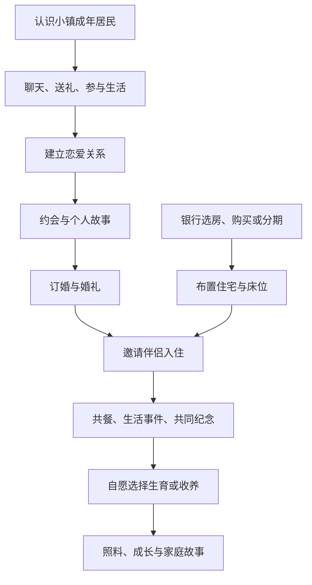

# RouchNao · 家庭与小镇生活设计方案

2026-10-18 · 供讨论的第一版，本文中的新增玩法尚未实装。本文不修改任务书、居民、住宅或存档。

## 1. 我建议怎样做

让玩家从“在小镇落脚的冒险者”，逐渐变成“有人认识、有人牵挂、有自己的家的人”。购买房子、认识喜欢的人、相处、结婚、生育可以成为一条完整的生活路线。婚后也要有值得回家的内容。

建议采用 **凡家物语负责人物关系，我们负责小镇生活** 的方案。好感、婚姻、亲子关系、遗传外观和族谱沿用 MCA；房屋、搬家、约会地点、共餐、家庭小事件和魔法生活由我们补充。玩家始终从居民身边右键交流，银行继续管理房屋和贷款，商店继续卖家具。

三种做法的取舍：

| 做法 | 优点 | 问题 |
|---|---|---|
| 只用 MCA 原版 | 很快能聊天、结婚、育儿 | 与购房、种养和我们的故事联系弱，结婚以后容易无事可做 |
| **MCA + 原创生活内容，推荐** | 保留成熟关系系统，精力用在人物与生活体验上 | 需要做好住宅权限、日程和事件接入 |
| 重写一整套恋爱家庭系统 | 控制最自由 | 重复实现婚姻、孩子、族谱，容易出现两套关系互相冲突 |

恋爱在买房之前就能开始；正式邀请伴侣入住时才需要自己的住宅。分期购买并完成交付的房屋也算自己的家，不要求还清房贷。婚姻、育儿都不作为主线、装备、魔力科技的解锁门槛。

## 2. 查到的现状：哪些已经有

核查对象为本机整合包安装的 `minecraft-comes-alive-7.6.26+1.20.1-universal.jar`、本机 `config/mca.json`，以及 TN-C 当前源码。网上资料只作交叉参考，不把其他版本的数值直接套过来。

### 2.1 凡家物语原本的基本流程

认识具有姓名、外观、性格的居民，通过聊天、互动与赠礼增加好感；达到条件后可以送花、订婚、结婚。婚后可通过原生交互选择生育，孩子会加入原生亲子关系与族谱。居民还具有住处、回家等原生交互。人物性格、心情与特征会影响互动，不能把每次聊天理解为固定加分按钮。

| 本机当前配置 | 当前值 | 含义 |
|---|---:|---|
| 花束门槛 `bouquetHeartsRequirement` | 10 | 花束相关关系进展的好感门槛 |
| 订婚门槛 `engagementHeartsRequirement` | 50 | 订婚要求 |
| 结婚门槛 `marriageHeartsRequirement` | 100 | 结婚要求 |
| 生育交互的好感检查 | 100 | 在安装版本的交互处理字节码中核实 |
| 生育间隔 `procreationCooldown` | 72000 tick | 按 20 TPS 折算为 60 分钟世界运行时间；不是现实离线时间 |
| 婴儿物品成长配置 `babyItemGrowUpTime` | 24000 tick | 按 20 TPS 折算为 20 分钟；实际计时还取决于婴儿物品的原生更新条件 |
| 重复礼物记录长度 | 16 | 原模组已有重复赠礼衰减机制 |
| 礼物衰减重置 `giftDesaturationReset` | 24000 tick | 当前配置周期，保留原生处理，不重复叠加一套惩罚 |
| 自动村民婚姻概率 | 每分钟 0.05 | 原生配置中存在，原创可攻略居民需要另外防止被随机配对抢走 |

以上是配置和代码核查结果，不表示本轮已经逐项完成恋爱、婚礼、育儿的游戏内验收。成长配置不能简单理解成“关游戏一晚上孩子就长大”。

MCA 的礼物数据可以按物品、标签和条件定义；当前 JAR 已带有农夫乐事礼物兼容。因此料理与好感的联系有现成基础，但我们自己的魔法作物、动物产物和原创料理仍需单独接入，不能认为已经自动全部支持。[MCA 官方礼物说明](https://github.com/Luke100000/minecraft-comes-alive/wiki/Gifts)

### 2.2 我们已经接入的内容

- 小镇定义了六名成年邻居：林禾、乔麦、蓝汐、燕岚、何舟、苏苒。安装 MCA 时使用原生 MCA 居民，关系通过原生界面操作。
- 已有住宅购买、分期、房屋边界与玩家协作权限；不是只有摆出来的房子。
- 已有 `/neighbor home` 搬家桥接：玩家站在自己的住宅中，让已婚 MCA 伴侣来到附近，将其住处设到家中。
- 当前搬家检查需要住宅里有两张普通床，伴侣在附近八格内。代码提示要求床边空间，但当前住宅查床函数主要检查床数量；未来正式家庭入口需要补齐可到达性与安全空间校验。
- MCA 未加载时的旧备用邻居交互中，有自定义赠食、共餐和同住。**本整合包加载 MCA 后，这些旧好感规则不生效，不能拿“亲密70、三次共餐”等旧规则向玩家介绍。**

当前并没有完整的原创约会、婚礼活动、家庭事件和儿童日程。下面是建议新增内容。

## 3. 玩家实际怎样玩

保留本机 MCA 的 10／50／100 好感门槛，先不为了新系统改成另一套数值。界面以“相识、朋友、恋人、订婚、家人”说明关系，同时保留原生好感显示。高好感本身不等于自动恋爱或自动结婚，关键进展必须由玩家主动选择。

建议追加两项轻量经历：订婚前完成一次角色专属故事；举办原创婚礼前完成一次双方赴约。故事允许经营、探索、直接购物等多种完成方式，不强制玩家击败某个 Boss 或练满某条副职业。已有 MCA 婚姻照常承认，不对已经结婚的玩家补课。

节奏目标：正常穿插生活，约 3～5 小时活跃游玩可走到婚礼；喜欢慢慢相处的玩家可以延长。这个时间是调优目标，需实测原生好感增速后调整礼物和原创事件，不能直接承诺已有这个节奏。

## 4. 居民要有区别

优先深化现有六位邻居，减少新增一堆只有名字的角色。下表是人物提案，保留当前姓名与已设定性别；外观、台词、故事尚需制作。

| 居民 | 生活与个性 | 喜欢的东西 | 专属相处故事 | 婚后仍有自己的生活 |
|---|---|---|---|---|
| 乔麦 | 女，认真但容易紧张的种植爱好者 | 蔬菜料理、特别的种子 | 共同观察一株夜间开花的植物；可自己培育，也可委托采购 | 白天照顾试验花圃，傍晚带回一段生长记录 |
| 蓝汐 | 女，爱听远方故事的钓鱼人 | 鱼料理、与旅行有关的小物 | 在安全水边等一次天色变化，聊远行与留居 | 保留钓鱼时间，偶尔邀请玩家看晚霞 |
| 苏苒 | 女，克制温柔的药草照料者 | 汤、炖菜、温和的魔法植物产物 | 为小镇一位居民准备暖汤，不设病人倒计时 | 定期去药草园，回家会谈当天遇到的人 |
| 林禾 | 男，喜欢把小事做好的烘焙爱好者 | 面包、烘焙料理 | 试做一份家乡点心，从三个口味中挑一个留下 | 有自己的烘焙安排，偶尔提出一起吃早餐 |
| 燕岚 | 男，安静而好奇的读书人 | 甜食、书与旅行见闻 | 整理一本关于岛上星空的手记，玩家选择记录内容 | 会去阅读，也会把玩家的冒险写进家庭纪念册 |
| 何舟 | 男，外向、重视朋友的料理爱好者 | 熟肉料理、适合聚餐的食物 | 筹备一次小型朋友聚餐，自备或买菜都可以 | 偶尔在酒馆见朋友，不整天跟随玩家 |

Self、艾琳、银行行长、铁匠等关键服务角色继续承担职责，不默认加入可攻略池。玩家也能只做朋友。家人的台词与原生性格组合时应检查一致性，不能预设温柔角色却不断随机辱骂玩家。

原创六人需要明确保护“恋爱可用状态”：陌生阶段不参与原生自动 NPC 配对；玩家正式确认关系后依据 MCA 原生关系锁定。自然生成居民仍可遵循原模组规则，不能为保护六个人把全世界婚姻系统关掉。

## 5. 好感与约会：少点菜单，多点相处

### 日常互动

日常聊天沿用 MCA；扩充与天气、季节、玩家远征归来、房屋装修、近期委托相关的原创台词。赠礼保留原生衰减，用喜好提示引导换口味。送错普通礼物只是收益低，不随便损失大量好感。

共餐新增一个明确入口：“一起吃点东西”。玩家准备两份同类料理，或在酒馆花钱购买双人餐；双方到桌边才结算，找不到位置时不扣物品。吃完有短对话与少量 MCA 好感增益。新增共餐奖励最多每 24000 tick 的玩家在线活跃时间一次，不因睡觉跳日重置；没有共餐也不扣分。

### 四类可重复约会

| 地点 | 实际内容 | 关联玩法 |
|---|---|---|
| 酒馆 | 一起点餐，随机谈一件小事；三项自然的对话选择 | 钱、料理、酒馆氛围 |
| 安全花圃 | 看花、观察小精灵，采一份允许采摘的材料 | 魔法植物收集与培育 |
| 观景台 | 看晚霞或星空，拍一张合照 | 时间变化、魔法世界景观 |
| 家中 | 一起摆一件家具、试一道新菜 | 商店、装修、料理 |

约会由玩家点击发起，约好后可直接选择“现在出发”。不要求守着现实时间赴约，不会因为退出游戏错过约会而掉好感。地点不安全、居民卡路时可取消或改约，不能先扣钱再让人等不到 NPC。

原创约会好感奖励最多每 24000 tick 玩家在线活跃时间一次，共餐另计；可随时再次游玩，只是不重复刷奖励。初始调优建议：约会 +6、共餐 +3、专属故事 +8，均写入 MCA 同一份好感数据。礼物与聊天继续执行原模组规则；不额外添加第二套总好感上限或重复衰减。

## 6. 婚礼、入住与房屋

结婚采用 MCA 原生关系和戒指，原创婚礼提供仪式体验。达成条件后，玩家与伴侣约定在镇上安全场地举行一个约 1～2 分钟的小型仪式：几位熟人到场、简短祝词、戒指确认、合照与纪念物。保留简单直接的原生结婚方式，不把场景演出变成必须付钱完成的关卡。

婚礼基础套餐建议 300 铜，包含现场布置和餐点；可选更丰盛的套餐只改变装饰与聚餐，伴侣好感相同。戒指费用另按已有物品配方／商店价格，不凭空设昂贵彩礼。银行不负责主持恋爱，筹备入口放在伴侣或酒馆接待处。

入住只需：拥有已交付住宅、双方已婚、两张可用床、能安全进出的空间。餐桌、灯、儿童房都是改善体验的选择，不用家具评分卡住入住。由伴侣面板点击“把这里当作家”，替代必须记住 `/neighbor home` 的操作；原命令保留作调试入口。

分期房屋交付后就能入住、生育。房贷欠款不删除家人、不强制分离、不清空装修；银行按自身规则提示账单。婚姻也不自动把住宅产权转给 NPC。

住处绑定床位与房源编号；换床、改装、购买其他房屋后的搬迁需要明确确认。床被拆掉先显示“住处需要重新设置”，居民暂用屋内安全点，不能直接消失或重新生成一个副本。室外活动范围要包含工作地点与酒馆，夜间再回家，家人不能被永久钉在门口。

## 7. 结婚以后，回家能做什么

这里才是我们需要重点原创的部分。共同生活保留轻松感：不回家不会掉线惩罚、离婚或饿死；回家则能遇到新内容。

| 内容 | 玩家看到的变化 | 获得什么 |
|---|---|---|
| 远征归来 | 相隔一段活跃游玩后回家，伴侣用不同台词问候 | 一段回应和生活感，不发大量钱 |
| 家庭餐桌 | 桌边共餐，家人会说起料理、动物或玩家见闻 | 原生好感、小量既有料理增益，不叠强力战斗加成 |
| 小愿望 | “想看会跳舞的花”“下次一起尝新汤” | 一次小事件或纪念品，可忽略、可替换、无逾期惩罚 |
| 周末式聚会 | 主动邀请两位朋友来家中或酒馆吃饭 | 合照、台词与纪念记录 |
| 家庭纪念册 | 第一次共餐、婚礼、入住、孩子成长留下一页 | 可放在家中的可读收藏品 |
| 出门留言 | 玩家选择“我要远行”，伴侣留下不同回应 | 返家后短对话，帮助维持跨冒险的连续感 |
| 共同收藏角 | 展示从植物、钓鱼、冒险获得的小纪念物 | 装饰与角色对话，不消耗珍贵战利品 |
| 小型魔法生活 | 家中观赏花、小精灵、暖灯进入家庭事件 | 让魔法种植和魔力装置进入日常生活 |

家庭小愿望最多同时一件；每 2 小时玩家在线活跃时间最多结算一次。完成后提供装饰、关系或故事反馈，不成为无限刷钱渠道。事件从足够大的台词池抽取，避免每次回家重复同一句话。

建议第一版准备：六人各 12 条日常、6 条返家、4 条共餐、1 条个人故事；公共家庭小事件至少 12 个。不同婚姻阶段使用不同文本，不能刚认识就以伴侣称呼。

## 8. 孩子：继续生活，而不是新增一张任务清单

生育由玩家在伴侣面板主动选择，沿用 MCA 原生流程与亲子数据，不随机强迫生育。当前生育检查包含 100 好感及原生冷却。新增生活条件只检查安全住处与可用床位，不要求高额存款、稀有 Boss 材料或昂贵儿童家具。

婴儿阶段保留原生起名与成长。可添加安置婴儿的家具与抱起交互，但需先核实原生婴儿容器兼容，不能做一个只会吞掉婴儿物品的装饰摇篮。原生收养入口也纳入可选家庭路线，具体界面与权限需游戏内核验后再落地。

| 成长阶段 | 原创生活内容提案 | 家庭参与 |
|---|---|---|
| 婴儿 | 起名、抱起、安置、成长记录 | 可选择照料；没有现实离线饥饿倒计时 |
| 幼儿 | 在安全家庭活动区玩耍、看小精灵、简单问话 | 带孩子认识家，不自由跑出天空岛 |
| 儿童 | 看魔法植物、照料一只温顺动物、听冒险故事 | 亲子事件，可随时取消 |
| 少年 | 表达自己的兴趣，制作一件小纪念物 | 玩家选择支持的方向，不按数值培养战斗工具 |
| 成年 | 保留族谱、可选独立居住与返家探望 | 家庭关系继续存在，不自动删掉或卖房 |

成长速度先沿用原生，再通过实际试玩决定是否延长；提供家庭面板“保持当前成长阶段”的可选项是新增提案，不宣称 MCA 已自带。暂停成长只暂停该家庭孩子的阶段推进，不冻结全世界时间。

不让孩子强制下矿、刷怪或参与高危自动化。兴趣主要影响故事、外观小物和生活活动，不给独身玩家拿不到的顶级战力。是否要加入孩子协助浇花等轻量互动，可以后续扩展；第一版不做全自动童工生产线。

## 9. 怎样和整个生存结合

| 既有系统 | 家庭带来的自然需求 | 保持的边界 |
|---|---|---|
| 农业、魔法植物 | 新料理、花园、约会观赏、家庭小愿望 | 不限定只能自己种；购买或交易也可获得材料 |
| 畜牧业 | 奶、蛋、料理、温顺动物观赏 | 危险魔法兽不直接放进住宅，饲养规则仍由畜牧系统负责 |
| 商店与家具 | 餐桌、灯、纪念架、儿童家具 | 家具以花钱购买为主要入口，入住不要求昂贵整套家具 |
| 银行与房产 | 从小屋到真正的家，分期也能开始生活 | 经济账本和亲密关系独立，不拿家庭当催债工具 |
| 酒馆委托 | 带回旅行故事、居民聚餐、家庭认识朋友 | 家庭事件不混成一堆公共杀怪委托 |
| 冒险 | 出发与回家的呼应，战利品变成可讲述的经历 | 不要求每天打卡陪伴，长期远征仍然成立 |
| 魔力科技 | 观赏灯、家庭魔法花园，未来可加家用设施 | 家庭不强制消耗魔力才能存活 |

第一版不设置自动领取的配偶工资、不额外发银行利息、不每天征收家庭维持费。生活经济通过真实的料理、家具和聚餐消费产生，不新增复杂税种。

## 10. 时间、联机与意外情况

**时间要分清。** 银行继续自己的现实时间结算；原生 MCA 冷却和成长遵循其世界／实体更新时间；原创每日互动限额按玩家在线活跃时间累计，睡觉、改时间和反复重登不能刷新。第一版不做现实离线育儿和离线好感下降。服务器世界继续运行时原生孩子可能继续成长，这与“玩家离线惩罚”不同，须在家庭帮助中说明，阶段暂停功能可解决希望保留童年的需求。

联机时一个居民只有一份真实关系状态。两个玩家同时求婚，服务端只接受一个合法结果；不能靠改名、传送或复制 NPC 获得第二段婚姻。人物识别用 UUID，姓名只是显示。朋友的装修授权不会自动给他搬走伴侣、修改孩子或结束婚姻的权限。

关键家庭成员在小镇安全区应防意外伤害与坠落；跟随玩家出城之前明确告知风险，默认不自动跨维度追进 Boss 场地。失踪先查询原生住处和实体位置：区块没加载不等于死亡，更不能就地生成同名替身。找回功能只移动原实体，并验证安全位置与使用权限。

分手、离婚沿用 MCA 关系接口，加二次确认和住处分离处理。孩子不会因分手被删除；玩家可明确指定孩子住处，房屋产权保持原有归属。家人死亡与原生墓碑／复活系统的衔接需另做兼容验收，不能直接删除族谱来“修复”。

## 11. 界面与任务书建议

右键普通居民仍打开这个人的交流面板。家庭相关项控制在“聊天／送礼、一起活动、关系与家庭”三个入口以内；进入家庭页后才出现邀请入住、生育、孩子与住处。每个动作旁用一句话说明要求及未满足项，不把银行、商店、铁匠功能塞进家庭界面。

独立 FTB 页建议叫 **「灯火与归处」**，仅写九个节点：认识居民 → 了解喜好 → 第一次相处 → 选择关系 → 订婚与婚礼 → 布置家 → 邀请入住 → 家庭生活 → 新的家人。购房节点链接现有银行页，不重复制作另一条买房线。最后给“保持朋友／独自生活”同样完整的介绍，家族路线可选。

任务奖励以帮助书、合照边框、小装饰为主，不发影响冒险平衡的独占神装。本轮只写方案，用户正在编辑的任务书保持原样。

## 12. 一段实际游玩体验

玩家第一次去酒馆交委托，认识乔麦。后来在商店买菜时又遇到她，听说她在观察一种夜间开花的植物。玩家可以外出寻找，也可以先从其他玩家手里买到植物，再约她去花圃看看。

相处中玩家知道她喜欢蔬菜料理，带回新食材时会顺便准备两份饭。关系更亲近后，玩家去银行看了几栋房，分期买下一间小屋，逐渐添桌子和灯。订婚与婚礼完成后，带她回家并设置住处。她白天仍会去花圃，晚上回家谈起今天的植物。

玩家外出挑战遗迹几天，回来家里依然正常。一次共餐时，她提议邀请蓝汐来尝新汤；玩家愿意就筹备聚餐，忙着研究魔力装置也可以以后再说。之后双方选择迎接孩子，看着孩子从会问花的名字，到希望拥有一处自己的小花园。家庭成为冒险之外持续存在的生活。

## 13. 后续制作范围与验收

如果采用本方案，第一版应把以下闭环一起完成：六名居民内容 → 关系进展 → 一次约会与个人故事 → 婚礼 → 房屋入住 → 共餐与家庭事件 → 原生生育和亲子关系接入 → 可理解的帮助。先完成这一条可玩的生活路线，再扩充节庆、更多候选人物和成年孩子的独立生活。

实现时以 MCA 为好感、婚姻与亲子关系的唯一来源；TN-C 只保存房源绑定、原创故事进度、互动限额和纪念记录。已有备用好感逻辑不在 MCA 模式下启用。定制礼物、对白先使用原生数据接口；人物专属条件和原创活动由 TN-C 适配，不能假定原生礼物 JSON 支持任意自定义 UUID 条件。

必须实际验证：

1. 六人能打开原生交流，外观完整，关系称呼对应本人；专属故事不会串人。
2. 从认识到结婚、生育可以走完；高好感、送花与正式结婚的状态区分明确。
3. 两个玩家同时操作时只产生一份合法关系，重登后不回滚、不复制居民。
4. 分期住宅可入住；改床、拆床、堵门、切维度都有可恢复的结果。
5. 共餐和约会失败不扣物品或钱；重复礼物、奖励限额不被睡觉／重登绕过。
6. 远征、玩家离线、服务器停机不会触发我们新增的好感或家庭惩罚。
7. 孩子保留原生父母和族谱；搬家、分手、居民区块卸载不会丢失家庭成员。
8. 玩家不结婚、不育儿仍可完整游玩主线、农业畜牧与魔力科技。

## 核查资料

- [MCA 官方项目与玩法概览](https://github.com/Luke100000/minecraft-comes-alive/wiki)：原生居民、家庭与定制能力；官方也提醒社区玩法 Wiki 可能与版本不同。
- [MCA 官方礼物数据说明](https://github.com/Luke100000/minecraft-comes-alive/wiki/Gifts)：礼物类型、条件与回应定制。
- [MCA 官方对白说明](https://github.com/Luke100000/minecraft-comes-alive/wiki/Dialogues)：对白资源扩展入口。
- 本机安装 MCA 7.6.26：`forge.net.mca.entity.interaction.VillagerCommandHandler` 的生育检查、随包礼物资源，以及选取的家庭配置项。本机数值优先于网页默认值。
- TN-C 源码：`home/McaResidents.java`、`home/ResidentService.java`、`home/HousingService.java`、`adventure/TownLifeGameTests.java`。核查不等于新增玩法已完成实装。
