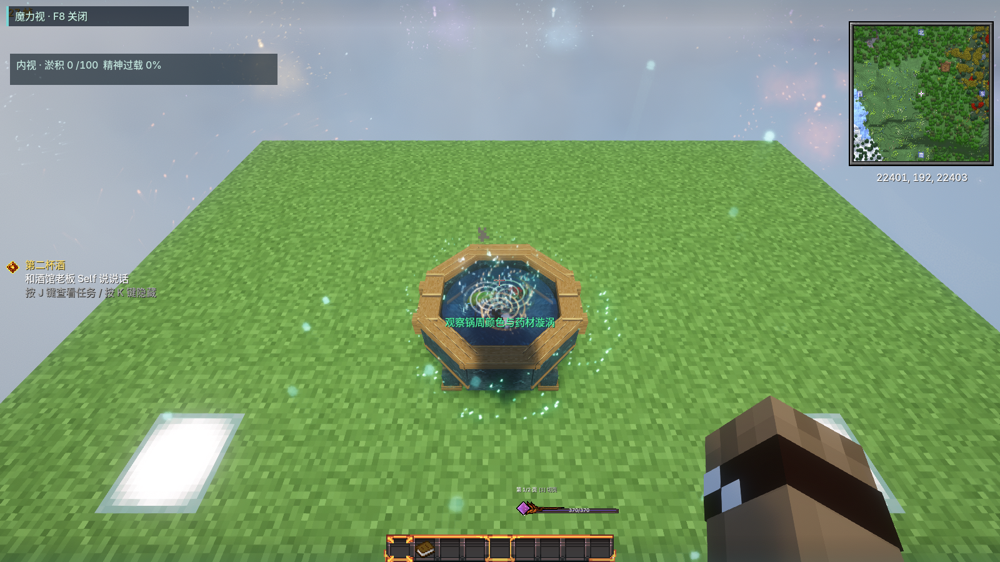
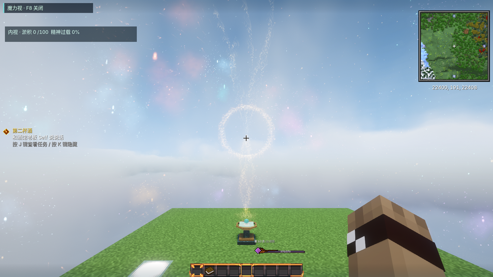
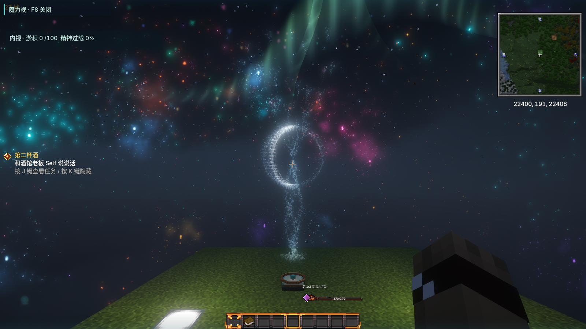
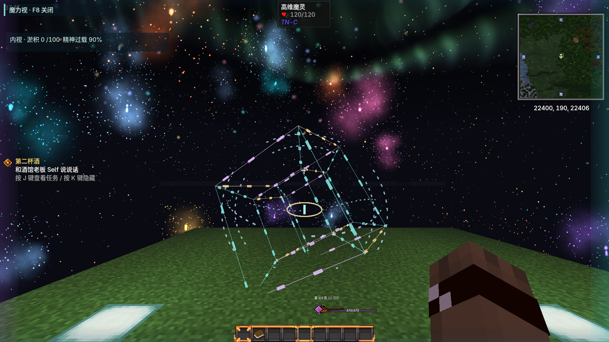

# 魔法交互修订与测试入口

本轮对应10月22日实测反馈，10月23日完成合并验证。操作主线仍见《魔导纪行全阶段实装手册-20261022.md》，FTB的魔导纪行、魔药、深度魔导、可选工坊四页同步修订。

## 日镜、月盘与魔灵

日镜工作时，金色日冕和太阳耀斑形成聚光，光尘从天体方向流向镜面；月盘出现随月相变化的银白轮廓、银光雨和盘上涟漪。普通视野保持克制，F8下完整显示。只有真正收进魔力时才播放采集流：满仓、遮挡或时间不对都停。

日镜须露天且高于海平面16格，白天基础24M/s；月盘露天夜间基础16M/s乘月相0.2—3。把晶纤接到消费者或未满储池，才能连续看到工作。光点不是额外可反复收取的余额。

高维魔灵改为镂空的四维投影、多重反向折叠的断环和中央眼睛。沿几何棱边移动的光块表示魔力流动，移除整片发白的实体面；F8与精神压力的出现条件保持原逻辑。

## 锻炉与深渊聚能塔

锻炉依然是3×3×3：下层九砖，中层七砖、一个炉口和中央炉核，顶层八砖和中央排烟口。手动把材料放进四个输入格，真实匹配后加工。右侧工艺记录初始为空，做成一种物品才记录；点击记录只显示材料参考，不会塞料、替换库存或直接做成物品。

晶纤贴在成型炉或聚能塔的任意外表面，都能接入控制器，包括背面、底面和顶角。线条显示的连接臂与真正传输一致，仍受所有权、带宽和储量约束。小储池可送入容量更大的储池或塔，避免大池反向倒灌。

聚能塔仍用24砖围三层，中央上方两格留空。搭对后砖壳展开为四柱聚能仪、反向旋转的约束环和悬浮核心，并有成型音效；拆掉外壳则退回未成型状态。旧塔会重新核对实际砖块状态。

## 动物产魔与多余面板

牧务杖先选成年异兽，再右键自己的集息器／色靶，出现文字、粒子和音效即绑定成功。没有驯养、窝点和先喂食的门槛；绑定后按物种的运动、昼夜、鸣叫等习性产出真实魔力。食物只提供额外20%产魔，不是启动燃料。

普通养殖、繁殖与兽材凝结仍可继续照料。色靶、采集器和导线等没有物品加工需求的器件不再弹出空面板，牧务杖操作优先。保留提纯、织造、锯切、充能等确有库存交互的面板。

## 四方药锅

1. 放下一只锅，预留2×2空间。锅有连续实体锅底、闭合八角厚壁、边沿和锅脚；不再透出草方块。
2. 用水桶倒水，加入三味实物药材。液面使用原版动态水纹及环境明暗，热水有气泡、少量蒸汽。
3. 用火魔法点燃，锅底可见火焰。F8下外围蓝冷、绿稳、红热；火法升温、水冰法降温。药材各有漩涡，逐步靠拢，不需搅拌棒或焰蕊盐。
4. 提前做好独立的四方封魔盖。在判断好的融合时刻，持锅盖右键锅，实物盖装到锅上，锁住融合与品质。
5. 保持绿色温区续煮累计六秒，再用玻璃瓶装取。取药返还锅盖，重复使用。锅盖和状态随存档、拆卸保留，不额外复制。

## 可携带的餐盘料理

摆2—9味合格材料，F8看颜色与相生相克。空手右键制作实物料理：逐格消耗一份材料、返还蜂蜜瓶等容器，把成品收入背包。此时不直接施加增益，吃下成品时才按原盘布局结算，悬浮提示可查实际材料。

| 组合 | 实物成品 |
| --- | --- |
| 舞瓣＋暖椒，相邻 | 日焰椒香烤盘 |
| 暖椒＋岩纹叶，相邻 | 岩根烤饼 |
| 岩纹叶＋归巢花瓣，相邻 | 月蜜凝露盏 |
| 归巢花瓣＋雨书莓，相邻 | 潮露清汤 |
| 雨书莓＋舞瓣，相邻 | 云叶拌蔬 |
| 甘味隔开相克食材形成中和桥 | 五味调和宴 |
| 九格成太阳阵 | 九曜烈阳盛宴 |
| 存在直接相克 | 相冲杂烩，保留负效提醒 |

复杂盘面按最强相生配对决定普通成品；中和、太阳阵和冲突有专门的优先判定。料理把材料及其原格位保留在成品数据中，装包、存箱和转交后仍有效。

## 安装与协作

运行包安装只替换TN-C自身JAR及四页本项目指引，不新增第三方模组。用户自写世界观／法杖页面、既有存档、天空岛模板和装修不改动，安装前完整备份任务书。

合伙人只pull源码不会自动替换启动器中的JAR。可以把本次增量包 `work/feedback-refinement-update-20261022.zip` 解压给合伙人，在退出游戏后执行包内 `apply_magic_progression_update.ps1 -Pack "其整合包版本文件夹"`；它校验文件哈希、备份并更新同样五个文件。开发者也可自行构建，再使用仓库的安装工具。

## 快速测试顺序

创造模式可用 `/give @s tnc:creative_mana_prism` 获得测试棱晶。右键设备补充储量；对充能台使用会同时补满台内可充物品。它只供测试，普通生存仍按真实来源和带宽运行。

建议依次检查：空锻炉右栏为空→手动铁锭首炉→背面接线；塔顶角接线→储池往塔送魔；野生成兽不喂食直接牧杖绑定；药锅倒水→火魔法点火→实物封盖→续煮→瓶取并收回盖；两味餐盘合成→背包料理提示→食用增益；日镜白天和月盘满月／弦月，F8与光影分别开关。

## 本轮验证

402项单元测试、155项服务端GameTest通过。完整整合包隔离客户端分别开启Complementary Unbound r5.6.1和关闭光影，完成两组11场景检查，包括空锅／水锅／沸腾／封盖、日镜、满月／弦月、魔灵、成型塔、空工艺记录和料理物品。类文件与模型资源哈希和待安装JAR一致。

FTB会在退出时自动规范化SNBT，重排章节序号、补默认字段及装备的Damage:0。第一组验证原始输入字节，第二组逐项核对规范化后的ID、文本、任务、奖励、依赖与布局，防止把格式变化误判为丢页，也不接受旧版操作说明。

本地安装回执：`release/feedback-refinement-install-20261022.json`。本次保留42个其他任务文件，安装前后哈希一致；保存完整任务书和旧JAR备份。

### 原生游戏截图

药锅水面、漩涡与温色：

太阳采集：

弦月采集：

关闭光影的高维魔灵：

